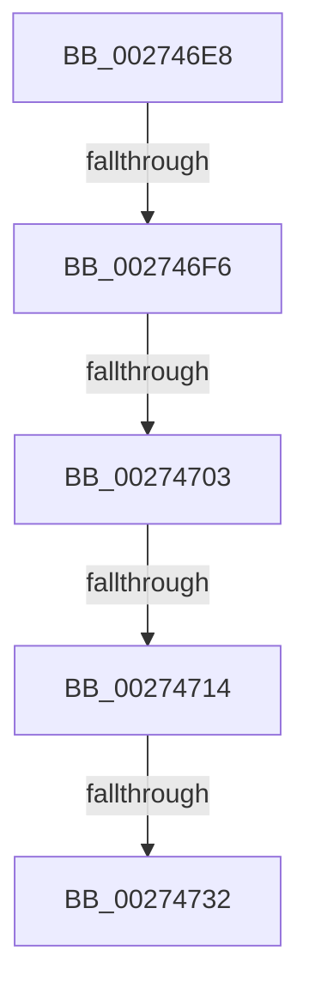

# sub_002746E8

- RVA: `0x002746E8`–`0x0027475C` (길이 `116` bytes)
- VA: `0x00000001402746E8`
- 실행 섹션: `.text`
- PDB 이름 있음: `아니요`; PDB Function 태그: `아니요`
- unwind 정보 RVA: `0x00065DF4`
- 디코드: `30`개 명령, `116/116` bytes 표시
- 미해석 바이트: `0` (있으면 어셈블리에 `.byte`로 보존)

> 이 문서는 커널 이미지의 기계어와 PDB 기호를 분석해 생성했습니다. 4번과 5번은 함수 원형과 자료형을 바이너리 사용 방식에서 추정한 C 해석이며 원본 소스 복구 결과는 아닙니다.

## 1. Dependencies

- 직접 호출 지점: **1**; 고유 호출 대상: **1**
- 직접 호출자로 확인된 함수: **0**
- RIP 상대 이미지 참조: **1**

### Outgoing calls
- `0x00274745` → [_security_check_cookie](../6A/_security_check_cookie_function_006AC640.md) (function, `0x006AC640`)

### Direct callers
- 이 함수 시작 RVA로 연결되는 직접 call은 확인되지 않았습니다. 간접 호출은 완전히 역산할 수 없습니다.

### Static image references
- `0x00274724` → RVA `0x00E0EB10` (`.data`; read)

## 2. Other-region calls and transfers

- 다른 실행 섹션으로 향하는 call: **0**
- call이 아닌 외부 분기/꼬리 이동: **4**
  - `0x002746F0` → [sub_0027475D + 0xF40](Unknown_function_0027475D.md) (`tail-transfer`)
  - `0x002746FD` → [sub_0027475D + 0x8F7](Unknown_function_0027475D.md) (`tail-transfer`)
  - `0x0027470E` → [sub_0027475D + 0xF6A](Unknown_function_0027475D.md) (`tail-transfer`)
  - `0x0027472C` → [sub_0027475D + 0x91A](Unknown_function_0027475D.md) (`tail-transfer`)

## 3. Assembly (complete function range)

```asm
002746E8  48 8B 47 08                     mov rax, qword ptr [rdi + 8]
002746EC  48 83 F8 02                     cmp rax, 2
002746F0  0F 87 A7 0F 00 00               ja 0x14027569d
002746F6  4D 8B CD                        mov r9, r13
002746F9  48 83 3F 01                     cmp qword ptr [rdi], 1
002746FD  0F 87 51 09 00 00               ja 0x140275054
00274703  8B 4F 2C                        mov ecx, dword ptr [rdi + 0x2c]
00274706  44 8B 54 24 44                  mov r10d, dword ptr [rsp + 0x44]
0027470B  44 3B D1                        cmp r10d, ecx
0027470E  0F 87 B3 0F 00 00               ja 0x1402756c7
00274714  41 8B 86 F0 8E 00 00            mov eax, dword ptr [r14 + 0x8ef0]
0027471B  33 D2                           xor edx, edx
0027471D  41 03 86 EC 8E 00 00            add eax, dword ptr [r14 + 0x8eec]
00274724  F7 35 E6 A3 B9 00               div dword ptr [rip + 0xb9a3e6]
0027472A  85 D2                           test edx, edx
0027472C  0F 84 45 09 00 00               je 0x140275077
00274732  44 89 6F 1C                     mov dword ptr [rdi + 0x1c], r13d
00274736  4C 8B AC 24 60 01 00 00         mov r13, qword ptr [rsp + 0x160]
0027473E  48 8B 4D 08                     mov rcx, qword ptr [rbp + 8]
00274742  48 33 CC                        xor rcx, rsp
00274745  E8 F6 7E 43 00                  call 0x1406ac640
0027474A  48 81 C4 10 01 00 00            add rsp, 0x110
00274751  41 5F                           pop r15
00274753  41 5E                           pop r14
00274755  41 5C                           pop r12
00274757  5F                              pop rdi
00274758  5E                              pop rsi
00274759  5B                              pop rbx
0027475A  5D                              pop rbp
0027475B  C3                              ret
```

## 4. C-style interpretation (structured pseudocode)

```c
__int64 __fastcall sub_002746E8(__int64 a1, int a2, __int64 a3, __int64 a4, __int64 a5, __int64 a6, __int64 a7, __int64 a8, __int64 a9, __int64 a10, __int64 a11, __int64 a12, __int64 a13, __int64 a14, __int64 a15, __int64 a16, __int64 a17, __int64 a18, __int64 a19, __int64 a20, __int64 a21, __int64 a22, __int64 a23, __int64 a24, __int64 a25, __int64 a26, __int64 a27, __int64 a28, __int64 a29, __int64 a30, __int64 a31, __int64 a32, __int64 a33, __int64 a34, __int64 a35, __int64 a36, __int64 a37, __int64 a38, __int64 a39, __int64 a40, __int64 a41, __int64 a42, __int64 a43, __int64 a44)
{
    __int64 result;
    __int64 v_rsp;
    unsigned int v_stack_p44;

    a2 = 0;
    result = (unsigned int)(((unsigned int)(*(unsigned int *)(v_r14 + 36592))) + (*(unsigned int *)(v_r14 + 36588)));
    *(unsigned int *)(v_rdi + 28) = (unsigned int)(v_r13);
    a1 = (*(unsigned __int64 *)(v_rbp + 8)) ^ (v_rsp);
    result = _security_check_cookie(a1, a2, a3, v_r13);
    v_rsp = (v_rsp) + (272);
    return result;
}
```

## 5. (Beta) C Style

```c
int64_t sub_002746E8(int64_t Arg1, int32_t Arg2, int64_t Arg3, int64_t Arg4, uint64_t Arg5, uint64_t Arg6, uint64_t Arg7, uint64_t Arg8, uint64_t Arg9, uint64_t Arg10, uint64_t Arg11, uint64_t Arg12, uint64_t Arg13, uint64_t Arg14, uint64_t Arg15, uint64_t Arg16, uint64_t Arg17, uint64_t Arg18, uint64_t Arg19, uint64_t Arg20, uint64_t Arg21, uint64_t Arg22, uint64_t Arg23, uint64_t Arg24, uint64_t Arg25, uint64_t Arg26, uint64_t Arg27, uint64_t Arg28, uint64_t Arg29, uint64_t Arg30, uint64_t Arg31, uint64_t Arg32, uint64_t Arg33, uint64_t Arg34, uint64_t Arg35, uint64_t Arg36, uint64_t Arg37, uint64_t Arg38, uint64_t Arg39, uint64_t Arg40, uint64_t Arg41, uint64_t Arg42, uint64_t Arg43, int64_t Arg44)
{
    int64_t result;
    int64_t local_rsp;
    uint32_t v_stack_p44;

    Arg2 = 0;
    result = (uint32_t)(((uint32_t)(*(uint32_t *)(local_r14 + 0x8EF0))) + (*(uint32_t *)(local_r14 + 0x8EEC)));
    *(uint32_t *)(local_rdi + 0x1C) = (uint32_t)(local_r13);
    Arg1 = (*(uint64_t *)(local_rbp + 0x8)) ^ (local_rsp);
    result = _security_check_cookie(Arg1, Arg2, Arg3, local_r13);
    local_rsp = (local_rsp) + (272);
    return result;
}
```

## 6. Execution-region graph

[열기: 2D/3D 그래프와 함수 탐색 컨트롤 패널](../../../control-panel.html?section=text&rva=0x002746E8&view=graph)

- 2D 그래프는 위에서 아래로 흐르고, 3D 그래프는 빈 공간을 드래그해 회전합니다. Shift+드래그는 이동, 휠은 확대·축소, 함수 노드 선택은 대상 보고서 이동입니다.

### Static fallback


