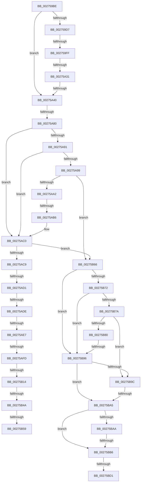

# sub_002759BE

- RVA: `0x002759BE`–`0x00275BEF` (길이 `561` bytes)
- VA: `0x00000001402759BE`
- 실행 섹션: `.text`
- PDB 이름 있음: `아니요`; PDB Function 태그: `아니요`
- unwind 정보 RVA: `0x00065E88`
- 디코드: `127`개 명령, `561/561` bytes 표시
- 미해석 바이트: `0` (있으면 어셈블리에 `.byte`로 보존)

> 이 문서는 커널 이미지의 기계어와 PDB 기호를 분석해 생성했습니다. 4번과 5번은 함수 원형과 자료형을 바이너리 사용 방식에서 추정한 C 해석이며 원본 소스 복구 결과는 아닙니다.

## 1. Dependencies

- 직접 호출 지점: **3**; 고유 호출 대상: **3**
- 직접 호출자로 확인된 함수: **0**
- RIP 상대 이미지 참조: **2**

### Outgoing calls
- `0x00275B5C` → [KxWaitForLockOwnerShip](../25/KxWaitForLockOwnerShip_function_00257EB0.md) (function, `0x00257EB0`)
- `0x00275BBB` → [MiInPagePageTable](../3E/MiInPagePageTable_function_003EF8DC.md) (function, `0x003EF8DC`)
- `0x00275BD4` → [MiUnlockFaultPageTable](MiUnlockFaultPageTable_function_0027D870.md) (function, `0x0027D870`)

### Direct callers
- 이 함수 시작 RVA로 연결되는 직접 call은 확인되지 않았습니다. 간접 호출은 완전히 역산할 수 없습니다.

### Static image references
- `0x00275A24` → RVA `0x00FC6B06` (`ALMOSTRO`; read)
- `0x00275A65` → RVA `0x00E2CB40` (`.data`; read)

## 2. Other-region calls and transfers

- 다른 실행 섹션으로 향하는 call: **0**
- call이 아닌 외부 분기/꼬리 이동: **18**
  - `0x002759F9` → [sub_00275BEF + 0x30C](Unknown_function_00275BEF.md) (`tail-transfer`)
  - `0x00275A2B` → [sub_00275BEF + 0x491](Unknown_function_00275BEF.md) (`tail-transfer`)
  - `0x00275A3A` → [sub_002760C1 + 0xC2](Unknown_function_002760C1.md) (`tail-transfer`)
  - `0x00275A7A` → [sub_00275BEF + 0x338](Unknown_function_00275BEF.md) (`tail-transfer`)
  - `0x00275AB0` → [sub_00275BEF](Unknown_function_00275BEF.md) (`tail-transfer`)
  - `0x00275ACB` → [sub_002760C1 + 0x1CC](Unknown_function_002760C1.md) (`tail-transfer`)
  - `0x00275AD8` → [sub_00275BEF + 0x8E](Unknown_function_00275BEF.md) (`tail-transfer`)
  - `0x00275AE1` → [sub_00275BEF + 0x8E](Unknown_function_00275BEF.md) (`tail-transfer`)
  - `0x00275AF7` → [sub_00275BEF + 0x98](Unknown_function_00275BEF.md) (`tail-transfer`)
  - `0x00275B0E` → [sub_00275BEF + 0x383](Unknown_function_00275BEF.md) (`tail-transfer`)
  - `0x00275B44` → [sub_00275BEF + 0x4A9](Unknown_function_00275BEF.md) (`tail-transfer`)
  - `0x00275B53` → [sub_00275BEF + 0x18F](Unknown_function_00275BEF.md) (`tail-transfer`)
  - `0x00275B61` → [sub_00275BEF + 0x17B](Unknown_function_00275BEF.md) (`tail-transfer`)
  - `0x00275B90` → [sub_00275BEF + 0x21E](Unknown_function_00275BEF.md) (`tail-transfer`)
  - `0x00275B9F` → [sub_002760C1 + 0xCF](Unknown_function_002760C1.md) (`tail-transfer`)
  - `0x00275BB0` → [sub_00275BEF + 0x44B](Unknown_function_00275BEF.md) (`tail-transfer`)
  - `0x00275BCB` → [sub_00275BEF + 0x466](Unknown_function_00275BEF.md) (`tail-transfer`)
  - `0x00275BEA` → [MiResolvePageTablePage + 0x6F](MiResolvePageTablePage_function_00275930.md) (`tail-transfer`)

## 3. Assembly (complete function range)

```asm
002759BE  48 89 5C 24 68                  mov qword ptr [rsp + 0x68], rbx
002759C3  48 89 7C 24 60                  mov qword ptr [rsp + 0x60], rdi
002759C8  4C 89 6C 24 58                  mov qword ptr [rsp + 0x58], r13
002759CD  44 89 8C 24 B8 00 00 00         mov dword ptr [rsp + 0xb8], r9d
002759D5  75 69                           jne 0x140275a40
002759D7  49 BD 68 DF BE 7D FB F6 FF FF   movabs r13, 0xfffff6fb7dbedf68
002759E1  49 8B C5                        mov rax, r13
002759E4  48 89 46 10                     mov qword ptr [rsi + 0x10], rax
002759E8  65 4C 8B 04 25 20 00 00 00      mov r8, qword ptr gs:[0x20]
002759F1  8B 85 B8 00 00 00               mov eax, dword ptr [rbp + 0xb8]
002759F7  24 0F                           and al, 0xf
002759F9  0F 85 FC 04 00 00               jne 0x140275efb
002759FF  B9 02 00 00 00                  mov ecx, 2
00275A04  48 8D 95 B0 00 00 00            lea rdx, [rbp + 0xb0]
00275A0B  8B C1                           mov eax, ecx
00275A0D  48 8D 88 C4 09 00 00            lea rcx, [rax + 0x9c4]
00275A14  48 8D 0C 48                     lea rcx, [rax + rcx*2]
00275A18  49 8D 0C C8                     lea rcx, [r8 + rcx*8]
00275A1C  48 89 51 08                     mov qword ptr [rcx + 8], rdx
00275A20  4C 89 09                        mov qword ptr [rcx], r9
00275A23  90                              nop
00275A24  F6 05 DB 10 D5 00 21            test byte ptr [rip + 0xd510db], 0x21
00275A2B  0F 85 4F 06 00 00               jne 0x140276080
00275A31  48 8B C1                        mov rax, rcx
00275A34  48 87 02                        xchg qword ptr [rdx], rax
00275A37  48 85 C0                        test rax, rax
00275A3A  0F 85 43 07 00 00               jne 0x140276183
00275A40  BF 03 00 00 00                  mov edi, 3
00275A45  49 BA 00 D0 BE 7D FB F6 FF FF   movabs r10, 0xfffff6fb7dbed000
00275A4F  8B DF                           mov ebx, edi
00275A51  49 BB FF DF BE 7D FB F6 FF FF   movabs r11, 0xfffff6fb7dbedfff
00275A5B  48 B9 F8 D7 BE 7D FB F6 FF FF   movabs rcx, 0xfffff6fb7dbed7f8
00275A65  4C 8D 0D D4 70 BB 00            lea r9, [rip + 0xbb70d4]
00275A6C  48 89 5C 24 40                  mov qword ptr [rsp + 0x40], rbx
00275A71  89 BC 24 A8 00 00 00            mov dword ptr [rsp + 0xa8], edi
00275A78  85 FF                           test edi, edi
00275A7A  0F 84 A7 04 00 00               je 0x140275f27
00275A80  4D 8B 6C DE 18                  mov r13, qword ptr [r14 + rbx*8 + 0x18]
00275A85  49 8B 55 00                     mov rdx, qword ptr [r13]
00275A89  49 8B C2                        mov rax, r10
00275A8C  4C 3B E8                        cmp r13, rax
00275A8F  72 2F                           jb 0x140275ac0
00275A91  48 8B C1                        mov rax, rcx
00275A94  4C 3B E8                        cmp r13, rax
00275A97  77 27                           ja 0x140275ac0
00275A99  F6 C2 01                        test dl, 1
00275A9C  0F 84 C4 00 00 00               je 0x140275b66
00275AA2  F6 C2 42                        test dl, 0x42
00275AA5  0F 95 C1                        setne cl
00275AA8  F6 C2 20                        test dl, 0x20
00275AAB  0F 95 C0                        setne al
00275AAE  84 C8                           test al, cl
00275AB0  0F 84 39 01 00 00               je 0x140275bef
00275AB6  48 B9 F8 D7 BE 7D FB F6 FF FF   movabs rcx, 0xfffff6fb7dbed7f8
00275AC0  F6 C2 01                        test dl, 1
00275AC3  0F 84 9D 00 00 00               je 0x140275b66
00275AC9  84 D2                           test dl, dl
00275ACB  0F 88 BC 07 00 00               js 0x14027628d
00275AD1  48 8B 46 10                     mov rax, qword ptr [rsi + 0x10]
00275AD5  48 85 C0                        test rax, rax
00275AD8  0F 84 9F 01 00 00               je 0x140275c7d
00275ADE  4C 3B E8                        cmp r13, rax
00275AE1  0F 84 96 01 00 00               je 0x140275c7d
00275AE7  48 B8 68 DF BE 7D FB F6 FF FF   movabs rax, 0xfffff6fb7dbedf68
00275AF1  48 8B C0                        mov rax, rax
00275AF4  4C 3B E8                        cmp r13, rax
00275AF7  0F 85 8A 01 00 00               jne 0x140275c87
00275AFD  65 4C 8B 04 25 20 00 00 00      mov r8, qword ptr gs:[0x20]
00275B06  8B 85 B8 00 00 00               mov eax, dword ptr [rbp + 0xb8]
00275B0C  24 0F                           and al, 0xf
00275B0E  0F 85 5E 04 00 00               jne 0x140275f72
00275B14  B9 02 00 00 00                  mov ecx, 2
00275B19  48 8D 95 B0 00 00 00            lea rdx, [rbp + 0xb0]
00275B20  8B C1                           mov eax, ecx
00275B22  48 8D 88 C4 09 00 00            lea rcx, [rax + 0x9c4]
00275B29  48 8D 0C 48                     lea rcx, [rax + rcx*2]
00275B2D  49 8D 0C C8                     lea rcx, [r8 + rcx*8]
00275B31  48 89 51 08                     mov qword ptr [rcx + 8], rdx
00275B35  48 C7 01 00 00 00 00            mov qword ptr [rcx], 0
00275B3C  90                              nop
00275B3D  F6 05 C2 0F D5 00 21            test byte ptr [rip + 0xd50fc2], 0x21
00275B44  0F 85 4E 05 00 00               jne 0x140276098
00275B4A  48 8B C1                        mov rax, rcx
00275B4D  48 87 02                        xchg qword ptr [rdx], rax
00275B50  48 85 C0                        test rax, rax
00275B53  0F 84 25 02 00 00               je 0x140275d7e
00275B59  48 8B D0                        mov rdx, rax
00275B5C  E8 4F 23 FE FF                  call 0x140257eb0
00275B61  E9 04 02 00 00                  jmp 0x140275d6a
00275B66  4D 8B 45 00                     mov r8, qword ptr [r13]
00275B6A  49 8B C2                        mov rax, r10
00275B6D  4C 3B E8                        cmp r13, rax
00275B70  72 24                           jb 0x140275b96
00275B72  48 8B C1                        mov rax, rcx
00275B75  4C 3B E8                        cmp r13, rax
00275B78  77 1C                           ja 0x140275b96
00275B7A  41 F6 C0 01                     test r8b, 1
00275B7E  74 1C                           je 0x140275b9c
00275B80  41 F6 C0 42                     test r8b, 0x42
00275B84  0F 95 C1                        setne cl
00275B87  41 F6 C0 20                     test r8b, 0x20
00275B8B  0F 95 C0                        setne al
00275B8E  84 C8                           test al, cl
00275B90  0F 84 77 02 00 00               je 0x140275e0d
00275B96  41 F6 C0 01                     test r8b, 1
00275B9A  75 09                           jne 0x140275ba5
00275B9C  4D 85 C0                        test r8, r8
00275B9F  0F 85 EB 05 00 00               jne 0x140276190
00275BA5  48 85 D2                        test rdx, rdx
00275BA8  75 0C                           jne 0x140275bb6
00275BAA  49 8B 46 10                     mov rax, qword ptr [r14 + 0x10]
00275BAE  A8 01                           test al, 1
00275BB0  0F 85 84 04 00 00               jne 0x14027603a
00275BB6  8B D7                           mov edx, edi
00275BB8  49 8B CE                        mov rcx, r14
00275BBB  E8 1C 9D 17 00                  call 0x1403ef8dc
00275BC0  89 84 24 B8 00 00 00            mov dword ptr [rsp + 0xb8], eax
00275BC7  8B D8                           mov ebx, eax
00275BC9  85 C0                           test eax, eax
00275BCB  0F 89 84 04 00 00               jns 0x140276055
00275BD1  48 8B CE                        mov rcx, rsi
00275BD4  E8 97 7C 00 00                  call 0x14027d870
00275BD9  48 8B 7C 24 60                  mov rdi, qword ptr [rsp + 0x60]
00275BDE  8B C3                           mov eax, ebx
00275BE0  48 8B 5C 24 68                  mov rbx, qword ptr [rsp + 0x68]
00275BE5  4C 8B 6C 24 58                  mov r13, qword ptr [rsp + 0x58]
00275BEA  E9 B0 FD FF FF                  jmp 0x14027599f
```

## 4. C-style interpretation (structured pseudocode)

```c
__int64 __fastcall sub_002759BE(__int64 a1, __int64 a2, __int64 a3, __int64 a4, __int64 a5, __int64 a6, __int64 a7, __int64 a8, __int64 a9, __int64 a10, __int64 a11, __int64 a12, __int64 a13)
{
    __int64 result;
    unsigned __int64 v_stack_p40;
    unsigned __int64 v_stack_p58;
    unsigned __int64 v_stack_p60;
    unsigned __int64 v_stack_p68;
    unsigned int v_stack_pA8;
    unsigned int v_stack_pB8;

    v_stack_p68 = v_rbx;
    v_stack_p60 = v_rdi;
    v_stack_p58 = v_r13;
    v_stack_pB8 = (unsigned int)(a4);
    if (condition_is_not_equal) goto loc_00275A40;
    *(unsigned __int64 *)(v_rsi + 16) = v_r13;
    result = (unsigned __int8)(((unsigned int)(*(unsigned int *)(v_rbp + 184))) & (15));
    *(unsigned __int64 *)(*(unsigned __int64 *)(gs_base + (0 + 32)) + 2 + 2 + 2500 * 2 * 8 + 8) = v_rbp + 176;
    *(unsigned __int64 *)(*(unsigned __int64 *)(gs_base + (0 + 32)) + 2 + 2 + 2500 * 2 * 8) = a4;
loc_00275A40:
    v_stack_p40 = 3;
    v_stack_pA8 = 3;
    if ((*(unsigned __int64 *)(v_r14 + 3 * 8 + 24)) < v_r10) goto loc_00275AC0;
    if ((*(unsigned __int64 *)(v_r14 + 3 * 8 + 24)) > (*(unsigned __int64 *)(gs_base + (0 + 32)) + 2 + 2 + 2500 * 2 * 8)) goto loc_00275AC0;
    if ((((unsigned __int8)(*(unsigned __int64 *)(*(unsigned __int64 *)(v_r14 + 3 * 8 + 24)))) & (1)) == 0) goto loc_00275B66;
    a1 = ((((unsigned __int8)(*(unsigned __int64 *)(*(unsigned __int64 *)(v_r14 + 3 * 8 + 24)))) & (66)) != 0) ? 1 : 0;
    result = ((((unsigned __int8)(*(unsigned __int64 *)(*(unsigned __int64 *)(v_r14 + 3 * 8 + 24)))) & (32)) != 0) ? 1 : 0;
loc_00275AC0:
    if ((((unsigned __int8)(*(unsigned __int64 *)(*(unsigned __int64 *)(v_r14 + 3 * 8 + 24)))) & (1)) == 0) goto loc_00275B66;
    result = (unsigned __int8)(((unsigned int)(*(unsigned int *)(v_rbp + 184))) & (15));
    *(unsigned __int64 *)(*(unsigned __int64 *)(gs_base + (0 + 32)) + 2 + 2 + 2500 * 2 * 8 + 8) = v_rbp + 176;
    *(unsigned __int64 *)(*(unsigned __int64 *)(gs_base + (0 + 32)) + 2 + 2 + 2500 * 2 * 8) = 0;
    result = KxWaitForLockOwnerShip(*(unsigned __int64 *)(gs_base + (0 + 32)) + 2 + 2 + 2500 * 2 * 8, *(unsigned __int64 *)(gs_base + (0 + 32)) + 2 + 2 + 2500 * 2 * 8, *(unsigned __int64 *)(gs_base + (0 + 32)), v_rip + 12284116);
loc_00275B66:
    if ((*(unsigned __int64 *)(v_r14 + 3 * 8 + 24)) < v_r10) goto loc_00275B96;
    if ((*(unsigned __int64 *)(v_r14 + 3 * 8 + 24)) > (*(unsigned __int64 *)(gs_base + (0 + 32)) + 2 + 2 + 2500 * 2 * 8)) goto loc_00275B96;
    if ((((unsigned __int8)(*(unsigned __int64 *)(*(unsigned __int64 *)(v_r14 + 3 * 8 + 24)))) & (1)) == 0) goto loc_00275B9C;
    a1 = ((((unsigned __int8)(*(unsigned __int64 *)(*(unsigned __int64 *)(v_r14 + 3 * 8 + 24)))) & (66)) != 0) ? 1 : 0;
    result = ((((unsigned __int8)(*(unsigned __int64 *)(*(unsigned __int64 *)(v_r14 + 3 * 8 + 24)))) & (32)) != 0) ? 1 : 0;
loc_00275B96:
    if ((((unsigned __int8)(*(unsigned __int64 *)(*(unsigned __int64 *)(v_r14 + 3 * 8 + 24)))) & (1)) != 0) goto loc_00275BA5;
loc_00275B9C:
loc_00275BA5:
    if (*(unsigned __int64 *)(gs_base + (0 + 32)) + 2 + 2 + 2500 * 2 * 8 != 0) goto loc_00275BB6;
loc_00275BB6:
    result = MiInPagePageTable(v_r14, 3, *(unsigned __int64 *)(*(unsigned __int64 *)(v_r14 + 3 * 8 + 24)), v_rip + 12284116);
    v_stack_pB8 = (unsigned int)(result);
    result = MiUnlockFaultPageTable(v_rsi, 3, *(unsigned __int64 *)(*(unsigned __int64 *)(v_r14 + 3 * 8 + 24)), v_rip + 12284116);
}
```

## 5. (Beta) C Style

```c
int64_t sub_002759BE(int64_t Arg1, int64_t Arg2, int64_t Arg3, int64_t Arg4, uint64_t Arg5, uint64_t Arg6, uint64_t Arg7, uint64_t Arg8, uint64_t Arg9, uint64_t Arg10, int64_t Arg11, int64_t Arg12, int64_t Arg13)
{
    int64_t result;
    uint64_t v_stack_p40;
    uint64_t v_stack_p58;
    uint64_t v_stack_p60;
    uint64_t v_stack_p68;
    uint32_t v_stack_pA8;
    uint32_t v_stack_pB8;

    v_stack_p68 = local_rbx;
    v_stack_p60 = local_rdi;
    v_stack_p58 = local_r13;
    v_stack_pB8 = (uint32_t)(Arg4);
    if (condition_is_not_equal) goto loc_00275A40;
    *(uint64_t *)(local_rsi + 0x10) = local_r13;
    result = (uint8_t)(((uint32_t)(*(uint32_t *)(local_rbp + 0xB8))) & (15));
    *(uint64_t *)(*(uint64_t *)(gs_base + (0 + 0x20)) + 0x2 + 0x2 + 0x9C4 * 2 * 8 + 0x8) = local_rbp + 176;
    *(uint64_t *)(*(uint64_t *)(gs_base + (0 + 0x20)) + 0x2 + 0x2 + 0x9C4 * 2 * 8) = Arg4;
loc_00275A40:
    v_stack_p40 = 3;
    v_stack_pA8 = 3;
    if ((*(uint64_t *)(local_r14 + 0x3 * 8 + 0x18)) < local_r10) goto loc_00275AC0;
    if ((*(uint64_t *)(local_r14 + 0x3 * 8 + 0x18)) > (*(uint64_t *)(gs_base + (0 + 0x20)) + 2 + 2 + 2500 * 2 * 8)) goto loc_00275AC0;
    if ((((uint8_t)(*(uint64_t *)(*(uint64_t *)(local_r14 + 0x3 * 8 + 0x18)))) & (1)) == 0) goto loc_00275B66;
    Arg1 = ((((uint8_t)(*(uint64_t *)(*(uint64_t *)(local_r14 + 0x3 * 8 + 0x18)))) & (66)) != 0) ? 1 : 0;
    result = ((((uint8_t)(*(uint64_t *)(*(uint64_t *)(local_r14 + 0x3 * 8 + 0x18)))) & (32)) != 0) ? 1 : 0;
loc_00275AC0:
    if ((((uint8_t)(*(uint64_t *)(*(uint64_t *)(local_r14 + 0x3 * 8 + 0x18)))) & (1)) == 0) goto loc_00275B66;
    result = (uint8_t)(((uint32_t)(*(uint32_t *)(local_rbp + 0xB8))) & (15));
    *(uint64_t *)(*(uint64_t *)(gs_base + (0 + 0x20)) + 0x2 + 0x2 + 0x9C4 * 2 * 8 + 0x8) = local_rbp + 176;
    *(uint64_t *)(*(uint64_t *)(gs_base + (0 + 0x20)) + 0x2 + 0x2 + 0x9C4 * 2 * 8) = 0;
    result = KxWaitForLockOwnerShip(*(uint64_t *)(gs_base + (0 + 0x20)) + 2 + 2 + 2500 * 2 * 8, *(uint64_t *)(gs_base + (0 + 0x20)) + 2 + 2 + 2500 * 2 * 8, *(uint64_t *)(gs_base + (0 + 0x20)), v_rip + 12284116);
loc_00275B66:
    if ((*(uint64_t *)(local_r14 + 0x3 * 8 + 0x18)) < local_r10) goto loc_00275B96;
    if ((*(uint64_t *)(local_r14 + 0x3 * 8 + 0x18)) > (*(uint64_t *)(gs_base + (0 + 0x20)) + 2 + 2 + 2500 * 2 * 8)) goto loc_00275B96;
    if ((((uint8_t)(*(uint64_t *)(*(uint64_t *)(local_r14 + 0x3 * 8 + 0x18)))) & (1)) == 0) goto loc_00275B9C;
    Arg1 = ((((uint8_t)(*(uint64_t *)(*(uint64_t *)(local_r14 + 0x3 * 8 + 0x18)))) & (66)) != 0) ? 1 : 0;
    result = ((((uint8_t)(*(uint64_t *)(*(uint64_t *)(local_r14 + 0x3 * 8 + 0x18)))) & (32)) != 0) ? 1 : 0;
loc_00275B96:
    if ((((uint8_t)(*(uint64_t *)(*(uint64_t *)(local_r14 + 0x3 * 8 + 0x18)))) & (1)) != 0) goto loc_00275BA5;
loc_00275B9C:
loc_00275BA5:
    if (*(uint64_t *)(gs_base + (0 + 0x20)) + 2 + 2 + 2500 * 2 * 8 != 0) goto loc_00275BB6;
loc_00275BB6:
    result = MiInPagePageTable(local_r14, 3, *(uint64_t *)(*(uint64_t *)(local_r14 + 0x3 * 8 + 0x18)), v_rip + 12284116);
    v_stack_pB8 = (uint32_t)(result);
    result = MiUnlockFaultPageTable(local_rsi, 3, *(uint64_t *)(*(uint64_t *)(local_r14 + 0x3 * 8 + 0x18)), v_rip + 12284116);
}
```

## 6. Execution-region graph

[열기: 2D/3D 그래프와 함수 탐색 컨트롤 패널](../../../control-panel.html?section=text&rva=0x002759BE&view=graph)

- 2D 그래프는 위에서 아래로 흐르고, 3D 그래프는 빈 공간을 드래그해 회전합니다. Shift+드래그는 이동, 휠은 확대·축소, 함수 노드 선택은 대상 보고서 이동입니다.

### Static fallback


