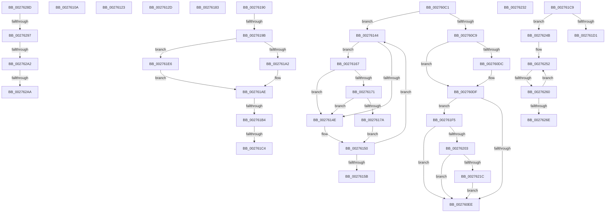

# sub_002760C1

- RVA: `0x002760C1`–`0x002762C2` (길이 `513` bytes)
- VA: `0x00000001402760C1`
- 실행 섹션: `.text`
- PDB 이름 있음: `아니요`; PDB Function 태그: `아니요`
- unwind 정보 RVA: `0x00065ED0`
- 디코드: `127`개 명령, `513/513` bytes 표시
- 미해석 바이트: `0` (있으면 어셈블리에 `.byte`로 보존)

> 이 문서는 커널 이미지의 기계어와 PDB 기호를 분석해 생성했습니다. 4번과 5번은 함수 원형과 자료형을 바이너리 사용 방식에서 추정한 C 해석이며 원본 소스 복구 결과는 아닙니다.

## 1. Dependencies

- 직접 호출 지점: **9**; 고유 호출 대상: **9**
- 직접 호출자로 확인된 함수: **0**
- RIP 상대 이미지 참조: **3**

### Outgoing calls
- `0x00276119` → [KeReleaseInStackQueuedSpinLockFromDpcLevel](../21/KeReleaseInStackQueuedSpinLockFromDpcLevel_function_002171B0.md) (function, `0x002171B0`)
- `0x00276171` → [KiCheckVpBackingLongSpinWaitHypercall](../30/KiCheckVpBackingLongSpinWaitHypercall_function_0030F490.md) (function, `0x0030F490`)
- `0x0027617C` → [HvlNotifyLongSpinWait](../30/HvlNotifyLongSpinWait_function_0030F460.md) (function, `0x0030F460`)
- `0x00276186` → [KxWaitForLockOwnerShip](../25/KxWaitForLockOwnerShip_function_00257EB0.md) (function, `0x00257EB0`)
- `0x002761B7` → [MiIsLazyStampedPte](../22/MiIsLazyStampedPte_function_00227B10.md) (function, `0x00227B10`)
- `0x002761EB` → [MiMakeDemandZeroPte](../33/MiMakeDemandZeroPte_function_00337A00.md) (function, `0x00337A00`)
- `0x00276228` → [MiCheckLinearProtectedPteAccessedBit](../29/MiCheckLinearProtectedPteAccessedBit_function_00292D80.md) (function, `0x00292D80`)
- `0x00276241` → [ExAcquireSpinLockExclusiveAtDpcLevel](../24/ExAcquireSpinLockExclusiveAtDpcLevel_function_00248E80.md) (function, `0x00248E80`)
- `0x002762BC` → [KeBugCheckEx](../4F/KeBugCheckEx_function_004FD660.md) (function, `0x004FD660`)

### Direct callers
- 이 함수 시작 RVA로 연결되는 직접 call은 확인되지 않았습니다. 간접 호출은 완전히 역산할 수 없습니다.

### Static image references
- `0x002760CF` → RVA `0x00FC6A88` (`ALMOSTRO`; read)
- `0x00276146` → RVA `0x00FC52AC` (`ALMOSTRO`; reference)
- `0x00276167` → RVA `0x00FC6AB8` (`ALMOSTRO`; read)

## 2. Other-region calls and transfers

- 다른 실행 섹션으로 향하는 call: **0**
- call이 아닌 외부 분기/꼬리 이동: **17**
  - `0x00276105` → [sub_00275BEF + 0x119](Unknown_function_00275BEF.md) (`tail-transfer`)
  - `0x0027611E` → [sub_00275BEF + 0x76](Unknown_function_00275BEF.md) (`tail-transfer`)
  - `0x00276128` → [sub_00275BEF + 0x31F](Unknown_function_00275BEF.md) (`tail-transfer`)
  - `0x0027613F` → [sub_002759BE + 0x162](Unknown_function_002759BE.md) (`tail-transfer`)
  - `0x00276162` → [sub_00275BEF + 0x119](Unknown_function_00275BEF.md) (`tail-transfer`)
  - `0x0027618B` → [sub_002759BE + 0x82](Unknown_function_002759BE.md) (`tail-transfer`)
  - `0x00276195` → [sub_002759BE + 0x1E7](Unknown_function_002759BE.md) (`tail-transfer`)
  - `0x002761AE` → [sub_00275BEF + 0x45C](Unknown_function_00275BEF.md) (`tail-transfer`)
  - `0x002761BE` → [sub_002759BE + 0x1E7](Unknown_function_002759BE.md) (`tail-transfer`)
  - `0x002761C4` → [sub_00275BEF + 0x45C](Unknown_function_00275BEF.md) (`tail-transfer`)
  - `0x002761E1` → [sub_00275BEF + 0x425](Unknown_function_00275BEF.md) (`tail-transfer`)
  - `0x00276246` → [sub_00275BEF + 0x17B](Unknown_function_00275BEF.md) (`tail-transfer`)
  - `0x0027625A` → [sub_002762D6 + 0x2B](Unknown_function_002762D6.md) (`tail-transfer`)
  - `0x00276288` → [sub_00275BEF + 0x425](Unknown_function_00275BEF.md) (`tail-transfer`)
  - `0x00276295` → [sub_002762D6](Unknown_function_002762D6.md) (`tail-transfer`)
  - `0x002762A0` → [sub_002762D6 + 0xC](Unknown_function_002762D6.md) (`tail-transfer`)
  - `0x002762A8` → [sub_002762D6 + 0xC](Unknown_function_002762D6.md) (`tail-transfer`)

## 3. Assembly (complete function range)

```asm
002760C1  A8 02                           test al, 2
002760C3  0F 85 7B 00 00 00               jne 0x140276144
002760C9  48 8B FB                        mov rdi, rbx
002760CC  49 0B FC                        or rdi, r12
002760CF  48 F7 05 AE 09 D5 00 00 00 00 02  test qword ptr [rip + 0xd509ae], 0x2000000
002760DA  74 03                           je 0x1402760df
002760DC  0F AE E8                        lfence
002760DF  48 0F BA 25 A0 09 D5 00 24      bt qword ptr [rip + 0xd509a0], 0x24
002760E8  0F 82 07 01 00 00               jb 0x1402761f5
002760EE  48 8B C3                        mov rax, rbx
002760F1  F0 49 0F B1 7D 00               lock cmpxchg qword ptr [r13], rdi
002760F7  48 8B D8                        mov rbx, rax
002760FA  48 0F 44 DF                     cmove rbx, rdi
002760FE  8B BC 24 B0 00 00 00            mov edi, dword ptr [rsp + 0xb0]
00276105  E9 FE FB FF FF                  jmp 0x140275d08
0027610A  48 81 C2 40 9C 00 00            add rdx, 0x9c40
00276111  B9 18 00 00 00                  mov ecx, 0x18
00276116  48 03 CA                        add rcx, rdx
00276119  E8 92 10 FA FF                  call 0x1402171b0
0027611E  E9 42 FB FF FF                  jmp 0x140275c65
00276123  B9 01 00 00 00                  mov ecx, 1
00276128  E9 E1 FD FF FF                  jmp 0x140275f0e
0027612D  B9 01 00 00 00                  mov ecx, 1
00276132  8B D1                           mov edx, ecx
00276134  48 81 C2 50 06 00 00            add rdx, 0x650
0027613B  49 8D 14 D1                     lea rdx, [r9 + rdx*8]
0027613F  E9 DC F9 FF FF                  jmp 0x140275b20
00276144  FF C7                           inc edi
00276146  85 3D 60 F1 D4 00               test dword ptr [rip + 0xd4f160], edi
0027614C  74 19                           je 0x140276167
0027614E  F3 90                           pause
00276150  49 8B 5D 00                     mov rbx, qword ptr [r13]
00276154  48 0F BA E3 3C                  bt rbx, 0x3c
00276159  72 E9                           jb 0x140276144
0027615B  89 BC 24 B0 00 00 00            mov dword ptr [rsp + 0xb0], edi
00276162  E9 A1 FB FF FF                  jmp 0x140275d08
00276167  8B 05 4B 09 D5 00               mov eax, dword ptr [rip + 0xd5094b]
0027616D  A8 40                           test al, 0x40
0027616F  74 DD                           je 0x14027614e
00276171  E8 1A 93 09 00                  call 0x14030f490
00276176  84 C0                           test al, al
00276178  74 D4                           je 0x14027614e
0027617A  8B CF                           mov ecx, edi
0027617C  E8 DF 92 09 00                  call 0x14030f460
00276181  EB CD                           jmp 0x140276150
00276183  48 8B D0                        mov rdx, rax
00276186  E8 25 1D FE FF                  call 0x140257eb0
0027618B  E9 B0 F8 FF FF                  jmp 0x140275a40
00276190  49 0F BA E0 0A                  bt r8, 0xa
00276195  0F 82 0A FA FF FF               jb 0x140275ba5
0027619B  49 0F BA E0 0B                  bt r8, 0xb
002761A0  73 44                           jae 0x1402761e6
002761A2  49 8B C0                        mov rax, r8
002761A5  48 C1 E8 05                     shr rax, 5
002761A9  83 E0 1F                        and eax, 0x1f
002761AC  3C 18                           cmp al, 0x18
002761AE  0F 84 97 FE FF FF               je 0x14027604b
002761B4  49 8B C8                        mov rcx, r8
002761B7  E8 54 19 FB FF                  call 0x140227b10
002761BC  85 C0                           test eax, eax
002761BE  0F 84 E1 F9 FF FF               je 0x140275ba5
002761C4  E9 82 FE FF FF                  jmp 0x14027604b
002761C9  A8 02                           test al, 2
002761CB  0F 85 7A 00 00 00               jne 0x14027624b
002761D1  8B CA                           mov ecx, edx
002761D3  8B C2                           mov eax, edx
002761D5  41 0B CA                        or ecx, r10d
002761D8  F0 0F B1 0B                     lock cmpxchg dword ptr [rbx], ecx
002761DC  8B D0                           mov edx, eax
002761DE  0F 44 D1                        cmove edx, ecx
002761E1  E9 2E FE FF FF                  jmp 0x140276014
002761E6  B9 10 00 00 00                  mov ecx, 0x10
002761EB  E8 10 18 0C 00                  call 0x140337a00
002761F0  4C 3B C0                        cmp r8, rax
002761F3  EB B9                           jmp 0x1402761ae
002761F5  40 0F B6 C7                     movzx eax, dil
002761F9  24 21                           and al, 0x21
002761FB  3C 01                           cmp al, 1
002761FD  0F 85 EB FE FF FF               jne 0x1402760ee
00276203  49 8B C7                        mov rax, r15
00276206  48 B9 00 00 00 00 40 00 00 00   movabs rcx, 0x4000000000
00276210  48 03 C1                        add rax, rcx
00276213  4C 3B E8                        cmp r13, rax
00276216  0F 82 D2 FE FF FF               jb 0x1402760ee
0027621C  41 B8 80 00 00 00               mov r8d, 0x80
00276222  48 8B D7                        mov rdx, rdi
00276225  49 8B CD                        mov rcx, r13
00276228  E8 53 CB 01 00                  call 0x140292d80
0027622D  E9 BC FE FF FF                  jmp 0x1402760ee
00276232  41 8B C5                        mov eax, r13d
00276235  C1 E8 03                        shr eax, 3
00276238  25 FF 01 00 00                  and eax, 0x1ff
0027623D  48 8D 0C 81                     lea rcx, [rcx + rax*4]
00276241  E8 3A 2C FD FF                  call 0x140248e80
00276246  E9 1F FB FF FF                  jmp 0x140275d6a
0027624B  8B B4 24 B0 00 00 00            mov esi, dword ptr [rsp + 0xb0]
00276252  FF C6                           inc esi
00276254  85 35 52 F0 D4 00               test dword ptr [rip + 0xd4f052], esi
0027625A  0F 84 A1 00 00 00               je 0x140276301
00276260  F3 90                           pause
00276262  8B 13                           mov edx, dword ptr [rbx]
00276264  8B CF                           mov ecx, edi
00276266  8B C2                           mov eax, edx
00276268  D3 E8                           shr eax, cl
0027626A  A8 01                           test al, 1
0027626C  75 E4                           jne 0x140276252
0027626E  44 8B 44 24 30                  mov r8d, dword ptr [rsp + 0x30]
00276273  44 8B 4C 24 34                  mov r9d, dword ptr [rsp + 0x34]
00276278  44 8B 54 24 38                  mov r10d, dword ptr [rsp + 0x38]
0027627D  89 B4 24 B0 00 00 00            mov dword ptr [rsp + 0xb0], esi
00276284  49 8D 76 38                     lea rsi, [r14 + 0x38]
00276288  E9 87 FD FF FF                  jmp 0x140276014
0027628D  4D 8B 4E 10                     mov r9, qword ptr [r14 + 0x10]
00276291  41 F6 C1 01                     test r9b, 1
00276295  75 3F                           jne 0x1402762d6
00276297  49 8B 16                        mov rdx, qword ptr [r14]
0027629A  49 8B C7                        mov rax, r15
0027629D  48 3B D0                        cmp rdx, rax
002762A0  72 40                           jb 0x1402762e2
002762A2  49 8B C4                        mov rax, r12
002762A5  48 3B D0                        cmp rdx, rax
002762A8  77 38                           ja 0x1402762e2
002762AA  4D 8B 46 08                     mov r8, qword ptr [r14 + 8]
002762AE  B9 50 00 00 00                  mov ecx, 0x50
002762B3  48 C7 44 24 20 08 00 00 00      mov qword ptr [rsp + 0x20], 8
002762BC  E8 9F 73 28 00                  call 0x1404fd660
002762C1  CC                              int3
```

## 4. C-style interpretation (structured pseudocode)

```c
__int64 __fastcall sub_002760C1(__int64 a1, __int64 a2, __int64 a3, __int64 a4, __int64 a5, __int64 a6, __int64 a7, __int64 a8, __int64 a9, __int64 a10, __int64 a11, __int64 a12, __int64 a13, __int64 a14, __int64 a15, __int64 a16, __int64 a17, __int64 a18, __int64 a19, __int64 a20, __int64 a21, unsigned int a22)
{
    __int64 result;
    __int64 v_rbx;
    __int64 v_rdi;
    unsigned __int64 v_stack_p20;
    unsigned int v_stack_p30;
    unsigned int v_stack_p34;
    unsigned int v_stack_p38;
    unsigned int v_stack_pB0;

    if ((((unsigned __int8)(result)) & (2)) != 0) goto loc_00276144;
    v_rdi = (v_rbx) | (v_r12);
    if (((*(unsigned __int64 *)(v_rip + 13961646)) & (0x2000000ULL)) != 0) {
    }
    if (condition_is_below) goto loc_002761F5;
loc_002760EE:
    if (((*(unsigned __int64 *)(v_rip + 13961646)) & (0x2000000ULL)) == 0) { v_rbx = v_rdi; }
loc_00276144:
    v_rdi = (unsigned int)(((unsigned int)(a22)) + 1);
    if (((*(unsigned int *)(v_rip + 13955424)) & ((unsigned int)(v_rdi))) == 0) goto loc_00276167;
loc_0027614E:
loc_00276150:
    if (condition_is_below) goto loc_00276144;
    v_stack_pB0 = (unsigned int)(v_rdi);
loc_00276167:
    if ((((unsigned __int8)((unsigned int)(*(unsigned int *)(v_rip + 13961547)))) & (64)) == 0) goto loc_0027614E;
    result = KiCheckVpBackingLongSpinWaitHypercall(a1, a2, a3, a4);
    if ((unsigned __int8)(result) == 0) goto loc_0027614E;
    result = HvlNotifyLongSpinWait((unsigned int)((unsigned int)(v_rdi)), a2, a3, a4);
    goto loc_00276150;
loc_002761F5:
    result = (unsigned __int8)(((unsigned __int8)(v_rdi)) & (33));
    if (((unsigned __int8)(result)) != 1) goto loc_002760EE;
    result = (v_r15) + ((unsigned int)((unsigned int)(v_rdi)));
    if (v_r13 < result) goto loc_002760EE;
    result = MiCheckLinearProtectedPteAccessedBit(v_r13, v_rdi, 128, a4);
    goto loc_002760EE;
}
```

## 5. (Beta) C Style

```c
int64_t sub_002760C1(int64_t Arg1, int64_t Arg2, int64_t Arg3, int64_t Arg4, uint64_t Arg5, uint64_t Arg6, uint64_t Arg7, uint64_t Arg8, uint64_t Arg9, uint64_t Arg10, uint64_t Arg11, uint64_t Arg12, uint64_t Arg13, uint64_t Arg14, uint64_t Arg15, uint64_t Arg16, uint64_t Arg17, uint64_t Arg18, uint64_t Arg19, uint64_t Arg20, uint64_t Arg21, uint32_t Arg22)
{
    int64_t result;
    int64_t local_rbx;
    int64_t local_rdi;
    uint64_t v_stack_p20;
    uint32_t v_stack_p30;
    uint32_t v_stack_p34;
    uint32_t v_stack_p38;
    uint32_t v_stack_pB0;

    if ((((uint8_t)(result)) & (2)) != 0) goto loc_00276144;
    local_rdi = (local_rbx) | (local_r12);
    if (((*(uint64_t *)(v_rip + 0xD509AE)) & (0x2000000ULL)) != 0) {
    }
    if (condition_is_below) goto loc_002761F5;
loc_002760EE:
    if (((*(uint64_t *)(v_rip + 0xD509AE)) & (0x2000000ULL)) == 0) { local_rbx = local_rdi; }
loc_00276144:
    local_rdi = (uint32_t)(((uint32_t)(Arg22)) + 1);
    if (((*(uint32_t *)(v_rip + 0xD4F160)) & ((uint32_t)(local_rdi))) == 0) goto loc_00276167;
loc_0027614E:
loc_00276150:
    if (condition_is_below) goto loc_00276144;
    v_stack_pB0 = (uint32_t)(local_rdi);
loc_00276167:
    if ((((uint8_t)((uint32_t)(*(uint32_t *)(v_rip + 0xD5094B)))) & (64)) == 0) goto loc_0027614E;
    result = KiCheckVpBackingLongSpinWaitHypercall(Arg1, Arg2, Arg3, Arg4);
    if ((uint8_t)(result) == 0) goto loc_0027614E;
    result = HvlNotifyLongSpinWait((uint32_t)((uint32_t)(local_rdi)), Arg2, Arg3, Arg4);
    goto loc_00276150;
loc_002761F5:
    result = (uint8_t)(((uint8_t)(local_rdi)) & (33));
    if (((uint8_t)(result)) != 1) goto loc_002760EE;
    result = (local_r15) + ((uint32_t)((uint32_t)(local_rdi)));
    if (local_r13 < result) goto loc_002760EE;
    result = MiCheckLinearProtectedPteAccessedBit(local_r13, local_rdi, 128, Arg4);
    goto loc_002760EE;
}
```

## 6. Execution-region graph

[열기: 2D/3D 그래프와 함수 탐색 컨트롤 패널](../../../control-panel.html?section=text&rva=0x002760C1&view=graph)

- 2D 그래프는 위에서 아래로 흐르고, 3D 그래프는 빈 공간을 드래그해 회전합니다. Shift+드래그는 이동, 휠은 확대·축소, 함수 노드 선택은 대상 보고서 이동입니다.

### Static fallback


