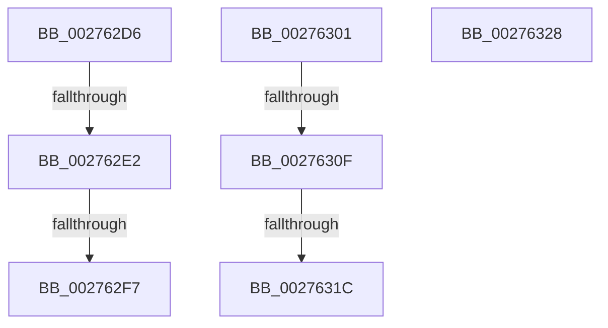

# sub_002762D6

- RVA: `0x002762D6`–`0x0027632F` (길이 `89` bytes)
- VA: `0x00000001402762D6`
- 실행 섹션: `.text`
- PDB 이름 있음: `아니요`; PDB Function 태그: `아니요`
- unwind 정보 RVA: `0x00065EFC`
- 디코드: `23`개 명령, `89/89` bytes 표시
- 미해석 바이트: `0` (있으면 어셈블리에 `.byte`로 보존)

> 이 문서는 커널 이미지의 기계어와 PDB 기호를 분석해 생성했습니다. 4번과 5번은 함수 원형과 자료형을 바이너리 사용 방식에서 추정한 C 해석이며 원본 소스 복구 결과는 아닙니다.

## 1. Dependencies

- 직접 호출 지점: **3**; 고유 호출 대상: **3**
- 직접 호출자로 확인된 함수: **0**
- RIP 상대 이미지 참조: **1**

### Outgoing calls
- `0x002762E8` → [MiLargePageFault](../3F/MiLargePageFault_function_003F01C4.md) (function, `0x003F01C4`)
- `0x0027630F` → [KiCheckVpBackingLongSpinWaitHypercall](../30/KiCheckVpBackingLongSpinWaitHypercall_function_0030F490.md) (function, `0x0030F490`)
- `0x0027631E` → [HvlNotifyLongSpinWait](../30/HvlNotifyLongSpinWait_function_0030F460.md) (function, `0x0030F460`)

### Direct callers
- 이 함수 시작 RVA로 연결되는 직접 call은 확인되지 않았습니다. 간접 호출은 완전히 역산할 수 없습니다.

### Static image references
- `0x00276301` → RVA `0x00FC6AB8` (`ALMOSTRO`; read)

## 2. Other-region calls and transfers

- 다른 실행 섹션으로 향하는 call: **0**
- call이 아닌 외부 분기/꼬리 이동: **7**
  - `0x002762E0` → [sub_002760C1 + 0x1D6](Unknown_function_002760C1.md) (`tail-transfer`)
  - `0x002762F1` → [sub_002759BE + 0x213](Unknown_function_002759BE.md) (`tail-transfer`)
  - `0x002762FC` → [sub_002759BE + 0x213](Unknown_function_002759BE.md) (`tail-transfer`)
  - `0x00276309` → [sub_002760C1 + 0x19F](Unknown_function_002760C1.md) (`tail-transfer`)
  - `0x00276316` → [sub_002760C1 + 0x19F](Unknown_function_002760C1.md) (`tail-transfer`)
  - `0x00276323` → [sub_002760C1 + 0x1A1](Unknown_function_002760C1.md) (`tail-transfer`)
  - `0x0027632A` → [sub_00275BEF + 0x398](Unknown_function_00275BEF.md) (`tail-transfer`)

## 3. Assembly (complete function range)

```asm
002762D6  49 8B C1                        mov rax, r9
002762D9  48 83 E0 FE                     and rax, 0xfffffffffffffffe
002762DD  80 38 01                        cmp byte ptr [rax], 1
002762E0  75 B5                           jne 0x140276297
002762E2  49 8B D5                        mov rdx, r13
002762E5  49 8B CE                        mov rcx, r14
002762E8  E8 D7 9E 17 00                  call 0x1403f01c4
002762ED  8B D8                           mov ebx, eax
002762EF  85 C0                           test eax, eax
002762F1  0F 88 DA F8 FF FF               js 0x140275bd1
002762F7  BB 34 04 00 C0                  mov ebx, 0xc0000434
002762FC  E9 D0 F8 FF FF                  jmp 0x140275bd1
00276301  8B 05 B1 07 D5 00               mov eax, dword ptr [rip + 0xd507b1]
00276307  A8 40                           test al, 0x40
00276309  0F 84 51 FF FF FF               je 0x140276260
0027630F  E8 7C 91 09 00                  call 0x14030f490
00276314  84 C0                           test al, al
00276316  0F 84 44 FF FF FF               je 0x140276260
0027631C  8B CE                           mov ecx, esi
0027631E  E8 3D 91 09 00                  call 0x14030f460
00276323  E9 3A FF FF FF                  jmp 0x140276262
00276328  33 C9                           xor ecx, ecx
0027632A  E9 58 FC FF FF                  jmp 0x140275f87
```

## 4. C-style interpretation (structured pseudocode)

```c
__int64 __fastcall sub_002762D6(__int64 a1, __int64 a2, __int64 a3, __int64 a4)
{
    __int64 result;

    result = (a4) & (-2);
    result = MiLargePageFault(v_r14, v_r13, a3, a4);
}
```

## 5. (Beta) C Style

```c
int64_t sub_002762D6(int64_t Arg1, int64_t Arg2, int64_t Arg3, void *Arg4)
{
    uint8_t *arg4 = (uint8_t *)Arg4;

    int64_t result;

    result = (Arg4) & (-2);
    result = MiLargePageFault(local_r14, local_r13, Arg3, Arg4);
}
```

### 관측된 메모리 오프셋

구조체 형식이 확인되지 않은 접근은 인자 기준의 오프셋으로만 기록했습니다.

| 기준 인자 | 오프셋 표현 | 폭 (bit) | 접근 |
|---|---:|---:|---|
| `Arg4` | `+ 0x0` | `8` | `R` |

## 6. Execution-region graph

[열기: 2D/3D 그래프와 함수 탐색 컨트롤 패널](../../../control-panel.html?section=text&rva=0x002762D6&view=graph)

- 2D 그래프는 위에서 아래로 흐르고, 3D 그래프는 빈 공간을 드래그해 회전합니다. Shift+드래그는 이동, 휠은 확대·축소, 함수 노드 선택은 대상 보고서 이동입니다.

### Static fallback


