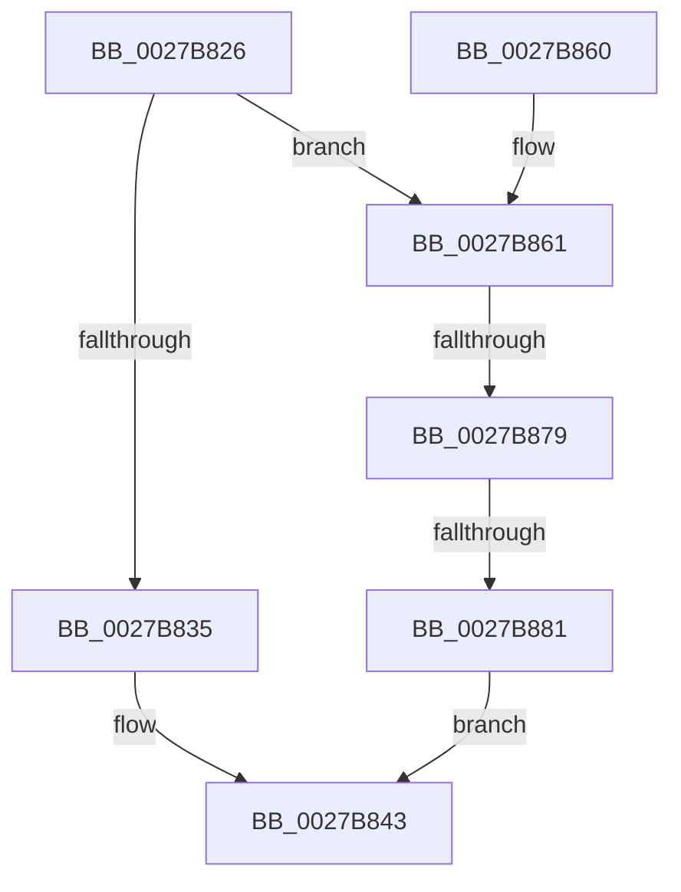

# sub_0027B826

- RVA: `0x0027B826`–`0x0027B888` (길이 `98` bytes)
- VA: `0x000000014027B826`
- 실행 섹션: `.text`
- PDB 이름 있음: `아니요`; PDB Function 태그: `아니요`
- unwind 정보 RVA: `0x00066024`
- 디코드: `27`개 명령, `98/98` bytes 표시
- 미해석 바이트: `0` (있으면 어셈블리에 `.byte`로 보존)

> 이 문서는 커널 이미지의 기계어와 PDB 기호를 분석해 생성했습니다. 4번과 5번은 함수 원형과 자료형을 바이너리 사용 방식에서 추정한 C 해석이며 원본 소스 복구 결과는 아닙니다.

## 1. Dependencies

- 직접 호출 지점: **0**; 고유 호출 대상: **0**
- 직접 호출자로 확인된 함수: **0**
- RIP 상대 이미지 참조: **0**

### Outgoing calls
- 직접 디코드된 call 명령이 없습니다.

### Direct callers
- 이 함수 시작 RVA로 연결되는 직접 call은 확인되지 않았습니다. 간접 호출은 완전히 역산할 수 없습니다.

### Static image references
- 디코드된 RIP-relative 메모리 참조가 없습니다.

## 2. Other-region calls and transfers

- 다른 실행 섹션으로 향하는 call: **0**
- call이 아닌 외부 분기/꼬리 이동: **2**
  - `0x0027B873` → [sub_0027B90E + 0x151](Unknown_function_0027B90E.md) (`tail-transfer`)
  - `0x0027B87B` → [sub_0027B90E](Unknown_function_0027B90E.md) (`tail-transfer`)

## 3. Assembly (complete function range)

```asm
0027B826  4C 89 64 24 40                  mov qword ptr [rsp + 0x40], r12
0027B82B  4C 89 7C 24 48                  mov qword ptr [rsp + 0x48], r15
0027B830  F6 C3 01                        test bl, 1
0027B833  75 2C                           jne 0x14027b861
0027B835  8B 06                           mov eax, dword ptr [rsi]
0027B837  A8 01                           test al, 1
0027B839  B8 00 00 00 00                  mov eax, 0
0027B83E  0F 95 C0                        setne al
0027B841  FF C0                           inc eax
0027B843  4C 8B 7C 24 48                  mov r15, qword ptr [rsp + 0x48]
0027B848  4C 8B 64 24 40                  mov r12, qword ptr [rsp + 0x40]
0027B84D  48 8B 5C 24 50                  mov rbx, qword ptr [rsp + 0x50]
0027B852  48 8B 6C 24 58                  mov rbp, qword ptr [rsp + 0x58]
0027B857  48 83 C4 20                     add rsp, 0x20
0027B85B  41 5E                           pop r14
0027B85D  5F                              pop rdi
0027B85E  5E                              pop rsi
0027B85F  C3                              ret
0027B860  CC                              int3
0027B861  44 8B 3E                        mov r15d, dword ptr [rsi]
0027B864  49 BC FF FF FF FF FF 00 00 00   movabs r12, 0xffffffffff
0027B86E  41 0F BA E7 0F                  bt r15d, 0xf
0027B873  0F 82 E6 01 00 00               jb 0x14027ba5f
0027B879  85 ED                           test ebp, ebp
0027B87B  0F 85 8D 00 00 00               jne 0x14027b90e
0027B881  B8 02 00 00 00                  mov eax, 2
0027B886  EB BB                           jmp 0x14027b843
```

## 4. C-style interpretation (structured pseudocode)

```c
__int64 __fastcall sub_0027B826(__int64 a1, __int64 a2, __int64 a3, __int64 a4, __int64 a5, __int64 a6, __int64 a7, __int64 a8, __int64 a9, __int64 a10, __int64 a11)
{
    __int64 result;
    __int64 v_rsp;
    unsigned __int64 v_stack_p40;
    unsigned __int64 v_stack_p48;

    v_stack_p40 = v_r12;
    v_stack_p48 = v_r15;
    if ((((unsigned __int8)(v_rbx)) & (1)) != 0) goto loc_0027B861;
    result = ((((unsigned __int8)((unsigned int)(*(unsigned int *)(v_rsi)))) & (1)) != 0) ? 1 : 0;
    result = (unsigned int)((result) + 1);
loc_0027B843:
    v_rsp = (v_rsp) + (32);
    return result;
loc_0027B861:
    goto loc_0027B843;
}
```

## 5. (Beta) C Style

```c
int64_t sub_0027B826(int64_t Arg1, int64_t Arg2, int64_t Arg3, int64_t Arg4, uint64_t Arg5, uint64_t Arg6, uint64_t Arg7, int64_t Arg8, int64_t Arg9, int64_t Arg10, int64_t Arg11)
{
    int64_t result;
    int64_t local_rsp;
    uint64_t v_stack_p40;
    uint64_t v_stack_p48;

    v_stack_p40 = local_r12;
    v_stack_p48 = local_r15;
    if ((((uint8_t)(local_rbx)) & (1)) != 0) goto loc_0027B861;
    result = ((((uint8_t)((uint32_t)(*(uint32_t *)(local_rsi)))) & (1)) != 0) ? 1 : 0;
    result = (uint32_t)((result) + 1);
loc_0027B843:
    local_rsp = (local_rsp) + (32);
    return result;
loc_0027B861:
    goto loc_0027B843;
}
```

## 6. Execution-region graph

[열기: 2D/3D 그래프와 함수 탐색 컨트롤 패널](../../../control-panel.html?section=text&rva=0x0027B826&view=graph)

- 2D 그래프는 위에서 아래로 흐르고, 3D 그래프는 빈 공간을 드래그해 회전합니다. Shift+드래그는 이동, 휠은 확대·축소, 함수 노드 선택은 대상 보고서 이동입니다.

### Static fallback


