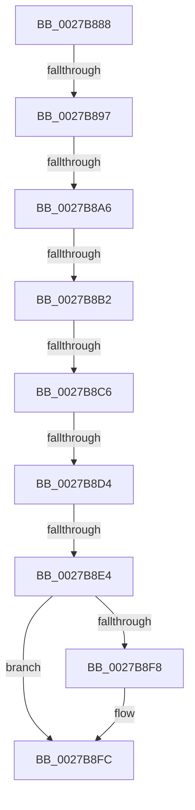

# sub_0027B888

- RVA: `0x0027B888`–`0x0027B90E` (길이 `134` bytes)
- VA: `0x000000014027B888`
- 실행 섹션: `.text`
- PDB 이름 있음: `아니요`; PDB Function 태그: `아니요`
- unwind 정보 RVA: `0x00066040`
- 디코드: `33`개 명령, `134/134` bytes 표시
- 미해석 바이트: `0` (있으면 어셈블리에 `.byte`로 보존)

> 이 문서는 커널 이미지의 기계어와 PDB 기호를 분석해 생성했습니다. 4번과 5번은 함수 원형과 자료형을 바이너리 사용 방식에서 추정한 C 해석이며 원본 소스 복구 결과는 아닙니다.

## 1. Dependencies

- 직접 호출 지점: **1**; 고유 호출 대상: **1**
- 직접 호출자로 확인된 함수: **0**
- RIP 상대 이미지 참조: **0**

### Outgoing calls
- `0x0027B8C6` → [MiPteHasShadow](../32/MiPteHasShadow_function_0032B998.md) (function, `0x0032B998`)

### Direct callers
- 이 함수 시작 RVA로 연결되는 직접 call은 확인되지 않았습니다. 간접 호출은 완전히 역산할 수 없습니다.

### Static image references
- 디코드된 RIP-relative 메모리 참조가 없습니다.

## 2. Other-region calls and transfers

- 다른 실행 섹션으로 향하는 call: **0**
- call이 아닌 외부 분기/꼬리 이동: **7**
  - `0x0027B895` → [sub_0027B826](Unknown_function_0027B826.md) (`tail-transfer`)
  - `0x0027B8A4` → [sub_0027B826](Unknown_function_0027B826.md) (`tail-transfer`)
  - `0x0027B8AC` → [sub_0027B826](Unknown_function_0027B826.md) (`tail-transfer`)
  - `0x0027B8C0` → [sub_0027B826](Unknown_function_0027B826.md) (`tail-transfer`)
  - `0x0027B8CE` → [sub_0027B826](Unknown_function_0027B826.md) (`tail-transfer`)
  - `0x0027B8DE` → [sub_0027B826](Unknown_function_0027B826.md) (`tail-transfer`)
  - `0x0027B909` → [sub_0027B826](Unknown_function_0027B826.md) (`tail-transfer`)

## 3. Assembly (complete function range)

```asm
0027B888  48 B8 00 D0 BE 7D FB F6 FF FF   movabs rax, 0xfffff6fb7dbed000
0027B892  48 3B F8                        cmp rdi, rax
0027B895  72 8F                           jb 0x14027b826
0027B897  48 B8 F8 D7 BE 7D FB F6 FF FF   movabs rax, 0xfffff6fb7dbed7f8
0027B8A1  48 3B F8                        cmp rdi, rax
0027B8A4  77 80                           ja 0x14027b826
0027B8A6  48 8B D3                        mov rdx, rbx
0027B8A9  F6 C3 01                        test bl, 1
0027B8AC  0F 84 74 FF FF FF               je 0x14027b826
0027B8B2  F6 C3 42                        test bl, 0x42
0027B8B5  0F 95 C1                        setne cl
0027B8B8  F6 C3 20                        test bl, 0x20
0027B8BB  0F 95 C0                        setne al
0027B8BE  84 C8                           test al, cl
0027B8C0  0F 85 60 FF FF FF               jne 0x14027b826
0027B8C6  E8 CD 00 0B 00                  call 0x14032b998
0027B8CB  48 85 C0                        test rax, rax
0027B8CE  0F 84 52 FF FF FF               je 0x14027b826
0027B8D4  48 8B 88 08 05 00 00            mov rcx, qword ptr [rax + 0x508]
0027B8DB  48 85 C9                        test rcx, rcx
0027B8DE  0F 84 42 FF FF FF               je 0x14027b826
0027B8E4  48 8B C7                        mov rax, rdi
0027B8E7  48 C1 E8 03                     shr rax, 3
0027B8EB  25 FF 01 00 00                  and eax, 0x1ff
0027B8F0  48 8B 04 C1                     mov rax, qword ptr [rcx + rax*8]
0027B8F4  A8 20                           test al, 0x20
0027B8F6  74 04                           je 0x14027b8fc
0027B8F8  48 83 CA 20                     or rdx, 0x20
0027B8FC  48 8B DA                        mov rbx, rdx
0027B8FF  48 83 CB 42                     or rbx, 0x42
0027B903  A8 42                           test al, 0x42
0027B905  48 0F 44 DA                     cmove rbx, rdx
0027B909  E9 18 FF FF FF                  jmp 0x14027b826
```

## 4. C-style interpretation (structured pseudocode)

```c
__int64 __fastcall sub_0027B888(void)
{
    __int64 result;
    __int64 v_rbx;

    a1 = ((((unsigned __int8)(v_rbx)) & (66)) != 0) ? 1 : 0;
    result = ((((unsigned __int8)(v_rbx)) & (32)) != 0) ? 1 : 0;
    result = MiPteHasShadow(a1, v_rbx, a3, a4);
    result = (v_rdi) >> (3);
    result = (unsigned int)((result) & (511));
    if ((((unsigned __int8)(*(unsigned __int64 *)(*(unsigned __int64 *)(result + 1288) + result * 8))) & (32)) != 0) {
        a2 = (v_rbx) | (32);
    }
    v_rbx = (a2) | (66);
    if ((((unsigned __int8)(*(unsigned __int64 *)(*(unsigned __int64 *)(result + 1288) + result * 8))) & (66)) == 0) { v_rbx = a2; }
}
```

## 5. (Beta) C Style

```c
void sub_0027B888(void)
{
    int64_t result;
    int64_t local_rbx;

    a1 = ((((uint8_t)(local_rbx)) & (66)) != 0) ? 1 : 0;
    result = ((((uint8_t)(local_rbx)) & (32)) != 0) ? 1 : 0;
    result = MiPteHasShadow(a1, local_rbx, a3, a4);
    result = (local_rdi) >> (3);
    result = (uint32_t)((result) & (511));
    if ((((uint8_t)(*(uint64_t *)(*(uint64_t *)(result + 0x508) + result * 8))) & (32)) != 0) {
        a2 = (local_rbx) | (32);
    }
    local_rbx = (a2) | (66);
    if ((((uint8_t)(*(uint64_t *)(*(uint64_t *)(result + 0x508) + result * 8))) & (66)) == 0) { local_rbx = a2; }
}
```

## 6. Execution-region graph

[열기: 2D/3D 그래프와 함수 탐색 컨트롤 패널](../../../control-panel.html?section=text&rva=0x0027B888&view=graph)

- 2D 그래프는 위에서 아래로 흐르고, 3D 그래프는 빈 공간을 드래그해 회전합니다. Shift+드래그는 이동, 휠은 확대·축소, 함수 노드 선택은 대상 보고서 이동입니다.

### Static fallback


