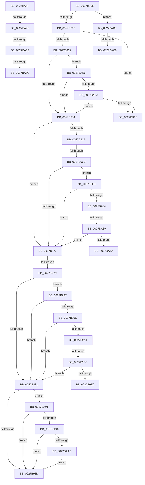

# sub_0027B90E

- RVA: `0x0027B90E`–`0x0027BB1F` (길이 `529` bytes)
- VA: `0x000000014027B90E`
- 실행 섹션: `.text`
- PDB 이름 있음: `아니요`; PDB Function 태그: `아니요`
- unwind 정보 RVA: `0x00066050`
- 디코드: `124`개 명령, `529/529` bytes 표시
- 미해석 바이트: `0` (있으면 어셈블리에 `.byte`로 보존)

> 이 문서는 커널 이미지의 기계어와 PDB 기호를 분석해 생성했습니다. 4번과 5번은 함수 원형과 자료형을 바이너리 사용 방식에서 추정한 C 해석이며 원본 소스 복구 결과는 아닙니다.

## 1. Dependencies

- 직접 호출 지점: **4**; 고유 호출 대상: **4**
- 직접 호출자로 확인된 함수: **0**
- RIP 상대 이미지 참조: **2**

### Outgoing calls
- `0x0027BA2B` → [MiGetSystemCacheReverseMap](../29/MiGetSystemCacheReverseMap_function_00294BF0.md) (function, `0x00294BF0`)
- `0x0027BA6B` → [MiIsPageAGapPage](../45/MiIsPageAGapPage_function_00451C2C.md) (function, `0x00451C2C`)
- `0x0027BAB4` → [MiMakeSystemLeavesNonZero](../4E/MiMakeSystemLeavesNonZero_function_004E26C0.md) (function, `0x004E26C0`)
- `0x0027BAD1` → [MiWalkLeap](../24/MiWalkLeap_function_0024A210.md) (function, `0x0024A210`)

### Direct callers
- 이 함수 시작 RVA로 연결되는 직접 call은 확인되지 않았습니다. 간접 호출은 완전히 역산할 수 없습니다.

### Static image references
- `0x0027BAE6` → RVA `0x00E37458` (`.data`; read)
- `0x0027BAED` → RVA `0x00E37440` (`.data`; read)

## 2. Other-region calls and transfers

- 다른 실행 섹션으로 향하는 call: **0**
- call이 아닌 외부 분기/꼬리 이동: **14**
  - `0x0027B967` → [sub_0027B826 + 0x5B](Unknown_function_0027B826.md) (`tail-transfer`)
  - `0x0027B976` → [sub_0027B826 + 0x5B](Unknown_function_0027B826.md) (`tail-transfer`)
  - `0x0027B992` → [sub_0027B826 + 0x1D](Unknown_function_0027B826.md) (`tail-transfer`)
  - `0x0027B9CF` → [sub_0027B826 + 0x5B](Unknown_function_0027B826.md) (`tail-transfer`)
  - `0x0027B9E9` → [sub_0027B826 + 0x5B](Unknown_function_0027B826.md) (`tail-transfer`)
  - `0x0027BA33` → [sub_0027B826 + 0x5B](Unknown_function_0027B826.md) (`tail-transfer`)
  - `0x0027BA5A` → [sub_0027B826 + 0x5B](Unknown_function_0027B826.md) (`tail-transfer`)
  - `0x0027BA72` → [sub_0027B826 + 0xF](Unknown_function_0027B826.md) (`tail-transfer`)
  - `0x0027BA7D` → [sub_0027B826 + 0x53](Unknown_function_0027B826.md) (`tail-transfer`)
  - `0x0027BA86` → [sub_0027B826 + 0xF](Unknown_function_0027B826.md) (`tail-transfer`)
  - `0x0027BA8C` → [sub_0027B826 + 0x53](Unknown_function_0027B826.md) (`tail-transfer`)
  - `0x0027BAC2` → [sub_0027B826 + 0x5B](Unknown_function_0027B826.md) (`tail-transfer`)
  - `0x0027BAE1` → [sub_0027B826 + 0x1D](Unknown_function_0027B826.md) (`tail-transfer`)
  - `0x0027BB1A` → [sub_0027B826 + 0x1D](Unknown_function_0027B826.md) (`tail-transfer`)

## 3. Assembly (complete function range)

```asm
0027B90E  84 DB                           test bl, bl
0027B910  0F 88 A8 01 00 00               js 0x14027babe
0027B916  48 B8 68 DF BE 7D FB F6 FF FF   movabs rax, 0xfffff6fb7dbedf68
0027B920  48 3B F8                        cmp rdi, rax
0027B923  0F 84 EC 01 00 00               je 0x14027bb15
0027B929  41 0F BA E7 09                  bt r15d, 9
0027B92E  0F 82 B2 01 00 00               jb 0x14027bae6
0027B934  41 F6 C7 01                     test r15b, 1
0027B938  75 38                           jne 0x14027b972
0027B93A  48 C1 EB 0C                     shr rbx, 0xc
0027B93E  49 23 DC                        and rbx, r12
0027B941  48 8D 04 5B                     lea rax, [rbx + rbx*2]
0027B945  48 03 C0                        add rax, rax
0027B948  48 B9 18 00 00 00 00 DE FF FF   movabs rcx, 0xffffde0000000018
0027B952  48 8B 04 C1                     mov rax, qword ptr [rcx + rax*8]
0027B956  48 B9 FF FF FF FF FF FF FF 3F   movabs rcx, 0x3fffffffffffffff
0027B960  48 23 C1                        and rax, rcx
0027B963  48 83 F8 01                     cmp rax, 1
0027B967  0F 84 14 FF FF FF               je 0x14027b881
0027B96D  83 FD 01                        cmp ebp, 1
0027B970  74 7C                           je 0x14027b9ee
0027B972  41 83 FE 03                     cmp r14d, 3
0027B976  0F 85 05 FF FF FF               jne 0x14027b881
0027B97C  83 FD 01                        cmp ebp, 1
0027B97F  74 16                           je 0x14027b997
0027B981  F7 06 00 80 00 00               test dword ptr [rsi], 0x8000
0027B987  0F 85 04 01 00 00               jne 0x14027ba91
0027B98D  B8 03 00 00 00                  mov eax, 3
0027B992  E9 AC FE FF FF                  jmp 0x14027b843
0027B997  8B 06                           mov eax, dword ptr [rsi]
0027B999  A8 10                           test al, 0x10
0027B99B  74 E4                           je 0x14027b981
0027B99D  A8 01                           test al, 1
0027B99F  75 E0                           jne 0x14027b981
0027B9A1  48 8B 07                        mov rax, qword ptr [rdi]
0027B9A4  48 C1 E8 0C                     shr rax, 0xc
0027B9A8  49 23 C4                        and rax, r12
0027B9AB  48 8D 04 40                     lea rax, [rax + rax*2]
0027B9AF  48 C1 E0 04                     shl rax, 4
0027B9B3  48 B9 00 00 00 00 00 DE FF FF   movabs rcx, 0xffffde0000000000
0027B9BD  48 03 C1                        add rax, rcx
0027B9C0  48 8B 08                        mov rcx, qword ptr [rax]
0027B9C3  48 8B 00                        mov rax, qword ptr [rax]
0027B9C6  48 C1 E8 2D                     shr rax, 0x2d
0027B9CA  A9 FF 03 00 00                  test eax, 0x3ff
0027B9CF  0F 84 AC FE FF FF               je 0x14027b881
0027B9D5  8B 46 04                        mov eax, dword ptr [rsi + 4]
0027B9D8  C1 E8 0C                        shr eax, 0xc
0027B9DB  48 C1 E9 37                     shr rcx, 0x37
0027B9DF  83 E0 0F                        and eax, 0xf
0027B9E2  83 E1 07                        and ecx, 7
0027B9E5  3A C8                           cmp cl, al
0027B9E7  73 98                           jae 0x14027b981
0027B9E9  E9 93 FE FF FF                  jmp 0x14027b881
0027B9EE  48 8B 46 20                     mov rax, qword ptr [rsi + 0x20]
0027B9F2  8B 88 B8 00 00 00               mov ecx, dword ptr [rax + 0xb8]
0027B9F8  80 E1 0F                        and cl, 0xf
0027B9FB  80 F9 01                        cmp cl, 1
0027B9FE  0F 85 6E FF FF FF               jne 0x14027b972
0027BA04  48 B8 00 00 00 00 80 F6 FF FF   movabs rax, 0xfffff68000000000
0027BA0E  48 C1 E0 19                     shl rax, 0x19
0027BA12  48 8B CF                        mov rcx, rdi
0027BA15  48 C1 E1 19                     shl rcx, 0x19
0027BA19  48 2B C8                        sub rcx, rax
0027BA1C  48 C1 F9 10                     sar rcx, 0x10
0027BA20  48 C1 E1 19                     shl rcx, 0x19
0027BA24  48 2B C8                        sub rcx, rax
0027BA27  48 C1 F9 10                     sar rcx, 0x10
0027BA2B  E8 C0 91 01 00                  call 0x140294bf0
0027BA30  48 85 C0                        test rax, rax
0027BA33  0F 84 48 FE FF FF               je 0x14027b881
0027BA39  48 8B 40 20                     mov rax, qword ptr [rax + 0x20]
0027BA3D  48 8B 4E 20                     mov rcx, qword ptr [rsi + 0x20]
0027BA41  48 C1 E8 06                     shr rax, 6
0027BA45  25 FF 03 00 00                  and eax, 0x3ff
0027BA4A  0F B7 91 AE 00 00 00            movzx edx, word ptr [rcx + 0xae]
0027BA51  48 3B C2                        cmp rax, rdx
0027BA54  0F 84 18 FF FF FF               je 0x14027b972
0027BA5A  E9 22 FE FF FF                  jmp 0x14027b881
0027BA5F  48 8B CB                        mov rcx, rbx
0027BA62  8B D5                           mov edx, ebp
0027BA64  48 C1 E9 0C                     shr rcx, 0xc
0027BA68  49 23 CC                        and rcx, r12
0027BA6B  E8 BC 61 1D 00                  call 0x140451c2c
0027BA70  85 C0                           test eax, eax
0027BA72  0F 85 BD FD FF FF               jne 0x14027b835
0027BA78  48 0F BA E3 0B                  bt rbx, 0xb
0027BA7D  0F 82 F6 FD FF FF               jb 0x14027b879
0027BA83  F6 C3 42                        test bl, 0x42
0027BA86  0F 84 A9 FD FF FF               je 0x14027b835
0027BA8C  E9 E8 FD FF FF                  jmp 0x14027b879
0027BA91  83 FD 01                        cmp ebp, 1
0027BA94  0F 8E F3 FE FF FF               jle 0x14027b98d
0027BA9A  8B 46 04                        mov eax, dword ptr [rsi + 4]
0027BA9D  C1 E8 06                        shr eax, 6
0027BAA0  83 E0 07                        and eax, 7
0027BAA3  3B E8                           cmp ebp, eax
0027BAA5  0F 85 E2 FE FF FF               jne 0x14027b98d
0027BAAB  44 8B C5                        mov r8d, ebp
0027BAAE  48 8B D7                        mov rdx, rdi
0027BAB1  48 8B CE                        mov rcx, rsi
0027BAB4  E8 07 6C 26 00                  call 0x1404e26c0
0027BAB9  E9 CF FE FF FF                  jmp 0x14027b98d
0027BABE  41 F6 C7 01                     test r15b, 1
0027BAC2  0F 85 B9 FD FF FF               jne 0x14027b881
0027BAC8  44 8B C5                        mov r8d, ebp
0027BACB  48 8B D7                        mov rdx, rdi
0027BACE  48 8B CE                        mov rcx, rsi
0027BAD1  E8 3A E7 FC FF                  call 0x14024a210
0027BAD6  83 F8 02                        cmp eax, 2
0027BAD9  B9 01 00 00 00                  mov ecx, 1
0027BADE  0F 44 C1                        cmove eax, ecx
0027BAE1  E9 5D FD FF FF                  jmp 0x14027b843
0027BAE6  48 8B 05 6B B9 BB 00            mov rax, qword ptr [rip + 0xbbb96b]
0027BAED  48 39 05 4C B9 BB 00            cmp qword ptr [rip + 0xbbb94c], rax
0027BAF4  0F 84 3A FE FF FF               je 0x14027b934
0027BAFA  48 8B C3                        mov rax, rbx
0027BAFD  48 8D 15 3C B9 BB 00            lea rdx, [rip + 0xbbb93c]
0027BB04  48 C1 E8 0C                     shr rax, 0xc
0027BB08  49 23 C4                        and rax, r12
0027BB0B  48 3B 04 EA                     cmp rax, qword ptr [rdx + rbp*8]
0027BB0F  0F 85 1F FE FF FF               jne 0x14027b934
0027BB15  B8 01 00 00 00                  mov eax, 1
0027BB1A  E9 24 FD FF FF                  jmp 0x14027b843
```

## 4. C-style interpretation (structured pseudocode)

```c
__int64 __fastcall sub_0027B90E(void)
{
    __int64 result;
    __int64 v_rbx;

    if (sign_flag) goto loc_0027BABE;
    if (v_rdi == result) goto loc_0027BB15;
    if (v_rdi < result) goto loc_0027BAE6;
loc_0027B934:
    if ((((unsigned __int8)(v_r15)) & (1)) != 0) goto loc_0027B972;
    v_rbx = (v_rbx) >> (12);
    v_rbx = (v_rbx) & (v_r12);
    result = (v_rbx + v_rbx * 2) + (v_rbx + v_rbx * 2);
    result = (*(unsigned __int64 *)(a1 + result * 8)) & (a1);
    if (((unsigned int)(v_rbp)) == 1) goto loc_0027B9EE;
loc_0027B972:
    if (((unsigned int)(v_rbp)) == 1) goto loc_0027B997;
loc_0027B981:
    if (((*(unsigned int *)(v_rsi)) & (0x8000ULL)) != 0) goto loc_0027BA91;
loc_0027B98D:
loc_0027B997:
    if ((((unsigned __int8)((unsigned int)(*(unsigned int *)(v_rsi)))) & (16)) == 0) goto loc_0027B981;
    if ((((unsigned __int8)((unsigned int)(*(unsigned int *)(v_rsi)))) & (1)) != 0) goto loc_0027B981;
    result = (*(unsigned __int64 *)(v_rdi)) >> (12);
    result = (result) & (v_r12);
    result = (result + result * 2) << (4);
    result = (result) + (a1);
    result = (*(unsigned __int64 *)(result)) >> (45);
    result = (unsigned int)(((unsigned int)(*(unsigned int *)(v_rsi + 4))) >> (12));
    a1 = (*(unsigned __int64 *)(result)) >> (55);
    result = (unsigned int)((result) & (15));
    a1 = (unsigned int)((a1) & (7));
    if (((unsigned __int8)(a1)) >= ((unsigned __int8)(result))) goto loc_0027B981;
loc_0027B9EE:
    a1 = (unsigned __int8)(((unsigned int)(*(unsigned int *)(*(unsigned __int64 *)(v_rsi + 32) + 184))) & (15));
    if (((unsigned __int8)(a1)) != 1) goto loc_0027B972;
    result = (*(unsigned __int64 *)(v_rsi + 32)) << (25);
    a1 = (v_rdi) << (25);
    a1 = (a1) - (result);
    a1 = (a1) >> (16);
    a1 = (a1) << (25);
    a1 = (a1) - (result);
    a1 = (a1) >> (16);
    result = MiGetSystemCacheReverseMap(a1, a2, a3, a4);
    result = (*(unsigned __int64 *)(result + 32)) >> (6);
    result = (unsigned int)((result) & (0x3FFULL));
    if (result == (*(unsigned __int16 *)(*(unsigned __int64 *)(v_rsi + 32) + 174))) goto loc_0027B972;
loc_0027BA91:
    if (((unsigned int)(v_rbp)) <= 1) goto loc_0027B98D;
    result = (unsigned int)(((unsigned int)(*(unsigned int *)(v_rsi + 4))) >> (6));
    result = (unsigned int)((result) & (7));
    if (((unsigned int)(v_rbp)) != ((unsigned int)(result))) goto loc_0027B98D;
    result = MiMakeSystemLeavesNonZero(v_rsi, v_rdi, (unsigned int)((unsigned int)(v_rbp)), a4);
    goto loc_0027B98D;
loc_0027BABE:
    result = MiWalkLeap(v_rsi, v_rdi, (unsigned int)((unsigned int)(v_rbp)), a4);
    if (((unsigned int)(result)) == 2) { result = 1; }
loc_0027BAE6:
    if ((*(unsigned __int64 *)(v_rip + 12302668)) == (*(unsigned __int64 *)(v_rip + 12302699))) goto loc_0027B934;
    result = (v_rbx) >> (12);
    result = (result) & (v_r12);
    if (result != (*(unsigned __int64 *)(v_rip + 12302652 + v_rbp * 8))) goto loc_0027B934;
loc_0027BB15:
}
```

## 5. (Beta) C Style

```c
void sub_0027B90E(void)
{
    int64_t result;
    int64_t local_rbx;

    if (sign_flag) goto loc_0027BABE;
    if (local_rdi == result) goto loc_0027BB15;
    if (local_rdi < result) goto loc_0027BAE6;
loc_0027B934:
    if ((((uint8_t)(local_r15)) & (1)) != 0) goto loc_0027B972;
    local_rbx = (local_rbx) >> (12);
    local_rbx = (local_rbx) & (local_r12);
    result = (local_rbx + local_rbx * 2) + (local_rbx + local_rbx * 2);
    result = (*(uint64_t *)(a1 + result * 8)) & (a1);
    if (((uint32_t)(local_rbp)) == 1) goto loc_0027B9EE;
loc_0027B972:
    if (((uint32_t)(local_rbp)) == 1) goto loc_0027B997;
loc_0027B981:
    if (((*(uint32_t *)(local_rsi)) & (0x8000ULL)) != 0) goto loc_0027BA91;
loc_0027B98D:
loc_0027B997:
    if ((((uint8_t)((uint32_t)(*(uint32_t *)(local_rsi)))) & (16)) == 0) goto loc_0027B981;
    if ((((uint8_t)((uint32_t)(*(uint32_t *)(local_rsi)))) & (1)) != 0) goto loc_0027B981;
    result = (*(uint64_t *)(local_rdi)) >> (12);
    result = (result) & (local_r12);
    result = (result + result * 2) << (4);
    result = (result) + (a1);
    result = (*(uint64_t *)(result)) >> (45);
    result = (uint32_t)(((uint32_t)(*(uint32_t *)(local_rsi + 0x4))) >> (12));
    a1 = (*(uint64_t *)(result)) >> (55);
    result = (uint32_t)((result) & (15));
    a1 = (uint32_t)((a1) & (7));
    if (((uint8_t)(a1)) >= ((uint8_t)(result))) goto loc_0027B981;
loc_0027B9EE:
    a1 = (uint8_t)(((uint32_t)(*(uint32_t *)(*(uint64_t *)(local_rsi + 0x20) + 0xB8))) & (15));
    if (((uint8_t)(a1)) != 1) goto loc_0027B972;
    result = (*(uint64_t *)(local_rsi + 0x20)) << (25);
    a1 = (local_rdi) << (25);
    a1 = (a1) - (result);
    a1 = (a1) >> (16);
    a1 = (a1) << (25);
    a1 = (a1) - (result);
    a1 = (a1) >> (16);
    result = MiGetSystemCacheReverseMap(a1, a2, a3, a4);
    result = (*(uint64_t *)(result + 0x20)) >> (6);
    result = (uint32_t)((result) & (0x3FFULL));
    if (result == (*(uint16_t *)(*(uint64_t *)(local_rsi + 0x20) + 0xAE))) goto loc_0027B972;
loc_0027BA91:
    if (((uint32_t)(local_rbp)) <= 1) goto loc_0027B98D;
    result = (uint32_t)(((uint32_t)(*(uint32_t *)(local_rsi + 0x4))) >> (6));
    result = (uint32_t)((result) & (7));
    if (((uint32_t)(local_rbp)) != ((uint32_t)(result))) goto loc_0027B98D;
    result = MiMakeSystemLeavesNonZero(local_rsi, local_rdi, (uint32_t)((uint32_t)(local_rbp)), a4);
    goto loc_0027B98D;
loc_0027BABE:
    result = MiWalkLeap(local_rsi, local_rdi, (uint32_t)((uint32_t)(local_rbp)), a4);
    if (((uint32_t)(result)) == 2) { result = 1; }
loc_0027BAE6:
    if ((*(uint64_t *)(v_rip + 0xBBB94C)) == (*(uint64_t *)(v_rip + 0xBBB96B))) goto loc_0027B934;
    result = (local_rbx) >> (12);
    result = (result) & (local_r12);
    if (result != (*(uint64_t *)(v_rip + 0xBBB93C + local_rbp * 8))) goto loc_0027B934;
loc_0027BB15:
}
```

## 6. Execution-region graph

[열기: 2D/3D 그래프와 함수 탐색 컨트롤 패널](../../../control-panel.html?section=text&rva=0x0027B90E&view=graph)

- 2D 그래프는 위에서 아래로 흐르고, 3D 그래프는 빈 공간을 드래그해 회전합니다. Shift+드래그는 이동, 휠은 확대·축소, 함수 노드 선택은 대상 보고서 이동입니다.

### Static fallback


