# sub_0027BB85

- RVA: `0x0027BB85`–`0x0027BF09` (길이 `900` bytes)
- VA: `0x000000014027BB85`
- 실행 섹션: `.text`
- PDB 이름 있음: `아니요`; PDB Function 태그: `아니요`
- unwind 정보 RVA: `0x0006607C`
- 디코드: `221`개 명령, `900/900` bytes 표시
- 미해석 바이트: `0` (있으면 어셈블리에 `.byte`로 보존)

> 이 문서는 커널 이미지의 기계어와 PDB 기호를 분석해 생성했습니다. 4번과 5번은 함수 원형과 자료형을 바이너리 사용 방식에서 추정한 C 해석이며 원본 소스 복구 결과는 아닙니다.

## 1. Dependencies

- 직접 호출 지점: **8**; 고유 호출 대상: **8**
- 직접 호출자로 확인된 함수: **0**
- RIP 상대 이미지 참조: **1**

### Outgoing calls
- `0x0027BBCC` → [MiFlushTbList](../31/MiFlushTbList_function_00311FC0.md) (function, `0x00311FC0`)
- `0x0027BBE0` → [guard_dispatch_icall](../6B/guard_dispatch_icall_function_006BAAD0.md) (function, `0x006BAAD0`)
- `0x0027BC18` → [MiUnlockWorkingSetShared](MiUnlockWorkingSetShared_function_0027D690.md) (function, `0x0027D690`)
- `0x0027BC9D` → [MmAccessFault](MmAccessFault_function_0027EE80.md) (function, `0x0027EE80`)
- `0x0027BCE4` → [MiFlushAllFilesystemPages](../4E/MiFlushAllFilesystemPages_function_004E141C.md) (function, `0x004E141C`)
- `0x0027BD09` → [KeBugCheckEx](../4F/KeBugCheckEx_function_004FD660.md) (function, `0x004FD660`)
- `0x0027BE69` → [ExReleaseSpinLockRegardlessFromDpcLevel](../23/ExReleaseSpinLockRegardlessFromDpcLevel_function_0023A330.md) (function, `0x0023A330`)
- `0x0027BE9D` → [KeReleaseInStackQueuedSpinLockFromDpcLevel](../21/KeReleaseInStackQueuedSpinLockFromDpcLevel_function_002171B0.md) (function, `0x002171B0`)

### Direct callers
- 이 함수 시작 RVA로 연결되는 직접 call은 확인되지 않았습니다. 간접 호출은 완전히 역산할 수 없습니다.

### Static image references
- `0x0027BEE5` → RVA `0x00E2CB40` (`.data`; read)

## 2. Other-region calls and transfers

- 다른 실행 섹션으로 향하는 call: **0**
- call이 아닌 외부 분기/꼬리 이동: **6**
  - `0x0027BBAB` → [sub_0027BF19 + 0xA9](Unknown_function_0027BF19.md) (`tail-transfer`)
  - `0x0027BC12` → [sub_0027BF19 + 0x1E](Unknown_function_0027BF19.md) (`tail-transfer`)
  - `0x0027BD55` → [sub_0027BF19 + 0xC9](Unknown_function_0027BF19.md) (`tail-transfer`)
  - `0x0027BD61` → [sub_0027BF19 + 0x133](Unknown_function_0027BF19.md) (`tail-transfer`)
  - `0x0027BD77` → [sub_0027BF19 + 0x28](Unknown_function_0027BF19.md) (`tail-transfer`)
  - `0x0027BE88` → [sub_0027BF19](Unknown_function_0027BF19.md) (`tail-transfer`)

## 3. Assembly (complete function range)

```asm
0027BB85  4C 89 B4 24 D0 00 00 00         mov qword ptr [rsp + 0xd0], r14
0027BB8D  4C 89 BC 24 D8 00 00 00         mov qword ptr [rsp + 0xd8], r15
0027BB95  4D 85 D2                        test r10, r10
0027BB98  0F 84 71 01 00 00               je 0x14027bd0f
0027BB9E  41 F6 C2 01                     test r10b, 1
0027BBA2  0F 85 98 01 00 00               jne 0x14027bd40
0027BBA8  83 FE 01                        cmp esi, 1
0027BBAB  0F 8D 11 04 00 00               jge 0x14027bfc2
0027BBB1  85 F6                           test esi, esi
0027BBB3  0F 84 C4 01 00 00               je 0x14027bd7d
0027BBB9  8B 03                           mov eax, dword ptr [rbx]
0027BBBB  84 C0                           test al, al
0027BBBD  0F 88 54 01 00 00               js 0x14027bd17
0027BBC3  48 8B 4B 18                     mov rcx, qword ptr [rbx + 0x18]
0027BBC7  48 85 C9                        test rcx, rcx
0027BBCA  74 05                           je 0x14027bbd1
0027BBCC  E8 EF 63 09 00                  call 0x140311fc0
0027BBD1  48 8B 83 B0 00 00 00            mov rax, qword ptr [rbx + 0xb0]
0027BBD8  48 85 C0                        test rax, rax
0027BBDB  74 08                           je 0x14027bbe5
0027BBDD  48 8B CB                        mov rcx, rbx
0027BBE0  E8 EB EE 43 00                  call 0x1406baad0
0027BBE5  8B 4B 04                        mov ecx, dword ptr [rbx + 4]
0027BBE8  F6 C1 1C                        test cl, 0x1c
0027BBEB  0F 84 B8 01 00 00               je 0x14027bda9
0027BBF1  F6 C1 01                        test cl, 1
0027BBF4  75 2B                           jne 0x14027bc21
0027BBF6  48 8B 53 38                     mov rdx, qword ptr [rbx + 0x38]
0027BBFA  48 8B 73 20                     mov rsi, qword ptr [rbx + 0x20]
0027BBFE  48 85 D2                        test rdx, rdx
0027BC01  0F 85 7D 01 00 00               jne 0x14027bd84
0027BC07  8B 03                           mov eax, dword ptr [rbx]
0027BC09  48 8B CE                        mov rcx, rsi
0027BC0C  0F B6 53 09                     movzx edx, byte ptr [rbx + 9]
0027BC10  A8 04                           test al, 4
0027BC12  0F 84 1F 03 00 00               je 0x14027bf37
0027BC18  E8 73 1A 00 00                  call 0x14027d690
0027BC1D  83 4B 04 01                     or dword ptr [rbx + 4], 1
0027BC21  48 BD 00 00 00 00 80 F6 FF FF   movabs rbp, 0xfffff68000000000
0027BC2B  48 8B F5                        mov rsi, rbp
0027BC2E  48 C1 E7 19                     shl rdi, 0x19
0027BC32  48 C1 E6 19                     shl rsi, 0x19
0027BC36  48 2B FE                        sub rdi, rsi
0027BC39  48 C1 FF 10                     sar rdi, 0x10
0027BC3D  48 8B C7                        mov rax, rdi
0027BC40  48 8B CD                        mov rcx, rbp
0027BC43  49 BE FF FF FF FF FF F6 FF FF   movabs r14, 0xfffff6ffffffffff
0027BC4D  48 3B F9                        cmp rdi, rcx
0027BC50  72 1B                           jb 0x14027bc6d
0027BC52  49 8B CE                        mov rcx, r14
0027BC55  48 3B C1                        cmp rax, rcx
0027BC58  77 13                           ja 0x14027bc6d
0027BC5A  48 C1 E0 19                     shl rax, 0x19
0027BC5E  48 2B C6                        sub rax, rsi
0027BC61  48 C1 F8 10                     sar rax, 0x10
0027BC65  48 8B CD                        mov rcx, rbp
0027BC68  48 3B C1                        cmp rax, rcx
0027BC6B  73 E5                           jae 0x14027bc52
0027BC6D  49 BF 00 00 00 00 00 80 FF FF   movabs r15, 0xffff800000000000
0027BC77  4C 8D 4C 24 30                  lea r9, [rsp + 0x30]
0027BC7C  49 3B C7                        cmp rax, r15
0027BC7F  48 8B D7                        mov rdx, rdi
0027BC82  0F 92 C0                        setb al
0027BC85  45 33 C0                        xor r8d, r8d
0027BC88  04 07                           add al, 7
0027BC8A  49 83 C9 01                     or r9, 1
0027BC8E  88 44 24 30                     mov byte ptr [rsp + 0x30], al
0027BC92  8B 43 10                        mov eax, dword ptr [rbx + 0x10]
0027BC95  41 8D 48 02                     lea ecx, [r8 + 2]
0027BC99  89 44 24 58                     mov dword ptr [rsp + 0x58], eax
0027BC9D  E8 DE 31 00 00                  call 0x14027ee80
0027BCA2  48 63 D8                        movsxd rbx, eax
0027BCA5  85 C0                           test eax, eax
0027BCA7  0F 89 D0 00 00 00               jns 0x14027bd7d
0027BCAD  48 8B D7                        mov rdx, rdi
0027BCB0  48 8B CD                        mov rcx, rbp
0027BCB3  48 3B F9                        cmp rdi, rcx
0027BCB6  72 1B                           jb 0x14027bcd3
0027BCB8  49 8B CE                        mov rcx, r14
0027BCBB  48 3B D1                        cmp rdx, rcx
0027BCBE  77 13                           ja 0x14027bcd3
0027BCC0  48 C1 E2 19                     shl rdx, 0x19
0027BCC4  48 2B D6                        sub rdx, rsi
0027BCC7  48 C1 FA 10                     sar rdx, 0x10
0027BCCB  48 8B C5                        mov rax, rbp
0027BCCE  48 3B D0                        cmp rdx, rax
0027BCD1  73 E5                           jae 0x14027bcb8
0027BCD3  49 3B D7                        cmp rdx, r15
0027BCD6  73 07                           jae 0x14027bcdf
0027BCD8  80 7C 24 5C 00                  cmp byte ptr [rsp + 0x5c], 0
0027BCDD  75 38                           jne 0x14027bd17
0027BCDF  B9 01 00 00 00                  mov ecx, 1
0027BCE4  E8 33 57 26 00                  call 0x1404e141c
0027BCE9  65 4C 8B 0C 25 88 01 00 00      mov r9, qword ptr gs:[0x188]
0027BCF2  BA 01 00 00 00                  mov edx, 1
0027BCF7  4C 8B C3                        mov r8, rbx
0027BCFA  48 89 7C 24 20                  mov qword ptr [rsp + 0x20], rdi
0027BCFF  4D 8B 89 B8 00 00 00            mov r9, qword ptr [r9 + 0xb8]
0027BD06  8D 4A 79                        lea ecx, [rdx + 0x79]
0027BD09  E8 52 19 28 00                  call 0x1404fd660
0027BD0E  CC                              int3
0027BD0F  85 F6                           test esi, esi
0027BD11  0F 84 B7 00 00 00               je 0x14027bdce
0027BD17  B8 01 00 00 00                  mov eax, 1
0027BD1C  4C 8B BC 24 D8 00 00 00         mov r15, qword ptr [rsp + 0xd8]
0027BD24  4C 8B B4 24 D0 00 00 00         mov r14, qword ptr [rsp + 0xd0]
0027BD2C  48 8B 9C 24 E0 00 00 00         mov rbx, qword ptr [rsp + 0xe0]
0027BD34  48 81 C4 B0 00 00 00            add rsp, 0xb0
0027BD3B  5F                              pop rdi
0027BD3C  5E                              pop rsi
0027BD3D  5D                              pop rbp
0027BD3E  C3                              ret
0027BD3F  CC                              int3
0027BD40  48 B8 68 DF BE 7D FB F6 FF FF   movabs rax, 0xfffff6fb7dbedf68
0027BD4A  48 8B C0                        mov rax, rax
0027BD4D  48 3B F8                        cmp rdi, rax
0027BD50  74 C5                           je 0x14027bd17
0027BD52  45 84 D2                        test r10b, r10b
0027BD55  0F 88 87 02 00 00               js 0x14027bfe2
0027BD5B  8B 0B                           mov ecx, dword ptr [rbx]
0027BD5D  0F BA E1 09                     bt ecx, 9
0027BD61  0F 82 E5 02 00 00               jb 0x14027c04c
0027BD67  8B 43 04                        mov eax, dword ptr [rbx + 4]
0027BD6A  C1 E8 06                        shr eax, 6
0027BD6D  83 E0 07                        and eax, 7
0027BD70  3B F0                           cmp esi, eax
0027BD72  7F 65                           jg 0x14027bdd9
0027BD74  F6 C1 40                        test cl, 0x40
0027BD77  0F 85 C4 01 00 00               jne 0x14027bf41
0027BD7D  B8 02 00 00 00                  mov eax, 2
0027BD82  EB 98                           jmp 0x14027bd1c
0027BD84  33 ED                           xor ebp, ebp
0027BD86  48 B8 68 DF BE 7D FB F6 FF FF   movabs rax, 0xfffff6fb7dbedf68
0027BD90  48 8B C0                        mov rax, rax
0027BD93  F7 03 00 10 00 00               test dword ptr [rbx], 0x1000
0027BD99  74 45                           je 0x14027bde0
0027BD9B  48 3B D0                        cmp rdx, rax
0027BD9E  75 49                           jne 0x14027bde9
0027BDA0  48 89 6B 38                     mov qword ptr [rbx + 0x38], rbp
0027BDA4  E9 5E FE FF FF                  jmp 0x14027bc07
0027BDA9  83 FD 03                        cmp ebp, 3
0027BDAC  0F 84 3F FE FF FF               je 0x14027bbf1
0027BDB2  40 0F B6 C6                     movzx eax, sil
0027BDB6  C1 E0 02                        shl eax, 2
0027BDB9  33 C1                           xor eax, ecx
0027BDBB  48 89 7B 48                     mov qword ptr [rbx + 0x48], rdi
0027BDBF  83 E0 1C                        and eax, 0x1c
0027BDC2  33 C1                           xor eax, ecx
0027BDC4  8B C8                           mov ecx, eax
0027BDC6  89 43 04                        mov dword ptr [rbx + 4], eax
0027BDC9  E9 23 FE FF FF                  jmp 0x14027bbf1
0027BDCE  8B 03                           mov eax, dword ptr [rbx]
0027BDD0  A8 01                           test al, 1
0027BDD2  75 A9                           jne 0x14027bd7d
0027BDD4  E9 3E FF FF FF                  jmp 0x14027bd17
0027BDD9  8B C5                           mov eax, ebp
0027BDDB  E9 3C FF FF FF                  jmp 0x14027bd1c
0027BDE0  48 3B D0                        cmp rdx, rax
0027BDE3  0F 84 8E 00 00 00               je 0x14027be77
0027BDE9  8B 86 B8 00 00 00               mov eax, dword ptr [rsi + 0xb8]
0027BDEF  49 B8 00 D0 BE 7D FB F6 FF FF   movabs r8, 0xfffff6fb7dbed000
0027BDF9  49 B9 FF DF BE 7D FB F6 FF FF   movabs r9, 0xfffff6fb7dbedfff
0027BE03  A8 0F                           test al, 0xf
0027BE05  74 21                           je 0x14027be28
0027BE07  8B 86 B8 00 00 00               mov eax, dword ptr [rsi + 0xb8]
0027BE0D  A8 0F                           test al, 0xf
0027BE0F  0F 85 96 00 00 00               jne 0x14027beab
0027BE15  48 B8 FF FF FF FF FF FF FF CF   movabs rax, 0xcfffffffffffffff
0027BE1F  F0 48 21 02                     lock and qword ptr [rdx], rax
0027BE23  E9 78 FF FF FF                  jmp 0x14027bda0
0027BE28  49 8B C0                        mov rax, r8
0027BE2B  48 3B D0                        cmp rdx, rax
0027BE2E  72 D7                           jb 0x14027be07
0027BE30  49 8B C1                        mov rax, r9
0027BE33  48 3B D0                        cmp rdx, rax
0027BE36  77 CF                           ja 0x14027be07
0027BE38  65 48 8B 04 25 88 01 00 00      mov rax, qword ptr gs:[0x188]
0027BE41  48 8B 88 B8 00 00 00            mov rcx, qword ptr [rax + 0xb8]
0027BE48  48 8B 81 10 04 00 00            mov rax, qword ptr [rcx + 0x410]
0027BE4F  48 8B 88 68 05 00 00            mov rcx, qword ptr [rax + 0x568]
0027BE56  48 85 C9                        test rcx, rcx
0027BE59  74 AC                           je 0x14027be07
0027BE5B  48 C1 EA 03                     shr rdx, 3
0027BE5F  81 E2 FF 01 00 00               and edx, 0x1ff
0027BE65  48 8D 0C 91                     lea rcx, [rcx + rdx*4]
0027BE69  E8 C2 E4 FB FF                  call 0x14023a330
0027BE6E  48 89 6B 38                     mov qword ptr [rbx + 0x38], rbp
0027BE72  E9 90 FD FF FF                  jmp 0x14027bc07
0027BE77  65 48 8B 14 25 20 00 00 00      mov rdx, qword ptr gs:[0x20]
0027BE80  8B 86 B8 00 00 00               mov eax, dword ptr [rsi + 0xb8]
0027BE86  24 0F                           and al, 0xf
0027BE88  0F 85 8B 00 00 00               jne 0x14027bf19
0027BE8E  B9 30 00 00 00                  mov ecx, 0x30
0027BE93  48 81 C2 40 9C 00 00            add rdx, 0x9c40
0027BE9A  48 03 CA                        add rcx, rdx
0027BE9D  E8 0E B3 F9 FF                  call 0x1402171b0
0027BEA2  48 89 6B 38                     mov qword ptr [rbx + 0x38], rbp
0027BEA6  E9 5C FD FF FF                  jmp 0x14027bc07
0027BEAB  49 8B C0                        mov rax, r8
0027BEAE  48 3B D0                        cmp rdx, rax
0027BEB1  0F 82 5E FF FF FF               jb 0x14027be15
0027BEB7  49 8B C1                        mov rax, r9
0027BEBA  48 3B D0                        cmp rdx, rax
0027BEBD  0F 87 52 FF FF FF               ja 0x14027be15
0027BEC3  49 8B C0                        mov rax, r8
0027BEC6  48 2B D0                        sub rdx, rax
0027BEC9  8B 86 B8 00 00 00               mov eax, dword ptr [rsi + 0xb8]
0027BECF  48 C1 FA 03                     sar rdx, 3
0027BED3  44 8D 04 12                     lea r8d, [rdx + rdx]
0027BED7  BA 02 00 00 00                  mov edx, 2
0027BEDC  41 8B C8                        mov ecx, r8d
0027BEDF  41 8B C0                        mov eax, r8d
0027BEE2  83 E1 1F                        and ecx, 0x1f
0027BEE5  4C 8D 05 54 0C BB 00            lea r8, [rip + 0xbb0c54]
0027BEEC  D3 E2                           shl edx, cl
0027BEEE  F7 D2                           not edx
0027BEF0  0F B3 CA                        btr edx, ecx
0027BEF3  48 C1 E8 05                     shr rax, 5
0027BEF7  F0 41 21 94 80 6C 26 00 00      lock and dword ptr [r8 + rax*4 + 0x266c], edx
0027BF00  48 89 6B 38                     mov qword ptr [rbx + 0x38], rbp
0027BF04  E9 FE FC FF FF                  jmp 0x14027bc07
```

## 4. C-style interpretation (structured pseudocode)

```c
__int64 __fastcall sub_0027BB85(__int64 a1, __int64 a2, int a3, __int64 a4, __int64 a5, __int64 a6, __int64 a7, __int64 a8, __int64 a9, __int64 a10, __int64 a11, __int64 a12, __int64 a13, __int64 a14, __int64 a15, __int64 a16, __int64 a17, __int64 a18, __int64 a19, __int64 a20, __int64 a21, __int64 a22, __int64 a23, __int64 a24, __int64 a25, __int64 a26, __int64 a27, __int64 a28)
{
    __int64 result;
    __int64 v_rbp;
    __int64 v_rdi;
    __int64 v_rsi;
    __int64 v_rsp;
    unsigned __int64 v_stack_p20;
    unsigned __int8 v_stack_p30;
    unsigned int v_stack_p58;
    unsigned __int8 v_stack_p5C;
    unsigned __int64 v_stack_pD0;
    unsigned __int64 v_stack_pD8;

    v_stack_pD0 = v_r14;
    v_stack_pD8 = v_r15;
    if (v_r10 == 0) goto loc_0027BD0F;
    if ((((unsigned __int8)(v_r10)) & (1)) != 0) goto loc_0027BD40;
    if ((unsigned int)(v_rsi) == 0) goto loc_0027BD7D;
    if (sign_flag) goto loc_0027BD17;
    result = (unsigned int)(*(unsigned int *)(v_rbx));
    if (*(unsigned __int64 *)(v_rbx + 24) != 0) {
        result = MiFlushTbList(*(unsigned __int64 *)(v_rbx + 24), a2, a3, a4);
    }
    result = *(unsigned __int64 *)(v_rbx + 176);
    if (*(unsigned __int64 *)(v_rbx + 176) != 0) {
        a1 = v_rbx;
        result = guard_dispatch_icall(a1, a2, a3, a4);
    }
    if ((((unsigned __int8)((unsigned int)(*(unsigned int *)(v_rbx + 4)))) & (28)) == 0) goto loc_0027BDA9;
loc_0027BBF1:
    if ((((unsigned __int8)((unsigned int)(*(unsigned int *)(v_rbx + 4)))) & (1)) != 0) goto loc_0027BC21;
    if (*(unsigned __int64 *)(v_rbx + 56) != 0) goto loc_0027BD84;
loc_0027BC07:
    result = MiUnlockWorkingSetShared(*(unsigned __int64 *)(v_rbx + 32), *(unsigned __int8 *)(v_rbx + 9), a3, a4);
loc_0027BC21:
    v_rdi = (v_rdi) << (25);
    v_rsi = (v_rbp) << (25);
    v_rdi = (v_rdi) - (v_rsi);
    v_rdi = (v_rdi) >> (16);
    if (v_rdi < v_rbp) goto loc_0027BC6D;
loc_0027BC52:
    if (v_rdi > v_r14) goto loc_0027BC6D;
    result = (v_rdi) << (25);
    result = (result) - (v_rsi);
    result = (result) >> (16);
    if (result >= v_rbp) goto loc_0027BC52;
loc_0027BC6D:
    result = (result < v_r15) ? 1 : 0;
    a3 = 0;
    result = (unsigned __int8)((result) + (7));
    a4 = (a6) | (1);
    v_stack_p30 = (unsigned __int8)(result);
    v_stack_p58 = (unsigned int)((unsigned int)(*(unsigned int *)(v_rbx + 16)));
    result = MmAccessFault(a3 + 2, v_rdi, a3, a4);
    if (!sign_flag) goto loc_0027BD7D;
    if (v_rdi < v_rbp) goto loc_0027BCD3;
loc_0027BCB8:
    if (v_rdi > v_r14) goto loc_0027BCD3;
    a2 = (v_rdi) << (25);
    a2 = (a2) - (v_rsi);
    a2 = (a2) >> (16);
    if (a2 >= v_rbp) goto loc_0027BCB8;
loc_0027BCD3:
    if (a2 >= v_r15) goto loc_0027BCDF;
    if (v_stack_p5C != 0) goto loc_0027BD17;
loc_0027BCDF:
    result = MiFlushAllFilesystemPages(1, a2, a3, a4);
    v_stack_p20 = v_rdi;
    result = KeBugCheckEx(1 + 121, 1, (int)((unsigned int)(result)), *(unsigned __int64 *)(*(unsigned __int64 *)(gs_base + (0 + 392)) + 184));
loc_0027BD0F:
    if ((unsigned int)(v_rsi) == 0) goto loc_0027BDCE;
loc_0027BD17:
loc_0027BD1C:
    v_rsp = (v_rsp) + (176);
    return 1;
loc_0027BD40:
    if (v_rdi == 1) goto loc_0027BD17;
    result = (unsigned int)(((unsigned int)(*(unsigned int *)(a28 + 4))) >> (6));
    result = (unsigned int)((result) & (7));
    if (((unsigned int)(v_rsi)) > ((unsigned int)(result))) goto loc_0027BDD9;
loc_0027BD7D:
    goto loc_0027BD1C;
loc_0027BD84:
    v_rbp = 0;
    if (((*(unsigned int *)(a28)) & (0x1000ULL)) == 0) goto loc_0027BDE0;
    if (1 != 2) goto loc_0027BDE9;
loc_0027BDA0:
    *(unsigned __int64 *)(a28 + 56) = 0;
    goto loc_0027BC07;
loc_0027BDA9:
    if (0 == 3) goto loc_0027BBF1;
    result = (unsigned int)(((unsigned __int8)(v_rsi)) << (2));
    result = (unsigned int)((result) ^ ((unsigned int)((unsigned int)(*(unsigned int *)(a28)))));
    *(unsigned __int64 *)(a28 + 72) = v_rdi;
    result = (unsigned int)((result) & (28));
    result = (unsigned int)((result) ^ ((unsigned int)((unsigned int)(*(unsigned int *)(a28)))));
    *(unsigned int *)(a28 + 4) = (unsigned int)(result);
    goto loc_0027BBF1;
loc_0027BDCE:
    if ((((unsigned __int8)((unsigned int)(*(unsigned int *)(a28)))) & (1)) != 0) goto loc_0027BD7D;
    goto loc_0027BD17;
loc_0027BDD9:
    goto loc_0027BD1C;
loc_0027BDE0:
    if (1 == 0) goto loc_0027BE77;
loc_0027BDE9:
    if ((((unsigned __int8)((unsigned int)(*(unsigned int *)(v_rsi + 184)))) & (15)) == 0) goto loc_0027BE28;
loc_0027BE07:
    if ((((unsigned __int8)((unsigned int)(*(unsigned int *)(v_rsi + 184)))) & (15)) != 0) goto loc_0027BEAB;
loc_0027BE15:
    goto loc_0027BDA0;
loc_0027BE28:
    if (1 < ((int)((unsigned int)(result)))) goto loc_0027BE07;
    if (1 > (*(unsigned __int64 *)(*(unsigned __int64 *)(gs_base + (0 + 392)) + 184))) goto loc_0027BE07;
    if (*(unsigned __int64 *)(*(unsigned __int64 *)(*(unsigned __int64 *)(*(unsigned __int64 *)(gs_base + (0 + 392)) + 184) + 1040) + 1384) == 0) goto loc_0027BE07;
    a2 = (1) >> (3);
    a2 = (unsigned int)((a2) & (511));
    result = ExReleaseSpinLockRegardlessFromDpcLevel(*(unsigned __int64 *)(*(unsigned __int64 *)(*(unsigned __int64 *)(*(unsigned __int64 *)(gs_base + (0 + 392)) + 184) + 1040) + 1384) + a2 * 4, a2, (int)((unsigned int)(result)), *(unsigned __int64 *)(*(unsigned __int64 *)(gs_base + (0 + 392)) + 184));
    *(unsigned __int64 *)(a28 + 56) = 0;
    goto loc_0027BC07;
loc_0027BE77:
    result = (unsigned __int8)(((unsigned int)(*(unsigned int *)(v_rsi + 184))) & (15));
    a2 = (*(unsigned __int64 *)(gs_base + (0 + 32))) + (0x9C40ULL);
    a1 = (48) + (a2);
    result = KeReleaseInStackQueuedSpinLockFromDpcLevel(a1, a2, (int)((unsigned int)(result)), *(unsigned __int64 *)(*(unsigned __int64 *)(gs_base + (0 + 392)) + 184));
    *(unsigned __int64 *)(a28 + 56) = 0;
    goto loc_0027BC07;
loc_0027BEAB:
    if (a2 < ((int)((unsigned int)(result)))) goto loc_0027BE15;
    if (a2 > (*(unsigned __int64 *)(*(unsigned __int64 *)(gs_base + (0 + 392)) + 184))) goto loc_0027BE15;
    a2 = (a2) - ((int)((unsigned int)(result)));
    a2 = (a2) >> (3);
    a1 = (unsigned int)(((unsigned int)((unsigned int)(a2 + a2 * 1))) & (31));
    a2 = (unsigned int)((2) << ((unsigned __int8)(a1)));
    a2 = (unsigned int)(~(a2));
    result = ((unsigned int)((unsigned int)(a2 + a2 * 1))) >> (5);
    *(unsigned __int64 *)(a28 + 56) = 0;
    goto loc_0027BC07;
}
```

## 5. (Beta) C Style

```c
int64_t sub_0027BB85(int64_t Arg1, int64_t Arg2, int32_t Arg3, int64_t Arg4, uint64_t Arg5, int64_t Arg6, uint64_t Arg7, uint64_t Arg8, uint64_t Arg9, uint64_t Arg10, uint64_t Arg11, uint64_t Arg12, uint64_t Arg13, uint64_t Arg14, uint64_t Arg15, uint64_t Arg16, uint64_t Arg17, uint64_t Arg18, uint64_t Arg19, uint64_t Arg20, uint64_t Arg21, uint64_t Arg22, uint64_t Arg23, uint64_t Arg24, uint64_t Arg25, int64_t Arg26, int64_t Arg27, int64_t Arg28)
{
    int64_t result;
    int64_t local_rbp;
    int64_t local_rdi;
    int64_t local_rsi;
    int64_t local_rsp;
    uint64_t v_stack_p20;
    uint8_t v_stack_p30;
    uint32_t v_stack_p58;
    uint8_t v_stack_p5C;
    uint64_t v_stack_pD0;
    uint64_t v_stack_pD8;

    v_stack_pD0 = local_r14;
    v_stack_pD8 = local_r15;
    if (local_r10 == 0) goto loc_0027BD0F;
    if ((((uint8_t)(local_r10)) & (1)) != 0) goto loc_0027BD40;
    if ((uint32_t)(local_rsi) == 0) goto loc_0027BD7D;
    if (sign_flag) goto loc_0027BD17;
    result = (uint32_t)(*(uint32_t *)(local_rbx));
    if (*(uint64_t *)(local_rbx + 0x18) != 0) {
        result = MiFlushTbList(*(uint64_t *)(local_rbx + 0x18), Arg2, Arg3, Arg4);
    }
    result = *(uint64_t *)(local_rbx + 0xB0);
    if (*(uint64_t *)(local_rbx + 0xB0) != 0) {
        Arg1 = local_rbx;
        result = guard_dispatch_icall(Arg1, Arg2, Arg3, Arg4);
    }
    if ((((uint8_t)((uint32_t)(*(uint32_t *)(local_rbx + 0x4)))) & (28)) == 0) goto loc_0027BDA9;
loc_0027BBF1:
    if ((((uint8_t)((uint32_t)(*(uint32_t *)(local_rbx + 0x4)))) & (1)) != 0) goto loc_0027BC21;
    if (*(uint64_t *)(local_rbx + 0x38) != 0) goto loc_0027BD84;
loc_0027BC07:
    result = MiUnlockWorkingSetShared(*(uint64_t *)(local_rbx + 0x20), *(uint8_t *)(local_rbx + 0x9), Arg3, Arg4);
loc_0027BC21:
    local_rdi = (local_rdi) << (25);
    local_rsi = (local_rbp) << (25);
    local_rdi = (local_rdi) - (local_rsi);
    local_rdi = (local_rdi) >> (16);
    if (local_rdi < local_rbp) goto loc_0027BC6D;
loc_0027BC52:
    if (local_rdi > local_r14) goto loc_0027BC6D;
    result = (local_rdi) << (25);
    result = (result) - (local_rsi);
    result = (result) >> (16);
    if (result >= local_rbp) goto loc_0027BC52;
loc_0027BC6D:
    result = (result < local_r15) ? 1 : 0;
    Arg3 = 0;
    result = (uint8_t)((result) + (7));
    Arg4 = (Arg6) | (1);
    v_stack_p30 = (uint8_t)(result);
    v_stack_p58 = (uint32_t)((uint32_t)(*(uint32_t *)(local_rbx + 0x10)));
    result = MmAccessFault(Arg3 + 2, local_rdi, Arg3, Arg4);
    if (!sign_flag) goto loc_0027BD7D;
    if (local_rdi < local_rbp) goto loc_0027BCD3;
loc_0027BCB8:
    if (local_rdi > local_r14) goto loc_0027BCD3;
    Arg2 = (local_rdi) << (25);
    Arg2 = (Arg2) - (local_rsi);
    Arg2 = (Arg2) >> (16);
    if (Arg2 >= local_rbp) goto loc_0027BCB8;
loc_0027BCD3:
    if (Arg2 >= local_r15) goto loc_0027BCDF;
    if (v_stack_p5C != 0) goto loc_0027BD17;
loc_0027BCDF:
    result = MiFlushAllFilesystemPages(1, Arg2, Arg3, Arg4);
    v_stack_p20 = local_rdi;
    result = KeBugCheckEx(1 + 121, 1, (int32_t)((uint32_t)(result)), *(uint64_t *)(*(uint64_t *)(gs_base + (0 + 0x188)) + 0xB8));
loc_0027BD0F:
    if ((uint32_t)(local_rsi) == 0) goto loc_0027BDCE;
loc_0027BD17:
loc_0027BD1C:
    local_rsp = (local_rsp) + (176);
    return 1;
loc_0027BD40:
    if (local_rdi == 1) goto loc_0027BD17;
    result = (uint32_t)(((uint32_t)(*(uint32_t *)(Arg28 + 0x4))) >> (6));
    result = (uint32_t)((result) & (7));
    if (((uint32_t)(local_rsi)) > ((uint32_t)(result))) goto loc_0027BDD9;
loc_0027BD7D:
    goto loc_0027BD1C;
loc_0027BD84:
    local_rbp = 0;
    if (((*(uint32_t *)(Arg28)) & (0x1000ULL)) == 0) goto loc_0027BDE0;
    if (1 != 2) goto loc_0027BDE9;
loc_0027BDA0:
    *(uint64_t *)(Arg28 + 0x38) = 0;
    goto loc_0027BC07;
loc_0027BDA9:
    if (0 == 3) goto loc_0027BBF1;
    result = (uint32_t)(((uint8_t)(local_rsi)) << (2));
    result = (uint32_t)((result) ^ ((uint32_t)((uint32_t)(*(uint32_t *)(Arg28)))));
    *(uint64_t *)(Arg28 + 0x48) = local_rdi;
    result = (uint32_t)((result) & (28));
    result = (uint32_t)((result) ^ ((uint32_t)((uint32_t)(*(uint32_t *)(Arg28)))));
    *(uint32_t *)(Arg28 + 0x4) = (uint32_t)(result);
    goto loc_0027BBF1;
loc_0027BDCE:
    if ((((uint8_t)((uint32_t)(*(uint32_t *)(Arg28)))) & (1)) != 0) goto loc_0027BD7D;
    goto loc_0027BD17;
loc_0027BDD9:
    goto loc_0027BD1C;
loc_0027BDE0:
    if (1 == 0) goto loc_0027BE77;
loc_0027BDE9:
    if ((((uint8_t)((uint32_t)(*(uint32_t *)(local_rsi + 0xB8)))) & (15)) == 0) goto loc_0027BE28;
loc_0027BE07:
    if ((((uint8_t)((uint32_t)(*(uint32_t *)(local_rsi + 0xB8)))) & (15)) != 0) goto loc_0027BEAB;
loc_0027BE15:
    goto loc_0027BDA0;
loc_0027BE28:
    if (1 < ((int32_t)((uint32_t)(result)))) goto loc_0027BE07;
    if (1 > (*(uint64_t *)(*(uint64_t *)(gs_base + (0 + 0x188)) + 0xB8))) goto loc_0027BE07;
    if (*(uint64_t *)(*(uint64_t *)(*(uint64_t *)(*(uint64_t *)(gs_base + (0 + 0x188)) + 0xB8) + 0x410) + 0x568) == 0) goto loc_0027BE07;
    Arg2 = (1) >> (3);
    Arg2 = (uint32_t)((Arg2) & (511));
    result = ExReleaseSpinLockRegardlessFromDpcLevel(*(uint64_t *)(*(uint64_t *)(*(uint64_t *)(*(uint64_t *)(gs_base + (0 + 0x188)) + 0xB8) + 0x410) + 0x568) + Arg2 * 4, Arg2, (int32_t)((uint32_t)(result)), *(uint64_t *)(*(uint64_t *)(gs_base + (0 + 0x188)) + 0xB8));
    *(uint64_t *)(Arg28 + 0x38) = 0;
    goto loc_0027BC07;
loc_0027BE77:
    result = (uint8_t)(((uint32_t)(*(uint32_t *)(local_rsi + 0xB8))) & (15));
    Arg2 = (*(uint64_t *)(gs_base + (0 + 0x20))) + (0x9C40ULL);
    Arg1 = (48) + (Arg2);
    result = KeReleaseInStackQueuedSpinLockFromDpcLevel(Arg1, Arg2, (int32_t)((uint32_t)(result)), *(uint64_t *)(*(uint64_t *)(gs_base + (0 + 0x188)) + 0xB8));
    *(uint64_t *)(Arg28 + 0x38) = 0;
    goto loc_0027BC07;
loc_0027BEAB:
    if (Arg2 < ((int32_t)((uint32_t)(result)))) goto loc_0027BE15;
    if (Arg2 > (*(uint64_t *)(*(uint64_t *)(gs_base + (0 + 0x188)) + 0xB8))) goto loc_0027BE15;
    Arg2 = (Arg2) - ((int32_t)((uint32_t)(result)));
    Arg2 = (Arg2) >> (3);
    Arg1 = (uint32_t)(((uint32_t)((uint32_t)(Arg2 + Arg2 * 1))) & (31));
    Arg2 = (uint32_t)((2) << ((uint8_t)(Arg1)));
    Arg2 = (uint32_t)(~(Arg2));
    result = ((uint32_t)((uint32_t)(Arg2 + Arg2 * 1))) >> (5);
    *(uint64_t *)(Arg28 + 0x38) = 0;
    goto loc_0027BC07;
}
```

## 6. Execution-region graph

[열기: 2D/3D 그래프와 함수 탐색 컨트롤 패널](../../../control-panel.html?section=text&rva=0x0027BB85&view=graph)

- 2D 그래프는 위에서 아래로 흐르고, 3D 그래프는 빈 공간을 드래그해 회전합니다. Shift+드래그는 이동, 휠은 확대·축소, 함수 노드 선택은 대상 보고서 이동입니다.

### Static fallback

```mermaid
flowchart TD
  bb_0027BB85[BB_0027BB85]
  bb_0027BB9E[BB_0027BB9E]
  bb_0027BBA8[BB_0027BBA8]
  bb_0027BBB1[BB_0027BBB1]
  bb_0027BBB9[BB_0027BBB9]
  bb_0027BBC3[BB_0027BBC3]
  bb_0027BBCC[BB_0027BBCC]
  bb_0027BBD1[BB_0027BBD1]
  bb_0027BBDD[BB_0027BBDD]
  bb_0027BBE5[BB_0027BBE5]
  bb_0027BBF1[BB_0027BBF1]
  bb_0027BBF6[BB_0027BBF6]
  bb_0027BC07[BB_0027BC07]
  bb_0027BC18[BB_0027BC18]
  bb_0027BC21[BB_0027BC21]
  bb_0027BC52[BB_0027BC52]
  bb_0027BC5A[BB_0027BC5A]
  bb_0027BC6D[BB_0027BC6D]
  bb_0027BCAD[BB_0027BCAD]
  bb_0027BCB8[BB_0027BCB8]
  bb_0027BCC0[BB_0027BCC0]
  bb_0027BCD3[BB_0027BCD3]
  bb_0027BCD8[BB_0027BCD8]
  bb_0027BCDF[BB_0027BCDF]
  bb_0027BD0F[BB_0027BD0F]
  bb_0027BD17[BB_0027BD17]
  bb_0027BD1C[BB_0027BD1C]
  bb_0027BD3F[BB_0027BD3F]
  bb_0027BD40[BB_0027BD40]
  bb_0027BD52[BB_0027BD52]
  bb_0027BD5B[BB_0027BD5B]
  bb_0027BD67[BB_0027BD67]
  bb_0027BD74[BB_0027BD74]
  bb_0027BD7D[BB_0027BD7D]
  bb_0027BD84[BB_0027BD84]
  bb_0027BD9B[BB_0027BD9B]
  bb_0027BDA0[BB_0027BDA0]
  bb_0027BDA9[BB_0027BDA9]
  bb_0027BDB2[BB_0027BDB2]
  bb_0027BDCE[BB_0027BDCE]
  bb_0027BDD4[BB_0027BDD4]
  bb_0027BDD9[BB_0027BDD9]
  bb_0027BDE0[BB_0027BDE0]
  bb_0027BDE9[BB_0027BDE9]
  bb_0027BE07[BB_0027BE07]
  bb_0027BE15[BB_0027BE15]
  bb_0027BE28[BB_0027BE28]
  bb_0027BE30[BB_0027BE30]
  bb_0027BE38[BB_0027BE38]
  bb_0027BE5B[BB_0027BE5B]
  bb_0027BE77[BB_0027BE77]
  bb_0027BE8E[BB_0027BE8E]
  bb_0027BEAB[BB_0027BEAB]
  bb_0027BEB7[BB_0027BEB7]
  bb_0027BEC3[BB_0027BEC3]
  bb_0027BB85 -->|branch| bb_0027BD0F
  bb_0027BB85 -->|fallthrough| bb_0027BB9E
  bb_0027BB9E -->|branch| bb_0027BD40
  bb_0027BB9E -->|fallthrough| bb_0027BBA8
  bb_0027BBA8 -->|fallthrough| bb_0027BBB1
  bb_0027BBB1 -->|branch| bb_0027BD7D
  bb_0027BBB1 -->|fallthrough| bb_0027BBB9
  bb_0027BBB9 -->|branch| bb_0027BD17
  bb_0027BBB9 -->|fallthrough| bb_0027BBC3
  bb_0027BBC3 -->|branch| bb_0027BBD1
  bb_0027BBC3 -->|fallthrough| bb_0027BBCC
  bb_0027BBCC -->|flow| bb_0027BBD1
  bb_0027BBD1 -->|branch| bb_0027BBE5
  bb_0027BBD1 -->|fallthrough| bb_0027BBDD
  bb_0027BBDD -->|flow| bb_0027BBE5
  bb_0027BBE5 -->|branch| bb_0027BDA9
  bb_0027BBE5 -->|fallthrough| bb_0027BBF1
  bb_0027BBF1 -->|branch| bb_0027BC21
  bb_0027BBF1 -->|fallthrough| bb_0027BBF6
  bb_0027BBF6 -->|branch| bb_0027BD84
  bb_0027BBF6 -->|fallthrough| bb_0027BC07
  bb_0027BC07 -->|fallthrough| bb_0027BC18
  bb_0027BC18 -->|flow| bb_0027BC21
  bb_0027BC21 -->|branch| bb_0027BC6D
  bb_0027BC21 -->|fallthrough| bb_0027BC52
  bb_0027BC52 -->|branch| bb_0027BC6D
  bb_0027BC52 -->|fallthrough| bb_0027BC5A
  bb_0027BC5A -->|branch| bb_0027BC52
  bb_0027BC5A -->|fallthrough| bb_0027BC6D
  bb_0027BC6D -->|branch| bb_0027BD7D
  bb_0027BC6D -->|fallthrough| bb_0027BCAD
  bb_0027BCAD -->|branch| bb_0027BCD3
  bb_0027BCAD -->|fallthrough| bb_0027BCB8
  bb_0027BCB8 -->|branch| bb_0027BCD3
  bb_0027BCB8 -->|fallthrough| bb_0027BCC0
  bb_0027BCC0 -->|branch| bb_0027BCB8
  bb_0027BCC0 -->|fallthrough| bb_0027BCD3
  bb_0027BCD3 -->|branch| bb_0027BCDF
  bb_0027BCD3 -->|fallthrough| bb_0027BCD8
  bb_0027BCD8 -->|branch| bb_0027BD17
  bb_0027BCD8 -->|fallthrough| bb_0027BCDF
  bb_0027BCDF -->|flow| bb_0027BD0F
  bb_0027BD0F -->|branch| bb_0027BDCE
  bb_0027BD0F -->|fallthrough| bb_0027BD17
  bb_0027BD17 -->|flow| bb_0027BD1C
  bb_0027BD3F -->|flow| bb_0027BD40
  bb_0027BD40 -->|branch| bb_0027BD17
  bb_0027BD40 -->|fallthrough| bb_0027BD52
  bb_0027BD52 -->|fallthrough| bb_0027BD5B
  bb_0027BD5B -->|fallthrough| bb_0027BD67
  bb_0027BD67 -->|branch| bb_0027BDD9
  bb_0027BD67 -->|fallthrough| bb_0027BD74
  bb_0027BD74 -->|fallthrough| bb_0027BD7D
  bb_0027BD7D -->|branch| bb_0027BD1C
  bb_0027BD84 -->|branch| bb_0027BDE0
  bb_0027BD84 -->|fallthrough| bb_0027BD9B
  bb_0027BD9B -->|branch| bb_0027BDE9
  bb_0027BD9B -->|fallthrough| bb_0027BDA0
  bb_0027BDA0 -->|branch| bb_0027BC07
  bb_0027BDA9 -->|branch| bb_0027BBF1
  bb_0027BDA9 -->|fallthrough| bb_0027BDB2
  bb_0027BDB2 -->|branch| bb_0027BBF1
  bb_0027BDCE -->|branch| bb_0027BD7D
  bb_0027BDCE -->|fallthrough| bb_0027BDD4
  bb_0027BDD4 -->|branch| bb_0027BD17
  bb_0027BDD9 -->|branch| bb_0027BD1C
  bb_0027BDE0 -->|branch| bb_0027BE77
  bb_0027BDE0 -->|fallthrough| bb_0027BDE9
  bb_0027BDE9 -->|branch| bb_0027BE28
  bb_0027BDE9 -->|fallthrough| bb_0027BE07
  bb_0027BE07 -->|branch| bb_0027BEAB
  bb_0027BE07 -->|fallthrough| bb_0027BE15
  bb_0027BE15 -->|branch| bb_0027BDA0
  bb_0027BE28 -->|branch| bb_0027BE07
  bb_0027BE28 -->|fallthrough| bb_0027BE30
  bb_0027BE30 -->|branch| bb_0027BE07
  bb_0027BE30 -->|fallthrough| bb_0027BE38
  bb_0027BE38 -->|branch| bb_0027BE07
  bb_0027BE38 -->|fallthrough| bb_0027BE5B
  bb_0027BE5B -->|branch| bb_0027BC07
  bb_0027BE77 -->|fallthrough| bb_0027BE8E
  bb_0027BE8E -->|branch| bb_0027BC07
  bb_0027BEAB -->|branch| bb_0027BE15
  bb_0027BEAB -->|fallthrough| bb_0027BEB7
  bb_0027BEB7 -->|branch| bb_0027BE15
  bb_0027BEB7 -->|fallthrough| bb_0027BEC3
  bb_0027BEC3 -->|branch| bb_0027BC07
```


