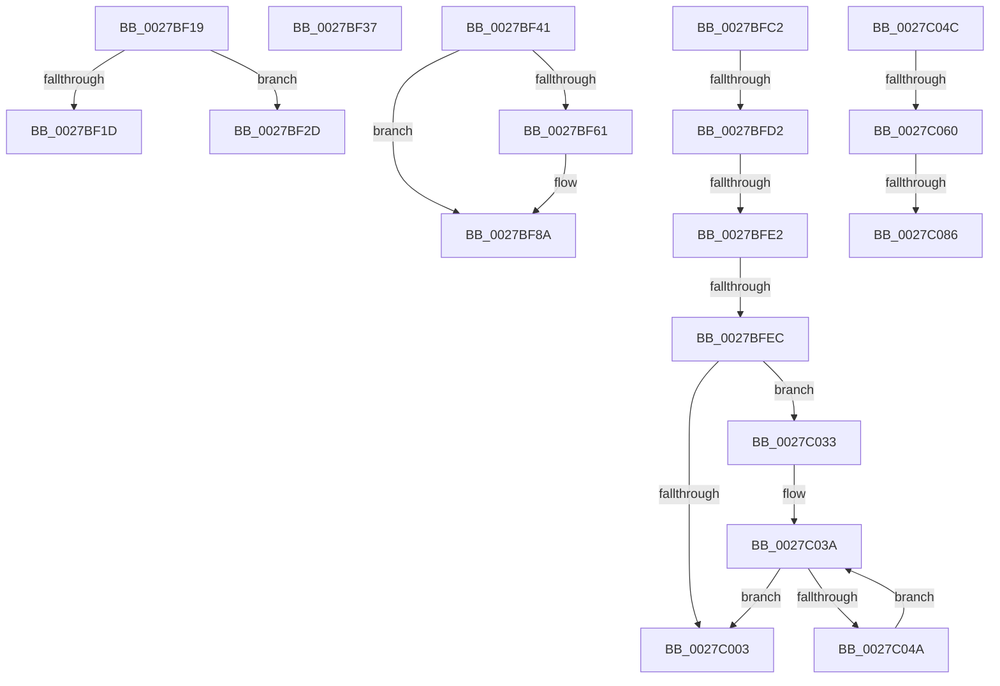

# sub_0027BF19

- RVA: `0x0027BF19`–`0x0027C08B` (길이 `370` bytes)
- VA: `0x000000014027BF19`
- 실행 섹션: `.text`
- PDB 이름 있음: `아니요`; PDB Function 태그: `아니요`
- unwind 정보 RVA: `0x000660A8`
- 디코드: `86`개 명령, `370/370` bytes 표시
- 미해석 바이트: `0` (있으면 어셈블리에 `.byte`로 보존)

> 이 문서는 커널 이미지의 기계어와 PDB 기호를 분석해 생성했습니다. 4번과 5번은 함수 원형과 자료형을 바이너리 사용 방식에서 추정한 C 해석이며 원본 소스 복구 결과는 아닙니다.

## 1. Dependencies

- 직접 호출 지점: **5**; 고유 호출 대상: **5**
- 직접 호출자로 확인된 함수: **0**
- RIP 상대 이미지 참조: **3**

### Outgoing calls
- `0x0027BF37` → [MiUnlockWorkingSetExclusive](MiUnlockWorkingSetExclusive_function_0027EC70.md) (function, `0x0027EC70`)
- `0x0027BF68` → [MiLockNestedPageTable](../23/MiLockNestedPageTable_function_0023E890.md) (function, `0x0023E890`)
- `0x0027BF81` → [MiUnlockPageTable](../21/MiUnlockPageTable_function_00216EC0.md) (function, `0x00216EC0`)
- `0x0027BFC5` → [MiIsPdeOrAboveAccessible](../22/MiIsPdeOrAboveAccessible_function_00227A10.md) (function, `0x00227A10`)
- `0x0027BFD5` → [MiIsLazyStampedPte](../22/MiIsLazyStampedPte_function_00227B10.md) (function, `0x00227B10`)

### Direct callers
- 이 함수 시작 RVA로 연결되는 직접 call은 확인되지 않았습니다. 간접 호출은 완전히 역산할 수 없습니다.

### Static image references
- `0x0027C04C` → RVA `0x00E37458` (`.data`; read)
- `0x0027C053` → RVA `0x00E37440` (`.data`; read)
- `0x0027C064` → RVA `0x00E2CB40` (`.data`; read)

## 2. Other-region calls and transfers

- 다른 실행 섹션으로 향하는 call: **0**
- call이 아닌 외부 분기/꼬리 이동: **11**
  - `0x0027BF28` → [sub_0027BB85 + 0x30E](Unknown_function_0027BB85.md) (`tail-transfer`)
  - `0x0027BF32` → [sub_0027BB85 + 0x30E](Unknown_function_0027BB85.md) (`tail-transfer`)
  - `0x0027BF3C` → [sub_0027BB85 + 0x98](Unknown_function_0027BB85.md) (`tail-transfer`)
  - `0x0027BFBD` → [sub_0027BB85 + 0x197](Unknown_function_0027BB85.md) (`tail-transfer`)
  - `0x0027BFCC` → [sub_0027BB85 + 0x34](Unknown_function_0027BB85.md) (`tail-transfer`)
  - `0x0027BFDC` → [sub_0027BB85 + 0x1F8](Unknown_function_0027BB85.md) (`tail-transfer`)
  - `0x0027BFE6` → [sub_0027BB85 + 0x1F8](Unknown_function_0027BB85.md) (`tail-transfer`)
  - `0x0027C02E` → [sub_0027BB85 + 0x197](Unknown_function_0027BB85.md) (`tail-transfer`)
  - `0x0027C05A` → [sub_0027BB85 + 0x1E2](Unknown_function_0027BB85.md) (`tail-transfer`)
  - `0x0027C080` → [sub_0027BB85 + 0x192](Unknown_function_0027BB85.md) (`tail-transfer`)
  - `0x0027C086` → [sub_0027BB85 + 0x1E2](Unknown_function_0027BB85.md) (`tail-transfer`)

## 3. Assembly (complete function range)

```asm
0027BF19  3C 07                           cmp al, 7
0027BF1B  74 10                           je 0x14027bf2d
0027BF1D  3C 05                           cmp al, 5
0027BF1F  B9 48 00 00 00                  mov ecx, 0x48
0027BF24  48 0F 44 CD                     cmove rcx, rbp
0027BF28  E9 66 FF FF FF                  jmp 0x14027be93
0027BF2D  B9 18 00 00 00                  mov ecx, 0x18
0027BF32  E9 5C FF FF FF                  jmp 0x14027be93
0027BF37  E8 34 2D 00 00                  call 0x14027ec70
0027BF3C  E9 DC FC FF FF                  jmp 0x14027bc1d
0027BF41  4C 8B B3 B8 00 00 00            mov r14, qword ptr [rbx + 0xb8]
0027BF48  48 BE F8 FF FF FF 7F 00 00 00   movabs rsi, 0x7ffffffff8
0027BF52  48 BD 00 00 00 00 80 F6 FF FF   movabs rbp, 0xfffff68000000000
0027BF5C  F6 C1 04                        test cl, 4
0027BF5F  74 29                           je 0x14027bf8a
0027BF61  48 8B 4B 20                     mov rcx, qword ptr [rbx + 0x20]
0027BF65  48 8B D7                        mov rdx, rdi
0027BF68  E8 23 29 FC FF                  call 0x14023e890
0027BF6D  48 8B D7                        mov rdx, rdi
0027BF70  48 C1 EA 09                     shr rdx, 9
0027BF74  48 23 D6                        and rdx, rsi
0027BF77  48 8B C5                        mov rax, rbp
0027BF7A  48 8B 4B 20                     mov rcx, qword ptr [rbx + 0x20]
0027BF7E  48 03 D0                        add rdx, rax
0027BF81  E8 3A AF F9 FF                  call 0x140216ec0
0027BF86  48 89 7B 38                     mov qword ptr [rbx + 0x38], rdi
0027BF8A  48 C1 E7 19                     shl rdi, 0x19
0027BF8E  48 8B C5                        mov rax, rbp
0027BF91  48 8B 4B 28                     mov rcx, qword ptr [rbx + 0x28]
0027BF95  48 C1 E0 19                     shl rax, 0x19
0027BF99  48 2B F8                        sub rdi, rax
0027BF9C  48 C1 E9 09                     shr rcx, 9
0027BFA0  48 C1 FF 10                     sar rdi, 0x10
0027BFA4  48 23 CE                        and rcx, rsi
0027BFA7  48 8B C5                        mov rax, rbp
0027BFAA  48 03 C8                        add rcx, rax
0027BFAD  B8 04 00 00 00                  mov eax, 4
0027BFB2  48 3B F9                        cmp rdi, rcx
0027BFB5  48 0F 42 F9                     cmovb rdi, rcx
0027BFB9  49 89 7E 08                     mov qword ptr [r14 + 8], rdi
0027BFBD  E9 5A FD FF FF                  jmp 0x14027bd1c
0027BFC2  48 8B CF                        mov rcx, rdi
0027BFC5  E8 46 BA FA FF                  call 0x140227a10
0027BFCA  85 C0                           test eax, eax
0027BFCC  0F 85 E7 FB FF FF               jne 0x14027bbb9
0027BFD2  49 8B CA                        mov rcx, r10
0027BFD5  E8 36 BB FA FF                  call 0x140227b10
0027BFDA  85 C0                           test eax, eax
0027BFDC  0F 85 9B FD FF FF               jne 0x14027bd7d
0027BFE2  8B 03                           mov eax, dword ptr [rbx]
0027BFE4  A8 40                           test al, 0x40
0027BFE6  0F 84 91 FD FF FF               je 0x14027bd7d
0027BFEC  48 8B 93 B8 00 00 00            mov rdx, qword ptr [rbx + 0xb8]
0027BFF3  48 BD 00 00 00 00 80 F6 FF FF   movabs rbp, 0xfffff68000000000
0027BFFD  89 32                           mov dword ptr [rdx], esi
0027BFFF  85 F6                           test esi, esi
0027C001  75 30                           jne 0x14027c033
0027C003  48 8B 4B 28                     mov rcx, qword ptr [rbx + 0x28]
0027C007  48 BE F8 FF FF FF 7F 00 00 00   movabs rsi, 0x7ffffffff8
0027C011  48 C1 E9 09                     shr rcx, 9
0027C015  48 23 CE                        and rcx, rsi
0027C018  48 8B C5                        mov rax, rbp
0027C01B  48 03 C8                        add rcx, rax
0027C01E  B8 04 00 00 00                  mov eax, 4
0027C023  48 3B F9                        cmp rdi, rcx
0027C026  48 0F 42 F9                     cmovb rdi, rcx
0027C02A  48 89 7A 08                     mov qword ptr [rdx + 8], rdi
0027C02E  E9 E9 FC FF FF                  jmp 0x14027bd1c
0027C033  48 8B C5                        mov rax, rbp
0027C036  48 C1 E0 19                     shl rax, 0x19
0027C03A  48 C1 E7 19                     shl rdi, 0x19
0027C03E  48 2B F8                        sub rdi, rax
0027C041  48 C1 FF 10                     sar rdi, 0x10
0027C045  83 EE 01                        sub esi, 1
0027C048  74 B9                           je 0x14027c003
0027C04A  EB EE                           jmp 0x14027c03a
0027C04C  48 8B 05 05 B4 BB 00            mov rax, qword ptr [rip + 0xbbb405]
0027C053  48 39 05 E6 B3 BB 00            cmp qword ptr [rip + 0xbbb3e6], rax
0027C05A  0F 84 07 FD FF FF               je 0x14027bd67
0027C060  49 C1 EA 0C                     shr r10, 0xc
0027C064  4C 8D 05 D5 0A BB 00            lea r8, [rip + 0xbb0ad5]
0027C06B  48 BA FF FF FF FF FF 00 00 00   movabs rdx, 0xffffffffff
0027C075  4C 23 D2                        and r10, rdx
0027C078  4D 3B 94 F0 00 A9 00 00         cmp r10, qword ptr [r8 + rsi*8 + 0xa900]
0027C080  0F 84 91 FC FF FF               je 0x14027bd17
0027C086  E9 DC FC FF FF                  jmp 0x14027bd67
```

## 4. C-style interpretation (structured pseudocode)

```c
__int64 __fastcall sub_0027BF19(void)
{
    if (((unsigned __int8)(result)) == 7) goto loc_0027BF2D;
    a1 = 72;
    if (((unsigned __int8)(result)) == 5) { a1 = v_rbp; }
loc_0027BF2D:
}
```

## 5. (Beta) C Style

```c
void sub_0027BF19(void)
{
    if (((uint8_t)(result)) == 7) goto loc_0027BF2D;
    a1 = 72;
    if (((uint8_t)(result)) == 5) { a1 = local_rbp; }
loc_0027BF2D:
}
```

## 6. Execution-region graph

[열기: 2D/3D 그래프와 함수 탐색 컨트롤 패널](../../../control-panel.html?section=text&rva=0x0027BF19&view=graph)

- 2D 그래프는 위에서 아래로 흐르고, 3D 그래프는 빈 공간을 드래그해 회전합니다. Shift+드래그는 이동, 휠은 확대·축소, 함수 노드 선택은 대상 보고서 이동입니다.

### Static fallback


