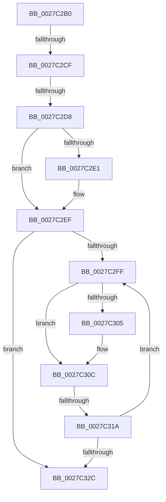

# sub_0027C2B0

- RVA: `0x0027C2B0`–`0x0027C340` (길이 `144` bytes)
- VA: `0x000000014027C2B0`
- 실행 섹션: `.text`
- PDB 이름 있음: `아니요`; PDB Function 태그: `아니요`
- unwind 정보 RVA: `0x000660D8`
- 디코드: `38`개 명령, `144/144` bytes 표시
- 미해석 바이트: `0` (있으면 어셈블리에 `.byte`로 보존)

> 이 문서는 커널 이미지의 기계어와 PDB 기호를 분석해 생성했습니다. 4번과 5번은 함수 원형과 자료형을 바이너리 사용 방식에서 추정한 C 해석이며 원본 소스 복구 결과는 아닙니다.

## 1. Dependencies

- 직접 호출 지점: **1**; 고유 호출 대상: **1**
- 직접 호출자로 확인된 함수: **0**
- RIP 상대 이미지 참조: **3**

### Outgoing calls
- `0x0027C2E8` → [ExpWaitForSpinLockExclusiveAndAcquire](../32/ExpWaitForSpinLockExclusiveAndAcquire_function_003239A0.md) (function, `0x003239A0`)

### Direct callers
- 이 함수 시작 RVA로 연결되는 직접 call은 확인되지 않았습니다. 간접 호출은 완전히 역산할 수 없습니다.

### Static image references
- `0x0027C2C2` → RVA `0x00FC6D20` (`ALMOSTRO`; read)
- `0x0027C2CF` → RVA `0x00FC6B06` (`ALMOSTRO`; read)
- `0x0027C30E` → RVA `0x00FC52AC` (`ALMOSTRO`; reference)

## 2. Other-region calls and transfers

- 다른 실행 섹션으로 향하는 call: **0**
- call이 아닌 외부 분기/꼬리 이동: **3**
  - `0x0027C2C9` → [sub_0027C341 + 0x2B](Unknown_function_0027C341.md) (`tail-transfer`)
  - `0x0027C2D6` → [sub_0027C341](Unknown_function_0027C341.md) (`tail-transfer`)
  - `0x0027C314` → [sub_0027C3A4](Unknown_function_0027C3A4.md) (`tail-transfer`)

## 3. Assembly (complete function range)

```asm
0027C2B0  48 89 74 24 40                  mov qword ptr [rsp + 0x40], rsi
0027C2B5  44 0F 20 C6                     mov rsi, cr8
0027C2B9  B8 02 00 00 00                  mov eax, 2
0027C2BE  44 0F 22 C0                     mov cr8, rax
0027C2C2  83 3D 57 AA D4 00 00            cmp dword ptr [rip + 0xd4aa57], 0
0027C2C9  0F 85 9D 00 00 00               jne 0x14027c36c
0027C2CF  F6 05 30 A8 D4 00 21            test byte ptr [rip + 0xd4a830], 0x21
0027C2D6  75 69                           jne 0x14027c341
0027C2D8  33 FF                           xor edi, edi
0027C2DA  F0 0F BA 2B 1F                  lock bts dword ptr [rbx], 0x1f
0027C2DF  73 0E                           jae 0x14027c2ef
0027C2E1  40 0F B6 D6                     movzx edx, sil
0027C2E5  48 8B CB                        mov rcx, rbx
0027C2E8  E8 B3 76 0A 00                  call 0x1403239a0
0027C2ED  8B F8                           mov edi, eax
0027C2EF  8B 03                           mov eax, dword ptr [rbx]
0027C2F1  8B C8                           mov ecx, eax
0027C2F3  0F BA F1 1E                     btr ecx, 0x1e
0027C2F7  81 F9 00 00 00 80               cmp ecx, 0x80000000
0027C2FD  74 2D                           je 0x14027c32c
0027C2FF  0F BA E0 1E                     bt eax, 0x1e
0027C303  72 07                           jb 0x14027c30c
0027C305  F0 81 0B 00 00 00 40            lock or dword ptr [rbx], 0x40000000
0027C30C  FF C7                           inc edi
0027C30E  85 3D 98 8F D4 00               test dword ptr [rip + 0xd48f98], edi
0027C314  0F 84 8A 00 00 00               je 0x14027c3a4
0027C31A  F3 90                           pause
0027C31C  8B 03                           mov eax, dword ptr [rbx]
0027C31E  8B C8                           mov ecx, eax
0027C320  0F BA F1 1E                     btr ecx, 0x1e
0027C324  81 F9 00 00 00 80               cmp ecx, 0x80000000
0027C32A  75 D3                           jne 0x14027c2ff
0027C32C  40 0F B6 C6                     movzx eax, sil
0027C330  48 8B 74 24 40                  mov rsi, qword ptr [rsp + 0x40]
0027C335  48 8B 5C 24 48                  mov rbx, qword ptr [rsp + 0x48]
0027C33A  48 83 C4 20                     add rsp, 0x20
0027C33E  5F                              pop rdi
0027C33F  C3                              ret
```

## 4. C-style interpretation (structured pseudocode)

```c
__int64 __fastcall sub_0027C2B0(__int64 a1, __int64 a2, __int64 a3, __int64 a4, __int64 a5, __int64 a6, __int64 a7, __int64 a8, __int64 a9)
{
    __int64 result;
    __int64 v_rdi;
    __int64 v_rsp;
    unsigned __int64 v_stack_p40;

    v_stack_p40 = v_rsi;
    v_rdi = 0;
    result = 2;
    if (!(condition_is_above_or_equal)) {
        a2 = (unsigned __int8)(v_cr8);
        a1 = v_rbx;
        result = ExpWaitForSpinLockExclusiveAndAcquire(a1, a2, a3, a4);
        v_rdi = (unsigned int)(result);
    }
    if (((unsigned int)((unsigned int)((unsigned int)((unsigned int)(*(unsigned int *)(v_rbx)))))) == 0x80000000ULL) goto loc_0027C32C;
loc_0027C2FF:
    if (((unsigned int)((unsigned int)((unsigned int)((unsigned int)(*(unsigned int *)(v_rbx)))))) >= 0x80000000ULL) {
    }
    v_rdi = (unsigned int)((v_rdi) + 1);
    if (((unsigned int)((unsigned int)((unsigned int)((unsigned int)(*(unsigned int *)(v_rbx)))))) != 0x80000000ULL) goto loc_0027C2FF;
loc_0027C32C:
    v_rsp = (v_rsp) + (32);
    return (unsigned __int8)(v_cr8);
}
```

## 5. (Beta) C Style

```c
int64_t sub_0027C2B0(int64_t Arg1, int64_t Arg2, int64_t Arg3, int64_t Arg4, uint64_t Arg5, uint64_t Arg6, uint64_t Arg7, int64_t Arg8, int64_t Arg9)
{
    int64_t result;
    int64_t local_rdi;
    int64_t local_rsp;
    uint64_t v_stack_p40;

    v_stack_p40 = local_rsi;
    local_rdi = 0;
    result = 2;
    if (!(condition_is_above_or_equal)) {
        Arg2 = (uint8_t)(v_cr8);
        Arg1 = local_rbx;
        result = ExpWaitForSpinLockExclusiveAndAcquire(Arg1, Arg2, Arg3, Arg4);
        local_rdi = (uint32_t)(result);
    }
    if (((uint32_t)((uint32_t)((uint32_t)((uint32_t)(*(uint32_t *)(local_rbx)))))) == 0x80000000ULL) goto loc_0027C32C;
loc_0027C2FF:
    if (((uint32_t)((uint32_t)((uint32_t)((uint32_t)(*(uint32_t *)(local_rbx)))))) >= 0x80000000ULL) {
    }
    local_rdi = (uint32_t)((local_rdi) + 1);
    if (((uint32_t)((uint32_t)((uint32_t)((uint32_t)(*(uint32_t *)(local_rbx)))))) != 0x80000000ULL) goto loc_0027C2FF;
loc_0027C32C:
    local_rsp = (local_rsp) + (32);
    return (uint8_t)(v_cr8);
}
```

## 6. Execution-region graph

[열기: 2D/3D 그래프와 함수 탐색 컨트롤 패널](../../../control-panel.html?section=text&rva=0x0027C2B0&view=graph)

- 2D 그래프는 위에서 아래로 흐르고, 3D 그래프는 빈 공간을 드래그해 회전합니다. Shift+드래그는 이동, 휠은 확대·축소, 함수 노드 선택은 대상 보고서 이동입니다.

### Static fallback


