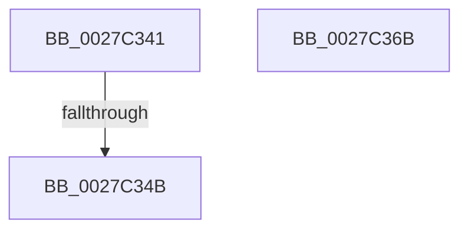

# sub_0027C341

- RVA: `0x0027C341`–`0x0027C37D` (길이 `60` bytes)
- VA: `0x000000014027C341`
- 실행 섹션: `.text`
- PDB 이름 있음: `아니요`; PDB Function 태그: `아니요`
- unwind 정보 RVA: `0x00066100`
- 디코드: `17`개 명령, `60/60` bytes 표시
- 미해석 바이트: `0` (있으면 어셈블리에 `.byte`로 보존)

> 이 문서는 커널 이미지의 기계어와 PDB 기호를 분석해 생성했습니다. 4번과 5번은 함수 원형과 자료형을 바이너리 사용 방식에서 추정한 C 해석이며 원본 소스 복구 결과는 아닙니다.

## 1. Dependencies

- 직접 호출 지점: **2**; 고유 호출 대상: **2**
- 직접 호출자로 확인된 함수: **0**
- RIP 상대 이미지 참조: **1**

### Outgoing calls
- `0x0027C352` → [ExpAcquireSpinLockExclusiveAtDpcLevelInstrumented](../32/ExpAcquireSpinLockExclusiveAtDpcLevelInstrumented_function_00323A70.md) (function, `0x00323A70`)
- `0x0027C373` → [KiRaiseIrqlProcessIrqlFlags](../4F/KiRaiseIrqlProcessIrqlFlags_function_004F56FC.md) (function, `0x004F56FC`)

### Direct callers
- 이 함수 시작 RVA로 연결되는 직접 call은 확인되지 않았습니다. 간접 호출은 완전히 역산할 수 없습니다.

### Static image references
- `0x0027C341` → RVA `0x00F0DE58` (`.data`; read)

## 2. Other-region calls and transfers

- 다른 실행 섹션으로 향하는 call: **0**
- call이 아닌 외부 분기/꼬리 이동: **2**
  - `0x0027C349` → [sub_0027C2B0 + 0x28](Unknown_function_0027C2B0.md) (`tail-transfer`)
  - `0x0027C378` → [sub_0027C2B0 + 0x1F](Unknown_function_0027C2B0.md) (`tail-transfer`)

## 3. Assembly (complete function range)

```asm
0027C341  8B 05 11 1B C9 00               mov eax, dword ptr [rip + 0xc91b11]
0027C347  85 C0                           test eax, eax
0027C349  75 8D                           jne 0x14027c2d8
0027C34B  40 0F B6 D6                     movzx edx, sil
0027C34F  48 8B CB                        mov rcx, rbx
0027C352  E8 19 77 0A 00                  call 0x140323a70
0027C357  48 8B 5C 24 48                  mov rbx, qword ptr [rsp + 0x48]
0027C35C  40 0F B6 C6                     movzx eax, sil
0027C360  48 8B 74 24 40                  mov rsi, qword ptr [rsp + 0x40]
0027C365  48 83 C4 20                     add rsp, 0x20
0027C369  5F                              pop rdi
0027C36A  C3                              ret
0027C36B  CC                              int3
0027C36C  0F B6 D0                        movzx edx, al
0027C36F  40 0F B6 CE                     movzx ecx, sil
0027C373  E8 84 93 27 00                  call 0x1404f56fc
0027C378  E9 52 FF FF FF                  jmp 0x14027c2cf
```

## 4. C-style interpretation (structured pseudocode)

```c
__int64 __fastcall sub_0027C341(__int64 a1, __int64 a2, __int64 a3, __int64 a4, __int64 a5, __int64 a6, __int64 a7, __int64 a8, __int64 a9)
{
    __int64 result;
    __int64 v_rsp;

    result = ExpAcquireSpinLockExclusiveAtDpcLevelInstrumented(v_rbx, (unsigned __int8)(v_rsi), a3, a4);
    v_rsp = (v_rsp) + (32);
    return (unsigned __int8)(v_rsi);
}
```

## 5. (Beta) C Style

```c
int64_t sub_0027C341(int64_t Arg1, int64_t Arg2, int64_t Arg3, int64_t Arg4, uint64_t Arg5, uint64_t Arg6, uint64_t Arg7, int64_t Arg8, int64_t Arg9)
{
    int64_t result;
    int64_t local_rsp;

    result = ExpAcquireSpinLockExclusiveAtDpcLevelInstrumented(local_rbx, (uint8_t)(local_rsi), Arg3, Arg4);
    local_rsp = (local_rsp) + (32);
    return (uint8_t)(local_rsi);
}
```

## 6. Execution-region graph

[열기: 2D/3D 그래프와 함수 탐색 컨트롤 패널](../../../control-panel.html?section=text&rva=0x0027C341&view=graph)

- 2D 그래프는 위에서 아래로 흐르고, 3D 그래프는 빈 공간을 드래그해 회전합니다. Shift+드래그는 이동, 휠은 확대·축소, 함수 노드 선택은 대상 보고서 이동입니다.

### Static fallback


