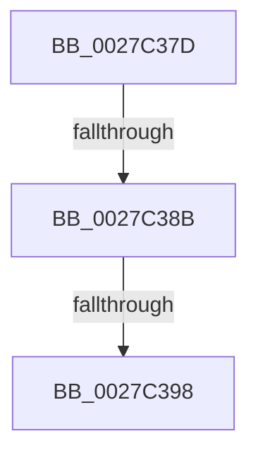

# sub_0027C37D

- RVA: `0x0027C37D`–`0x0027C3A4` (길이 `39` bytes)
- VA: `0x000000014027C37D`
- 실행 섹션: `.text`
- PDB 이름 있음: `아니요`; PDB Function 태그: `아니요`
- unwind 정보 RVA: `0x00066118`
- 디코드: `9`개 명령, `39/39` bytes 표시
- 미해석 바이트: `0` (있으면 어셈블리에 `.byte`로 보존)

> 이 문서는 커널 이미지의 기계어와 PDB 기호를 분석해 생성했습니다. 4번과 5번은 함수 원형과 자료형을 바이너리 사용 방식에서 추정한 C 해석이며 원본 소스 복구 결과는 아닙니다.

## 1. Dependencies

- 직접 호출 지점: **2**; 고유 호출 대상: **2**
- 직접 호출자로 확인된 함수: **0**
- RIP 상대 이미지 참조: **1**

### Outgoing calls
- `0x0027C38B` → [KiCheckVpBackingLongSpinWaitHypercall](../30/KiCheckVpBackingLongSpinWaitHypercall_function_0030F490.md) (function, `0x0030F490`)
- `0x0027C39A` → [HvlNotifyLongSpinWait](../30/HvlNotifyLongSpinWait_function_0030F460.md) (function, `0x0030F460`)

### Direct callers
- 이 함수 시작 RVA로 연결되는 직접 call은 확인되지 않았습니다. 간접 호출은 완전히 역산할 수 없습니다.

### Static image references
- `0x0027C37D` → RVA `0x00FC6AB8` (`ALMOSTRO`; read)

## 2. Other-region calls and transfers

- 다른 실행 섹션으로 향하는 call: **0**
- call이 아닌 외부 분기/꼬리 이동: **3**
  - `0x0027C385` → [MiLockVadTree + 0x128](MiLockVadTree_function_0027C0F0.md) (`tail-transfer`)
  - `0x0027C392` → [MiLockVadTree + 0x128](MiLockVadTree_function_0027C0F0.md) (`tail-transfer`)
  - `0x0027C39F` → [MiLockVadTree + 0x12A](MiLockVadTree_function_0027C0F0.md) (`tail-transfer`)

## 3. Assembly (complete function range)

```asm
0027C37D  8B 05 35 A7 D4 00               mov eax, dword ptr [rip + 0xd4a735]
0027C383  A8 40                           test al, 0x40
0027C385  0F 84 8D FE FF FF               je 0x14027c218
0027C38B  E8 00 31 09 00                  call 0x14030f490
0027C390  84 C0                           test al, al
0027C392  0F 84 80 FE FF FF               je 0x14027c218
0027C398  8B CF                           mov ecx, edi
0027C39A  E8 C1 30 09 00                  call 0x14030f460
0027C39F  E9 76 FE FF FF                  jmp 0x14027c21a
```

## 4. C-style interpretation (structured pseudocode)

```c
__int64 __fastcall sub_0027C37D(void)
{
    __int64 result;

    result = KiCheckVpBackingLongSpinWaitHypercall(a1, a2, a3, a4);
    result = HvlNotifyLongSpinWait((unsigned int)((unsigned int)(v_rdi)), a2, a3, a4);
}
```

## 5. (Beta) C Style

```c
void sub_0027C37D(void)
{
    int64_t result;

    result = KiCheckVpBackingLongSpinWaitHypercall(a1, a2, a3, a4);
    result = HvlNotifyLongSpinWait((uint32_t)((uint32_t)(local_rdi)), a2, a3, a4);
}
```

## 6. Execution-region graph

[열기: 2D/3D 그래프와 함수 탐색 컨트롤 패널](../../../control-panel.html?section=text&rva=0x0027C37D&view=graph)

- 2D 그래프는 위에서 아래로 흐르고, 3D 그래프는 빈 공간을 드래그해 회전합니다. Shift+드래그는 이동, 휠은 확대·축소, 함수 노드 선택은 대상 보고서 이동입니다.

### Static fallback


