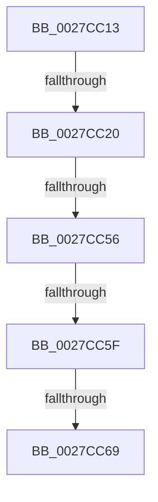

# sub_0027CC13

- RVA: `0x0027CC13`–`0x0027CC8F` (길이 `124` bytes)
- VA: `0x000000014027CC13`
- 실행 섹션: `.text`
- PDB 이름 있음: `아니요`; PDB Function 태그: `아니요`
- unwind 정보 RVA: `0x00066184`
- 디코드: `29`개 명령, `124/124` bytes 표시
- 미해석 바이트: `0` (있으면 어셈블리에 `.byte`로 보존)

> 이 문서는 커널 이미지의 기계어와 PDB 기호를 분석해 생성했습니다. 4번과 5번은 함수 원형과 자료형을 바이너리 사용 방식에서 추정한 C 해석이며 원본 소스 복구 결과는 아닙니다.

## 1. Dependencies

- 직접 호출 지점: **1**; 고유 호출 대상: **1**
- 직접 호출자로 확인된 함수: **0**
- RIP 상대 이미지 참조: **4**

### Outgoing calls
- `0x0027CC70` → [ExpAcquireSpinLockSharedAtDpcLevelInstrumented](ExpAcquireSpinLockSharedAtDpcLevelInstrumented_function_0027CD20.md) (function, `0x0027CD20`)

### Direct callers
- 이 함수 시작 RVA로 연결되는 직접 call은 확인되지 않았습니다. 간접 호출은 완전히 역산할 수 없습니다.

### Static image references
- `0x0027CC20` → RVA `0x00E38840` (`.data`; read)
- `0x0027CC4D` → RVA `0x00FC6D20` (`ALMOSTRO`; read)
- `0x0027CC56` → RVA `0x00FC6B06` (`ALMOSTRO`; read)
- `0x0027CC5F` → RVA `0x00F0DE58` (`.data`; read)

## 2. Other-region calls and transfers

- 다른 실행 섹션으로 향하는 call: **0**
- call이 아닌 외부 분기/꼬리 이동: **5**
  - `0x0027CC1A` → [sub_0027CD07](Unknown_function_0027CD07.md) (`tail-transfer`)
  - `0x0027CC54` → [sub_0027CCA5 + 0x24](Unknown_function_0027CCA5.md) (`tail-transfer`)
  - `0x0027CC5D` → [sub_0027CCA5](Unknown_function_0027CCA5.md) (`tail-transfer`)
  - `0x0027CC67` → [sub_0027CCA5](Unknown_function_0027CCA5.md) (`tail-transfer`)
  - `0x0027CC8D` → [sub_0027CC8F + 0x6](Unknown_function_0027CC8F.md) (`tail-transfer`)

## 3. Assembly (complete function range)

```asm
0027CC13  48 89 7C 24 38                  mov qword ptr [rsp + 0x38], rdi
0027CC18  3C 01                           cmp al, 1
0027CC1A  0F 85 E7 00 00 00               jne 0x14027cd07
0027CC20  48 8D 05 19 BC BB 00            lea rax, [rip + 0xbbbc19]
0027CC27  65 8B 1C 25 A4 01 00 00         mov ebx, dword ptr gs:[0x1a4]
0027CC2F  48 8B 00                        mov rax, qword ptr [rax]
0027CC32  D1 EB                           shr ebx, 1
0027CC34  83 E3 03                        and ebx, 3
0027CC37  8B FB                           mov edi, ebx
0027CC39  48 C1 E7 06                     shl rdi, 6
0027CC3D  48 03 F8                        add rdi, rax
0027CC40  44 0F 20 C6                     mov rsi, cr8
0027CC44  B9 02 00 00 00                  mov ecx, 2
0027CC49  44 0F 22 C1                     mov cr8, rcx
0027CC4D  83 3D CC A0 D4 00 00            cmp dword ptr [rip + 0xd4a0cc], 0
0027CC54  75 73                           jne 0x14027ccc9
0027CC56  F6 05 A9 9E D4 00 21            test byte ptr [rip + 0xd49ea9], 0x21
0027CC5D  74 46                           je 0x14027cca5
0027CC5F  8B 05 F3 11 C9 00               mov eax, dword ptr [rip + 0xc911f3]
0027CC65  85 C0                           test eax, eax
0027CC67  75 3C                           jne 0x14027cca5
0027CC69  40 0F B6 D6                     movzx edx, sil
0027CC6D  48 8B CF                        mov rcx, rdi
0027CC70  E8 AB 00 00 00                  call 0x14027cd20
0027CC75  65 48 8B 0C 25 20 00 00 00      mov rcx, qword ptr gs:[0x20]
0027CC7E  48 8B 7C 24 38                  mov rdi, qword ptr [rsp + 0x38]
0027CC83  48 8B 89 38 88 00 00            mov rcx, qword ptr [rcx + 0x8838]
0027CC8A  48 85 C9                        test rcx, rcx
0027CC8D  74 06                           je 0x14027cc95
```

## 4. C-style interpretation (structured pseudocode)

```c
__int64 __fastcall sub_0027CC13(__int64 a1, __int64 a2, __int64 a3, __int64 a4, __int64 a5, __int64 a6, __int64 a7)
{
    __int64 result;
    __int64 v_rbx;
    __int64 v_rdi;
    unsigned __int64 v_stack_p38;

    v_stack_p38 = v_rdi;
    v_rbx = (unsigned int)(((unsigned int)(*(unsigned int *)(gs_base + (0 + 420)))) >> (1));
    v_rbx = (unsigned int)((v_rbx) & (3));
    v_rdi = ((unsigned int)((unsigned int)(v_rbx))) << (6);
    v_rdi = (v_rdi) + (*(unsigned __int64 *)(v_rip + 12303385));
    result = ExpAcquireSpinLockSharedAtDpcLevelInstrumented(v_rdi, (unsigned __int8)(v_cr8), a3, a4);
}
```

## 5. (Beta) C Style

```c
int64_t sub_0027CC13(int64_t Arg1, int64_t Arg2, int64_t Arg3, int64_t Arg4, uint64_t Arg5, uint64_t Arg6, int64_t Arg7)
{
    int64_t result;
    int64_t local_rbx;
    int64_t local_rdi;
    uint64_t v_stack_p38;

    v_stack_p38 = local_rdi;
    local_rbx = (uint32_t)(((uint32_t)(*(uint32_t *)(gs_base + (0 + 0x1A4)))) >> (1));
    local_rbx = (uint32_t)((local_rbx) & (3));
    local_rdi = ((uint32_t)((uint32_t)(local_rbx))) << (6);
    local_rdi = (local_rdi) + (*(uint64_t *)(v_rip + 0xBBBC19));
    result = ExpAcquireSpinLockSharedAtDpcLevelInstrumented(local_rdi, (uint8_t)(v_cr8), Arg3, Arg4);
}
```

## 6. Execution-region graph

[열기: 2D/3D 그래프와 함수 탐색 컨트롤 패널](../../../control-panel.html?section=text&rva=0x0027CC13&view=graph)

- 2D 그래프는 위에서 아래로 흐르고, 3D 그래프는 빈 공간을 드래그해 회전합니다. Shift+드래그는 이동, 휠은 확대·축소, 함수 노드 선택은 대상 보고서 이동입니다.

### Static fallback


