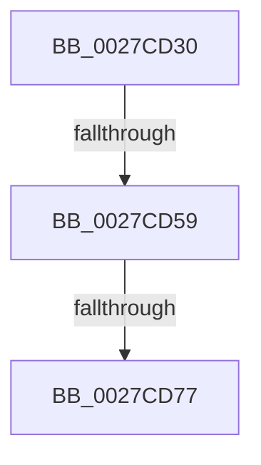

# sub_0027CD30

- RVA: `0x0027CD30`–`0x0027CD86` (길이 `86` bytes)
- VA: `0x000000014027CD30`
- 실행 섹션: `.text`
- PDB 이름 있음: `아니요`; PDB Function 태그: `아니요`
- unwind 정보 RVA: `0x00066210`
- 디코드: `22`개 명령, `86/86` bytes 표시
- 미해석 바이트: `0` (있으면 어셈블리에 `.byte`로 보존)

> 이 문서는 커널 이미지의 기계어와 PDB 기호를 분석해 생성했습니다. 4번과 5번은 함수 원형과 자료형을 바이너리 사용 방식에서 추정한 C 해석이며 원본 소스 복구 결과는 아닙니다.

## 1. Dependencies

- 직접 호출 지점: **0**; 고유 호출 대상: **0**
- 직접 호출자로 확인된 함수: **0**
- RIP 상대 이미지 참조: **1**

### Outgoing calls
- 직접 디코드된 call 명령이 없습니다.

### Direct callers
- 이 함수 시작 RVA로 연결되는 직접 call은 확인되지 않았습니다. 간접 호출은 완전히 역산할 수 없습니다.

### Static image references
- `0x0027CD45` → RVA `0x00FC6B06` (`ALMOSTRO`; read)

## 2. Other-region calls and transfers

- 다른 실행 섹션으로 향하는 call: **0**
- call이 아닌 외부 분기/꼬리 이동: **3**
  - `0x0027CD57` → [sub_0027CD98 + 0x21](Unknown_function_0027CD98.md) (`tail-transfer`)
  - `0x0027CD75` → [sub_0027CD98](Unknown_function_0027CD98.md) (`tail-transfer`)
  - `0x0027CD84` → [sub_0027CDDA](Unknown_function_0027CDDA.md) (`tail-transfer`)

## 3. Assembly (complete function range)

```asm
0027CD30  48 89 74 24 40                  mov qword ptr [rsp + 0x40], rsi
0027CD35  45 33 C9                        xor r9d, r9d
0027CD38  65 48 8B 34 25 20 00 00 00      mov rsi, qword ptr gs:[0x20]
0027CD41  44 0F B6 C2                     movzx r8d, dl
0027CD45  F6 05 BA 9D D4 00 01            test byte ptr [rip + 0xd49dba], 1
0027CD4C  48 8B D9                        mov rbx, rcx
0027CD4F  48 89 7C 24 48                  mov qword ptr [rsp + 0x48], rdi
0027CD54  45 8B F1                        mov r14d, r9d
0027CD57  75 60                           jne 0x14027cdb9
0027CD59  40 32 FF                        xor dil, dil
0027CD5C  41 8B E9                        mov ebp, r9d
0027CD5F  FF 86 C0 8E 00 00               inc dword ptr [rsi + 0x8ec0]
0027CD65  0F 0D 09                        prefetchw byte ptr [rcx]
0027CD68  8B 01                           mov eax, dword ptr [rcx]
0027CD6A  0F BA F0 1F                     btr eax, 0x1f
0027CD6E  8D 48 01                        lea ecx, [rax + 1]
0027CD71  F0 0F B1 0B                     lock cmpxchg dword ptr [rbx], ecx
0027CD75  75 21                           jne 0x14027cd98
0027CD77  48 8B 74 24 40                  mov rsi, qword ptr [rsp + 0x40]
0027CD7C  40 84 FF                        test dil, dil
0027CD7F  48 8B 7C 24 48                  mov rdi, qword ptr [rsp + 0x48]
0027CD84  75 54                           jne 0x14027cdda
```

## 4. C-style interpretation (structured pseudocode)

```c
__int64 __fastcall sub_0027CD30(__int64 a1, unsigned __int8 a2, __int64 a3, int a4, __int64 a5, __int64 a6, __int64 a7, __int64 a8, __int64 a9)
{
    __int64 v_rdi;
    unsigned __int64 v_stack_p40;
    unsigned __int64 v_stack_p48;

    v_stack_p40 = v_rsi;
    a4 = 0;
    v_stack_p48 = v_rdi;
    v_rdi = 0;
}
```

## 5. (Beta) C Style

```c
int64_t sub_0027CD30(void *Arg1, uint8_t Arg2, int64_t Arg3, int32_t Arg4, uint64_t Arg5, uint64_t Arg6, uint64_t Arg7, int64_t Arg8, int64_t Arg9)
{
    uint8_t *arg1 = (uint8_t *)Arg1;

    int64_t local_rdi;
    uint64_t v_stack_p40;
    uint64_t v_stack_p48;

    v_stack_p40 = local_rsi;
    Arg4 = 0;
    v_stack_p48 = local_rdi;
    local_rdi = 0;
}
```

### 관측된 메모리 오프셋

구조체 형식이 확인되지 않은 접근은 인자 기준의 오프셋으로만 기록했습니다.

| 기준 인자 | 오프셋 표현 | 폭 (bit) | 접근 |
|---|---:|---:|---|
| `Arg1` | `+ 0x0` | `8` | `R` |
| `Arg1` | `+ 0x0` | `32` | `R` |

## 6. Execution-region graph

[열기: 2D/3D 그래프와 함수 탐색 컨트롤 패널](../../../control-panel.html?section=text&rva=0x0027CD30&view=graph)

- 2D 그래프는 위에서 아래로 흐르고, 3D 그래프는 빈 공간을 드래그해 회전합니다. Shift+드래그는 이동, 휠은 확대·축소, 함수 노드 선택은 대상 보고서 이동입니다.

### Static fallback


