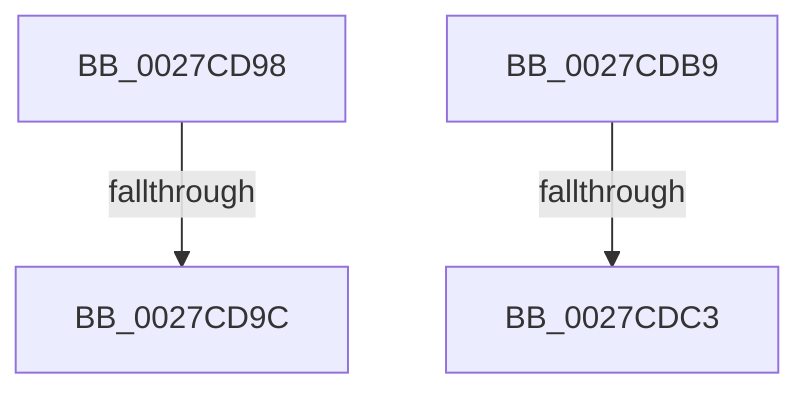

# sub_0027CD98

- RVA: `0x0027CD98`–`0x0027CDDA` (길이 `66` bytes)
- VA: `0x000000014027CD98`
- 실행 섹션: `.text`
- PDB 이름 있음: `아니요`; PDB Function 태그: `아니요`
- unwind 정보 RVA: `0x0006623C`
- 디코드: `19`개 명령, `66/66` bytes 표시
- 미해석 바이트: `0` (있으면 어셈블리에 `.byte`로 보존)

> 이 문서는 커널 이미지의 기계어와 PDB 기호를 분석해 생성했습니다. 4번과 5번은 함수 원형과 자료형을 바이너리 사용 방식에서 추정한 C 해석이며 원본 소스 복구 결과는 아닙니다.

## 1. Dependencies

- 직접 호출 지점: **1**; 고유 호출 대상: **1**
- 직접 호출자로 확인된 함수: **0**
- RIP 상대 이미지 참조: **1**

### Outgoing calls
- `0x0027CDA3` → [ExpWaitForSpinLockSharedAndAcquire](../36/ExpWaitForSpinLockSharedAndAcquire_function_00362380.md) (function, `0x00362380`)

### Direct callers
- 이 함수 시작 RVA로 연결되는 직접 call은 확인되지 않았습니다. 간접 호출은 완전히 역산할 수 없습니다.

### Static image references
- `0x0027CDB9` → RVA `0x00F0DE58` (`.data`; read)

## 2. Other-region calls and transfers

- 다른 실행 섹션으로 향하는 call: **0**
- call이 아닌 외부 분기/꼬리 이동: **4**
  - `0x0027CD9A` → [sub_0027CD30 + 0x3E](Unknown_function_0027CD30.md) (`tail-transfer`)
  - `0x0027CDB7` → [sub_0027CD30 + 0x47](Unknown_function_0027CD30.md) (`tail-transfer`)
  - `0x0027CDC1` → [sub_0027CD30 + 0x29](Unknown_function_0027CD30.md) (`tail-transfer`)
  - `0x0027CDD8` → [sub_0027CD30 + 0x2F](Unknown_function_0027CD30.md) (`tail-transfer`)

## 3. Assembly (complete function range)

```asm
0027CD98  85 C0                           test eax, eax
0027CD9A  79 D2                           jns 0x14027cd6e
0027CD9C  41 0F B6 D0                     movzx edx, r8b
0027CDA0  48 8B CB                        mov rcx, rbx
0027CDA3  E8 D8 55 0E 00                  call 0x140362380
0027CDA8  FF 86 C4 8E 00 00               inc dword ptr [rsi + 0x8ec4]
0027CDAE  44 8B C8                        mov r9d, eax
0027CDB1  01 86 C8 8E 00 00               add dword ptr [rsi + 0x8ec8], eax
0027CDB7  EB BE                           jmp 0x14027cd77
0027CDB9  8B 05 99 10 C9 00               mov eax, dword ptr [rip + 0xc91099]
0027CDBF  85 C0                           test eax, eax
0027CDC1  75 96                           jne 0x14027cd59
0027CDC3  40 B7 01                        mov dil, 1
0027CDC6  0F 31                           rdtsc
0027CDC8  8B AE 40 86 00 00               mov ebp, dword ptr [rsi + 0x8640]
0027CDCE  48 C1 E2 20                     shl rdx, 0x20
0027CDD2  48 0B C2                        or rax, rdx
0027CDD5  4C 8B F0                        mov r14, rax
0027CDD8  EB 85                           jmp 0x14027cd5f
```

## 4. C-style interpretation (structured pseudocode)

```c
__int64 __fastcall sub_0027CD98(__int64 a1, __int64 a2, unsigned __int8 a3)
{
    __int64 result;

    result = ExpWaitForSpinLockSharedAndAcquire(v_rbx, a3, a3, a4);
}
```

## 5. (Beta) C Style

```c
int64_t sub_0027CD98(int64_t Arg1, int64_t Arg2, uint8_t Arg3)
{
    int64_t result;

    result = ExpWaitForSpinLockSharedAndAcquire(local_rbx, Arg3, Arg3, a4);
}
```

## 6. Execution-region graph

[열기: 2D/3D 그래프와 함수 탐색 컨트롤 패널](../../../control-panel.html?section=text&rva=0x0027CD98&view=graph)

- 2D 그래프는 위에서 아래로 흐르고, 3D 그래프는 빈 공간을 드래그해 회전합니다. Shift+드래그는 이동, 휠은 확대·축소, 함수 노드 선택은 대상 보고서 이동입니다.

### Static fallback


