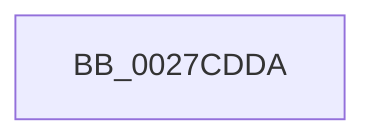

# sub_0027CDDA

- RVA: `0x0027CDDA`–`0x0027CDFF` (길이 `37` bytes)
- VA: `0x000000014027CDDA`
- 실행 섹션: `.text`
- PDB 이름 있음: `아니요`; PDB Function 태그: `아니요`
- unwind 정보 RVA: `0x00066254`
- 디코드: `11`개 명령, `37/37` bytes 표시
- 미해석 바이트: `0` (있으면 어셈블리에 `.byte`로 보존)

> 이 문서는 커널 이미지의 기계어와 PDB 기호를 분석해 생성했습니다. 4번과 5번은 함수 원형과 자료형을 바이너리 사용 방식에서 추정한 C 해석이며 원본 소스 복구 결과는 아닙니다.

## 1. Dependencies

- 직접 호출 지점: **1**; 고유 호출 대상: **1**
- 직접 호출자로 확인된 함수: **0**
- RIP 상대 이미지 참조: **0**

### Outgoing calls
- `0x0027CDF8` → [PerfLogSpinLockAcquire](../41/PerfLogSpinLockAcquire_function_00414FC4.md) (function, `0x00414FC4`)

### Direct callers
- 이 함수 시작 RVA로 연결되는 직접 call은 확인되지 않았습니다. 간접 호출은 완전히 역산할 수 없습니다.

### Static image references
- 디코드된 RIP-relative 메모리 참조가 없습니다.

## 2. Other-region calls and transfers

- 다른 실행 섹션으로 향하는 call: **0**
- call이 아닌 외부 분기/꼬리 이동: **1**
  - `0x0027CDFD` → [sub_0027CD86](Unknown_function_0027CD86.md) (`tail-transfer`)

## 3. Assembly (complete function range)

```asm
0027CDDA  0F 31                           rdtsc
0027CDDC  48 C1 E2 20                     shl rdx, 0x20
0027CDE0  48 8B CB                        mov rcx, rbx
0027CDE3  48 0B C2                        or rax, rdx
0027CDE6  C6 44 24 28 02                  mov byte ptr [rsp + 0x28], 2
0027CDEB  44 8B C0                        mov r8d, eax
0027CDEE  89 6C 24 20                     mov dword ptr [rsp + 0x20], ebp
0027CDF2  45 2B C6                        sub r8d, r14d
0027CDF5  48 8B D0                        mov rdx, rax
0027CDF8  E8 C7 81 19 00                  call 0x140414fc4
0027CDFD  EB 87                           jmp 0x14027cd86
```

## 4. C-style interpretation (structured pseudocode)

```c
__int64 __fastcall sub_0027CDDA(__int64 a1, __int64 a2)
{
    __int64 result;
    unsigned int v_stack_p20;
    unsigned __int8 v_stack_p28;

    a2 = (a2) << (32);
    result = (result) | (a2);
    v_stack_p28 = 2;
    v_stack_p20 = (unsigned int)(v_rbp);
    a3 = (unsigned int)(((unsigned int)((unsigned int)(result))) - ((unsigned int)(v_r14)));
    result = PerfLogSpinLockAcquire(v_rbx, result, a3, a4);
}
```

## 5. (Beta) C Style

```c
int64_t sub_0027CDDA(int64_t Arg1, int64_t Arg2)
{
    int64_t result;
    uint32_t v_stack_p20;
    uint8_t v_stack_p28;

    Arg2 = (Arg2) << (32);
    result = (result) | (Arg2);
    v_stack_p28 = 2;
    v_stack_p20 = (uint32_t)(local_rbp);
    a3 = (uint32_t)(((uint32_t)((uint32_t)(result))) - ((uint32_t)(local_r14)));
    result = PerfLogSpinLockAcquire(local_rbx, result, a3, a4);
}
```

## 6. Execution-region graph

[열기: 2D/3D 그래프와 함수 탐색 컨트롤 패널](../../../control-panel.html?section=text&rva=0x0027CDDA&view=graph)

- 2D 그래프는 위에서 아래로 흐르고, 3D 그래프는 빈 공간을 드래그해 회전합니다. Shift+드래그는 이동, 휠은 확대·축소, 함수 노드 선택은 대상 보고서 이동입니다.

### Static fallback


