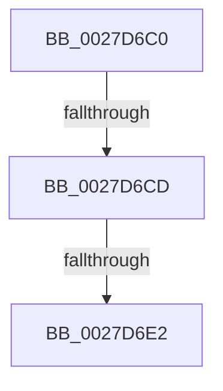

# sub_0027D6C0

- RVA: `0x0027D6C0`–`0x0027D6EE` (길이 `46` bytes)
- VA: `0x000000014027D6C0`
- 실행 섹션: `.text`
- PDB 이름 있음: `아니요`; PDB Function 태그: `아니요`
- unwind 정보 RVA: `0x000662AC`
- 디코드: `8`개 명령, `46/46` bytes 표시
- 미해석 바이트: `0` (있으면 어셈블리에 `.byte`로 보존)

> 이 문서는 커널 이미지의 기계어와 PDB 기호를 분석해 생성했습니다. 4번과 5번은 함수 원형과 자료형을 바이너리 사용 방식에서 추정한 C 해석이며 원본 소스 복구 결과는 아닙니다.

## 1. Dependencies

- 직접 호출 지점: **0**; 고유 호출 대상: **0**
- 직접 호출자로 확인된 함수: **0**
- RIP 상대 이미지 참조: **0**

### Outgoing calls
- 직접 디코드된 call 명령이 없습니다.

### Direct callers
- 이 함수 시작 RVA로 연결되는 직접 call은 확인되지 않았습니다. 간접 호출은 완전히 역산할 수 없습니다.

### Static image references
- 디코드된 RIP-relative 메모리 참조가 없습니다.

## 2. Other-region calls and transfers

- 다른 실행 섹션으로 향하는 call: **0**
- call이 아닌 외부 분기/꼬리 이동: **3**
  - `0x0027D6C7` → [sub_0027D718 + 0x35](Unknown_function_0027D718.md) (`tail-transfer`)
  - `0x0027D6E0` → [sub_0027D718 + 0x35](Unknown_function_0027D718.md) (`tail-transfer`)
  - `0x0027D6EC` → [sub_0027D718 + 0x35](Unknown_function_0027D718.md) (`tail-transfer`)

## 3. Assembly (complete function range)

```asm
0027D6C0  48 89 74 24 38                  mov qword ptr [rsp + 0x38], rsi
0027D6C5  A8 03                           test al, 3
0027D6C7  0F 84 80 00 00 00               je 0x14027d74d
0027D6CD  65 48 8B 34 25 88 01 00 00      mov rsi, qword ptr gs:[0x188]
0027D6D6  F7 86 A0 05 00 00 00 00 40 00   test dword ptr [rsi + 0x5a0], 0x400000
0027D6E0  75 6B                           jne 0x14027d74d
0027D6E2  F7 86 A4 05 00 00 00 20 00 00   test dword ptr [rsi + 0x5a4], 0x2000
0027D6EC  75 5F                           jne 0x14027d74d
```

## 4. C-style interpretation (structured pseudocode)

```c
void __fastcall sub_0027D6C0(void)
{
    unsigned __int64 v_stack_p38;

    v_stack_p38 = v_rsi;
}
```

## 5. (Beta) C Style

```c
void sub_0027D6C0(void)
{
    uint64_t v_stack_p38;

    v_stack_p38 = local_rsi;
}
```

## 6. Execution-region graph

[열기: 2D/3D 그래프와 함수 탐색 컨트롤 패널](../../../control-panel.html?section=text&rva=0x0027D6C0&view=graph)

- 2D 그래프는 위에서 아래로 흐르고, 3D 그래프는 빈 공간을 드래그해 회전합니다. Shift+드래그는 이동, 휠은 확대·축소, 함수 노드 선택은 대상 보고서 이동입니다.

### Static fallback


