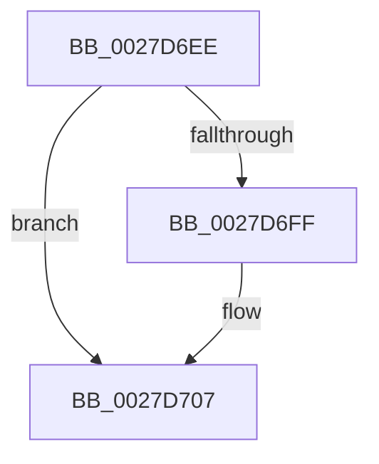

# sub_0027D6EE

- RVA: `0x0027D6EE`–`0x0027D718` (길이 `42` bytes)
- VA: `0x000000014027D6EE`
- 실행 섹션: `.text`
- PDB 이름 있음: `아니요`; PDB Function 태그: `아니요`
- unwind 정보 RVA: `0x000662C0`
- 디코드: `10`개 명령, `42/42` bytes 표시
- 미해석 바이트: `0` (있으면 어셈블리에 `.byte`로 보존)

> 이 문서는 커널 이미지의 기계어와 PDB 기호를 분석해 생성했습니다. 4번과 5번은 함수 원형과 자료형을 바이너리 사용 방식에서 추정한 C 해석이며 원본 소스 복구 결과는 아닙니다.

## 1. Dependencies

- 직접 호출 지점: **1**; 고유 호출 대상: **1**
- 직접 호출자로 확인된 함수: **0**
- RIP 상대 이미지 참조: **0**

### Outgoing calls
- `0x0027D702` → [MiSelfTrim](MiSelfTrim_function_0027E870.md) (function, `0x0027E870`)

### Direct callers
- 이 함수 시작 RVA로 연결되는 직접 call은 확인되지 않았습니다. 간접 호출은 완전히 역산할 수 없습니다.

### Static image references
- 디코드된 RIP-relative 메모리 참조가 없습니다.

## 2. Other-region calls and transfers

- 다른 실행 섹션으로 향하는 call: **0**
- call이 아닌 외부 분기/꼬리 이동: **1**
  - `0x0027D716` → [sub_0027D718 + 0x20](Unknown_function_0027D718.md) (`tail-transfer`)

## 3. Assembly (complete function range)

```asm
0027D6EE  48 89 6C 24 30                  mov qword ptr [rsp + 0x30], rbp
0027D6F3  8B A9 BC 00 00 00               mov ebp, dword ptr [rcx + 0xbc]
0027D6F9  40 F6 C5 01                     test bpl, 1
0027D6FD  74 08                           je 0x14027d707
0027D6FF  0F B6 D3                        movzx edx, bl
0027D702  E8 69 11 00 00                  call 0x14027e870
0027D707  8B 87 B8 00 00 00               mov eax, dword ptr [rdi + 0xb8]
0027D70D  40 F6 C5 02                     test bpl, 2
0027D711  48 8B 6C 24 30                  mov rbp, qword ptr [rsp + 0x30]
0027D716  74 20                           je 0x14027d738
```

## 4. C-style interpretation (structured pseudocode)

```c
__int64 __fastcall sub_0027D6EE(__int64 a1, __int64 a2, __int64 a3, __int64 a4, __int64 a5, __int64 a6)
{
    __int64 result;
    unsigned __int64 v_stack_p30;

    v_stack_p30 = v_rbp;
    if ((((unsigned __int8)((unsigned int)(*(unsigned int *)(a1 + 188)))) & (1)) != 0) {
        a2 = (unsigned __int8)(v_rbx);
        result = MiSelfTrim(a1, a2, a3, a4);
    }
}
```

## 5. (Beta) C Style

```c
int64_t sub_0027D6EE(void *Arg1, int64_t Arg2, int64_t Arg3, int64_t Arg4, uint64_t Arg5, int64_t Arg6)
{
    uint8_t *arg1 = (uint8_t *)Arg1;

    int64_t result;
    uint64_t v_stack_p30;

    v_stack_p30 = local_rbp;
    if ((((uint8_t)((uint32_t)(*(uint32_t *)(arg1 + 0xBC)))) & (1)) != 0) {
        Arg2 = (uint8_t)(local_rbx);
        result = MiSelfTrim(Arg1, Arg2, Arg3, Arg4);
    }
}
```

### 관측된 메모리 오프셋

구조체 형식이 확인되지 않은 접근은 인자 기준의 오프셋으로만 기록했습니다.

| 기준 인자 | 오프셋 표현 | 폭 (bit) | 접근 |
|---|---:|---:|---|
| `Arg1` | `+ 0xBC` | `32` | `R` |

## 6. Execution-region graph

[열기: 2D/3D 그래프와 함수 탐색 컨트롤 패널](../../../control-panel.html?section=text&rva=0x0027D6EE&view=graph)

- 2D 그래프는 위에서 아래로 흐르고, 3D 그래프는 빈 공간을 드래그해 회전합니다. Shift+드래그는 이동, 휠은 확대·축소, 함수 노드 선택은 대상 보고서 이동입니다.

### Static fallback


