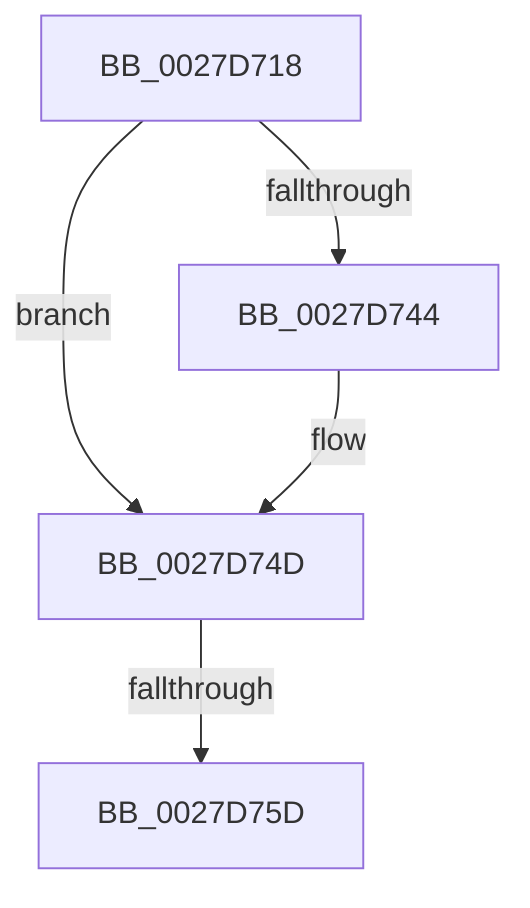

# sub_0027D718

- RVA: `0x0027D718`–`0x0027D792` (길이 `122` bytes)
- VA: `0x000000014027D718`
- 실행 섹션: `.text`
- PDB 이름 있음: `아니요`; PDB Function 태그: `아니요`
- unwind 정보 RVA: `0x000662D4`
- 디코드: `23`개 명령, `122/122` bytes 표시
- 미해석 바이트: `0` (있으면 어셈블리에 `.byte`로 보존)

> 이 문서는 커널 이미지의 기계어와 PDB 기호를 분석해 생성했습니다. 4번과 5번은 함수 원형과 자료형을 바이너리 사용 방식에서 추정한 C 해석이며 원본 소스 복구 결과는 아닙니다.

## 1. Dependencies

- 직접 호출 지점: **2**; 고유 호출 대상: **2**
- 직접 호출자로 확인된 함수: **0**
- RIP 상대 이미지 참조: **1**

### Outgoing calls
- `0x0027D733` → [MiReduceWs](MiReduceWs_function_0027E908.md) (function, `0x0027E908`)
- `0x0027D76C` → [MiCheckProcessShadow](MiCheckProcessShadow_function_0027E4C0.md) (function, `0x0027E4C0`)

### Direct callers
- 이 함수 시작 RVA로 연결되는 직접 call은 확인되지 않았습니다. 간접 호출은 완전히 역산할 수 없습니다.

### Static image references
- `0x0027D75D` → RVA `0x00E38840` (`.data`; read)

## 2. Other-region calls and transfers

- 다른 실행 섹션으로 향하는 call: **0**
- call이 아닌 외부 분기/꼬리 이동: **2**
  - `0x0027D757` → [sub_0027D80F](Unknown_function_0027D80F.md) (`tail-transfer`)
  - `0x0027D78C` → [sub_0027D81B + 0x3C](Unknown_function_0027D81B.md) (`tail-transfer`)

## 3. Assembly (complete function range)

```asm
0027D718  F0 83 A7 BC 00 00 00 FD         lock and dword ptr [rdi + 0xbc], 0xfffffffd
0027D720  F0 0F BA AE A0 05 00 00 16      lock bts dword ptr [rsi + 0x5a0], 0x16
0027D729  4C 8B 47 78                     mov r8, qword ptr [rdi + 0x78]
0027D72D  0F B6 D3                        movzx edx, bl
0027D730  48 8B CF                        mov rcx, rdi
0027D733  E8 D0 11 00 00                  call 0x14027e908
0027D738  F7 86 A0 05 00 00 00 00 40 00   test dword ptr [rsi + 0x5a0], 0x400000
0027D742  74 09                           je 0x14027d74d
0027D744  F0 0F BA B6 A0 05 00 00 16      lock btr dword ptr [rsi + 0x5a0], 0x16
0027D74D  8B 87 B8 00 00 00               mov eax, dword ptr [rdi + 0xb8]
0027D753  24 0F                           and al, 0xf
0027D755  3C 01                           cmp al, 1
0027D757  0F 85 B2 00 00 00               jne 0x14027d80f
0027D75D  48 8D 35 DC B0 BB 00            lea rsi, [rip + 0xbbb0dc]
0027D764  BA 01 00 00 00                  mov edx, 1
0027D769  48 8B CF                        mov rcx, rdi
0027D76C  E8 4F 0D 00 00                  call 0x14027e4c0
0027D771  65 48 8B 04 25 20 00 00 00      mov rax, qword ptr gs:[0x20]
0027D77A  48 8B 16                        mov rdx, qword ptr [rsi]
0027D77D  48 8B 74 24 38                  mov rsi, qword ptr [rsp + 0x38]
0027D782  48 8B 88 38 88 00 00            mov rcx, qword ptr [rax + 0x8838]
0027D789  48 85 C9                        test rcx, rcx
0027D78C  0F 84 C5 00 00 00               je 0x14027d857
```

## 4. C-style interpretation (structured pseudocode)

```c
__int64 __fastcall sub_0027D718(__int64 a1, __int64 a2, __int64 a3, __int64 a4, __int64 a5, __int64 a6, __int64 a7)
{
    __int64 result;

    result = MiReduceWs(v_rdi, (unsigned __int8)(v_rbx), *(unsigned __int64 *)(v_rdi + 120), a4);
    if (((*(unsigned int *)(v_rsi + 1440)) & (0x400000ULL)) != 0) {
    }
    result = (unsigned __int8)(((unsigned int)(*(unsigned int *)(v_rdi + 184))) & (15));
    result = MiCheckProcessShadow(v_rdi, 1, *(unsigned __int64 *)(v_rdi + 120), a4);
}
```

## 5. (Beta) C Style

```c
int64_t sub_0027D718(int64_t Arg1, int64_t Arg2, int64_t Arg3, int64_t Arg4, uint64_t Arg5, uint64_t Arg6, int64_t Arg7)
{
    int64_t result;

    result = MiReduceWs(local_rdi, (uint8_t)(local_rbx), *(uint64_t *)(local_rdi + 0x78), Arg4);
    if (((*(uint32_t *)(local_rsi + 0x5A0)) & (0x400000ULL)) != 0) {
    }
    result = (uint8_t)(((uint32_t)(*(uint32_t *)(local_rdi + 0xB8))) & (15));
    result = MiCheckProcessShadow(local_rdi, 1, *(uint64_t *)(local_rdi + 0x78), Arg4);
}
```

## 6. Execution-region graph

[열기: 2D/3D 그래프와 함수 탐색 컨트롤 패널](../../../control-panel.html?section=text&rva=0x0027D718&view=graph)

- 2D 그래프는 위에서 아래로 흐르고, 3D 그래프는 빈 공간을 드래그해 회전합니다. Shift+드래그는 이동, 휠은 확대·축소, 함수 노드 선택은 대상 보고서 이동입니다.

### Static fallback


