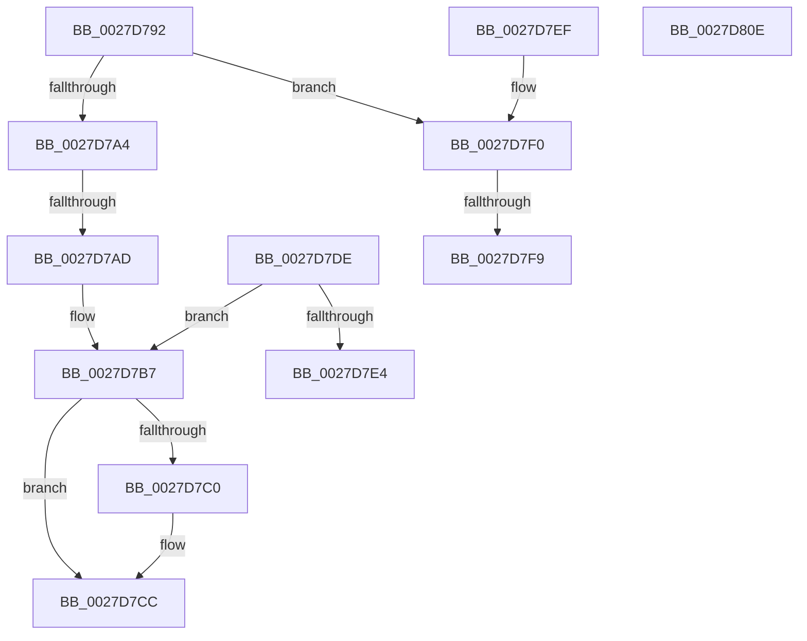

# sub_0027D792

- RVA: `0x0027D792`–`0x0027D80F` (길이 `125` bytes)
- VA: `0x000000014027D792`
- 실행 섹션: `.text`
- PDB 이름 있음: `아니요`; PDB Function 태그: `아니요`
- unwind 정보 RVA: `0x000662E4`
- 디코드: `37`개 명령, `125/125` bytes 표시
- 미해석 바이트: `0` (있으면 어셈블리에 `.byte`로 보존)

> 이 문서는 커널 이미지의 기계어와 PDB 기호를 분석해 생성했습니다. 4번과 5번은 함수 원형과 자료형을 바이너리 사용 방식에서 추정한 C 해석이며 원본 소스 복구 결과는 아닙니다.

## 1. Dependencies

- 직접 호출 지점: **1**; 고유 호출 대상: **1**
- 직접 호출자로 확인된 함수: **0**
- RIP 상대 이미지 참조: **2**

### Outgoing calls
- `0x0027D7C7` → [KiLowerIrqlProcessIrqlFlags](../4F/KiLowerIrqlProcessIrqlFlags_function_004F5698.md) (function, `0x004F5698`)

### Direct callers
- 이 함수 시작 RVA로 연결되는 직접 call은 확인되지 않았습니다. 간접 호출은 완전히 역산할 수 없습니다.

### Static image references
- `0x0027D7A4` → RVA `0x00FC6B06` (`ALMOSTRO`; read)
- `0x0027D7B7` → RVA `0x00FC6D20` (`ALMOSTRO`; read)

## 2. Other-region calls and transfers

- 다른 실행 섹션으로 향하는 call: **0**
- call이 아닌 외부 분기/꼬리 이동: **2**
  - `0x0027D7AB` → [sub_0027D81B](Unknown_function_0027D81B.md) (`tail-transfer`)
  - `0x0027D7F7` → [sub_0027D81B + 0x19](Unknown_function_0027D81B.md) (`tail-transfer`)

## 3. Assembly (complete function range)

```asm
0027D792  8B 81 44 01 00 00               mov eax, dword ptr [rcx + 0x144]
0027D798  48 C1 E0 06                     shl rax, 6
0027D79C  48 03 C2                        add rax, rdx
0027D79F  80 FB 11                        cmp bl, 0x11
0027D7A2  74 4C                           je 0x14027d7f0
0027D7A4  F6 05 5B 93 D4 00 01            test byte ptr [rip + 0xd4935b], 1
0027D7AB  75 6E                           jne 0x14027d81b
0027D7AD  F0 81 20 FF FF FF BF            lock and dword ptr [rax], 0xbfffffff
0027D7B4  F0 FF 08                        lock dec dword ptr [rax]
0027D7B7  83 3D 62 95 D4 00 00            cmp dword ptr [rip + 0xd49562], 0
0027D7BE  74 0C                           je 0x14027d7cc
0027D7C0  0F B6 D3                        movzx edx, bl
0027D7C3  44 0F 20 C1                     mov rcx, cr8
0027D7C7  E8 CC 7E 27 00                  call 0x1404f5698
0027D7CC  0F B6 C3                        movzx eax, bl
0027D7CF  44 0F 22 C0                     mov cr8, rax
0027D7D3  48 8B 5C 24 40                  mov rbx, qword ptr [rsp + 0x40]
0027D7D8  48 83 C4 20                     add rsp, 0x20
0027D7DC  5F                              pop rdi
0027D7DD  C3                              ret
0027D7DE  CC                              int3
0027D7DF  80 FB 11                        cmp bl, 0x11
0027D7E2  75 D3                           jne 0x14027d7b7
0027D7E4  48 8B 5C 24 40                  mov rbx, qword ptr [rsp + 0x40]
0027D7E9  48 83 C4 20                     add rsp, 0x20
0027D7ED  5F                              pop rdi
0027D7EE  C3                              ret
0027D7EF  CC                              int3
0027D7F0  F6 05 0F 93 D4 00 01            test byte ptr [rip + 0xd4930f], 1
0027D7F7  75 3B                           jne 0x14027d834
0027D7F9  F0 81 20 FF FF FF BF            lock and dword ptr [rax], 0xbfffffff
0027D800  F0 FF 08                        lock dec dword ptr [rax]
0027D803  48 8B 5C 24 40                  mov rbx, qword ptr [rsp + 0x40]
0027D808  48 83 C4 20                     add rsp, 0x20
0027D80C  5F                              pop rdi
0027D80D  C3                              ret
0027D80E  CC                              int3
```

## 4. C-style interpretation (structured pseudocode)

```c
__int64 __fastcall sub_0027D792(__int64 a1, __int64 a2, __int64 a3, __int64 a4, __int64 a5, __int64 a6, __int64 a7, __int64 a8)
{
    __int64 result;
    __int64 v_rsp;
    unsigned __int64 v_stack_p68;

    result = ((unsigned int)(*(unsigned int *)(a1 + 324))) << (6);
    result = (result) + (a2);
    if (((unsigned __int8)(v_rbx)) == 17) goto loc_0027D7F0;
loc_0027D7B7:
    if ((*(unsigned int *)(v_rip + 13931874)) != 0) {
        a2 = (unsigned __int8)(v_rbx);
        a1 = v_cr8;
        result = KiLowerIrqlProcessIrqlFlags(a1, a2, a3, a4);
    }
    v_rsp = (v_rsp) + (32);
    return (unsigned __int8)(v_rbx);
loc_0027D7F0:
    v_rsp = (v_rsp) + (32);
    return (unsigned __int8)(v_rbx);
}
```

## 5. (Beta) C Style

```c
int64_t sub_0027D792(void *Arg1, int64_t Arg2, int64_t Arg3, int64_t Arg4, uint64_t Arg5, uint64_t Arg6, uint64_t Arg7, int64_t Arg8)
{
    uint8_t *arg1 = (uint8_t *)Arg1;

    int64_t result;
    int64_t local_rsp;
    uint64_t v_stack_p68;

    result = ((uint32_t)(*(uint32_t *)(arg1 + 0x144))) << (6);
    result = (result) + (Arg2);
    if (((uint8_t)(local_rbx)) == 17) goto loc_0027D7F0;
loc_0027D7B7:
    if ((*(uint32_t *)(v_rip + 0xD49562)) != 0) {
        Arg2 = (uint8_t)(local_rbx);
        Arg1 = v_cr8;
        result = KiLowerIrqlProcessIrqlFlags(Arg1, Arg2, Arg3, Arg4);
    }
    local_rsp = (local_rsp) + (32);
    return (uint8_t)(local_rbx);
loc_0027D7F0:
    local_rsp = (local_rsp) + (32);
    return (uint8_t)(local_rbx);
}
```

### 관측된 메모리 오프셋

구조체 형식이 확인되지 않은 접근은 인자 기준의 오프셋으로만 기록했습니다.

| 기준 인자 | 오프셋 표현 | 폭 (bit) | 접근 |
|---|---:|---:|---|
| `Arg1` | `+ 0x144` | `32` | `R` |

## 6. Execution-region graph

[열기: 2D/3D 그래프와 함수 탐색 컨트롤 패널](../../../control-panel.html?section=text&rva=0x0027D792&view=graph)

- 2D 그래프는 위에서 아래로 흐르고, 3D 그래프는 빈 공간을 드래그해 회전합니다. Shift+드래그는 이동, 휠은 확대·축소, 함수 노드 선택은 대상 보고서 이동입니다.

### Static fallback


