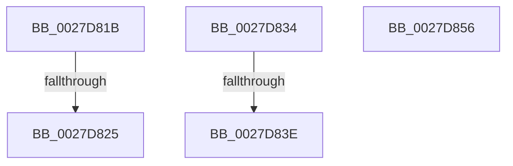

# sub_0027D81B

- RVA: `0x0027D81B`–`0x0027D85E` (길이 `67` bytes)
- VA: `0x000000014027D81B`
- 실행 섹션: `.text`
- PDB 이름 있음: `아니요`; PDB Function 태그: `아니요`
- unwind 정보 RVA: `0x00066310`
- 디코드: `20`개 명령, `67/67` bytes 표시
- 미해석 바이트: `0` (있으면 어셈블리에 `.byte`로 보존)

> 이 문서는 커널 이미지의 기계어와 PDB 기호를 분석해 생성했습니다. 4번과 5번은 함수 원형과 자료형을 바이너리 사용 방식에서 추정한 C 해석이며 원본 소스 복구 결과는 아닙니다.

## 1. Dependencies

- 직접 호출 지점: **2**; 고유 호출 대상: **1**
- 직접 호출자로 확인된 함수: **0**
- RIP 상대 이미지 참조: **1**

### Outgoing calls
- `0x0027D82D` → [ExpReleaseSpinLockSharedFromDpcLevelInstrumented](../2F/ExpReleaseSpinLockSharedFromDpcLevelInstrumented_function_002F0F48.md) (function, `0x002F0F48`)
- `0x0027D846` → [ExpReleaseSpinLockSharedFromDpcLevelInstrumented](../2F/ExpReleaseSpinLockSharedFromDpcLevelInstrumented_function_002F0F48.md) (function, `0x002F0F48`)

### Direct callers
- 이 함수 시작 RVA로 연결되는 직접 call은 확인되지 않았습니다. 간접 호출은 완전히 역산할 수 없습니다.

### Static image references
- `0x0027D81B` → RVA `0x00F0DE58` (`.data`; read)

## 2. Other-region calls and transfers

- 다른 실행 섹션으로 향하는 call: **0**
- call이 아닌 외부 분기/꼬리 이동: **4**
  - `0x0027D823` → [sub_0027D792 + 0x1B](Unknown_function_0027D792.md) (`tail-transfer`)
  - `0x0027D832` → [sub_0027D792 + 0x25](Unknown_function_0027D792.md) (`tail-transfer`)
  - `0x0027D83C` → [sub_0027D792 + 0x67](Unknown_function_0027D792.md) (`tail-transfer`)
  - `0x0027D859` → [sub_0027D792 + 0x6](Unknown_function_0027D792.md) (`tail-transfer`)

## 3. Assembly (complete function range)

```asm
0027D81B  8B 0D 37 06 C9 00               mov ecx, dword ptr [rip + 0xc90637]
0027D821  85 C9                           test ecx, ecx
0027D823  75 88                           jne 0x14027d7ad
0027D825  48 8B 54 24 28                  mov rdx, qword ptr [rsp + 0x28]
0027D82A  48 8B C8                        mov rcx, rax
0027D82D  E8 16 37 07 00                  call 0x1402f0f48
0027D832  EB 83                           jmp 0x14027d7b7
0027D834  8B 0D 1E 06 C9 00               mov ecx, dword ptr [rip + 0xc9061e]
0027D83A  85 C9                           test ecx, ecx
0027D83C  75 BB                           jne 0x14027d7f9
0027D83E  48 8B 54 24 28                  mov rdx, qword ptr [rsp + 0x28]
0027D843  48 8B C8                        mov rcx, rax
0027D846  E8 FD 36 07 00                  call 0x1402f0f48
0027D84B  48 8B 5C 24 40                  mov rbx, qword ptr [rsp + 0x40]
0027D850  48 83 C4 20                     add rsp, 0x20
0027D854  5F                              pop rdi
0027D855  C3                              ret
0027D856  CC                              int3
0027D857  33 C0                           xor eax, eax
0027D859  E9 3A FF FF FF                  jmp 0x14027d798
```

## 4. C-style interpretation (structured pseudocode)

```c
__int64 __fastcall sub_0027D81B(__int64 a1, __int64 a2, __int64 a3, __int64 a4, __int64 a5)
{
    __int64 result;
    unsigned __int64 v_stack_p28;
    unsigned __int64 v_stack_p40;

    result = ExpReleaseSpinLockSharedFromDpcLevelInstrumented(result, a5, a3, a4);
}
```

## 5. (Beta) C Style

```c
int64_t sub_0027D81B(int64_t Arg1, int64_t Arg2, int64_t Arg3, int64_t Arg4, int64_t Arg5)
{
    int64_t result;
    uint64_t v_stack_p28;
    uint64_t v_stack_p40;

    result = ExpReleaseSpinLockSharedFromDpcLevelInstrumented(result, Arg5, Arg3, Arg4);
}
```

## 6. Execution-region graph

[열기: 2D/3D 그래프와 함수 탐색 컨트롤 패널](../../../control-panel.html?section=text&rva=0x0027D81B&view=graph)

- 2D 그래프는 위에서 아래로 흐르고, 3D 그래프는 빈 공간을 드래그해 회전합니다. Shift+드래그는 이동, 휠은 확대·축소, 함수 노드 선택은 대상 보고서 이동입니다.

### Static fallback


