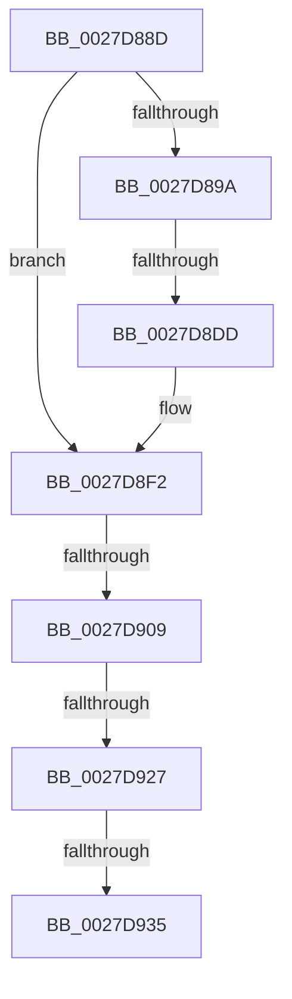

# sub_0027D88D

- RVA: `0x0027D88D`–`0x0027D950` (길이 `195` bytes)
- VA: `0x000000014027D88D`
- 실행 섹션: `.text`
- PDB 이름 있음: `아니요`; PDB Function 태그: `아니요`
- unwind 정보 RVA: `0x00066330`
- 디코드: `43`개 명령, `195/195` bytes 표시
- 미해석 바이트: `0` (있으면 어셈블리에 `.byte`로 보존)

> 이 문서는 커널 이미지의 기계어와 PDB 기호를 분석해 생성했습니다. 4번과 5번은 함수 원형과 자료형을 바이너리 사용 방식에서 추정한 C 해석이며 원본 소스 복구 결과는 아닙니다.

## 1. Dependencies

- 직접 호출 지점: **1**; 고유 호출 대상: **1**
- 직접 호출자로 확인된 함수: **0**
- RIP 상대 이미지 참조: **0**

### Outgoing calls
- `0x0027D8E9` → [MiAddWorkingSetEntries](MiAddWorkingSetEntries_function_0027DC00.md) (function, `0x0027DC00`)

### Direct callers
- 이 함수 시작 RVA로 연결되는 직접 call은 확인되지 않았습니다. 간접 호출은 완전히 역산할 수 없습니다.

### Static image references
- 디코드된 RIP-relative 메모리 참조가 없습니다.

## 2. Other-region calls and transfers

- 다른 실행 섹션으로 향하는 call: **0**
- call이 아닌 외부 분기/꼬리 이동: **4**
  - `0x0027D8DB` → [sub_0027D95C](Unknown_function_0027D95C.md) (`tail-transfer`)
  - `0x0027D903` → [sub_0027D95C + 0x99](Unknown_function_0027D95C.md) (`tail-transfer`)
  - `0x0027D925` → [sub_0027D95C + 0x2A](Unknown_function_0027D95C.md) (`tail-transfer`)
  - `0x0027D92F` → [sub_0027D95C + 0x15F](Unknown_function_0027D95C.md) (`tail-transfer`)

## 3. Assembly (complete function range)

```asm
0027D88D  48 89 74 24 40                  mov qword ptr [rsp + 0x40], rsi
0027D892  33 F6                           xor esi, esi
0027D894  66 39 71 0A                     cmp word ptr [rcx + 0xa], si
0027D898  74 58                           je 0x14027d8f2
0027D89A  48 B9 00 00 00 00 80 F6 FF FF   movabs rcx, 0xfffff68000000000
0027D8A4  48 8B C1                        mov rax, rcx
0027D8A7  44 0F B6 4B 0D                  movzx r9d, byte ptr [rbx + 0xd]
0027D8AC  48 C1 E2 19                     shl rdx, 0x19
0027D8B0  41 83 E1 02                     and r9d, 2
0027D8B4  48 C1 E0 19                     shl rax, 0x19
0027D8B8  48 2B D0                        sub rdx, rax
0027D8BB  48 C1 FA 10                     sar rdx, 0x10
0027D8BF  48 C1 E2 19                     shl rdx, 0x19
0027D8C3  48 2B D0                        sub rdx, rax
0027D8C6  0F B7 43 08                     movzx eax, word ptr [rbx + 8]
0027D8CA  48 C1 E0 0C                     shl rax, 0xc
0027D8CE  48 C1 FA 10                     sar rdx, 0x10
0027D8D2  48 03 D0                        add rdx, rax
0027D8D5  48 8B C1                        mov rax, rcx
0027D8D8  48 3B D0                        cmp rdx, rax
0027D8DB  73 7F                           jae 0x14027d95c
0027D8DD  41 83 C9 05                     or r9d, 5
0027D8E1  44 0F B7 43 0A                  movzx r8d, word ptr [rbx + 0xa]
0027D8E6  48 8B CF                        mov rcx, rdi
0027D8E9  E8 12 03 00 00                  call 0x14027dc00
0027D8EE  66 89 73 0A                     mov word ptr [rbx + 0xa], si
0027D8F2  48 8B 53 10                     mov rdx, qword ptr [rbx + 0x10]
0027D8F6  48 B8 68 DF BE 7D FB F6 FF FF   movabs rax, 0xfffff6fb7dbedf68
0027D900  48 3B D0                        cmp rdx, rax
0027D903  0F 84 EC 00 00 00               je 0x14027d9f5
0027D909  8B 87 B8 00 00 00               mov eax, dword ptr [rdi + 0xb8]
0027D90F  49 B8 00 D0 BE 7D FB F6 FF FF   movabs r8, 0xfffff6fb7dbed000
0027D919  49 B9 FF DF BE 7D FB F6 FF FF   movabs r9, 0xfffff6fb7dbedfff
0027D923  A8 0F                           test al, 0xf
0027D925  74 5F                           je 0x14027d986
0027D927  8B 87 B8 00 00 00               mov eax, dword ptr [rdi + 0xb8]
0027D92D  A8 0F                           test al, 0xf
0027D92F  0F 85 86 01 00 00               jne 0x14027dabb
0027D935  48 B8 FF FF FF FF FF FF FF CF   movabs rax, 0xcfffffffffffffff
0027D93F  F0 48 21 02                     lock and qword ptr [rdx], rax
0027D943  80 4B 0D 04                     or byte ptr [rbx + 0xd], 4
0027D947  48 89 73 10                     mov qword ptr [rbx + 0x10], rsi
0027D94B  48 8B 74 24 40                  mov rsi, qword ptr [rsp + 0x40]
```

## 4. C-style interpretation (structured pseudocode)

```c
__int64 __fastcall sub_0027D88D(__int64 a1, __int64 a2, __int64 a3, __int64 a4, __int64 a5, __int64 a6, __int64 a7, __int64 a8)
{
    __int64 result;
    __int64 v_rsi;
    unsigned __int64 v_stack_p40;

    v_stack_p40 = v_rsi;
    v_rsi = 0;
    if ((*(unsigned __int16 *)(a1 + 10)) == 0) goto loc_0027D8F2;
    a2 = (a2) << (25);
    a4 = (unsigned int)((*(unsigned __int8 *)(v_rbx + 13)) & (2));
    result = (a1) << (25);
    a2 = (a2) - (result);
    a2 = (a2) >> (16);
    a2 = (a2) << (25);
    a2 = (a2) - (result);
    result = (*(unsigned __int16 *)(v_rbx + 8)) << (12);
    a2 = (a2) >> (16);
    a2 = (a2) + (result);
    a4 = (unsigned int)((a4) | (5));
    result = MiAddWorkingSetEntries(v_rdi, a2, *(unsigned __int16 *)(v_rbx + 10), a4);
    *(unsigned __int16 *)(v_rbx + 10) = 0;
loc_0027D8F2:
    *(unsigned __int64 *)(v_rbx + 16) = 0;
    return (unsigned int)(*(unsigned int *)(v_rdi + 184));
}
```

## 5. (Beta) C Style

```c
int64_t sub_0027D88D(void *Arg1, int64_t Arg2, int64_t Arg3, int64_t Arg4, uint64_t Arg5, uint64_t Arg6, uint64_t Arg7, int64_t Arg8)
{
    uint8_t *arg1 = (uint8_t *)Arg1;

    int64_t result;
    int64_t local_rsi;
    uint64_t v_stack_p40;

    v_stack_p40 = local_rsi;
    local_rsi = 0;
    if ((*(uint16_t *)(arg1 + 0xA)) == 0) goto loc_0027D8F2;
    Arg2 = (Arg2) << (25);
    Arg4 = (uint32_t)((*(uint8_t *)(local_rbx + 0xD)) & (2));
    result = (Arg1) << (25);
    Arg2 = (Arg2) - (result);
    Arg2 = (Arg2) >> (16);
    Arg2 = (Arg2) << (25);
    Arg2 = (Arg2) - (result);
    result = (*(uint16_t *)(local_rbx + 0x8)) << (12);
    Arg2 = (Arg2) >> (16);
    Arg2 = (Arg2) + (result);
    Arg4 = (uint32_t)((Arg4) | (5));
    result = MiAddWorkingSetEntries(local_rdi, Arg2, *(uint16_t *)(local_rbx + 0xA), Arg4);
    *(uint16_t *)(local_rbx + 0xA) = 0;
loc_0027D8F2:
    *(uint64_t *)(local_rbx + 0x10) = 0;
    return (uint32_t)(*(uint32_t *)(local_rdi + 0xB8));
}
```

### 관측된 메모리 오프셋

구조체 형식이 확인되지 않은 접근은 인자 기준의 오프셋으로만 기록했습니다.

| 기준 인자 | 오프셋 표현 | 폭 (bit) | 접근 |
|---|---:|---:|---|
| `Arg1` | `+ 0xA` | `16` | `R` |

## 6. Execution-region graph

[열기: 2D/3D 그래프와 함수 탐색 컨트롤 패널](../../../control-panel.html?section=text&rva=0x0027D88D&view=graph)

- 2D 그래프는 위에서 아래로 흐르고, 3D 그래프는 빈 공간을 드래그해 회전합니다. Shift+드래그는 이동, 휠은 확대·축소, 함수 노드 선택은 대상 보고서 이동입니다.

### Static fallback


