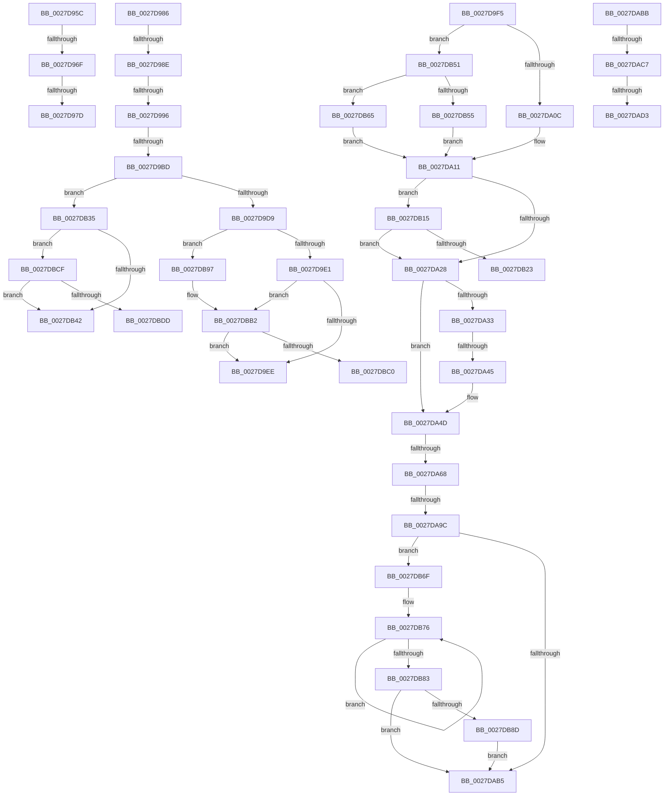

# sub_0027D95C

- RVA: `0x0027D95C`–`0x0027DBEC` (길이 `656` bytes)
- VA: `0x000000014027D95C`
- 실행 섹션: `.text`
- PDB 이름 있음: `아니요`; PDB Function 태그: `아니요`
- unwind 정보 RVA: `0x00066358`
- 디코드: `147`개 명령, `656/656` bytes 표시
- 미해석 바이트: `0` (있으면 어셈블리에 `.byte`로 보존)

> 이 문서는 커널 이미지의 기계어와 PDB 기호를 분석해 생성했습니다. 4번과 5번은 함수 원형과 자료형을 바이너리 사용 방식에서 추정한 C 해석이며 원본 소스 복구 결과는 아닙니다.

## 1. Dependencies

- 직접 호출 지점: **8**; 고유 호출 대상: **8**
- 직접 호출자로 확인된 함수: **0**
- RIP 상대 이미지 참조: **3**

### Outgoing calls
- `0x0027DA48` → [KxWaitForLockChainValid](../21/KxWaitForLockChainValid_function_00217AA0.md) (function, `0x00217AA0`)
- `0x0027DA7B` → [KeDisableInterrupts](../21/KeDisableInterrupts_function_00217BE0.md) (function, `0x00217BE0`)
- `0x0027DA8E` → [KiHaltOnAddressWakeEntireList](../21/KiHaltOnAddressWakeEntireList_function_00217AF4.md) (function, `0x00217AF4`)
- `0x0027DB2B` → [KiReleaseQueuedSpinLockInstrumented](../21/KiReleaseQueuedSpinLockInstrumented_function_002179F0.md) (function, `0x002179F0`)
- `0x0027DB8D` → [KiRemoveSystemWorkPriorityKick](../26/KiRemoveSystemWorkPriorityKick_function_002631D0.md) (function, `0x002631D0`)
- `0x0027DBAC` → [KeBugCheckEx](../4F/KeBugCheckEx_function_004FD660.md) (function, `0x004FD660`)
- `0x0027DBC5` → [ExpReleaseSpinLockExclusiveFromDpcLevelInstrumented](../2C/ExpReleaseSpinLockExclusiveFromDpcLevelInstrumented_function_002C0F44.md) (function, `0x002C0F44`)
- `0x0027DBE2` → [ExpReleaseSpinLockSharedFromDpcLevelInstrumented](../2F/ExpReleaseSpinLockSharedFromDpcLevelInstrumented_function_002F0F48.md) (function, `0x002F0F48`)

### Direct callers
- 이 함수 시작 RVA로 연결되는 직접 call은 확인되지 않았습니다. 간접 호출은 완전히 역산할 수 없습니다.

### Static image references
- `0x0027D9E1` → RVA `0x00FC6B06` (`ALMOSTRO`; read)
- `0x0027DA70` → RVA `0x00000000` (`image boundary/outside`; read)
- `0x0027DB15` → RVA `0x00F0DE58` (`.data`; read)

## 2. Other-region calls and transfers

- 다른 실행 섹션으로 향하는 call: **0**
- call이 아닌 외부 분기/꼬리 이동: **18**
  - `0x0027D969` → [sub_0027D88D + 0x50](Unknown_function_0027D88D.md) (`tail-transfer`)
  - `0x0027D977` → [sub_0027D88D + 0x54](Unknown_function_0027D88D.md) (`tail-transfer`)
  - `0x0027D981` → [sub_0027D88D + 0x54](Unknown_function_0027D88D.md) (`tail-transfer`)
  - `0x0027D98C` → [sub_0027D88D + 0x9A](Unknown_function_0027D88D.md) (`tail-transfer`)
  - `0x0027D994` → [sub_0027D88D + 0x9A](Unknown_function_0027D88D.md) (`tail-transfer`)
  - `0x0027D9B7` → [sub_0027D88D + 0x9A](Unknown_function_0027D88D.md) (`tail-transfer`)
  - `0x0027D9F0` → [sub_0027D88D + 0xB6](Unknown_function_0027D88D.md) (`tail-transfer`)
  - `0x0027DA3F` → [sub_0027D88D + 0xB6](Unknown_function_0027D88D.md) (`tail-transfer`)
  - `0x0027DA62` → [sub_0027D88D + 0xB6](Unknown_function_0027D88D.md) (`tail-transfer`)
  - `0x0027DA96` → [sub_0027D88D + 0xB6](Unknown_function_0027D88D.md) (`tail-transfer`)
  - `0x0027DAB6` → [sub_0027D88D + 0xB6](Unknown_function_0027D88D.md) (`tail-transfer`)
  - `0x0027DAC1` → [sub_0027D88D + 0xA8](Unknown_function_0027D88D.md) (`tail-transfer`)
  - `0x0027DACD` → [sub_0027D88D + 0xA8](Unknown_function_0027D88D.md) (`tail-transfer`)
  - `0x0027DB10` → [sub_0027D88D + 0xB6](Unknown_function_0027D88D.md) (`tail-transfer`)
  - `0x0027DB30` → [sub_0027D88D + 0xB6](Unknown_function_0027D88D.md) (`tail-transfer`)
  - `0x0027DB4C` → [sub_0027D88D + 0xB6](Unknown_function_0027D88D.md) (`tail-transfer`)
  - `0x0027DBCA` → [sub_0027D88D + 0xB6](Unknown_function_0027D88D.md) (`tail-transfer`)
  - `0x0027DBE7` → [sub_0027D88D + 0xB6](Unknown_function_0027D88D.md) (`tail-transfer`)

## 3. Assembly (complete function range)

```asm
0027D95C  48 B8 FF FF FF FF FF F6 FF FF   movabs rax, 0xfffff6ffffffffff
0027D966  48 3B D0                        cmp rdx, rax
0027D969  0F 87 6E FF FF FF               ja 0x14027d8dd
0027D96F  8B 87 B8 00 00 00               mov eax, dword ptr [rdi + 0xb8]
0027D975  A8 0F                           test al, 0xf
0027D977  0F 85 64 FF FF FF               jne 0x14027d8e1
0027D97D  41 83 C9 04                     or r9d, 4
0027D981  E9 5B FF FF FF                  jmp 0x14027d8e1
0027D986  49 8B C0                        mov rax, r8
0027D989  48 3B D0                        cmp rdx, rax
0027D98C  72 99                           jb 0x14027d927
0027D98E  49 8B C1                        mov rax, r9
0027D991  48 3B D0                        cmp rdx, rax
0027D994  77 91                           ja 0x14027d927
0027D996  65 48 8B 04 25 88 01 00 00      mov rax, qword ptr gs:[0x188]
0027D99F  48 8B 88 B8 00 00 00            mov rcx, qword ptr [rax + 0xb8]
0027D9A6  48 8B 81 10 04 00 00            mov rax, qword ptr [rcx + 0x410]
0027D9AD  48 8B 88 68 05 00 00            mov rcx, qword ptr [rax + 0x568]
0027D9B4  48 85 C9                        test rcx, rcx
0027D9B7  0F 84 6A FF FF FF               je 0x14027d927
0027D9BD  48 C1 EA 03                     shr rdx, 3
0027D9C1  81 E2 FF 01 00 00               and edx, 0x1ff
0027D9C7  8B 04 91                        mov eax, dword ptr [rcx + rdx*4]
0027D9CA  48 8D 0C 91                     lea rcx, [rcx + rdx*4]
0027D9CE  A9 FF FF FF 3F                  test eax, 0x3fffffff
0027D9D3  0F 85 5C 01 00 00               jne 0x14027db35
0027D9D9  85 C0                           test eax, eax
0027D9DB  0F 89 B6 01 00 00               jns 0x14027db97
0027D9E1  F6 05 1E 91 D4 00 01            test byte ptr [rip + 0xd4911e], 1
0027D9E8  0F 85 C4 01 00 00               jne 0x14027dbb2
0027D9EE  89 31                           mov dword ptr [rcx], esi
0027D9F0  E9 4E FF FF FF                  jmp 0x14027d943
0027D9F5  65 48 8B 0C 25 20 00 00 00      mov rcx, qword ptr gs:[0x20]
0027D9FE  8B 87 B8 00 00 00               mov eax, dword ptr [rdi + 0xb8]
0027DA04  24 0F                           and al, 0xf
0027DA06  0F 85 45 01 00 00               jne 0x14027db51
0027DA0C  BA 30 00 00 00                  mov edx, 0x30
0027DA11  48 8D B9 40 9C 00 00            lea rdi, [rcx + 0x9c40]
0027DA18  48 03 FA                        add rdi, rdx
0027DA1B  F6 05 E4 90 D4 00 01            test byte ptr [rip + 0xd490e4], 1
0027DA22  0F 85 ED 00 00 00               jne 0x14027db15
0027DA28  0F 0D 0F                        prefetchw byte ptr [rdi]
0027DA2B  48 8B 07                        mov rax, qword ptr [rdi]
0027DA2E  48 85 C0                        test rax, rax
0027DA31  75 1A                           jne 0x14027da4d
0027DA33  48 8B 4F 08                     mov rcx, qword ptr [rdi + 8]
0027DA37  48 8B C7                        mov rax, rdi
0027DA3A  F0 48 0F B1 31                  lock cmpxchg qword ptr [rcx], rsi
0027DA3F  0F 84 FE FE FF FF               je 0x14027d943
0027DA45  48 8B CF                        mov rcx, rdi
0027DA48  E8 53 A0 F9 FF                  call 0x140217aa0
0027DA4D  4C 8D 40 08                     lea r8, [rax + 8]
0027DA51  48 89 37                        mov qword ptr [rdi], rsi
0027DA54  48 8B 4F 08                     mov rcx, qword ptr [rdi + 8]
0027DA58  48 8B C1                        mov rax, rcx
0027DA5B  49 87 00                        xchg qword ptr [r8], rax
0027DA5E  32 C1                           xor al, cl
0027DA60  A8 04                           test al, 4
0027DA62  0F 84 DB FE FF FF               je 0x14027d943
0027DA68  F0 09 34 24                     lock or dword ptr [rsp], esi
0027DA6C  49 C1 E8 05                     shr r8, 5
0027DA70  4C 8D 0D 89 25 D8 FF            lea r9, [rip - 0x27da77]
0027DA77  41 83 E0 7F                     and r8d, 0x7f
0027DA7B  E8 60 A1 F9 FF                  call 0x140217be0
0027DA80  48 8B D6                        mov rdx, rsi
0027DA83  0F B6 F8                        movzx edi, al
0027DA86  4B 87 94 C1 20 1B F2 00         xchg qword ptr [r9 + r8*8 + 0xf21b20], rdx
0027DA8E  E8 61 A0 F9 FF                  call 0x140217af4
0027DA93  40 84 FF                        test dil, dil
0027DA96  0F 84 A7 FE FF FF               je 0x14027d943
0027DA9C  65 48 8B 0C 25 20 00 00 00      mov rcx, qword ptr gs:[0x20]
0027DAA5  4C 8B 81 B8 8E 00 00            mov r8, qword ptr [rcx + 0x8eb8]
0027DAAC  4D 85 C0                        test r8, r8
0027DAAF  0F 85 BA 00 00 00               jne 0x14027db6f
0027DAB5  FB                              sti
0027DAB6  E9 88 FE FF FF                  jmp 0x14027d943
0027DABB  49 8B C0                        mov rax, r8
0027DABE  48 3B D0                        cmp rdx, rax
0027DAC1  0F 82 6E FE FF FF               jb 0x14027d935
0027DAC7  49 8B C1                        mov rax, r9
0027DACA  48 3B D0                        cmp rdx, rax
0027DACD  0F 87 62 FE FF FF               ja 0x14027d935
0027DAD3  49 8B C0                        mov rax, r8
0027DAD6  48 2B D0                        sub rdx, rax
0027DAD9  4C 8D 0D 20 25 D8 FF            lea r9, [rip - 0x27dae0]
0027DAE0  8B 87 B8 00 00 00               mov eax, dword ptr [rdi + 0xb8]
0027DAE6  48 C1 FA 03                     sar rdx, 3
0027DAEA  44 8D 04 12                     lea r8d, [rdx + rdx]
0027DAEE  BA 02 00 00 00                  mov edx, 2
0027DAF3  41 8B C8                        mov ecx, r8d
0027DAF6  41 8B C0                        mov eax, r8d
0027DAF9  83 E1 1F                        and ecx, 0x1f
0027DAFC  D3 E2                           shl edx, cl
0027DAFE  F7 D2                           not edx
0027DB00  0F B3 CA                        btr edx, ecx
0027DB03  48 C1 E8 05                     shr rax, 5
0027DB07  F0 41 21 94 81 AC F1 E2 00      lock and dword ptr [r9 + rax*4 + 0xe2f1ac], edx
0027DB10  E9 2E FE FF FF                  jmp 0x14027d943
0027DB15  8B 05 3D 03 C9 00               mov eax, dword ptr [rip + 0xc9033d]
0027DB1B  85 C0                           test eax, eax
0027DB1D  0F 85 05 FF FF FF               jne 0x14027da28
0027DB23  48 8B 54 24 38                  mov rdx, qword ptr [rsp + 0x38]
0027DB28  48 8B CF                        mov rcx, rdi
0027DB2B  E8 C0 9E F9 FF                  call 0x1402179f0
0027DB30  E9 0E FE FF FF                  jmp 0x14027d943
0027DB35  F6 05 CA 8F D4 00 01            test byte ptr [rip + 0xd48fca], 1
0027DB3C  0F 85 8D 00 00 00               jne 0x14027dbcf
0027DB42  F0 81 21 FF FF FF BF            lock and dword ptr [rcx], 0xbfffffff
0027DB49  F0 FF 09                        lock dec dword ptr [rcx]
0027DB4C  E9 F2 FD FF FF                  jmp 0x14027d943
0027DB51  3C 07                           cmp al, 7
0027DB53  74 10                           je 0x14027db65
0027DB55  3C 05                           cmp al, 5
0027DB57  BA 48 00 00 00                  mov edx, 0x48
0027DB5C  48 0F 44 D6                     cmove rdx, rsi
0027DB60  E9 AC FE FF FF                  jmp 0x14027da11
0027DB65  BA 18 00 00 00                  mov edx, 0x18
0027DB6A  E9 A2 FE FF FF                  jmp 0x14027da11
0027DB6F  41 0F 0D 08                     prefetchw byte ptr [r8]
0027DB73  41 8B 00                        mov eax, dword ptr [r8]
0027DB76  8B D0                           mov edx, eax
0027DB78  0F BA F2 15                     btr edx, 0x15
0027DB7C  F0 41 0F B1 10                  lock cmpxchg dword ptr [r8], edx
0027DB81  75 F3                           jne 0x14027db76
0027DB83  0F BA E0 15                     bt eax, 0x15
0027DB87  0F 83 28 FF FF FF               jae 0x14027dab5
0027DB8D  E8 3E 56 FE FF                  call 0x1402631d0
0027DB92  E9 1E FF FF FF                  jmp 0x14027dab5
0027DB97  45 33 C9                        xor r9d, r9d
0027DB9A  48 89 74 24 20                  mov qword ptr [rsp + 0x20], rsi
0027DB9F  48 8B D1                        mov rdx, rcx
0027DBA2  41 B8 00 01 00 00               mov r8d, 0x100
0027DBA8  41 8D 49 10                     lea ecx, [r9 + 0x10]
0027DBAC  E8 AF FA 27 00                  call 0x1404fd660
0027DBB1  CC                              int3
0027DBB2  8B 05 A0 02 C9 00               mov eax, dword ptr [rip + 0xc902a0]
0027DBB8  85 C0                           test eax, eax
0027DBBA  0F 85 2E FE FF FF               jne 0x14027d9ee
0027DBC0  48 8B 54 24 38                  mov rdx, qword ptr [rsp + 0x38]
0027DBC5  E8 7A 33 04 00                  call 0x1402c0f44
0027DBCA  E9 74 FD FF FF                  jmp 0x14027d943
0027DBCF  8B 05 83 02 C9 00               mov eax, dword ptr [rip + 0xc90283]
0027DBD5  85 C0                           test eax, eax
0027DBD7  0F 85 65 FF FF FF               jne 0x14027db42
0027DBDD  48 8B 54 24 38                  mov rdx, qword ptr [rsp + 0x38]
0027DBE2  E8 61 33 07 00                  call 0x1402f0f48
0027DBE7  E9 57 FD FF FF                  jmp 0x14027d943
```

## 4. C-style interpretation (structured pseudocode)

```c
__int64 __fastcall sub_0027D95C(__int64 a1, __int64 a2, __int64 a3, int a4)
{
    unsigned int v_stack_p0;
    unsigned __int64 v_stack_p20;
    unsigned __int64 v_stack_p38;

    a4 = (unsigned int)((a4) | (4));
}
```

## 5. (Beta) C Style

```c
int64_t sub_0027D95C(int64_t Arg1, int64_t Arg2, int64_t Arg3, int32_t Arg4)
{
    uint32_t v_stack_p0;
    uint64_t v_stack_p20;
    uint64_t v_stack_p38;

    Arg4 = (uint32_t)((Arg4) | (4));
}
```

## 6. Execution-region graph

[열기: 2D/3D 그래프와 함수 탐색 컨트롤 패널](../../../control-panel.html?section=text&rva=0x0027D95C&view=graph)

- 2D 그래프는 위에서 아래로 흐르고, 3D 그래프는 빈 공간을 드래그해 회전합니다. Shift+드래그는 이동, 휠은 확대·축소, 함수 노드 선택은 대상 보고서 이동입니다.

### Static fallback


