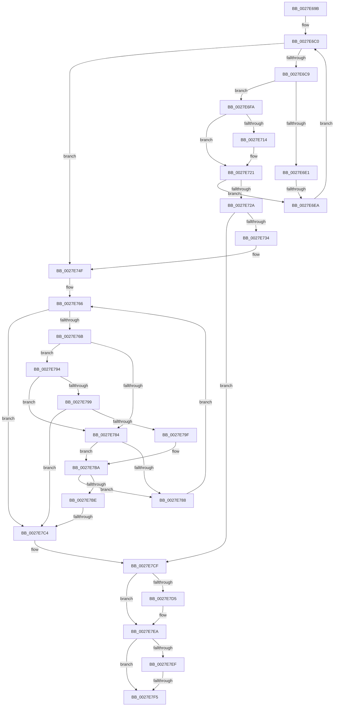

# sub_0027E69B

- RVA: `0x0027E69B`–`0x0027E807` (길이 `364` bytes)
- VA: `0x000000014027E69B`
- 실행 섹션: `.text`
- PDB 이름 있음: `아니요`; PDB Function 태그: `아니요`
- unwind 정보 RVA: `0x000663A8`
- 디코드: `93`개 명령, `364/364` bytes 표시
- 미해석 바이트: `0` (있으면 어셈블리에 `.byte`로 보존)

> 이 문서는 커널 이미지의 기계어와 PDB 기호를 분석해 생성했습니다. 4번과 5번은 함수 원형과 자료형을 바이너리 사용 방식에서 추정한 C 해석이며 원본 소스 복구 결과는 아닙니다.

## 1. Dependencies

- 직접 호출 지점: **7**; 고유 호출 대상: **3**
- 직접 호출자로 확인된 함수: **0**
- RIP 상대 이미지 참조: **1**

### Outgoing calls
- `0x0027E6CC` → [MI_READ_PTE_LOCK_FREE](../28/MI_READ_PTE_LOCK_FREE_function_002828A0.md) (function, `0x002828A0`)
- `0x0027E6D7` → [MI_READ_PTE_LOCK_FREE](../28/MI_READ_PTE_LOCK_FREE_function_002828A0.md) (function, `0x002828A0`)
- `0x0027E749` → [KeBugCheckEx](../4F/KeBugCheckEx_function_004FD660.md) (function, `0x004FD660`)
- `0x0027E76E` → [MI_READ_PTE_LOCK_FREE](../28/MI_READ_PTE_LOCK_FREE_function_002828A0.md) (function, `0x002828A0`)
- `0x0027E77A` → [MI_READ_PTE_LOCK_FREE](../28/MI_READ_PTE_LOCK_FREE_function_002828A0.md) (function, `0x002828A0`)
- `0x0027E7B4` → [KeBugCheckEx](../4F/KeBugCheckEx_function_004FD660.md) (function, `0x004FD660`)
- `0x0027E7E5` → [MiUnlockPageTable](../21/MiUnlockPageTable_function_00216EC0.md) (function, `0x00216EC0`)

### Direct callers
- 이 함수 시작 RVA로 연결되는 직접 call은 확인되지 않았습니다. 간접 호출은 완전히 역산할 수 없습니다.

### Static image references
- `0x0027E70B` → RVA `0x00E2EE85` (`.data`; read)

## 2. Other-region calls and transfers

- 다른 실행 섹션으로 향하는 call: **0**
- call이 아닌 외부 분기/꼬리 이동: **4**
  - `0x0027E6E4` → [sub_0027E83C](Unknown_function_0027E83C.md) (`tail-transfer`)
  - `0x0027E7C2` → [sub_0027E807](Unknown_function_0027E807.md) (`tail-transfer`)
  - `0x0027E7F3` → [sub_0027E83C + 0x21](Unknown_function_0027E83C.md) (`tail-transfer`)
  - `0x0027E802` → [MiCheckProcessShadow + 0x15E](MiCheckProcessShadow_function_0027E4C0.md) (`tail-transfer`)

## 3. Assembly (complete function range)

```asm
0027E69B  4C 89 64 24 60                  mov qword ptr [rsp + 0x60], r12
0027E6A0  4C 89 6C 24 68                  mov qword ptr [rsp + 0x68], r13
0027E6A5  49 BC 00 D0 BE 7D FB F6 FF FF   movabs r12, 0xfffff6fb7dbed000
0027E6AF  BF FF FF FF FF                  mov edi, 0xffffffff
0027E6B4  41 BD 00 01 00 00               mov r13d, 0x100
0027E6BA  66 0F 1F 44 00 00               nop word ptr [rax + rax]
0027E6C0  45 85 ED                        test r13d, r13d
0027E6C3  0F 84 86 00 00 00               je 0x14027e74f
0027E6C9  49 8B CC                        mov rcx, r12
0027E6CC  E8 CF 41 00 00                  call 0x1402828a0
0027E6D1  49 8B CF                        mov rcx, r15
0027E6D4  48 8B D8                        mov rbx, rax
0027E6D7  E8 C4 41 00 00                  call 0x1402828a0
0027E6DC  F6 C3 01                        test bl, 1
0027E6DF  75 19                           jne 0x14027e6fa
0027E6E1  48 85 C0                        test rax, rax
0027E6E4  0F 85 52 01 00 00               jne 0x14027e83c
0027E6EA  49 83 C4 08                     add r12, 8
0027E6EE  49 83 C7 08                     add r15, 8
0027E6F2  49 FF C6                        inc r14
0027E6F5  44 03 EF                        add r13d, edi
0027E6F8  EB C6                           jmp 0x14027e6c0
0027E6FA  48 B9 FF FF FF FF FF FF FF CF   movabs rcx, 0xcfffffffffffffff
0027E704  48 23 D9                        and rbx, rcx
0027E707  48 83 CB 20                     or rbx, 0x20
0027E70B  80 3D 73 07 BB 00 00            cmp byte ptr [rip + 0xbb0773], 0
0027E712  75 0D                           jne 0x14027e721
0027E714  48 B9 00 00 00 00 00 00 00 80   movabs rcx, 0x8000000000000000
0027E71E  48 0B C1                        or rax, rcx
0027E721  48 83 C8 20                     or rax, 0x20
0027E725  48 3B D8                        cmp rbx, rax
0027E728  74 C0                           je 0x14027e6ea
0027E72A  40 F6 C5 08                     test bpl, 8
0027E72E  0F 85 9B 00 00 00               jne 0x14027e7cf
0027E734  4C 8B CB                        mov r9, rbx
0027E737  48 89 44 24 20                  mov qword ptr [rsp + 0x20], rax
0027E73C  4D 8B C4                        mov r8, r12
0027E73F  BA 00 13 00 00                  mov edx, 0x1300
0027E744  B9 1A 00 00 00                  mov ecx, 0x1a
0027E749  E8 12 EF 27 00                  call 0x1404fd660
0027E74E  CC                              int3
0027E74F  41 8B C4                        mov eax, r12d
0027E752  41 BD 00 02 00 00               mov r13d, 0x200
0027E758  C1 E8 03                        shr eax, 3
0027E75B  25 FF 01 00 00                  and eax, 0x1ff
0027E760  44 2B E8                        sub r13d, eax
0027E763  4D 2B FC                        sub r15, r12
0027E766  45 85 ED                        test r13d, r13d
0027E769  74 59                           je 0x14027e7c4
0027E76B  49 8B CC                        mov rcx, r12
0027E76E  E8 2D 41 00 00                  call 0x1402828a0
0027E773  4B 8D 0C 27                     lea rcx, [r15 + r12]
0027E777  48 8B D8                        mov rbx, rax
0027E77A  E8 21 41 00 00                  call 0x1402828a0
0027E77F  F6 C3 01                        test bl, 1
0027E782  75 10                           jne 0x14027e794
0027E784  A8 01                           test al, 1
0027E786  75 32                           jne 0x14027e7ba
0027E788  49 83 C4 08                     add r12, 8
0027E78C  49 FF C6                        inc r14
0027E78F  44 03 EF                        add r13d, edi
0027E792  EB D2                           jmp 0x14027e766
0027E794  F6 C3 04                        test bl, 4
0027E797  74 EB                           je 0x14027e784
0027E799  40 F6 C5 08                     test bpl, 8
0027E79D  75 25                           jne 0x14027e7c4
0027E79F  4C 8B CB                        mov r9, rbx
0027E7A2  48 89 44 24 20                  mov qword ptr [rsp + 0x20], rax
0027E7A7  4D 8B C4                        mov r8, r12
0027E7AA  BA 04 13 00 00                  mov edx, 0x1304
0027E7AF  B9 1A 00 00 00                  mov ecx, 0x1a
0027E7B4  E8 A7 EE 27 00                  call 0x1404fd660
0027E7B9  CC                              int3
0027E7BA  A8 04                           test al, 4
0027E7BC  74 CA                           je 0x14027e788
0027E7BE  40 F6 C5 08                     test bpl, 8
0027E7C2  74 43                           je 0x14027e807
0027E7C4  49 F7 C4 FF 0F 00 00            test r12, 0xfff
0027E7CB  4C 0F 44 F7                     cmove r14, rdi
0027E7CF  40 F6 C5 01                     test bpl, 1
0027E7D3  74 15                           je 0x14027e7ea
0027E7D5  48 B8 68 DF BE 7D FB F6 FF FF   movabs rax, 0xfffff6fb7dbedf68
0027E7DF  48 8B D0                        mov rdx, rax
0027E7E2  48 8B CE                        mov rcx, rsi
0027E7E5  E8 D6 86 F9 FF                  call 0x140216ec0
0027E7EA  4C 3B F7                        cmp r14, rdi
0027E7ED  75 06                           jne 0x14027e7f5
0027E7EF  40 F6 C5 10                     test bpl, 0x10
0027E7F3  75 68                           jne 0x14027e85d
0027E7F5  4C 8B 64 24 60                  mov r12, qword ptr [rsp + 0x60]
0027E7FA  49 8B C6                        mov rax, r14
0027E7FD  4C 8B 6C 24 68                  mov r13, qword ptr [rsp + 0x68]
0027E802  E9 17 FE FF FF                  jmp 0x14027e61e
```

## 4. C-style interpretation (structured pseudocode)

```c
__int64 __fastcall sub_0027E69B(__int64 a1, __int64 a2, __int64 a3, __int64 a4, __int64 a5, __int64 a6, __int64 a7, __int64 a8, __int64 a9, __int64 a10, __int64 a11, __int64 a12, __int64 a13)
{
    __int64 result;
    __int64 v_r12;
    __int64 v_r13;
    __int64 v_r14;
    __int64 v_r15;
    __int64 v_rbx;
    unsigned __int64 v_stack_p20;
    unsigned __int64 v_stack_p60;
    unsigned __int64 v_stack_p68;

    v_stack_p60 = v_r12;
    v_stack_p68 = v_r13;
loc_0027E6C0:
    if (256 == 0) goto loc_0027E74F;
    result = MI_READ_PTE_LOCK_FREE(v_r12, a2, a3, a4);
    result = MI_READ_PTE_LOCK_FREE(v_r15, a2, a3, a4);
    if ((((unsigned __int8)(result)) & (1)) != 0) goto loc_0027E6FA;
loc_0027E6EA:
    v_r12 = (v_r12) + (8);
    v_r15 = (v_r15) + (8);
    v_r14 = (v_r14) + 1;
    v_r13 = (unsigned int)((256) + ((unsigned int)((unsigned int)(0xFFFFFFFFULL))));
    goto loc_0027E6C0;
loc_0027E6FA:
    v_rbx = (result) & (v_r15);
    v_rbx = (v_rbx) | (32);
    if ((*(unsigned __int8 *)(v_rip + 12257139)) == 0) {
        result = (result) | (v_r15);
    }
    result = (result) | (32);
    if (v_rbx == result) goto loc_0027E6EA;
    if ((((unsigned __int8)(v_rbp)) & (8)) != 0) goto loc_0027E7CF;
    v_stack_p20 = result;
    result = KeBugCheckEx(26, (unsigned int)(0x1300ULL), v_r12, v_rbx);
loc_0027E74F:
    result = (unsigned int)(((unsigned int)((unsigned int)(v_r12))) >> (3));
    result = (unsigned int)((result) & (511));
    v_r13 = (unsigned int)((512) - ((unsigned int)(result)));
    v_r15 = (v_r15) - (v_r12);
loc_0027E766:
    if ((unsigned int)(v_r13) == 0) goto loc_0027E7C4;
    result = MI_READ_PTE_LOCK_FREE(v_r12, (unsigned int)(0x1300ULL), v_r12, v_rbx);
    result = MI_READ_PTE_LOCK_FREE(v_r15 + v_r12 * 1, (unsigned int)(0x1300ULL), v_r12, v_rbx);
    if ((((unsigned __int8)(result)) & (1)) != 0) goto loc_0027E794;
loc_0027E784:
    if ((((unsigned __int8)(result)) & (1)) != 0) goto loc_0027E7BA;
loc_0027E788:
    v_r12 = (v_r12) + (8);
    v_r14 = (v_r14) + 1;
    v_r13 = (unsigned int)((v_r13) + ((unsigned int)((unsigned int)(0xFFFFFFFFULL))));
    goto loc_0027E766;
loc_0027E794:
    if ((((unsigned __int8)(result)) & (4)) == 0) goto loc_0027E784;
    if ((((unsigned __int8)(v_rbp)) & (8)) != 0) goto loc_0027E7C4;
    v_stack_p20 = result;
    result = KeBugCheckEx(26, (unsigned int)(0x1304ULL), v_r12, result);
loc_0027E7BA:
    if ((((unsigned __int8)(result)) & (4)) == 0) goto loc_0027E788;
loc_0027E7C4:
    if (((v_r12) & (0xFFFULL)) == 0) { v_r14 = (unsigned int)(0xFFFFFFFFULL); }
loc_0027E7CF:
    if ((((unsigned __int8)(v_rbp)) & (1)) != 0) {
        a2 = result;
        a1 = v_rsi;
        result = MiUnlockPageTable(a1, a2, v_r12, result);
    }
    if (v_r14 != ((unsigned int)(0xFFFFFFFFULL))) goto loc_0027E7F5;
loc_0027E7F5:
}
```

## 5. (Beta) C Style

```c
int64_t sub_0027E69B(int64_t Arg1, int64_t Arg2, int64_t Arg3, int64_t Arg4, uint64_t Arg5, uint64_t Arg6, uint64_t Arg7, uint64_t Arg8, uint64_t Arg9, uint64_t Arg10, uint64_t Arg11, int64_t Arg12, int64_t Arg13)
{
    int64_t result;
    int64_t local_r12;
    int64_t local_r13;
    int64_t local_r14;
    int64_t local_r15;
    int64_t local_rbx;
    uint64_t v_stack_p20;
    uint64_t v_stack_p60;
    uint64_t v_stack_p68;

    v_stack_p60 = local_r12;
    v_stack_p68 = local_r13;
loc_0027E6C0:
    if (256 == 0) goto loc_0027E74F;
    result = MI_READ_PTE_LOCK_FREE(local_r12, Arg2, Arg3, Arg4);
    result = MI_READ_PTE_LOCK_FREE(local_r15, Arg2, Arg3, Arg4);
    if ((((uint8_t)(result)) & (1)) != 0) goto loc_0027E6FA;
loc_0027E6EA:
    local_r12 = (local_r12) + (8);
    local_r15 = (local_r15) + (8);
    local_r14 = (local_r14) + 1;
    local_r13 = (uint32_t)((256) + ((uint32_t)((uint32_t)(0xFFFFFFFFULL))));
    goto loc_0027E6C0;
loc_0027E6FA:
    local_rbx = (result) & (local_r15);
    local_rbx = (local_rbx) | (32);
    if ((*(uint8_t *)(v_rip + 0xBB0773)) == 0) {
        result = (result) | (local_r15);
    }
    result = (result) | (32);
    if (local_rbx == result) goto loc_0027E6EA;
    if ((((uint8_t)(local_rbp)) & (8)) != 0) goto loc_0027E7CF;
    v_stack_p20 = result;
    result = KeBugCheckEx(26, (uint32_t)(0x1300ULL), local_r12, local_rbx);
loc_0027E74F:
    result = (uint32_t)(((uint32_t)((uint32_t)(local_r12))) >> (3));
    result = (uint32_t)((result) & (511));
    local_r13 = (uint32_t)((512) - ((uint32_t)(result)));
    local_r15 = (local_r15) - (local_r12);
loc_0027E766:
    if ((uint32_t)(local_r13) == 0) goto loc_0027E7C4;
    result = MI_READ_PTE_LOCK_FREE(local_r12, (uint32_t)(0x1300ULL), local_r12, local_rbx);
    result = MI_READ_PTE_LOCK_FREE(local_r15 + local_r12 * 1, (uint32_t)(0x1300ULL), local_r12, local_rbx);
    if ((((uint8_t)(result)) & (1)) != 0) goto loc_0027E794;
loc_0027E784:
    if ((((uint8_t)(result)) & (1)) != 0) goto loc_0027E7BA;
loc_0027E788:
    local_r12 = (local_r12) + (8);
    local_r14 = (local_r14) + 1;
    local_r13 = (uint32_t)((local_r13) + ((uint32_t)((uint32_t)(0xFFFFFFFFULL))));
    goto loc_0027E766;
loc_0027E794:
    if ((((uint8_t)(result)) & (4)) == 0) goto loc_0027E784;
    if ((((uint8_t)(local_rbp)) & (8)) != 0) goto loc_0027E7C4;
    v_stack_p20 = result;
    result = KeBugCheckEx(26, (uint32_t)(0x1304ULL), local_r12, result);
loc_0027E7BA:
    if ((((uint8_t)(result)) & (4)) == 0) goto loc_0027E788;
loc_0027E7C4:
    if (((local_r12) & (0xFFFULL)) == 0) { local_r14 = (uint32_t)(0xFFFFFFFFULL); }
loc_0027E7CF:
    if ((((uint8_t)(local_rbp)) & (1)) != 0) {
        Arg2 = result;
        Arg1 = local_rsi;
        result = MiUnlockPageTable(Arg1, Arg2, local_r12, result);
    }
    if (local_r14 != ((uint32_t)(0xFFFFFFFFULL))) goto loc_0027E7F5;
loc_0027E7F5:
}
```

## 6. Execution-region graph

[열기: 2D/3D 그래프와 함수 탐색 컨트롤 패널](../../../control-panel.html?section=text&rva=0x0027E69B&view=graph)

- 2D 그래프는 위에서 아래로 흐르고, 3D 그래프는 빈 공간을 드래그해 회전합니다. Shift+드래그는 이동, 휠은 확대·축소, 함수 노드 선택은 대상 보고서 이동입니다.

### Static fallback


