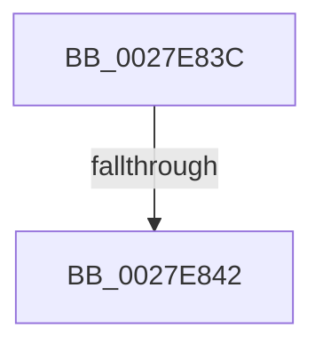

# sub_0027E83C

- RVA: `0x0027E83C`–`0x0027E869` (길이 `45` bytes)
- VA: `0x000000014027E83C`
- 실행 섹션: `.text`
- PDB 이름 있음: `아니요`; PDB Function 태그: `아니요`
- unwind 정보 RVA: `0x000663E8`
- 디코드: `13`개 명령, `45/45` bytes 표시
- 미해석 바이트: `0` (있으면 어셈블리에 `.byte`로 보존)

> 이 문서는 커널 이미지의 기계어와 PDB 기호를 분석해 생성했습니다. 4번과 5번은 함수 원형과 자료형을 바이너리 사용 방식에서 추정한 C 해석이며 원본 소스 복구 결과는 아닙니다.

## 1. Dependencies

- 직접 호출 지점: **2**; 고유 호출 대상: **2**
- 직접 호출자로 확인된 함수: **0**
- RIP 상대 이미지 참조: **0**

### Outgoing calls
- `0x0027E857` → [KeBugCheckEx](../4F/KeBugCheckEx_function_004FD660.md) (function, `0x004FD660`)
- `0x0027E85F` → [MiCheckRelevantKernelShadows](../43/MiCheckRelevantKernelShadows_function_004323B4.md) (function, `0x004323B4`)

### Direct callers
- 이 함수 시작 RVA로 연결되는 직접 call은 확인되지 않았습니다. 간접 호출은 완전히 역산할 수 없습니다.

### Static image references
- 디코드된 RIP-relative 메모리 참조가 없습니다.

## 2. Other-region calls and transfers

- 다른 실행 섹션으로 향하는 call: **0**
- call이 아닌 외부 분기/꼬리 이동: **2**
  - `0x0027E840` → [sub_0027E69B + 0x134](Unknown_function_0027E69B.md) (`tail-transfer`)
  - `0x0027E867` → [sub_0027E69B + 0x15A](Unknown_function_0027E69B.md) (`tail-transfer`)

## 3. Assembly (complete function range)

```asm
0027E83C  40 F6 C5 08                     test bpl, 8
0027E840  75 8D                           jne 0x14027e7cf
0027E842  4C 8B C8                        mov r9, rax
0027E845  48 89 44 24 20                  mov qword ptr [rsp + 0x20], rax
0027E84A  4D 8B C4                        mov r8, r12
0027E84D  BA 01 13 00 00                  mov edx, 0x1301
0027E852  B9 1A 00 00 00                  mov ecx, 0x1a
0027E857  E8 04 EE 27 00                  call 0x1404fd660
0027E85C  CC                              int3
0027E85D  8B CD                           mov ecx, ebp
0027E85F  E8 50 3B 1B 00                  call 0x1404323b4
0027E864  4C 8B F0                        mov r14, rax
0027E867  EB 8C                           jmp 0x14027e7f5
```

## 4. C-style interpretation (structured pseudocode)

```c
__int64 __fastcall sub_0027E83C(void)
{
    __int64 result;
    unsigned __int64 v_stack_p20;

    v_stack_p20 = result;
    result = KeBugCheckEx(26, (unsigned int)(0x1301ULL), v_r12, result);
    result = MiCheckRelevantKernelShadows((unsigned int)((unsigned int)(v_rbp)), (unsigned int)(0x1301ULL), v_r12, result);
}
```

## 5. (Beta) C Style

```c
void sub_0027E83C(void)
{
    int64_t result;
    uint64_t v_stack_p20;

    v_stack_p20 = result;
    result = KeBugCheckEx(26, (uint32_t)(0x1301ULL), local_r12, result);
    result = MiCheckRelevantKernelShadows((uint32_t)((uint32_t)(local_rbp)), (uint32_t)(0x1301ULL), local_r12, result);
}
```

## 6. Execution-region graph

[열기: 2D/3D 그래프와 함수 탐색 컨트롤 패널](../../../control-panel.html?section=text&rva=0x0027E83C&view=graph)

- 2D 그래프는 위에서 아래로 흐르고, 3D 그래프는 빈 공간을 드래그해 회전합니다. Shift+드래그는 이동, 휠은 확대·축소, 함수 노드 선택은 대상 보고서 이동입니다.

### Static fallback


