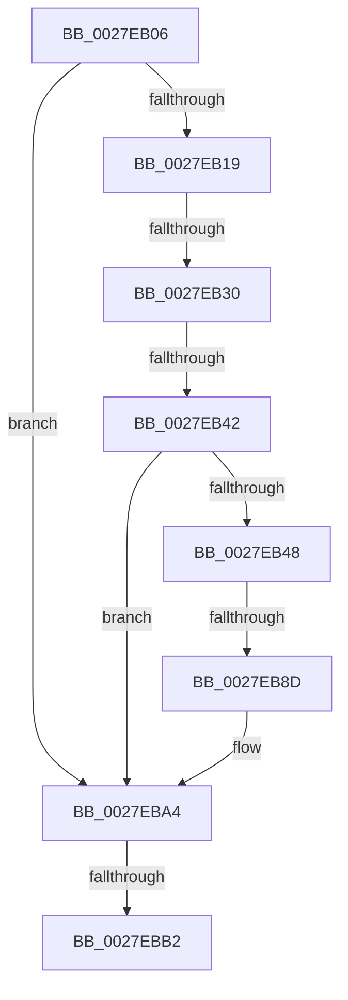

# sub_0027EB06

- RVA: `0x0027EB06`–`0x0027EBC0` (길이 `186` bytes)
- VA: `0x000000014027EB06`
- 실행 섹션: `.text`
- PDB 이름 있음: `아니요`; PDB Function 태그: `아니요`
- unwind 정보 RVA: `0x0006645C`
- 디코드: `50`개 명령, `186/186` bytes 표시
- 미해석 바이트: `0` (있으면 어셈블리에 `.byte`로 보존)

> 이 문서는 커널 이미지의 기계어와 PDB 기호를 분석해 생성했습니다. 4번과 5번은 함수 원형과 자료형을 바이너리 사용 방식에서 추정한 C 해석이며 원본 소스 복구 결과는 아닙니다.

## 1. Dependencies

- 직접 호출 지점: **1**; 고유 호출 대상: **1**
- 직접 호출자로 확인된 함수: **0**
- RIP 상대 이미지 참조: **0**

### Outgoing calls
- `0x0027EB99` → [MiAddWorkingSetEntries](MiAddWorkingSetEntries_function_0027DC00.md) (function, `0x0027DC00`)

### Direct callers
- 이 함수 시작 RVA로 연결되는 직접 call은 확인되지 않았습니다. 간접 호출은 완전히 역산할 수 없습니다.

### Static image references
- 디코드된 RIP-relative 메모리 참조가 없습니다.

## 2. Other-region calls and transfers

- 다른 실행 섹션으로 향하는 call: **0**
- call이 아닌 외부 분기/꼬리 이동: **4**
  - `0x0027EB2A` → [sub_0027EC31](Unknown_function_0027EC31.md) (`tail-transfer`)
  - `0x0027EB3C` → [sub_0027EBD1](Unknown_function_0027EBD1.md) (`tail-transfer`)
  - `0x0027EB8B` → [sub_0027EBD1 + 0x2E](Unknown_function_0027EBD1.md) (`tail-transfer`)
  - `0x0027EBB0` → [sub_0027EBD1 + 0xC](Unknown_function_0027EBD1.md) (`tail-transfer`)

## 3. Assembly (complete function range)

```asm
0027EB06  48 89 6C 24 30                  mov qword ptr [rsp + 0x30], rbp
0027EB0B  BD FF 01 00 00                  mov ebp, 0x1ff
0027EB10  66 85 C0                        test ax, ax
0027EB13  0F 84 8B 00 00 00               je 0x14027eba4
0027EB19  8B C8                           mov ecx, eax
0027EB1B  0F B7 43 08                     movzx eax, word ptr [rbx + 8]
0027EB1F  03 C8                           add ecx, eax
0027EB21  8B C7                           mov eax, edi
0027EB23  C1 E8 03                        shr eax, 3
0027EB26  23 C5                           and eax, ebp
0027EB28  3B C8                           cmp ecx, eax
0027EB2A  0F 85 01 01 00 00               jne 0x14027ec31
0027EB30  49 8B 40 28                     mov rax, qword ptr [r8 + 0x28]
0027EB34  44 0F B6 4B 0D                  movzx r9d, byte ptr [rbx + 0xd]
0027EB39  48 85 C0                        test rax, rax
0027EB3C  0F 88 8F 00 00 00               js 0x14027ebd1
0027EB42  41 F6 C1 02                     test r9b, 2
0027EB46  75 5C                           jne 0x14027eba4
0027EB48  48 B9 00 00 00 00 80 F6 FF FF   movabs rcx, 0xfffff68000000000
0027EB52  48 8B C1                        mov rax, rcx
0027EB55  48 8B 53 10                     mov rdx, qword ptr [rbx + 0x10]
0027EB59  41 83 E1 02                     and r9d, 2
0027EB5D  4C 8B 13                        mov r10, qword ptr [rbx]
0027EB60  48 C1 E2 19                     shl rdx, 0x19
0027EB64  48 C1 E0 19                     shl rax, 0x19
0027EB68  48 2B D0                        sub rdx, rax
0027EB6B  48 C1 FA 10                     sar rdx, 0x10
0027EB6F  48 C1 E2 19                     shl rdx, 0x19
0027EB73  48 2B D0                        sub rdx, rax
0027EB76  0F B7 43 08                     movzx eax, word ptr [rbx + 8]
0027EB7A  48 C1 E0 0C                     shl rax, 0xc
0027EB7E  48 C1 FA 10                     sar rdx, 0x10
0027EB82  48 03 D0                        add rdx, rax
0027EB85  48 8B C1                        mov rax, rcx
0027EB88  48 3B D0                        cmp rdx, rax
0027EB8B  73 72                           jae 0x14027ebff
0027EB8D  41 83 C9 05                     or r9d, 5
0027EB91  44 0F B7 43 0A                  movzx r8d, word ptr [rbx + 0xa]
0027EB96  49 8B CA                        mov rcx, r10
0027EB99  E8 62 F0 FF FF                  call 0x14027dc00
0027EB9E  33 C0                           xor eax, eax
0027EBA0  66 89 43 0A                     mov word ptr [rbx + 0xa], ax
0027EBA4  0F B7 43 0A                     movzx eax, word ptr [rbx + 0xa]
0027EBA8  B9 01 00 00 00                  mov ecx, 1
0027EBAD  66 85 C0                        test ax, ax
0027EBB0  74 2B                           je 0x14027ebdd
0027EBB2  66 FF C0                        inc ax
0027EBB5  66 89 43 0A                     mov word ptr [rbx + 0xa], ax
0027EBB9  48 8B 6C 24 30                  mov rbp, qword ptr [rsp + 0x30]
0027EBBE  8B C1                           mov eax, ecx
```

## 4. C-style interpretation (structured pseudocode)

```c
__int64 __fastcall sub_0027EB06(__int64 a1, __int64 a2, __int64 a3, __int64 a4, __int64 a5, __int64 a6)
{
    __int64 result;
    unsigned __int64 v_stack_p30;

    v_stack_p30 = v_rbp;
    if ((unsigned __int16)(result) == 0) goto loc_0027EBA4;
    a1 = (unsigned int)(((unsigned int)((unsigned int)(result))) + ((unsigned int)(*(unsigned __int16 *)(v_rbx + 8))));
    result = (unsigned int)(((unsigned int)((unsigned int)(v_rdi))) >> (3));
    result = (unsigned int)((result) & (511));
    if ((((unsigned __int8)(*(unsigned __int8 *)(v_rbx + 13))) & (2)) != 0) goto loc_0027EBA4;
    a4 = (unsigned int)((*(unsigned __int8 *)(v_rbx + 13)) & (2));
    a2 = (*(unsigned __int64 *)(v_rbx + 16)) << (25);
    result = (a1) << (25);
    a2 = (a2) - (result);
    a2 = (a2) >> (16);
    a2 = (a2) << (25);
    a2 = (a2) - (result);
    result = (*(unsigned __int16 *)(v_rbx + 8)) << (12);
    a2 = (a2) >> (16);
    a2 = (a2) + (result);
    a4 = (unsigned int)((a4) | (5));
    result = MiAddWorkingSetEntries(*(unsigned __int64 *)(v_rbx), a2, *(unsigned __int16 *)(v_rbx + 10), a4);
    result = 0;
    *(unsigned __int16 *)(v_rbx + 10) = 0;
loc_0027EBA4:
    result = (unsigned __int16)((*(unsigned __int16 *)(v_rbx + 10)) + 1);
    *(unsigned __int16 *)(v_rbx + 10) = (unsigned __int16)(result);
    return 1;
}
```

## 5. (Beta) C Style

```c
int64_t sub_0027EB06(int64_t Arg1, int64_t Arg2, void *Arg3, int64_t Arg4, uint64_t Arg5, int64_t Arg6)
{
    uint8_t *arg3 = (uint8_t *)Arg3;

    int64_t result;
    uint64_t v_stack_p30;

    v_stack_p30 = local_rbp;
    if ((uint16_t)(result) == 0) goto loc_0027EBA4;
    Arg1 = (uint32_t)(((uint32_t)((uint32_t)(result))) + ((uint32_t)(*(uint16_t *)(local_rbx + 0x8))));
    result = (uint32_t)(((uint32_t)((uint32_t)(local_rdi))) >> (3));
    result = (uint32_t)((result) & (511));
    if ((((uint8_t)(*(uint8_t *)(local_rbx + 0xD))) & (2)) != 0) goto loc_0027EBA4;
    Arg4 = (uint32_t)((*(uint8_t *)(local_rbx + 0xD)) & (2));
    Arg2 = (*(uint64_t *)(local_rbx + 0x10)) << (25);
    result = (Arg1) << (25);
    Arg2 = (Arg2) - (result);
    Arg2 = (Arg2) >> (16);
    Arg2 = (Arg2) << (25);
    Arg2 = (Arg2) - (result);
    result = (*(uint16_t *)(local_rbx + 0x8)) << (12);
    Arg2 = (Arg2) >> (16);
    Arg2 = (Arg2) + (result);
    Arg4 = (uint32_t)((Arg4) | (5));
    result = MiAddWorkingSetEntries(*(uint64_t *)(local_rbx), Arg2, *(uint16_t *)(local_rbx + 0xA), Arg4);
    result = 0;
    *(uint16_t *)(local_rbx + 0xA) = 0;
loc_0027EBA4:
    result = (uint16_t)((*(uint16_t *)(local_rbx + 0xA)) + 1);
    *(uint16_t *)(local_rbx + 0xA) = (uint16_t)(result);
    return 1;
}
```

### 관측된 메모리 오프셋

구조체 형식이 확인되지 않은 접근은 인자 기준의 오프셋으로만 기록했습니다.

| 기준 인자 | 오프셋 표현 | 폭 (bit) | 접근 |
|---|---:|---:|---|
| `Arg3` | `+ 0x28` | `64` | `R` |

## 6. Execution-region graph

[열기: 2D/3D 그래프와 함수 탐색 컨트롤 패널](../../../control-panel.html?section=text&rva=0x0027EB06&view=graph)

- 2D 그래프는 위에서 아래로 흐르고, 3D 그래프는 빈 공간을 드래그해 회전합니다. Shift+드래그는 이동, 휠은 확대·축소, 함수 노드 선택은 대상 보고서 이동입니다.

### Static fallback


