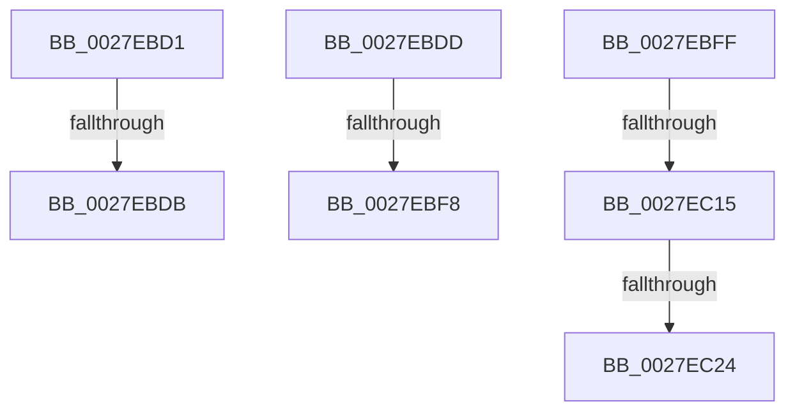

# sub_0027EBD1

- RVA: `0x0027EBD1`–`0x0027EC2D` (길이 `92` bytes)
- VA: `0x000000014027EBD1`
- 실행 섹션: `.text`
- PDB 이름 있음: `아니요`; PDB Function 태그: `아니요`
- unwind 정보 RVA: `0x00066484`
- 디코드: `23`개 명령, `92/92` bytes 표시
- 미해석 바이트: `0` (있으면 어셈블리에 `.byte`로 보존)

> 이 문서는 커널 이미지의 기계어와 PDB 기호를 분석해 생성했습니다. 4번과 5번은 함수 원형과 자료형을 바이너리 사용 방식에서 추정한 C 해석이며 원본 소스 복구 결과는 아닙니다.

## 1. Dependencies

- 직접 호출 지점: **0**; 고유 호출 대상: **0**
- 직접 호출자로 확인된 함수: **0**
- RIP 상대 이미지 참조: **0**

### Outgoing calls
- 직접 디코드된 call 명령이 없습니다.

### Direct callers
- 이 함수 시작 RVA로 연결되는 직접 call은 확인되지 않았습니다. 간접 호출은 완전히 역산할 수 없습니다.

### Static image references
- 디코드된 RIP-relative 메모리 참조가 없습니다.

## 2. Other-region calls and transfers

- 다른 실행 섹션으로 향하는 call: **0**
- call이 아닌 외부 분기/꼬리 이동: **7**
  - `0x0027EBD5` → [sub_0027EB06 + 0x42](Unknown_function_0027EB06.md) (`tail-transfer`)
  - `0x0027EBDB` → [sub_0027EB06 + 0x9E](Unknown_function_0027EB06.md) (`tail-transfer`)
  - `0x0027EBF6` → [sub_0027EC31 + 0xD](Unknown_function_0027EC31.md) (`tail-transfer`)
  - `0x0027EBFD` → [sub_0027EB06 + 0xB3](Unknown_function_0027EB06.md) (`tail-transfer`)
  - `0x0027EC0F` → [sub_0027EB06 + 0x87](Unknown_function_0027EB06.md) (`tail-transfer`)
  - `0x0027EC1E` → [sub_0027EB06 + 0x8B](Unknown_function_0027EB06.md) (`tail-transfer`)
  - `0x0027EC28` → [sub_0027EB06 + 0x8B](Unknown_function_0027EB06.md) (`tail-transfer`)

## 3. Assembly (complete function range)

```asm
0027EBD1  41 F6 C1 02                     test r9b, 2
0027EBD5  0F 85 6D FF FF FF               jne 0x14027eb48
0027EBDB  EB C7                           jmp 0x14027eba4
0027EBDD  C1 EF 03                        shr edi, 3
0027EBE0  66 23 FD                        and di, bp
0027EBE3  66 89 4B 0A                     mov word ptr [rbx + 0xa], cx
0027EBE7  66 89 7B 08                     mov word ptr [rbx + 8], di
0027EBEB  48 8B 46 28                     mov rax, qword ptr [rsi + 0x28]
0027EBEF  48 85 C0                        test rax, rax
0027EBF2  0F B6 43 0D                     movzx eax, byte ptr [rbx + 0xd]
0027EBF6  78 46                           js 0x14027ec3e
0027EBF8  0C 02                           or al, 2
0027EBFA  88 43 0D                        mov byte ptr [rbx + 0xd], al
0027EBFD  EB BA                           jmp 0x14027ebb9
0027EBFF  48 B8 FF FF FF FF FF F6 FF FF   movabs rax, 0xfffff6ffffffffff
0027EC09  48 8B C0                        mov rax, rax
0027EC0C  48 3B D0                        cmp rdx, rax
0027EC0F  0F 87 78 FF FF FF               ja 0x14027eb8d
0027EC15  41 8B 82 B8 00 00 00            mov eax, dword ptr [r10 + 0xb8]
0027EC1C  A8 0F                           test al, 0xf
0027EC1E  0F 85 6D FF FF FF               jne 0x14027eb91
0027EC24  41 83 C9 04                     or r9d, 4
0027EC28  E9 64 FF FF FF                  jmp 0x14027eb91
```

## 4. C-style interpretation (structured pseudocode)

```c
__int64 __fastcall sub_0027EBD1(unsigned __int16 a1, __int64 a2, __int64 a3, int a4)
{
}
```

## 5. (Beta) C Style

```c
int64_t sub_0027EBD1(uint16_t Arg1, int64_t Arg2, int64_t Arg3, int32_t Arg4)
{
}
```

## 6. Execution-region graph

[열기: 2D/3D 그래프와 함수 탐색 컨트롤 패널](../../../control-panel.html?section=text&rva=0x0027EBD1&view=graph)

- 2D 그래프는 위에서 아래로 흐르고, 3D 그래프는 빈 공간을 드래그해 회전합니다. Shift+드래그는 이동, 휠은 확대·축소, 함수 노드 선택은 대상 보고서 이동입니다.

### Static fallback


