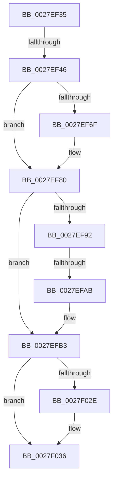

# sub_0027EF35

- RVA: `0x0027EF35`–`0x0027F063` (길이 `302` bytes)
- VA: `0x000000014027EF35`
- 실행 섹션: `.text`
- PDB 이름 있음: `아니요`; PDB Function 태그: `아니요`
- unwind 정보 RVA: `0x00066508`
- 디코드: `74`개 명령, `302/302` bytes 표시
- 미해석 바이트: `0` (있으면 어셈블리에 `.byte`로 보존)

> 이 문서는 커널 이미지의 기계어와 PDB 기호를 분석해 생성했습니다. 4번과 5번은 함수 원형과 자료형을 바이너리 사용 방식에서 추정한 C 해석이며 원본 소스 복구 결과는 아닙니다.

## 1. Dependencies

- 직접 호출 지점: **0**; 고유 호출 대상: **0**
- 직접 호출자로 확인된 함수: **0**
- RIP 상대 이미지 참조: **1**

### Outgoing calls
- 직접 디코드된 call 명령이 없습니다.

### Direct callers
- 이 함수 시작 RVA로 연결되는 직접 call은 확인되지 않았습니다. 간접 호출은 완전히 역산할 수 없습니다.

### Static image references
- `0x0027EF83` → RVA `0x00000000` (`image boundary/outside`; read)

## 2. Other-region calls and transfers

- 다른 실행 섹션으로 향하는 call: **0**
- call이 아닌 외부 분기/꼬리 이동: **3**
  - `0x0027EF40` → [sub_0027F337](Unknown_function_0027F337.md) (`tail-transfer`)
  - `0x0027EFA5` → [sub_0027F24A](Unknown_function_0027F24A.md) (`tail-transfer`)
  - `0x0027F05D` → [sub_0027F1E6](Unknown_function_0027F1E6.md) (`tail-transfer`)

## 3. Assembly (complete function range)

```asm
0027EF35  48 89 BC 24 80 01 00 00         mov qword ptr [rsp + 0x180], rdi
0027EF3D  83 E2 04                        and edx, 4
0027EF40  0F 85 F1 03 00 00               jne 0x14027f337
0027EF46  48 85 D2                        test rdx, rdx
0027EF49  48 8D 45 E4                     lea rax, [rbp - 0x1c]
0027EF4D  4C 8D 45 E0                     lea r8, [rbp - 0x20]
0027EF51  B9 01 00 00 00                  mov ecx, 1
0027EF56  4C 0F 45 C0                     cmovne r8, rax
0027EF5A  49 8B C1                        mov rax, r9
0027EF5D  48 C1 E0 20                     shl rax, 0x20
0027EF61  49 8B F8                        mov rdi, r8
0027EF64  49 0B C1                        or rax, r9
0027EF67  F3 48 AB                        rep stosq qword ptr [rdi], rax
0027EF6A  48 85 D2                        test rdx, rdx
0027EF6D  75 11                           jne 0x14027ef80
0027EF6F  B8 04 00 00 00                  mov eax, 4
0027EF74  B9 08 00 00 00                  mov ecx, 8
0027EF79  0F 44 C1                        cmove eax, ecx
0027EF7C  46 89 0C 00                     mov dword ptr [rax + r8], r9d
0027EF80  49 8B D5                        mov rdx, r13
0027EF83  48 8D 3D 76 10 D8 FF            lea rdi, [rip - 0x27ef8a]
0027EF8A  41 8B CD                        mov ecx, r13d
0027EF8D  83 F9 03                        cmp ecx, 3
0027EF90  73 21                           jae 0x14027efb3
0027EF92  8B C1                           mov eax, ecx
0027EF94  48 8D 04 C5 00 00 00 00         lea rax, [rax*8]
0027EF9C  48 83 BC 38 60 1C 01 00 10      cmp qword ptr [rax + rdi + 0x11c60], 0x10
0027EFA5  0F 85 9F 02 00 00               jne 0x14027f24a
0027EFAB  48 8B 94 38 D0 EC E0 00         mov rdx, qword ptr [rax + rdi + 0xe0ecd0]
0027EFB3  48 8B CE                        mov rcx, rsi
0027EFB6  48 89 55 08                     mov qword ptr [rbp + 8], rdx
0027EFBA  48 C1 E9 09                     shr rcx, 9
0027EFBE  0F 57 C0                        xorps xmm0, xmm0
0027EFC1  48 BF F8 FF FF FF 7F 00 00 00   movabs rdi, 0x7ffffffff8
0027EFCB  66 0F 7F 45 10                  movdqa xmmword ptr [rbp + 0x10], xmm0
0027EFD0  48 23 CF                        and rcx, rdi
0027EFD3  48 BA 00 00 00 00 80 F6 FF FF   movabs rdx, 0xfffff68000000000
0027EFDD  48 8B C2                        mov rax, rdx
0027EFE0  48 03 C8                        add rcx, rax
0027EFE3  48 89 4C 24 58                  mov qword ptr [rsp + 0x58], rcx
0027EFE8  48 C1 E9 09                     shr rcx, 9
0027EFEC  48 23 CF                        and rcx, rdi
0027EFEF  48 8B C2                        mov rax, rdx
0027EFF2  48 03 C8                        add rcx, rax
0027EFF5  48 89 4C 24 60                  mov qword ptr [rsp + 0x60], rcx
0027EFFA  48 C1 E9 09                     shr rcx, 9
0027EFFE  48 23 CF                        and rcx, rdi
0027F001  48 8B C2                        mov rax, rdx
0027F004  48 03 C8                        add rcx, rax
0027F007  48 89 4C 24 68                  mov qword ptr [rsp + 0x68], rcx
0027F00C  48 C1 E9 09                     shr rcx, 9
0027F010  48 23 CF                        and rcx, rdi
0027F013  48 8B C2                        mov rax, rdx
0027F016  48 03 C8                        add rcx, rax
0027F019  48 8D 45 E0                     lea rax, [rbp - 0x20]
0027F01D  48 89 4C 24 70                  mov qword ptr [rsp + 0x70], rcx
0027F022  8B 4D 90                        mov ecx, dword ptr [rbp - 0x70]
0027F025  48 89 45 A0                     mov qword ptr [rbp - 0x60], rax
0027F029  F6 C3 40                        test bl, 0x40
0027F02C  74 08                           je 0x14027f036
0027F02E  0F BA E9 07                     bts ecx, 7
0027F032  48 83 E3 FD                     and rbx, 0xfffffffffffffffd
0027F036  41 8B C6                        mov eax, r14d
0027F039  48 89 5C 24 48                  mov qword ptr [rsp + 0x48], rbx
0027F03E  83 E0 01                        and eax, 1
0027F041  48 89 74 24 40                  mov qword ptr [rsp + 0x40], rsi
0027F046  C1 E0 08                        shl eax, 8
0027F049  0F BA F1 08                     btr ecx, 8
0027F04D  0B C1                           or eax, ecx
0027F04F  4C 89 7C 24 50                  mov qword ptr [rsp + 0x50], r15
0027F054  89 45 90                        mov dword ptr [rbp - 0x70], eax
0027F057  44 0F 20 C0                     mov rax, cr8
0027F05B  3C 01                           cmp al, 1
0027F05D  0F 87 83 01 00 00               ja 0x14027f1e6
```

## 4. C-style interpretation (structured pseudocode)

```c
__int64 __fastcall sub_0027EF35(__int64 a1, int a2, __int64 a3, __int64 a4)
{
    __int64 result;
    __int64 v_rbx;
    unsigned __int64 v_stack_p180;
    unsigned __int64 v_stack_p40;
    unsigned __int64 v_stack_p48;
    unsigned __int64 v_stack_p50;
    unsigned __int64 v_stack_p58;
    unsigned __int64 v_stack_p60;
    unsigned __int64 v_stack_p68;
    unsigned __int64 v_stack_p70;

    v_stack_p180 = v_rdi;
    a2 = (unsigned int)((a2) & (4));
    a3 = v_rbp - 32;
    if (a2 != 0) { a3 = v_rbp - 28; }
    result = (a4) << (32);
    result = (result) | (a4);
    if (a2 == 0) {
        result = 4;
        a1 = 8;
        if (a2 == 0) { result = (unsigned int)(a1); }
        *(unsigned int *)(result + a3 * 1) = (unsigned int)(a4);
    }
    if (((unsigned int)((unsigned int)((unsigned int)(v_r13)))) >= 3) goto loc_0027EFB3;
loc_0027EFB3:
    *(unsigned __int64 *)(v_rbp + 8) = *(unsigned __int64 *)((unsigned int)((unsigned int)((unsigned int)((unsigned int)(v_r13)))) * 8 + v_rip - 2617226 * 1 + 14740688);
    a1 = (v_rsi) >> (9);
    *(unsigned __int64 *)(v_rbp + 16) = v_xmm0;
    a1 = (a1) & (v_rip - 2617226);
    a1 = (a1) + (*(unsigned __int64 *)((unsigned int)((unsigned int)((unsigned int)((unsigned int)(v_r13)))) * 8 + v_rip - 2617226 * 1 + 14740688));
    v_stack_p58 = a1;
    a1 = (a1) >> (9);
    a1 = (a1) & (v_rip - 2617226);
    a1 = (a1) + (*(unsigned __int64 *)((unsigned int)((unsigned int)((unsigned int)((unsigned int)(v_r13)))) * 8 + v_rip - 2617226 * 1 + 14740688));
    v_stack_p60 = a1;
    a1 = (a1) >> (9);
    a1 = (a1) & (v_rip - 2617226);
    a1 = (a1) + (*(unsigned __int64 *)((unsigned int)((unsigned int)((unsigned int)((unsigned int)(v_r13)))) * 8 + v_rip - 2617226 * 1 + 14740688));
    v_stack_p68 = a1;
    a1 = (a1) >> (9);
    a1 = (a1) & (v_rip - 2617226);
    a1 = (a1) + (*(unsigned __int64 *)((unsigned int)((unsigned int)((unsigned int)((unsigned int)(v_r13)))) * 8 + v_rip - 2617226 * 1 + 14740688));
    v_stack_p70 = a1;
    *(unsigned __int64 *)(v_rbp - 96) = v_rbp - 32;
    if ((((unsigned __int8)(v_rbx)) & (64)) != 0) {
        v_rbx = (v_rbx) & (-3);
    }
    v_stack_p48 = v_rbx;
    result = (unsigned int)(((unsigned int)((unsigned int)(v_r14))) & (1));
    v_stack_p40 = v_rsi;
    result = (unsigned int)((result) << (8));
    result = (unsigned int)((result) | ((unsigned int)((unsigned int)(*(unsigned int *)(v_rbp - 112)))));
    v_stack_p50 = v_r15;
    *(unsigned int *)(v_rbp - 112) = (unsigned int)(result);
}
```

## 5. (Beta) C Style

```c
int64_t sub_0027EF35(int64_t Arg1, int32_t Arg2, int64_t Arg3, int64_t Arg4)
{
    int64_t result;
    int64_t local_rbx;
    uint64_t v_stack_p180;
    uint64_t v_stack_p40;
    uint64_t v_stack_p48;
    uint64_t v_stack_p50;
    uint64_t v_stack_p58;
    uint64_t v_stack_p60;
    uint64_t v_stack_p68;
    uint64_t v_stack_p70;

    v_stack_p180 = local_rdi;
    Arg2 = (uint32_t)((Arg2) & (4));
    Arg3 = local_rbp - 32;
    if (Arg2 != 0) { Arg3 = local_rbp - 28; }
    result = (Arg4) << (32);
    result = (result) | (Arg4);
    if (Arg2 == 0) {
        result = 4;
        Arg1 = 8;
        if (Arg2 == 0) { result = (uint32_t)(Arg1); }
        *(uint32_t *)(result + Arg3 * 1) = (uint32_t)(Arg4);
    }
    if (((uint32_t)((uint32_t)((uint32_t)(local_r13)))) >= 3) goto loc_0027EFB3;
loc_0027EFB3:
    *(uint64_t *)(local_rbp + 0x8) = *(uint64_t *)((uint32_t)((uint32_t)((uint32_t)((uint32_t)(local_r13)))) * 8 + v_rip - 0x27EF8A * 1 + 0xE0ECD0);
    Arg1 = (local_rsi) >> (9);
    *(uint64_t *)(local_rbp + 0x10) = v_xmm0;
    Arg1 = (Arg1) & (v_rip - 2617226);
    Arg1 = (Arg1) + (*(uint64_t *)((uint32_t)((uint32_t)((uint32_t)((uint32_t)(local_r13)))) * 8 + v_rip - 0x27EF8A * 1 + 0xE0ECD0));
    v_stack_p58 = Arg1;
    Arg1 = (Arg1) >> (9);
    Arg1 = (Arg1) & (v_rip - 2617226);
    Arg1 = (Arg1) + (*(uint64_t *)((uint32_t)((uint32_t)((uint32_t)((uint32_t)(local_r13)))) * 8 + v_rip - 0x27EF8A * 1 + 0xE0ECD0));
    v_stack_p60 = Arg1;
    Arg1 = (Arg1) >> (9);
    Arg1 = (Arg1) & (v_rip - 2617226);
    Arg1 = (Arg1) + (*(uint64_t *)((uint32_t)((uint32_t)((uint32_t)((uint32_t)(local_r13)))) * 8 + v_rip - 0x27EF8A * 1 + 0xE0ECD0));
    v_stack_p68 = Arg1;
    Arg1 = (Arg1) >> (9);
    Arg1 = (Arg1) & (v_rip - 2617226);
    Arg1 = (Arg1) + (*(uint64_t *)((uint32_t)((uint32_t)((uint32_t)((uint32_t)(local_r13)))) * 8 + v_rip - 0x27EF8A * 1 + 0xE0ECD0));
    v_stack_p70 = Arg1;
    *(uint64_t *)(local_rbp - 0x60) = local_rbp - 32;
    if ((((uint8_t)(local_rbx)) & (64)) != 0) {
        local_rbx = (local_rbx) & (-3);
    }
    v_stack_p48 = local_rbx;
    result = (uint32_t)(((uint32_t)((uint32_t)(local_r14))) & (1));
    v_stack_p40 = local_rsi;
    result = (uint32_t)((result) << (8));
    result = (uint32_t)((result) | ((uint32_t)((uint32_t)(*(uint32_t *)(local_rbp - 0x70)))));
    v_stack_p50 = local_r15;
    *(uint32_t *)(local_rbp - 0x70) = (uint32_t)(result);
}
```

## 6. Execution-region graph

[열기: 2D/3D 그래프와 함수 탐색 컨트롤 패널](../../../control-panel.html?section=text&rva=0x0027EF35&view=graph)

- 2D 그래프는 위에서 아래로 흐르고, 3D 그래프는 빈 공간을 드래그해 회전합니다. Shift+드래그는 이동, 휠은 확대·축소, 함수 노드 선택은 대상 보고서 이동입니다.

### Static fallback


