# sub_0027F063

- RVA: `0x0027F063`–`0x0027F195` (길이 `306` bytes)
- VA: `0x000000014027F063`
- 실행 섹션: `.text`
- PDB 이름 있음: `아니요`; PDB Function 태그: `아니요`
- unwind 정보 RVA: `0x0006651C`
- 디코드: `64`개 명령, `306/306` bytes 표시
- 미해석 바이트: `0` (있으면 어셈블리에 `.byte`로 보존)

> 이 문서는 커널 이미지의 기계어와 PDB 기호를 분석해 생성했습니다. 4번과 5번은 함수 원형과 자료형을 바이너리 사용 방식에서 추정한 C 해석이며 원본 소스 복구 결과는 아닙니다.

## 1. Dependencies

- 직접 호출 지점: **5**; 고유 호출 대상: **5**
- 직접 호출자로 확인된 함수: **0**
- RIP 상대 이미지 참조: **0**

### Outgoing calls
- `0x0027F089` → [MiUserFault](../32/MiUserFault_function_00329840.md) (function, `0x00329840`)
- `0x0027F0A1` → [MiDispatchFault](../32/MiDispatchFault_function_00320520.md) (function, `0x00320520`)
- `0x0027F0CF` → [MiUnlockFaultPageTable](MiUnlockFaultPageTable_function_0027D870.md) (function, `0x0027D870`)
- `0x0027F0E5` → [MiUnlockWorkingSetShared](MiUnlockWorkingSetShared_function_0027D690.md) (function, `0x0027D690`)
- `0x0027F15C` → [MiConvertFaultStatus](../2A/MiConvertFaultStatus_function_002A2CC0.md) (function, `0x002A2CC0`)

### Direct callers
- 이 함수 시작 RVA로 연결되는 직접 call은 확인되지 않았습니다. 간접 호출은 완전히 역산할 수 없습니다.

### Static image references
- 디코드된 RIP-relative 메모리 참조가 없습니다.

## 2. Other-region calls and transfers

- 다른 실행 섹션으로 향하는 call: **0**
- call이 아닌 외부 분기/꼬리 이동: **14**
  - `0x0027F07E` → [sub_0027F36E + 0x14E](Unknown_function_0027F36E.md) (`tail-transfer`)
  - `0x0027F0AD` → [sub_0027F36E + 0x13](Unknown_function_0027F36E.md) (`tail-transfer`)
  - `0x0027F0BB` → [sub_0027F2B0](Unknown_function_0027F2B0.md) (`tail-transfer`)
  - `0x0027F0DF` → [sub_0027F36E](Unknown_function_0027F36E.md) (`tail-transfer`)
  - `0x0027F0F8` → [sub_0027F340](Unknown_function_0027F340.md) (`tail-transfer`)
  - `0x0027F10C` → [sub_0027F251](Unknown_function_0027F251.md) (`tail-transfer`)
  - `0x0027F122` → [sub_0027F2B0 + 0x4B](Unknown_function_0027F2B0.md) (`tail-transfer`)
  - `0x0027F12F` → [sub_0027F528](Unknown_function_0027F528.md) (`tail-transfer`)
  - `0x0027F13C` → [sub_0027F528 + 0x15](Unknown_function_0027F528.md) (`tail-transfer`)
  - `0x0027F147` → [sub_0027F1F2](Unknown_function_0027F1F2.md) (`tail-transfer`)
  - `0x0027F168` → [sub_0027F528 + 0x50](Unknown_function_0027F528.md) (`tail-transfer`)
  - `0x0027F170` → [sub_0027F528 + 0x6A](Unknown_function_0027F528.md) (`tail-transfer`)
  - `0x0027F17A` → [sub_0027F36E + 0xC9](Unknown_function_0027F36E.md) (`tail-transfer`)
  - `0x0027F18F` → [sub_0027F2A6](Unknown_function_0027F2A6.md) (`tail-transfer`)

## 3. Assembly (complete function range)

```asm
0027F063  4C 89 A4 24 30 01 00 00         mov qword ptr [rsp + 0x130], r12
0027F06B  48 BB 00 00 00 00 00 80 FF FF   movabs rbx, 0xffff800000000000
0027F075  41 BC 00 10 00 00               mov r12d, 0x1000
0027F07B  48 3B F3                        cmp rsi, rbx
0027F07E  0F 83 38 04 00 00               jae 0x14027f4bc
0027F084  48 8D 4C 24 40                  lea rcx, [rsp + 0x40]
0027F089  E8 B2 A7 0A 00                  call 0x140329840
0027F08E  8B F8                           mov edi, eax
0027F090  3D 16 00 00 C0                  cmp eax, 0xc0000016
0027F095  75 5D                           jne 0x14027f0f4
0027F097  48 8D 54 24 30                  lea rdx, [rsp + 0x30]
0027F09C  48 8D 4C 24 40                  lea rcx, [rsp + 0x40]
0027F0A1  E8 7A 14 0A 00                  call 0x140320520
0027F0A6  8B F8                           mov edi, eax
0027F0A8  3D 16 00 00 C0                  cmp eax, 0xc0000016
0027F0AD  0F 84 CE 02 00 00               je 0x14027f381
0027F0B3  48 8B 44 24 30                  mov rax, qword ptr [rsp + 0x30]
0027F0B8  48 85 C0                        test rax, rax
0027F0BB  0F 85 EF 01 00 00               jne 0x14027f2b0
0027F0C1  4C 89 6D A8                     mov qword ptr [rbp - 0x58], r13
0027F0C5  48 8B 5C 24 78                  mov rbx, qword ptr [rsp + 0x78]
0027F0CA  48 8D 4C 24 78                  lea rcx, [rsp + 0x78]
0027F0CF  E8 9C E7 FF FF                  call 0x14027d870
0027F0D4  F6 45 85 01                     test byte ptr [rbp - 0x7b], 1
0027F0D8  48 8B CB                        mov rcx, rbx
0027F0DB  0F B6 55 84                     movzx edx, byte ptr [rbp - 0x7c]
0027F0DF  0F 85 89 02 00 00               jne 0x14027f36e
0027F0E5  E8 A6 E5 FF FF                  call 0x14027d690
0027F0EA  48 BB 00 00 00 00 00 80 FF FF   movabs rbx, 0xffff800000000000
0027F0F4  F6 45 90 20                     test byte ptr [rbp - 0x70], 0x20
0027F0F8  0F 85 42 02 00 00               jne 0x14027f340
0027F0FE  48 8B 44 24 78                  mov rax, qword ptr [rsp + 0x78]
0027F103  8B 88 B8 00 00 00               mov ecx, dword ptr [rax + 0xb8]
0027F109  F6 C1 0F                        test cl, 0xf
0027F10C  0F 85 3F 01 00 00               jne 0x14027f251
0027F112  65 48 8B 04 25 88 01 00 00      mov rax, qword ptr gs:[0x188]
0027F11B  80 B8 C3 00 00 00 10            cmp byte ptr [rax + 0xc3], 0x10
0027F122  0F 8D D3 01 00 00               jge 0x14027f2fb
0027F128  48 8B 4D B8                     mov rcx, qword ptr [rbp - 0x48]
0027F12C  48 85 C9                        test rcx, rcx
0027F12F  0F 85 F3 03 00 00               jne 0x14027f528
0027F135  48 8B 4D C0                     mov rcx, qword ptr [rbp - 0x40]
0027F139  48 85 C9                        test rcx, rcx
0027F13C  0F 85 FB 03 00 00               jne 0x14027f53d
0027F142  F6 44 24 50 01                  test byte ptr [rsp + 0x50], 1
0027F147  0F 85 A5 00 00 00               jne 0x14027f1f2
0027F14D  85 FF                           test edi, edi
0027F14F  74 12                           je 0x14027f163
0027F151  44 8B C7                        mov r8d, edi
0027F154  48 8D 4C 24 40                  lea rcx, [rsp + 0x40]
0027F159  41 8B D4                        mov edx, r12d
0027F15C  E8 5F 3B 02 00                  call 0x1402a2cc0
0027F161  8B F8                           mov edi, eax
0027F163  8B 45 90                        mov eax, dword ptr [rbp - 0x70]
0027F166  A8 01                           test al, 1
0027F168  0F 85 0A 04 00 00               jne 0x14027f578
0027F16E  A8 02                           test al, 2
0027F170  0F 85 1C 04 00 00               jne 0x14027f592
0027F176  4C 39 6D A8                     cmp qword ptr [rbp - 0x58], r13
0027F17A  0F 85 B7 02 00 00               jne 0x14027f437
0027F180  48 8B 4D B0                     mov rcx, qword ptr [rbp - 0x50]
0027F184  4C 8B A4 24 30 01 00 00         mov r12, qword ptr [rsp + 0x130]
0027F18C  48 85 C9                        test rcx, rcx
0027F18F  0F 85 11 01 00 00               jne 0x14027f2a6
```

## 4. C-style interpretation (structured pseudocode)

```c
__int64 __fastcall sub_0027F063(__int64 a1, __int64 a2, __int64 a3, __int64 a4, __int64 a5, __int64 a6, __int64 a7, __int64 a8, __int64 a9, unsigned __int8 a10, __int64 a11, __int64 a12, __int64 a13, __int64 a14, __int64 a15, __int64 a16, __int64 a17, __int64 a18, __int64 a19, __int64 a20, __int64 a21, __int64 a22, __int64 a23, __int64 a24, __int64 a25, __int64 a26, __int64 a27, __int64 a28, __int64 a29, __int64 a30, __int64 a31, __int64 a32, __int64 a33, __int64 a34, __int64 a35, __int64 a36, __int64 a37, __int64 a38)
{
    __int64 result;
    __int64 v_rdi;
    unsigned __int64 v_stack_p130;

    v_stack_p130 = v_r12;
    result = MiUserFault(a8, a2, a3, a4);
    if (((unsigned int)(result)) != 0xC0000016ULL) goto loc_0027F0F4;
    result = MiDispatchFault(a8, a6, a3, a4);
    *(unsigned __int64 *)(v_rbp - 88) = v_r13;
    result = MiUnlockFaultPageTable(a15, a6, a3, a4);
    result = MiUnlockWorkingSetShared(a15, *(unsigned __int8 *)(v_rbp - 124), a3, a4);
loc_0027F0F4:
    result = *(unsigned __int64 *)(gs_base + (0 + 392));
    v_rdi = (unsigned int)((unsigned int)(result));
    if ((unsigned int)((unsigned int)((unsigned int)(result))) != 0) {
        a3 = (unsigned int)((unsigned int)((unsigned int)(result)));
        a1 = a8;
        a2 = (unsigned int)((unsigned int)(0x1000ULL));
        result = MiConvertFaultStatus(a1, a2, a3, a4);
        v_rdi = (unsigned int)(result);
    }
}
```

## 5. (Beta) C Style

```c
int64_t sub_0027F063(int64_t Arg1, int64_t Arg2, int64_t Arg3, int64_t Arg4, uint64_t Arg5, int64_t Arg6, uint64_t Arg7, int64_t Arg8, uint64_t Arg9, uint8_t Arg10, uint64_t Arg11, uint64_t Arg12, uint64_t Arg13, uint64_t Arg14, void *Arg15, uint64_t Arg16, uint64_t Arg17, uint64_t Arg18, uint64_t Arg19, uint64_t Arg20, uint64_t Arg21, uint64_t Arg22, uint64_t Arg23, uint64_t Arg24, uint64_t Arg25, uint64_t Arg26, uint64_t Arg27, uint64_t Arg28, uint64_t Arg29, uint64_t Arg30, uint64_t Arg31, uint64_t Arg32, uint64_t Arg33, uint64_t Arg34, uint64_t Arg35, uint64_t Arg36, uint64_t Arg37, int64_t Arg38)
{
    uint8_t *arg15 = (uint8_t *)Arg15;

    int64_t result;
    int64_t local_rdi;
    uint64_t v_stack_p130;

    v_stack_p130 = local_r12;
    result = MiUserFault(Arg8, Arg2, Arg3, Arg4);
    if (((uint32_t)(result)) != 0xC0000016ULL) goto loc_0027F0F4;
    result = MiDispatchFault(Arg8, Arg6, Arg3, Arg4);
    *(uint64_t *)(local_rbp - 0x58) = local_r13;
    result = MiUnlockFaultPageTable(Arg15, Arg6, Arg3, Arg4);
    result = MiUnlockWorkingSetShared(Arg15, *(uint8_t *)(local_rbp - 0x7C), Arg3, Arg4);
loc_0027F0F4:
    result = *(uint64_t *)(gs_base + (0 + 0x188));
    local_rdi = (uint32_t)((uint32_t)(result));
    if ((uint32_t)((uint32_t)((uint32_t)(result))) != 0) {
        Arg3 = (uint32_t)((uint32_t)((uint32_t)(result)));
        Arg1 = Arg8;
        Arg2 = (uint32_t)((uint32_t)(0x1000ULL));
        result = MiConvertFaultStatus(Arg1, Arg2, Arg3, Arg4);
        local_rdi = (uint32_t)(result);
    }
}
```

### 관측된 메모리 오프셋

구조체 형식이 확인되지 않은 접근은 인자 기준의 오프셋으로만 기록했습니다.

| 기준 인자 | 오프셋 표현 | 폭 (bit) | 접근 |
|---|---:|---:|---|
| `Arg15` | `+ 0xB8` | `32` | `R` |

## 6. Execution-region graph

[열기: 2D/3D 그래프와 함수 탐색 컨트롤 패널](../../../control-panel.html?section=text&rva=0x0027F063&view=graph)

- 2D 그래프는 위에서 아래로 흐르고, 3D 그래프는 빈 공간을 드래그해 회전합니다. Shift+드래그는 이동, 휠은 확대·축소, 함수 노드 선택은 대상 보고서 이동입니다.

### Static fallback

```mermaid
flowchart TD
  bb_0027F063[BB_0027F063]
  bb_0027F084[BB_0027F084]
  bb_0027F097[BB_0027F097]
  bb_0027F0B3[BB_0027F0B3]
  bb_0027F0C1[BB_0027F0C1]
  bb_0027F0E5[BB_0027F0E5]
  bb_0027F0F4[BB_0027F0F4]
  bb_0027F0FE[BB_0027F0FE]
  bb_0027F112[BB_0027F112]
  bb_0027F128[BB_0027F128]
  bb_0027F135[BB_0027F135]
  bb_0027F142[BB_0027F142]
  bb_0027F14D[BB_0027F14D]
  bb_0027F151[BB_0027F151]
  bb_0027F163[BB_0027F163]
  bb_0027F16E[BB_0027F16E]
  bb_0027F176[BB_0027F176]
  bb_0027F180[BB_0027F180]
  bb_0027F063 -->|fallthrough| bb_0027F084
  bb_0027F084 -->|branch| bb_0027F0F4
  bb_0027F084 -->|fallthrough| bb_0027F097
  bb_0027F097 -->|fallthrough| bb_0027F0B3
  bb_0027F0B3 -->|fallthrough| bb_0027F0C1
  bb_0027F0C1 -->|fallthrough| bb_0027F0E5
  bb_0027F0E5 -->|flow| bb_0027F0F4
  bb_0027F0F4 -->|fallthrough| bb_0027F0FE
  bb_0027F0FE -->|fallthrough| bb_0027F112
  bb_0027F112 -->|fallthrough| bb_0027F128
  bb_0027F128 -->|fallthrough| bb_0027F135
  bb_0027F135 -->|fallthrough| bb_0027F142
  bb_0027F142 -->|fallthrough| bb_0027F14D
  bb_0027F14D -->|branch| bb_0027F163
  bb_0027F14D -->|fallthrough| bb_0027F151
  bb_0027F151 -->|flow| bb_0027F163
  bb_0027F163 -->|fallthrough| bb_0027F16E
  bb_0027F16E -->|fallthrough| bb_0027F176
  bb_0027F176 -->|fallthrough| bb_0027F180
```


