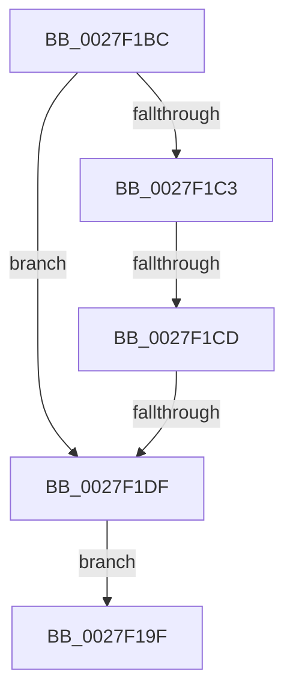

# sub_0027F19F

- RVA: `0x0027F19F`–`0x0027F1E6` (길이 `71` bytes)
- VA: `0x000000014027F19F`
- 실행 섹션: `.text`
- PDB 이름 있음: `아니요`; PDB Function 태그: `아니요`
- unwind 정보 RVA: `0x00066540`
- 디코드: `23`개 명령, `71/71` bytes 표시
- 미해석 바이트: `0` (있으면 어셈블리에 `.byte`로 보존)

> 이 문서는 커널 이미지의 기계어와 PDB 기호를 분석해 생성했습니다. 4번과 5번은 함수 원형과 자료형을 바이너리 사용 방식에서 추정한 C 해석이며 원본 소스 복구 결과는 아닙니다.

## 1. Dependencies

- 직접 호출 지점: **2**; 고유 호출 대상: **2**
- 직접 호출자로 확인된 함수: **0**
- RIP 상대 이미지 참조: **0**

### Outgoing calls
- `0x0027F1A6` → [_security_check_cookie](../6A/_security_check_cookie_function_006AC640.md) (function, `0x006AC640`)
- `0x0027F1D2` → [KeInvalidAccessAllowed](../34/KeInvalidAccessAllowed_function_0034B3F0.md) (function, `0x0034B3F0`)

### Direct callers
- 이 함수 시작 RVA로 연결되는 직접 call은 확인되지 않았습니다. 간접 호출은 완전히 역산할 수 없습니다.

### Static image references
- 디코드된 RIP-relative 메모리 참조가 없습니다.

## 2. Other-region calls and transfers

- 다른 실행 섹션으로 향하는 call: **0**
- call이 아닌 외부 분기/꼬리 이동: **2**
  - `0x0027F1C7` → [sub_0027F5A9](Unknown_function_0027F5A9.md) (`tail-transfer`)
  - `0x0027F1D9` → [sub_0027F5A9 + 0x25](Unknown_function_0027F5A9.md) (`tail-transfer`)

## 3. Assembly (complete function range)

```asm
0027F19F  48 8B 4D 20                     mov rcx, qword ptr [rbp + 0x20]
0027F1A3  48 33 CC                        xor rcx, rsp
0027F1A6  E8 95 D4 42 00                  call 0x1406ac640
0027F1AB  48 81 C4 38 01 00 00            add rsp, 0x138
0027F1B2  41 5F                           pop r15
0027F1B4  41 5E                           pop r14
0027F1B6  41 5D                           pop r13
0027F1B8  5E                              pop rsi
0027F1B9  5B                              pop rbx
0027F1BA  5D                              pop rbp
0027F1BB  C3                              ret
0027F1BC  CC                              int3
0027F1BD  41 80 FE 01                     cmp r14b, 1
0027F1C1  74 1C                           je 0x14027f1df
0027F1C3  41 F6 C7 01                     test r15b, 1
0027F1C7  0F 85 DC 03 00 00               jne 0x14027f5a9
0027F1CD  33 D2                           xor edx, edx
0027F1CF  49 8B CF                        mov rcx, r15
0027F1D2  E8 19 C2 0C 00                  call 0x14034b3f0
0027F1D7  84 C0                           test al, al
0027F1D9  0F 84 EF 03 00 00               je 0x14027f5ce
0027F1DF  B8 05 00 00 C0                  mov eax, 0xc0000005
0027F1E4  EB B9                           jmp 0x14027f19f
```

## 4. C-style interpretation (structured pseudocode)

```c
__int64 __fastcall sub_0027F19F(__int64 a1, int a2)
{
    __int64 result;
    __int64 v_rsp;

    a1 = (*(unsigned __int64 *)(v_rbp + 32)) ^ (v_rsp);
    result = _security_check_cookie(a1, a2, a3, a4);
    v_rsp = (v_rsp) + (312);
    return result;
}
```

## 5. (Beta) C Style

```c
int64_t sub_0027F19F(int64_t Arg1, int32_t Arg2)
{
    int64_t result;
    int64_t local_rsp;

    Arg1 = (*(uint64_t *)(local_rbp + 0x20)) ^ (local_rsp);
    result = _security_check_cookie(Arg1, Arg2, a3, a4);
    local_rsp = (local_rsp) + (312);
    return result;
}
```

## 6. Execution-region graph

[열기: 2D/3D 그래프와 함수 탐색 컨트롤 패널](../../../control-panel.html?section=text&rva=0x0027F19F&view=graph)

- 2D 그래프는 위에서 아래로 흐르고, 3D 그래프는 빈 공간을 드래그해 회전합니다. Shift+드래그는 이동, 휠은 확대·축소, 함수 노드 선택은 대상 보고서 이동입니다.

### Static fallback


