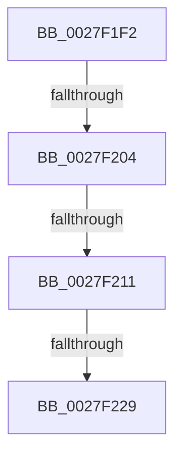

# sub_0027F1F2

- RVA: `0x0027F1F2`–`0x0027F233` (길이 `65` bytes)
- VA: `0x000000014027F1F2`
- 실행 섹션: `.text`
- PDB 이름 있음: `아니요`; PDB Function 태그: `아니요`
- unwind 정보 RVA: `0x00066568`
- 디코드: `14`개 명령, `65/65` bytes 표시
- 미해석 바이트: `0` (있으면 어셈블리에 `.byte`로 보존)

> 이 문서는 커널 이미지의 기계어와 PDB 기호를 분석해 생성했습니다. 4번과 5번은 함수 원형과 자료형을 바이너리 사용 방식에서 추정한 C 해석이며 원본 소스 복구 결과는 아닙니다.

## 1. Dependencies

- 직접 호출 지점: **1**; 고유 호출 대상: **1**
- 직접 호출자로 확인된 함수: **0**
- RIP 상대 이미지 참조: **0**

### Outgoing calls
- `0x0027F218` → [MiReplenishSlabAllocator](../37/MiReplenishSlabAllocator_function_003788E4.md) (function, `0x003788E4`)

### Direct callers
- 이 함수 시작 RVA로 연결되는 직접 call은 확인되지 않았습니다. 간접 호출은 완전히 역산할 수 없습니다.

### Static image references
- 디코드된 RIP-relative 메모리 참조가 없습니다.

## 2. Other-region calls and transfers

- 다른 실행 섹션으로 향하는 call: **0**
- call이 아닌 외부 분기/꼬리 이동: **4**
  - `0x0027F1FE` → [sub_0027F063 + 0xEA](Unknown_function_0027F063.md) (`tail-transfer`)
  - `0x0027F20B` → [sub_0027F063 + 0xEA](Unknown_function_0027F063.md) (`tail-transfer`)
  - `0x0027F223` → [sub_0027F063 + 0xEA](Unknown_function_0027F063.md) (`tail-transfer`)
  - `0x0027F22E` → [sub_0027F063 + 0xEE](Unknown_function_0027F063.md) (`tail-transfer`)

## 3. Assembly (complete function range)

```asm
0027F1F2  48 8B 44 24 50                  mov rax, qword ptr [rsp + 0x50]
0027F1F7  48 83 E0 FE                     and rax, 0xfffffffffffffffe
0027F1FB  80 38 05                        cmp byte ptr [rax], 5
0027F1FE  0F 85 49 FF FF FF               jne 0x14027f14d
0027F204  48 8B 48 30                     mov rcx, qword ptr [rax + 0x30]
0027F208  48 85 C9                        test rcx, rcx
0027F20B  0F 84 3C FF FF FF               je 0x14027f14d
0027F211  45 33 C0                        xor r8d, r8d
0027F214  41 8D 50 01                     lea edx, [r8 + 1]
0027F218  E8 C7 96 0F 00                  call 0x1403788e4
0027F21D  81 FF 17 00 00 C0               cmp edi, 0xc0000017
0027F223  0F 85 24 FF FF FF               jne 0x14027f14d
0027F229  BF 34 04 00 C0                  mov edi, 0xc0000434
0027F22E  E9 1E FF FF FF                  jmp 0x14027f151
```

## 4. C-style interpretation (structured pseudocode)

```c
__int64 __fastcall sub_0027F1F2(__int64 a1, __int64 a2, int a3, __int64 a4, __int64 a5, __int64 a6, __int64 a7, __int64 a8, __int64 a9, __int64 a10)
{
    __int64 result;

    result = (a10) & (-2);
    a3 = 0;
    result = MiReplenishSlabAllocator(*(unsigned __int64 *)(result + 48), a3 + 1, a3, a4);
}
```

## 5. (Beta) C Style

```c
int64_t sub_0027F1F2(int64_t Arg1, int64_t Arg2, int32_t Arg3, int64_t Arg4, uint64_t Arg5, uint64_t Arg6, uint64_t Arg7, uint64_t Arg8, uint64_t Arg9, void *Arg10)
{
    uint8_t *arg10 = (uint8_t *)Arg10;

    int64_t result;

    result = (Arg10) & (-2);
    Arg3 = 0;
    result = MiReplenishSlabAllocator(*(uint64_t *)(result + 0x30), Arg3 + 1, Arg3, Arg4);
}
```

### 관측된 메모리 오프셋

구조체 형식이 확인되지 않은 접근은 인자 기준의 오프셋으로만 기록했습니다.

| 기준 인자 | 오프셋 표현 | 폭 (bit) | 접근 |
|---|---:|---:|---|
| `Arg10` | `+ 0x0` | `8` | `R` |
| `Arg10` | `+ 0x30` | `64` | `R` |

## 6. Execution-region graph

[열기: 2D/3D 그래프와 함수 탐색 컨트롤 패널](../../../control-panel.html?section=text&rva=0x0027F1F2&view=graph)

- 2D 그래프는 위에서 아래로 흐르고, 3D 그래프는 빈 공간을 드래그해 회전합니다. Shift+드래그는 이동, 휠은 확대·축소, 함수 노드 선택은 대상 보고서 이동입니다.

### Static fallback


