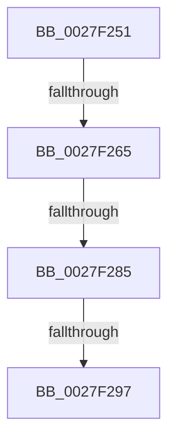

# sub_0027F251

- RVA: `0x0027F251`–`0x0027F2A6` (길이 `85` bytes)
- VA: `0x000000014027F251`
- 실행 섹션: `.text`
- PDB 이름 있음: `아니요`; PDB Function 태그: `아니요`
- unwind 정보 RVA: `0x000665A4`
- 디코드: `17`개 명령, `85/85` bytes 표시
- 미해석 바이트: `0` (있으면 어셈블리에 `.byte`로 보존)

> 이 문서는 커널 이미지의 기계어와 PDB 기호를 분석해 생성했습니다. 4번과 5번은 함수 원형과 자료형을 바이너리 사용 방식에서 추정한 C 해석이며 원본 소스 복구 결과는 아닙니다.

## 1. Dependencies

- 직접 호출 지점: **2**; 고유 호출 대상: **2**
- 직접 호출자로 확인된 함수: **0**
- RIP 상대 이미지 참조: **1**

### Outgoing calls
- `0x0027F28A` → [MiSufficientAvailablePages](../36/MiSufficientAvailablePages_function_0036D0B0.md) (function, `0x0036D0B0`)
- `0x0027F29C` → [MiDelayFaultingThread](../2A/MiDelayFaultingThread_function_002A3054.md) (function, `0x002A3054`)

### Direct callers
- 이 함수 시작 RVA로 연결되는 직접 call은 확인되지 않았습니다. 간접 호출은 완전히 역산할 수 없습니다.

### Static image references
- `0x0027F271` → RVA `0x00E30088` (`.data`; read)

## 2. Other-region calls and transfers

- 다른 실행 섹션으로 향하는 call: **0**
- call이 아닌 외부 분기/꼬리 이동: **4**
  - `0x0027F25F` → [sub_0027F063 + 0xC5](Unknown_function_0027F063.md) (`tail-transfer`)
  - `0x0027F27F` → [sub_0027F063 + 0xC5](Unknown_function_0027F063.md) (`tail-transfer`)
  - `0x0027F291` → [sub_0027F063 + 0xC5](Unknown_function_0027F063.md) (`tail-transfer`)
  - `0x0027F2A1` → [sub_0027F063 + 0xC5](Unknown_function_0027F063.md) (`tail-transfer`)

## 3. Assembly (complete function range)

```asm
0027F251  48 8B 44 24 78                  mov rax, qword ptr [rsp + 0x78]
0027F256  8B 48 04                        mov ecx, dword ptr [rax + 4]
0027F259  F7 C1 FF 0F 00 00               test ecx, 0xfff
0027F25F  0F 85 C3 FE FF FF               jne 0x14027f128
0027F265  48 8B 44 24 78                  mov rax, qword ptr [rsp + 0x78]
0027F26A  0F B7 88 AE 00 00 00            movzx ecx, word ptr [rax + 0xae]
0027F271  48 8B 05 10 0E BB 00            mov rax, qword ptr [rip + 0xbb0e10]
0027F278  48 8B 0C C8                     mov rcx, qword ptr [rax + rcx*8]
0027F27C  48 85 C9                        test rcx, rcx
0027F27F  0F 84 A3 FE FF FF               je 0x14027f128
0027F285  BA 20 04 00 00                  mov edx, 0x420
0027F28A  E8 21 DE 0E 00                  call 0x14036d0b0
0027F28F  85 C0                           test eax, eax
0027F291  0F 85 91 FE FF FF               jne 0x14027f128
0027F297  B9 0A 00 01 00                  mov ecx, 0x1000a
0027F29C  E8 B3 3D 02 00                  call 0x1402a3054
0027F2A1  E9 82 FE FF FF                  jmp 0x14027f128
```

## 4. C-style interpretation (structured pseudocode)

```c
__int64 __fastcall sub_0027F251(__int64 a1, __int64 a2, __int64 a3, __int64 a4, __int64 a5, __int64 a6, __int64 a7, __int64 a8, __int64 a9, __int64 a10, __int64 a11, __int64 a12, __int64 a13, __int64 a14, __int64 a15)
{
    __int64 result;

    result = MiSufficientAvailablePages(*(unsigned __int64 *)(*(unsigned __int64 *)(v_rip + 12258832) + *(unsigned __int16 *)(a15 + 174) * 8), (unsigned int)(0x420ULL), a3, a4);
    result = MiDelayFaultingThread((unsigned int)(0x1000AULL), (unsigned int)(0x420ULL), a3, a4);
}
```

## 5. (Beta) C Style

```c
int64_t sub_0027F251(int64_t Arg1, int64_t Arg2, int64_t Arg3, int64_t Arg4, uint64_t Arg5, uint64_t Arg6, uint64_t Arg7, uint64_t Arg8, uint64_t Arg9, uint64_t Arg10, uint64_t Arg11, uint64_t Arg12, uint64_t Arg13, uint64_t Arg14, void *Arg15)
{
    uint8_t *arg15 = (uint8_t *)Arg15;

    int64_t result;

    result = MiSufficientAvailablePages(*(uint64_t *)(*(uint64_t *)(v_rip + 0xBB0E10) + *(uint16_t *)(arg15 + 0xAE) * 8), (uint32_t)(0x420ULL), Arg3, Arg4);
    result = MiDelayFaultingThread((uint32_t)(0x1000AULL), (uint32_t)(0x420ULL), Arg3, Arg4);
}
```

### 관측된 메모리 오프셋

구조체 형식이 확인되지 않은 접근은 인자 기준의 오프셋으로만 기록했습니다.

| 기준 인자 | 오프셋 표현 | 폭 (bit) | 접근 |
|---|---:|---:|---|
| `Arg15` | `+ 0x4` | `32` | `R` |
| `Arg15` | `+ 0xAE` | `16` | `R` |

## 6. Execution-region graph

[열기: 2D/3D 그래프와 함수 탐색 컨트롤 패널](../../../control-panel.html?section=text&rva=0x0027F251&view=graph)

- 2D 그래프는 위에서 아래로 흐르고, 3D 그래프는 빈 공간을 드래그해 회전합니다. Shift+드래그는 이동, 휠은 확대·축소, 함수 노드 선택은 대상 보고서 이동입니다.

### Static fallback


