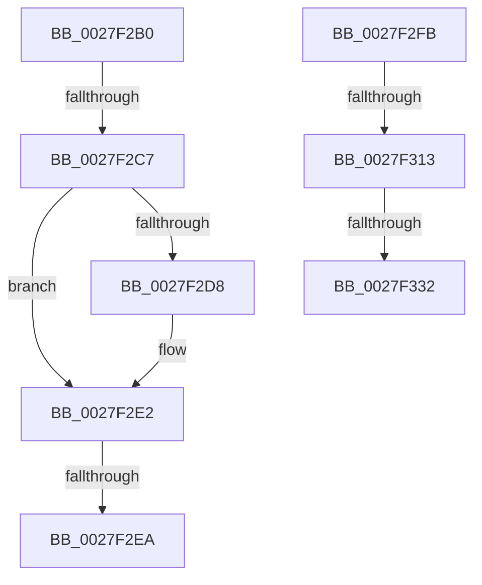

# sub_0027F2B0

- RVA: `0x0027F2B0`–`0x0027F337` (길이 `135` bytes)
- VA: `0x000000014027F2B0`
- 실행 섹션: `.text`
- PDB 이름 있음: `아니요`; PDB Function 태그: `아니요`
- unwind 정보 RVA: `0x000665D0`
- 디코드: `30`개 명령, `135/135` bytes 표시
- 미해석 바이트: `0` (있으면 어셈블리에 `.byte`로 보존)

> 이 문서는 커널 이미지의 기계어와 PDB 기호를 분석해 생성했습니다. 4번과 5번은 함수 원형과 자료형을 바이너리 사용 방식에서 추정한 C 해석이며 원본 소스 복구 결과는 아닙니다.

## 1. Dependencies

- 직접 호출 지점: **1**; 고유 호출 대상: **1**
- 직접 호출자로 확인된 함수: **0**
- RIP 상대 이미지 참조: **0**

### Outgoing calls
- `0x0027F2EF` → [MiIssueHardFault](../38/MiIssueHardFault_function_00380074.md) (function, `0x00380074`)

### Direct callers
- 이 함수 시작 RVA로 연결되는 직접 call은 확인되지 않았습니다. 간접 호출은 완전히 역산할 수 없습니다.

### Static image references
- 디코드된 RIP-relative 메모리 참조가 없습니다.

## 2. Other-region calls and transfers

- 다른 실행 섹션으로 향하는 call: **0**
- call이 아닌 외부 분기/꼬리 이동: **6**
  - `0x0027F2C1` → [sub_0027F36E + 0xA](Unknown_function_0027F36E.md) (`tail-transfer`)
  - `0x0027F2E4` → [sub_0027F36E + 0x12F](Unknown_function_0027F36E.md) (`tail-transfer`)
  - `0x0027F2F6` → [sub_0027F063 + 0x5E](Unknown_function_0027F063.md) (`tail-transfer`)
  - `0x0027F30D` → [sub_0027F063 + 0xC5](Unknown_function_0027F063.md) (`tail-transfer`)
  - `0x0027F32C` → [sub_0027F251 + 0x19](Unknown_function_0027F251.md) (`tail-transfer`)
  - `0x0027F332` → [sub_0027F063 + 0xC5](Unknown_function_0027F063.md) (`tail-transfer`)

## 3. Assembly (complete function range)

```asm
0027F2B0  48 8B 88 00 01 00 00            mov rcx, qword ptr [rax + 0x100]
0027F2B7  44 8B A0 38 01 00 00            mov r12d, dword ptr [rax + 0x138]
0027F2BE  48 85 C9                        test rcx, rcx
0027F2C1  0F 85 B1 00 00 00               jne 0x14027f378
0027F2C7  8B 80 C0 00 00 00               mov eax, dword ptr [rax + 0xc0]
0027F2CD  48 8B 54 24 30                  mov rdx, qword ptr [rsp + 0x30]
0027F2D2  41 80 FE 01                     cmp r14b, 1
0027F2D6  75 0A                           jne 0x14027f2e2
0027F2D8  0F BA E8 13                     bts eax, 0x13
0027F2DC  89 82 C0 00 00 00               mov dword ptr [rdx + 0xc0], eax
0027F2E2  A8 01                           test al, 1
0027F2E4  0F 85 B3 01 00 00               jne 0x14027f49d
0027F2EA  48 8D 4C 24 40                  lea rcx, [rsp + 0x40]
0027F2EF  E8 80 0D 10 00                  call 0x140380074
0027F2F4  8B F8                           mov edi, eax
0027F2F6  E9 C6 FD FF FF                  jmp 0x14027f0c1
0027F2FB  8B 80 A4 05 00 00               mov eax, dword ptr [rax + 0x5a4]
0027F301  A8 0C                           test al, 0xc
0027F303  0F 94 C1                        sete cl
0027F306  A8 02                           test al, 2
0027F308  0F 94 C0                        sete al
0027F30B  84 C8                           test al, cl
0027F30D  0F 84 15 FE FF FF               je 0x14027f128
0027F313  48 8B 44 24 78                  mov rax, qword ptr [rsp + 0x78]
0027F318  48 8B 88 80 00 00 00            mov rcx, qword ptr [rax + 0x80]
0027F31F  48 8B 44 24 78                  mov rax, qword ptr [rsp + 0x78]
0027F324  48 2B 48 70                     sub rcx, qword ptr [rax + 0x70]
0027F328  48 83 F9 64                     cmp rcx, 0x64
0027F32C  0F 8F 38 FF FF FF               jg 0x14027f26a
0027F332  E9 F1 FD FF FF                  jmp 0x14027f128
```

## 4. C-style interpretation (structured pseudocode)

```c
__int64 __fastcall sub_0027F2B0(__int64 a1, __int64 a2, __int64 a3, __int64 a4, __int64 a5, __int64 a6, __int64 a7, __int64 a8)
{
    __int64 result;
    unsigned __int64 v_stack_p78;

    if (((unsigned __int8)(v_r14)) == 1) {
        *(unsigned int *)(a6 + 192) = (unsigned int)((unsigned int)(*(unsigned int *)(result + 192)));
    }
    result = MiIssueHardFault(a8, a6, a3, a4);
}
```

## 5. (Beta) C Style

```c
int64_t sub_0027F2B0(int64_t Arg1, int64_t Arg2, int64_t Arg3, int64_t Arg4, uint64_t Arg5, void *Arg6, uint64_t Arg7, int64_t Arg8)
{
    uint8_t *arg6 = (uint8_t *)Arg6;

    int64_t result;
    uint64_t v_stack_p78;

    if (((uint8_t)(local_r14)) == 1) {
        *(uint32_t *)(arg6 + 0xC0) = (uint32_t)((uint32_t)(*(uint32_t *)(result + 0xC0)));
    }
    result = MiIssueHardFault(Arg8, Arg6, Arg3, Arg4);
}
```

### 관측된 메모리 오프셋

구조체 형식이 확인되지 않은 접근은 인자 기준의 오프셋으로만 기록했습니다.

| 기준 인자 | 오프셋 표현 | 폭 (bit) | 접근 |
|---|---:|---:|---|
| `Arg6` | `+ 0xC0` | `32` | `W` |

## 6. Execution-region graph

[열기: 2D/3D 그래프와 함수 탐색 컨트롤 패널](../../../control-panel.html?section=text&rva=0x0027F2B0&view=graph)

- 2D 그래프는 위에서 아래로 흐르고, 3D 그래프는 빈 공간을 드래그해 회전합니다. Shift+드래그는 이동, 휠은 확대·축소, 함수 노드 선택은 대상 보고서 이동입니다.

### Static fallback


