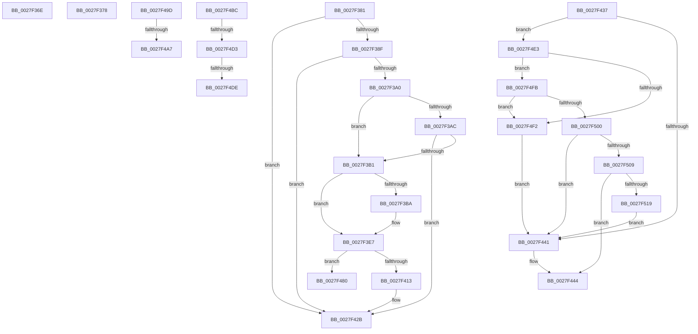

# sub_0027F36E

- RVA: `0x0027F36E`–`0x0027F51E` (길이 `432` bytes)
- VA: `0x000000014027F36E`
- 실행 섹션: `.text`
- PDB 이름 있음: `아니요`; PDB Function 태그: `아니요`
- unwind 정보 RVA: `0x00066624`
- 디코드: `103`개 명령, `432/432` bytes 표시
- 미해석 바이트: `0` (있으면 어셈블리에 `.byte`로 보존)

> 이 문서는 커널 이미지의 기계어와 PDB 기호를 분석해 생성했습니다. 4번과 5번은 함수 원형과 자료형을 바이너리 사용 방식에서 추정한 C 해석이며 원본 소스 복구 결과는 아닙니다.

## 1. Dependencies

- 직접 호출 지점: **10**; 고유 호출 대상: **10**
- 직접 호출자로 확인된 함수: **0**
- RIP 상대 이미지 참조: **2**

### Outgoing calls
- `0x0027F36E` → [MiUnlockWorkingSetExclusive](MiUnlockWorkingSetExclusive_function_0027EC70.md) (function, `0x0027EC70`)
- `0x0027F3BF` → [MiLockVadTree](MiLockVadTree_function_0027C0F0.md) (function, `0x0027C0F0`)
- `0x0027F3C9` → [MiLocateAddress](../31/MiLocateAddress_function_003168D0.md) (function, `0x003168D0`)
- `0x0027F3D9` → [MiUnlockVadTree](../29/MiUnlockVadTree_function_00297020.md) (function, `0x00297020`)
- `0x0027F406` → [MiGetProtoPteAddress](../32/MiGetProtoPteAddress_function_0032E970.md) (function, `0x0032E970`)
- `0x0027F426` → [MiRetainSubsection](../47/MiRetainSubsection_function_00479864.md) (function, `0x00479864`)
- `0x0027F469` → [MiInitializePageFaultPacket](../22/MiInitializePageFaultPacket_function_00228EB0.md) (function, `0x00228EB0`)
- `0x0027F48A` → [MiReleaseFaultState](MiReleaseFaultState_function_0027D290.md) (function, `0x0027D290`)
- `0x0027F4AC` → [MiFaultGetFileExtents](../47/MiFaultGetFileExtents_function_00479758.md) (function, `0x00479758`)
- `0x0027F4C1` → [MiSystemFault](../34/MiSystemFault_function_0034AA64.md) (function, `0x0034AA64`)

### Direct callers
- 이 함수 시작 RVA로 연결되는 직접 call은 확인되지 않았습니다. 간접 호출은 완전히 역산할 수 없습니다.

### Static image references
- `0x0027F393` → RVA `0x00E2DB68` (`.data`; read)
- `0x0027F3A0` → RVA `0x00E2DB70` (`.data`; read)

## 2. Other-region calls and transfers

- 다른 실행 섹션으로 향하는 call: **0**
- call이 아닌 외부 분기/꼬리 이동: **10**
  - `0x0027F373` → [sub_0027F063 + 0x87](Unknown_function_0027F063.md) (`tail-transfer`)
  - `0x0027F37C` → [sub_0027F2B0 + 0x17](Unknown_function_0027F2B0.md) (`tail-transfer`)
  - `0x0027F432` → [sub_0027F063 + 0x62](Unknown_function_0027F063.md) (`tail-transfer`)
  - `0x0027F47B` → [sub_0027F063 + 0x12](Unknown_function_0027F063.md) (`tail-transfer`)
  - `0x0027F498` → [sub_0027F063 + 0xC5](Unknown_function_0027F063.md) (`tail-transfer`)
  - `0x0027F4A1` → [sub_0027F2B0 + 0x3A](Unknown_function_0027F2B0.md) (`tail-transfer`)
  - `0x0027F4B7` → [sub_0027F063 + 0x91](Unknown_function_0027F063.md) (`tail-transfer`)
  - `0x0027F4CD` → [sub_0027F063 + 0x21](Unknown_function_0027F063.md) (`tail-transfer`)
  - `0x0027F4D8` → [sub_0027F063 + 0xC5](Unknown_function_0027F063.md) (`tail-transfer`)
  - `0x0027F4DE` → [sub_0027F063 + 0x34](Unknown_function_0027F063.md) (`tail-transfer`)

## 3. Assembly (complete function range)

```asm
0027F36E  E8 FD F8 FF FF                  call 0x14027ec70
0027F373  E9 72 FD FF FF                  jmp 0x14027f0ea
0027F378  44 8B 61 28                     mov r12d, dword ptr [rcx + 0x28]
0027F37C  E9 46 FF FF FF                  jmp 0x14027f2c7
0027F381  48 8B 54 24 40                  mov rdx, qword ptr [rsp + 0x40]
0027F386  48 3B D3                        cmp rdx, rbx
0027F389  0F 83 9C 00 00 00               jae 0x14027f42b
0027F38F  48 8B 4D A8                     mov rcx, qword ptr [rbp - 0x58]
0027F393  48 3B 0D CE E7 BA 00            cmp rcx, qword ptr [rip + 0xbae7ce]
0027F39A  0F 84 8B 00 00 00               je 0x14027f42b
0027F3A0  48 8B 05 C9 E7 BA 00            mov rax, qword ptr [rip + 0xbae7c9]
0027F3A7  48 85 C0                        test rax, rax
0027F3AA  74 05                           je 0x14027f3b1
0027F3AC  48 3B C8                        cmp rcx, rax
0027F3AF  74 7A                           je 0x14027f42b
0027F3B1  48 8B 4D 98                     mov rcx, qword ptr [rbp - 0x68]
0027F3B5  48 85 C9                        test rcx, rcx
0027F3B8  75 2D                           jne 0x14027f3e7
0027F3BA  B9 01 00 00 00                  mov ecx, 1
0027F3BF  E8 2C CD FF FF                  call 0x14027c0f0
0027F3C4  48 8B 4C 24 40                  mov rcx, qword ptr [rsp + 0x40]
0027F3C9  E8 02 75 09 00                  call 0x1403168d0
0027F3CE  B2 11                           mov dl, 0x11
0027F3D0  48 89 45 98                     mov qword ptr [rbp - 0x68], rax
0027F3D4  B9 01 00 00 00                  mov ecx, 1
0027F3D9  E8 42 7C 01 00                  call 0x140297020
0027F3DE  48 8B 4D 98                     mov rcx, qword ptr [rbp - 0x68]
0027F3E2  48 8B 54 24 40                  mov rdx, qword ptr [rsp + 0x40]
0027F3E7  44 8B 45 90                     mov r8d, dword ptr [rbp - 0x70]
0027F3EB  4C 8D 4D B0                     lea r9, [rbp - 0x50]
0027F3EF  41 C1 E8 03                     shr r8d, 3
0027F3F3  41 F7 D0                        not r8d
0027F3F6  48 C1 EA 0C                     shr rdx, 0xc
0027F3FA  41 83 E0 01                     and r8d, 1
0027F3FE  46 8D 04 45 0A 00 00 00         lea r8d, [r8*2 + 0xa]
0027F406  E8 65 F5 0A 00                  call 0x14032e970
0027F40B  48 8B C8                        mov rcx, rax
0027F40E  48 85 C0                        test rax, rax
0027F411  74 6D                           je 0x14027f480
0027F413  48 8B 45 A8                     mov rax, qword ptr [rbp - 0x58]
0027F417  48 3B C1                        cmp rax, rcx
0027F41A  48 0F 45 C1                     cmovne rax, rcx
0027F41E  48 8B 4D B0                     mov rcx, qword ptr [rbp - 0x50]
0027F422  48 89 45 A8                     mov qword ptr [rbp - 0x58], rax
0027F426  E8 39 A4 1F 00                  call 0x140479864
0027F42B  83 65 90 F7                     and dword ptr [rbp - 0x70], 0xfffffff7
0027F42F  41 8B FD                        mov edi, r13d
0027F432  E9 8E FC FF FF                  jmp 0x14027f0c5
0027F437  41 F6 C7 01                     test r15b, 1
0027F43B  0F 85 A2 00 00 00               jne 0x14027f4e3
0027F441  4D 8B FD                        mov r15, r13
0027F444  48 8B 55 A8                     mov rdx, qword ptr [rbp - 0x58]
0027F448  48 8D 44 24 40                  lea rax, [rsp + 0x40]
0027F44D  48 8B 7D B0                     mov rdi, qword ptr [rbp - 0x50]
0027F451  45 33 C0                        xor r8d, r8d
0027F454  48 89 44 24 28                  mov qword ptr [rsp + 0x28], rax
0027F459  4D 8B CF                        mov r9, r15
0027F45C  48 8D 45 E0                     lea rax, [rbp - 0x20]
0027F460  48 89 44 24 20                  mov qword ptr [rsp + 0x20], rax
0027F465  41 8D 48 02                     lea ecx, [r8 + 2]
0027F469  E8 42 9A FA FF                  call 0x140228eb0
0027F46E  83 4D 90 40                     or dword ptr [rbp - 0x70], 0x40
0027F472  48 8B 74 24 40                  mov rsi, qword ptr [rsp + 0x40]
0027F477  48 89 7D B0                     mov qword ptr [rbp - 0x50], rdi
0027F47B  E9 F5 FB FF FF                  jmp 0x14027f075
0027F480  45 33 C0                        xor r8d, r8d
0027F483  48 8D 4C 24 78                  lea rcx, [rsp + 0x78]
0027F488  B2 11                           mov dl, 0x11
0027F48A  E8 01 DE FF FF                  call 0x14027d290
0027F48F  4C 89 6D A8                     mov qword ptr [rbp - 0x58], r13
0027F493  BF 05 00 00 C0                  mov edi, 0xc0000005
0027F498  E9 8B FC FF FF                  jmp 0x14027f128
0027F49D  44 39 6A 50                     cmp dword ptr [rdx + 0x50], r13d
0027F4A1  0F 8C 43 FE FF FF               jl 0x14027f2ea
0027F4A7  48 8D 4C 24 40                  lea rcx, [rsp + 0x40]
0027F4AC  E8 A7 A2 1F 00                  call 0x140479758
0027F4B1  8B F8                           mov edi, eax
0027F4B3  4C 89 6D A8                     mov qword ptr [rbp - 0x58], r13
0027F4B7  E9 38 FC FF FF                  jmp 0x14027f0f4
0027F4BC  48 8D 4C 24 40                  lea rcx, [rsp + 0x40]
0027F4C1  E8 9E B5 0C 00                  call 0x14034aa64
0027F4C6  8B F8                           mov edi, eax
0027F4C8  3D C0 00 00 00                  cmp eax, 0xc0
0027F4CD  0F 84 B1 FB FF FF               je 0x14027f084
0027F4D3  3D 16 00 00 C0                  cmp eax, 0xc0000016
0027F4D8  0F 85 4A FC FF FF               jne 0x14027f128
0027F4DE  E9 B4 FB FF FF                  jmp 0x14027f097
0027F4E3  49 8B C7                        mov rax, r15
0027F4E6  48 83 E0 FE                     and rax, 0xfffffffffffffffe
0027F4EA  0F B6 08                        movzx ecx, byte ptr [rax]
0027F4ED  80 F9 01                        cmp cl, 1
0027F4F0  75 09                           jne 0x14027f4fb
0027F4F2  C6 40 01 01                     mov byte ptr [rax + 1], 1
0027F4F6  E9 46 FF FF FF                  jmp 0x14027f441
0027F4FB  80 F9 02                        cmp cl, 2
0027F4FE  74 F2                           je 0x14027f4f2
0027F500  80 F9 05                        cmp cl, 5
0027F503  0F 84 38 FF FF FF               je 0x14027f441
0027F509  49 8B C7                        mov rax, r15
0027F50C  48 83 E0 FE                     and rax, 0xfffffffffffffffe
0027F510  80 38 06                        cmp byte ptr [rax], 6
0027F513  0F 84 2B FF FF FF               je 0x14027f444
0027F519  E9 23 FF FF FF                  jmp 0x14027f441
```

## 4. C-style interpretation (structured pseudocode)

```c
__int64 __fastcall sub_0027F36E(__int64 a1)
{
    __int64 result;
    unsigned __int64 v_stack_p20;
    unsigned __int64 v_stack_p28;
    unsigned __int64 v_stack_p40;
    unsigned __int64 v_stack_p78;

    result = MiUnlockWorkingSetExclusive(a1, a2, a3, a4);
}
```

## 5. (Beta) C Style

```c
int64_t sub_0027F36E(int64_t Arg1)
{
    int64_t result;
    uint64_t v_stack_p20;
    uint64_t v_stack_p28;
    uint64_t v_stack_p40;
    uint64_t v_stack_p78;

    result = MiUnlockWorkingSetExclusive(Arg1, a2, a3, a4);
}
```

## 6. Execution-region graph

[열기: 2D/3D 그래프와 함수 탐색 컨트롤 패널](../../../control-panel.html?section=text&rva=0x0027F36E&view=graph)

- 2D 그래프는 위에서 아래로 흐르고, 3D 그래프는 빈 공간을 드래그해 회전합니다. Shift+드래그는 이동, 휠은 확대·축소, 함수 노드 선택은 대상 보고서 이동입니다.

### Static fallback


