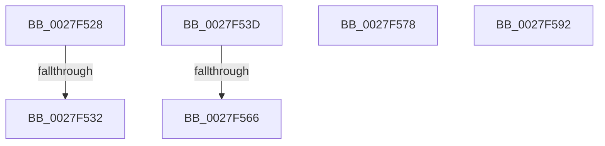

# sub_0027F528

- RVA: `0x0027F528`–`0x0027F5A9` (길이 `129` bytes)
- VA: `0x000000014027F528`
- 실행 섹션: `.text`
- PDB 이름 있음: `아니요`; PDB Function 태그: `아니요`
- unwind 정보 RVA: `0x0006664C`
- 디코드: `30`개 명령, `129/129` bytes 표시
- 미해석 바이트: `0` (있으면 어셈블리에 `.byte`로 보존)

> 이 문서는 커널 이미지의 기계어와 PDB 기호를 분석해 생성했습니다. 4번과 5번은 함수 원형과 자료형을 바이너리 사용 방식에서 추정한 C 해석이며 원본 소스 복구 결과는 아닙니다.

## 1. Dependencies

- 직접 호출 지점: **5**; 고유 호출 대상: **4**
- 직접 호출자로 확인된 함수: **0**
- RIP 상대 이미지 참조: **0**

### Outgoing calls
- `0x0027F532` → [MiReplenishTransitionPageHeatList](../4E/MiReplenishTransitionPageHeatList_function_004E131C.md) (function, `0x004E131C`)
- `0x0027F554` → [MiReplenishSlabAllocator](../37/MiReplenishSlabAllocator_function_003788E4.md) (function, `0x003788E4`)
- `0x0027F56D` → [ExReleaseRundownProtection](../34/ExReleaseRundownProtection_function_00349E80.md) (function, `0x00349E80`)
- `0x0027F585` → [MiCopyOnWriteCheckConditions](../2A/MiCopyOnWriteCheckConditions_function_002A750C.md) (function, `0x002A750C`)
- `0x0027F59F` → [MiCopyOnWriteCheckConditions](../2A/MiCopyOnWriteCheckConditions_function_002A750C.md) (function, `0x002A750C`)

### Direct callers
- 이 함수 시작 RVA로 연결되는 직접 call은 확인되지 않았습니다. 간접 호출은 완전히 역산할 수 없습니다.

### Static image references
- 디코드된 RIP-relative 메모리 참조가 없습니다.

## 2. Other-region calls and transfers

- 다른 실행 섹션으로 향하는 call: **0**
- call이 아닌 외부 분기/꼬리 이동: **6**
  - `0x0027F52C` → [sub_006DA10C](../6D/Unknown_function_006DA10C.md) (`tail-transfer`)
  - `0x0027F538` → [sub_006DA10C + 0xE](../6D/Unknown_function_006DA10C.md) (`tail-transfer`)
  - `0x0027F560` → [sub_006DA10C + 0x17](../6D/Unknown_function_006DA10C.md) (`tail-transfer`)
  - `0x0027F573` → [sub_006DA10C + 0x17](../6D/Unknown_function_006DA10C.md) (`tail-transfer`)
  - `0x0027F58D` → [sub_0027F063 + 0x10B](Unknown_function_0027F063.md) (`tail-transfer`)
  - `0x0027F5A4` → [sub_0027F063 + 0x113](Unknown_function_0027F063.md) (`tail-transfer`)

## 3. Assembly (complete function range)

```asm
0027F528  48 83 F9 FF                     cmp rcx, -1
0027F52C  0F 85 DA AB 45 00               jne 0x1406da10c
0027F532  E8 E5 1D 26 00                  call 0x1404e131c
0027F537  90                              nop
0027F538  E9 DD AB 45 00                  jmp 0x1406da11a
0027F53D  44 8B 45 90                     mov r8d, dword ptr [rbp - 0x70]
0027F541  48 8B 55 D0                     mov rdx, qword ptr [rbp - 0x30]
0027F545  41 C1 E8 08                     shr r8d, 8
0027F549  41 F7 D0                        not r8d
0027F54C  41 83 E0 01                     and r8d, 1
0027F550  41 C1 E0 11                     shl r8d, 0x11
0027F554  E8 8B 93 0F 00                  call 0x1403788e4
0027F559  48 8B 4D C8                     mov rcx, qword ptr [rbp - 0x38]
0027F55D  48 85 C9                        test rcx, rcx
0027F560  0F 84 BD AB 45 00               je 0x1406da123
0027F566  48 81 C1 C8 47 00 00            add rcx, 0x47c8
0027F56D  E8 0E A9 0C 00                  call 0x140349e80
0027F572  90                              nop
0027F573  E9 AB AB 45 00                  jmp 0x1406da123
0027F578  48 8B 4C 24 78                  mov rcx, qword ptr [rsp + 0x78]
0027F57D  45 33 C0                        xor r8d, r8d
0027F580  BA 17 00 00 C0                  mov edx, 0xc0000017
0027F585  E8 82 7F 02 00                  call 0x1402a750c
0027F58A  8B 45 90                        mov eax, dword ptr [rbp - 0x70]
0027F58D  E9 DC FB FF FF                  jmp 0x14027f16e
0027F592  48 8B 4C 24 78                  mov rcx, qword ptr [rsp + 0x78]
0027F597  45 33 C0                        xor r8d, r8d
0027F59A  BA 34 04 00 C0                  mov edx, 0xc0000434
0027F59F  E8 68 7F 02 00                  call 0x1402a750c
0027F5A4  E9 CD FB FF FF                  jmp 0x14027f176
```

## 4. C-style interpretation (structured pseudocode)

```c
__int64 __fastcall sub_0027F528(__int64 a1)
{
    __int64 result;
    unsigned __int64 v_stack_p78;

    result = MiReplenishTransitionPageHeatList(a1, a2, a3, a4);
}
```

## 5. (Beta) C Style

```c
int64_t sub_0027F528(int64_t Arg1)
{
    int64_t result;
    uint64_t v_stack_p78;

    result = MiReplenishTransitionPageHeatList(Arg1, a2, a3, a4);
}
```

## 6. Execution-region graph

[열기: 2D/3D 그래프와 함수 탐색 컨트롤 패널](../../../control-panel.html?section=text&rva=0x0027F528&view=graph)

- 2D 그래프는 위에서 아래로 흐르고, 3D 그래프는 빈 공간을 드래그해 회전합니다. Shift+드래그는 이동, 휠은 확대·축소, 함수 노드 선택은 대상 보고서 이동입니다.

### Static fallback


