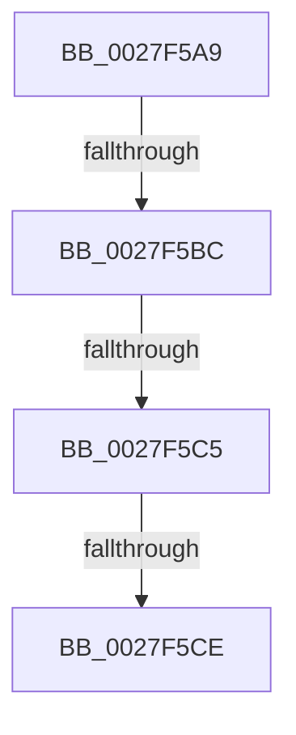

# sub_0027F5A9

- RVA: `0x0027F5A9`–`0x0027F5EA` (길이 `65` bytes)
- VA: `0x000000014027F5A9`
- 실행 섹션: `.text`
- PDB 이름 있음: `아니요`; PDB Function 태그: `아니요`
- unwind 정보 RVA: `0x00066664`
- 디코드: `17`개 명령, `65/65` bytes 표시
- 미해석 바이트: `0` (있으면 어셈블리에 `.byte`로 보존)

> 이 문서는 커널 이미지의 기계어와 PDB 기호를 분석해 생성했습니다. 4번과 5번은 함수 원형과 자료형을 바이너리 사용 방식에서 추정한 C 해석이며 원본 소스 복구 결과는 아닙니다.

## 1. Dependencies

- 직접 호출 지점: **1**; 고유 호출 대상: **1**
- 직접 호출자로 확인된 함수: **0**
- RIP 상대 이미지 참조: **0**

### Outgoing calls
- `0x0027F5E4` → [KeBugCheckEx](../4F/KeBugCheckEx_function_004FD660.md) (function, `0x004FD660`)

### Direct callers
- 이 함수 시작 RVA로 연결되는 직접 call은 확인되지 않았습니다. 간접 호출은 완전히 역산할 수 없습니다.

### Static image references
- 디코드된 RIP-relative 메모리 참조가 없습니다.

## 2. Other-region calls and transfers

- 다른 실행 섹션으로 향하는 call: **0**
- call이 아닌 외부 분기/꼬리 이동: **3**
  - `0x0027F5B6` → [sub_0027F19F + 0x40](Unknown_function_0027F19F.md) (`tail-transfer`)
  - `0x0027F5BF` → [sub_0027F19F + 0x40](Unknown_function_0027F19F.md) (`tail-transfer`)
  - `0x0027F5C8` → [sub_0027F19F + 0x40](Unknown_function_0027F19F.md) (`tail-transfer`)

## 3. Assembly (complete function range)

```asm
0027F5A9  49 8B C7                        mov rax, r15
0027F5AC  48 83 E0 FE                     and rax, 0xfffffffffffffffe
0027F5B0  0F B6 08                        movzx ecx, byte ptr [rax]
0027F5B3  80 F9 01                        cmp cl, 1
0027F5B6  0F 84 23 FC FF FF               je 0x14027f1df
0027F5BC  80 F9 03                        cmp cl, 3
0027F5BF  0F 84 1A FC FF FF               je 0x14027f1df
0027F5C5  80 F9 06                        cmp cl, 6
0027F5C8  0F 84 11 FC FF FF               je 0x14027f1df
0027F5CE  B8 04 00 00 00                  mov eax, 4
0027F5D3  4D 8B CF                        mov r9, r15
0027F5D6  4C 8B C3                        mov r8, rbx
0027F5D9  48 89 44 24 20                  mov qword ptr [rsp + 0x20], rax
0027F5DE  48 8B D6                        mov rdx, rsi
0027F5E1  8D 48 4C                        lea ecx, [rax + 0x4c]
0027F5E4  E8 77 E0 27 00                  call 0x1404fd660
0027F5E9  CC                              int3
```

## 4. C-style interpretation (structured pseudocode)

```c
__int64 __fastcall sub_0027F5A9(void)
{
    __int64 result;
    unsigned __int64 v_stack_p20;

    result = (v_r15) & (-2);
    v_stack_p20 = 4;
    result = KeBugCheckEx(4 + 76, v_rsi, v_rbx, v_r15);
    return result;
}
```

## 5. (Beta) C Style

```c
void sub_0027F5A9(void)
{
    int64_t result;
    uint64_t v_stack_p20;

    result = (local_r15) & (-2);
    v_stack_p20 = 4;
    result = KeBugCheckEx(4 + 76, local_rsi, local_rbx, local_r15);
    return result;
}
```

## 6. Execution-region graph

[열기: 2D/3D 그래프와 함수 탐색 컨트롤 패널](../../../control-panel.html?section=text&rva=0x0027F5A9&view=graph)

- 2D 그래프는 위에서 아래로 흐르고, 3D 그래프는 빈 공간을 드래그해 회전합니다. Shift+드래그는 이동, 휠은 확대·축소, 함수 노드 선택은 대상 보고서 이동입니다.

### Static fallback


