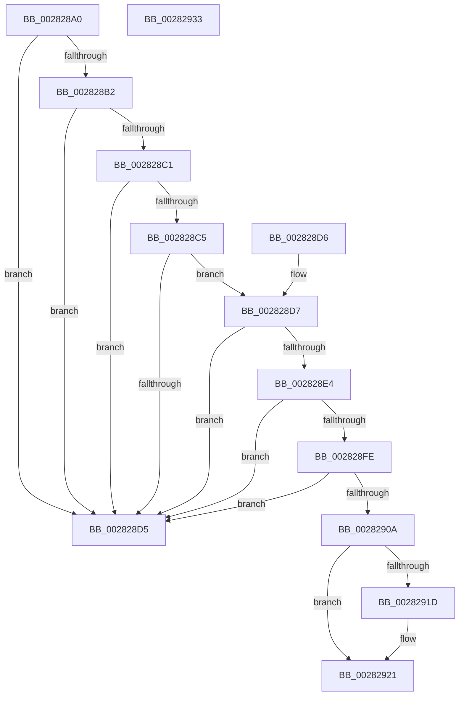

# MI_READ_PTE_LOCK_FREE

- RVA: `0x002828A0`–`0x00282934` (길이 `148` bytes)
- VA: `0x00000001402828A0`
- 실행 섹션: `.text`
- PDB 이름 있음: `예`; PDB Function 태그: `아니요`
- unwind 정보 RVA: `0x000DB714`
- 디코드: `39`개 명령, `148/148` bytes 표시
- 미해석 바이트: `0` (있으면 어셈블리에 `.byte`로 보존)

> 이 문서는 커널 이미지의 기계어와 PDB 기호를 분석해 생성했습니다. 4번과 5번은 함수 원형과 자료형을 바이너리 사용 방식에서 추정한 C 해석이며 원본 소스 복구 결과는 아닙니다.

## 1. Dependencies

- 직접 호출 지점: **0**; 고유 호출 대상: **0**
- 직접 호출자로 확인된 함수: **193**
- RIP 상대 이미지 참조: **1**

### Outgoing calls
- 직접 디코드된 call 명령이 없습니다.

### Direct callers
- [MmStealTopLevelPage](../22/MmStealTopLevelPage_function_002281E0.md) at `0x002282A8`
- [MmStealTopLevelPage](../22/MmStealTopLevelPage_function_002281E0.md) at `0x00228369`
- [MiTranslatePageForCopy](../22/MiTranslatePageForCopy_function_00228960.md) at `0x00228C95`
- [MiTranslatePageForCopy](../22/MiTranslatePageForCopy_function_00228960.md) at `0x00228E6F`
- [MiReplacePageTablePage](../22/MiReplacePageTablePage_function_00229184.md) at `0x002292FD`
- [MiReplacePageTablePage](../22/MiReplacePageTablePage_function_00229184.md) at `0x002293FE`
- [MiReplacePageTablePage](../22/MiReplacePageTablePage_function_00229184.md) at `0x002294B8`
- [MiReplacePageTablePage](../22/MiReplacePageTablePage_function_00229184.md) at `0x00229791`
- [MiReplacePageTablePage](../22/MiReplacePageTablePage_function_00229184.md) at `0x0022989C`
- [MiIsPageTableLocked](../22/MiIsPageTableLocked_function_0022A5B0.md) at `0x0022A60A`
- [MiResetAccessBitPte](../22/MiResetAccessBitPte_function_0022A800.md) at `0x0022A82A`
- [MiWalkVaCheckCommon](../22/MiWalkVaCheckCommon_function_0022A960.md) at `0x0022AA50`
- [MiRemoveWsle](../22/MiRemoveWsle_function_0022D0C4.md) at `0x0022D1A0`
- [MiHandleForkTransitionPte](../22/MiHandleForkTransitionPte_function_0022D34C.md) at `0x0022D4C5`
- [MiHandleForkTransitionPte](../22/MiHandleForkTransitionPte_function_0022D34C.md) at `0x0022D4FA`
- [MiHandleForkTransitionPte](../22/MiHandleForkTransitionPte_function_0022D34C.md) at `0x0022D669`
- [MmSetAddressRangeModifiedEx](../23/MmSetAddressRangeModifiedEx_function_00236F20.md) at `0x002370A2`
- [MiLockWorkingSetOptimal](../23/MiLockWorkingSetOptimal_function_00238FC0.md) at `0x002391B4`
- [MmGetPhysicalAddress](../23/MmGetPhysicalAddress_function_0023A500.md) at `0x0023A826`
- [MiGetPhysicalAddress](../23/MiGetPhysicalAddress_function_0023B120.md) at `0x0023B2E5`
- [MiLockPageLeafPageTable](../23/MiLockPageLeafPageTable_function_0023D160.md) at `0x0023D3A8`
- [sub_0023F124](../23/Unknown_function_0023F124.md) at `0x0023F1B9`
- [sub_0023F124](../23/Unknown_function_0023F124.md) at `0x0023F204`
- [sub_0023FA7A](../23/Unknown_function_0023FA7A.md) at `0x0023FA7F`
- [MiWsleFlush](../23/MiWsleFlush_function_0023FB30.md) at `0x0023FB7E`
- [sub_0023FFC8](../23/Unknown_function_0023FFC8.md) at `0x00240041`
- [MiDecommitHandleTransitionPte](../24/MiDecommitHandleTransitionPte_function_0024037C.md) at `0x002403C8`
- [MiDecommitHandleTransitionPte](../24/MiDecommitHandleTransitionPte_function_0024037C.md) at `0x00240466`
- [MiLogPageAccess](../24/MiLogPageAccess_function_00240870.md) at `0x002408C9`
- [MiGetVaAge](../24/MiGetVaAge_function_00240AC0.md) at `0x00240BBB`
- [MiEmptyWorkingSetHelper](../24/MiEmptyWorkingSetHelper_function_00240C00.md) at `0x00240D42`
- [sub_00241476](../24/Unknown_function_00241476.md) at `0x00241644`
- [MiDecommitAddToList](../24/MiDecommitAddToList_function_00242264.md) at `0x002422C3`
- [MiDecommitHandlePageFileFormatPte](../24/MiDecommitHandlePageFileFormatPte_function_00242A5C.md) at `0x00242BDE`
- [MiActOnPte](../24/MiActOnPte_function_00244C90.md) at `0x00244D0A`
- [MiActOnPte](../24/MiActOnPte_function_00244C90.md) at `0x00244E82`
- [MiActOnPte](../24/MiActOnPte_function_00244C90.md) at `0x002452CE`
- [MiActOnPte](../24/MiActOnPte_function_00244C90.md) at `0x00245374`
- [MmProtectPool](../26/MmProtectPool_function_002697AC.md) at `0x00269AD7`
- [sub_00275BEF](../27/Unknown_function_00275BEF.md) at `0x00275CE2`
- [sub_00275BEF](../27/Unknown_function_00275BEF.md) at `0x00275F57`
- [MiFastLockLeafPageTable](../27/MiFastLockLeafPageTable_function_00276340.md) at `0x00277353`
- [MiDeleteVa](../27/MiDeleteVa_function_002789E0.md) at `0x00278DDB`
- [sub_0027BF09](../27/Unknown_function_0027BF09.md) at `0x0027BF0C`
- [MiMakeHyperRangeAccessible](../27/MiMakeHyperRangeAccessible_function_0027CE10.md) at `0x0027D1BD`
- [MiAddWorkingSetEntries](../27/MiAddWorkingSetEntries_function_0027DC00.md) at `0x0027E32B`
- [sub_0027E69B](../27/Unknown_function_0027E69B.md) at `0x0027E6CC`
- [sub_0027E69B](../27/Unknown_function_0027E69B.md) at `0x0027E6D7`
- [sub_0027E69B](../27/Unknown_function_0027E69B.md) at `0x0027E76E`
- [sub_0027E69B](../27/Unknown_function_0027E69B.md) at `0x0027E77A`
- [MiFastReadLeafPte](../27/MiFastReadLeafPte_function_0027E9A0.md) at `0x0027EA6E`
- [MiResolveTransitionFault](MiResolveTransitionFault_function_00282940.md) at `0x00282AF7`
- [MiResolveTransitionFault](MiResolveTransitionFault_function_00282940.md) at `0x00282BAE`
- [MiResolveTransitionFault](MiResolveTransitionFault_function_00282940.md) at `0x00282E99`
- [MiResolveTransitionFault](MiResolveTransitionFault_function_00282940.md) at `0x00282F40`
- [MiResolveTransitionFault](MiResolveTransitionFault_function_00282940.md) at `0x00282F9F`
- [MiWsleFree](MiWsleFree_function_00284600.md) at `0x00284FA6`
- [MiWsleFree](MiWsleFree_function_00284600.md) at `0x00285000`
- [MiMigratePfn](MiMigratePfn_function_0028DBB0.md) at `0x0028DE92`
- [MiSynchronizeSystemVa](MiSynchronizeSystemVa_function_0028ECB8.md) at `0x0028EEB0`
- [MiUpdateWsleAge](MiUpdateWsleAge_function_0028F608.md) at `0x0028F666`
- [MiUpdateWsleAge](MiUpdateWsleAge_function_0028F608.md) at `0x0028F687`
- [MiUpdateWsleAge](MiUpdateWsleAge_function_0028F608.md) at `0x0028F6EC`
- [sub_0029016D](../29/Unknown_function_0029016D.md) at `0x00290193`
- [sub_002901B8](../29/Unknown_function_002901B8.md) at `0x002902FF`
- [MiClearPteAccessed](../29/MiClearPteAccessed_function_00290630.md) at `0x0029071D`
- [MiSetVaAgeList](../29/MiSetVaAgeList_function_00290A20.md) at `0x002916D9`
- [MiTrimPte](../29/MiTrimPte_function_00292F30.md) at `0x00292F7E`
- [MiTrimPte](../29/MiTrimPte_function_00292F30.md) at `0x00293036`
- [MiTrimPte](../29/MiTrimPte_function_00292F30.md) at `0x0029320D`
- [MiTrimThisWsle](../29/MiTrimThisWsle_function_002932E4.md) at `0x00293337`
- [MiTrimThisWsle](../29/MiTrimThisWsle_function_002932E4.md) at `0x00293368`
- [MiTrimThisWsle](../29/MiTrimThisWsle_function_002932E4.md) at `0x0029356B`
- [MiSetWsleProtection](../29/MiSetWsleProtection_function_002939D8.md) at `0x00293A18`
- [sub_00293F76](../29/Unknown_function_00293F76.md) at `0x00293FFE`
- [MI_WSLE_LOG_ACCESS](../29/MI_WSLE_LOG_ACCESS_function_00294400.md) at `0x00294457`
- [MmGrowKernelStackEx](../2A/MmGrowKernelStackEx_function_002A04E0.md) at `0x002A05EA`
- [MiAllocateKernelStackPages](../2A/MiAllocateKernelStackPages_function_002A1BEC.md) at `0x002A1FFB`
- [MiMakePteClean](../2A/MiMakePteClean_function_002A901C.md) at `0x002A907E`
- [MiUnlockOpportunisticPagesInPageTable](../2A/MiUnlockOpportunisticPagesInPageTable_function_002AA88C.md) at `0x002AA959`
- [MiInitializeTransitionPfn](../2A/MiInitializeTransitionPfn_function_002AC2E8.md) at `0x002AC332`
- [MiInitializeTransitionPfn](../2A/MiInitializeTransitionPfn_function_002AC2E8.md) at `0x002AC3A5`
- [MiFastTrimWorkingSet](../2A/MiFastTrimWorkingSet_function_002AD420.md) at `0x002AD576`
- [MiFastTrimWorkingSet](../2A/MiFastTrimWorkingSet_function_002AD420.md) at `0x002AD680`
- [MiFastTrimWorkingSet](../2A/MiFastTrimWorkingSet_function_002AD420.md) at `0x002AD767`
- [MiFastTrimWorkingSet](../2A/MiFastTrimWorkingSet_function_002AD420.md) at `0x002AD815`
- [MiCopyDataPageToImagePage](../2A/MiCopyDataPageToImagePage_function_002AE818.md) at `0x002AEC98`
- [MiWorkingSetInfoCheckPageTable](../2A/MiWorkingSetInfoCheckPageTable_function_002AEFCC.md) at `0x002AEFF6`
- [MiGetWorkingSetInfoList](../2A/MiGetWorkingSetInfoList_function_002AF770.md) at `0x002AFAB7`
- [MiGetWorkingSetInfoList](../2A/MiGetWorkingSetInfoList_function_002AF770.md) at `0x002AFB2C`
- [MiGetWorkingSetInfoList](../2A/MiGetWorkingSetInfoList_function_002AF770.md) at `0x002AFFE4`
- [MiGetWorkingSetInfoList](../2A/MiGetWorkingSetInfoList_function_002AF770.md) at `0x002B0080`
- [MiGetWorkingSetInfoList](../2A/MiGetWorkingSetInfoList_function_002AF770.md) at `0x002B00E1`
- [MiReplaceTransitionPage](../2B/MiReplaceTransitionPage_function_002B1120.md) at `0x002B163C`
- [sub_002B2847](../2B/Unknown_function_002B2847.md) at `0x002B2865`
- [MiStealPage](../2B/MiStealPage_function_002B28D0.md) at `0x002B2C81`
- [MiLockStealUserVm](../2B/MiLockStealUserVm_function_002B3EDC.md) at `0x002B41AE`
- [MiResolveDemandZeroFault](../2B/MiResolveDemandZeroFault_function_002B5A40.md) at `0x002B5A7B`
- [sub_002B5B1B](../2B/Unknown_function_002B5B1B.md) at `0x002B5B95`
- [sub_002B5FA0](../2B/Unknown_function_002B5FA0.md) at `0x002B6001`
- [MiCreateSharedZeroPages](../2B/MiCreateSharedZeroPages_function_002B6318.md) at `0x002B638A`
- [MiSharedVaToPartition](../2B/MiSharedVaToPartition_function_002B6700.md) at `0x002B671B`
- [sub_002B674F](../2B/Unknown_function_002B674F.md) at `0x002B6779`
- [MiClearNonPagedPtes](../2C/MiClearNonPagedPtes_function_002C17A0.md) at `0x002C19D0`
- [sub_002C1B88](../2C/Unknown_function_002C1B88.md) at `0x002C1C07`
- [MiEvictPageTableLock](../2C/MiEvictPageTableLock_function_002C1FBC.md) at `0x002C1FE8`
- [MiEvictPageTableLock](../2C/MiEvictPageTableLock_function_002C1FBC.md) at `0x002C202A`
- [MiWalkPageTablesRecursivelyNoSynch](../2C/MiWalkPageTablesRecursivelyNoSynch_function_002C2A28.md) at `0x002C2AAA`
- [MiCountSharedPages](../2C/MiCountSharedPages_function_002C30A4.md) at `0x002C3198`
- [MiSetProtectionOnTransitionPte](../2C/MiSetProtectionOnTransitionPte_function_002C586C.md) at `0x002C58CC`
- [MiSetProtectionOnTransitionPte](../2C/MiSetProtectionOnTransitionPte_function_002C586C.md) at `0x002C5950`
- [MiComputePageCommitment](../2C/MiComputePageCommitment_function_002C5C34.md) at `0x002C5D63`
- [MiCompleteRestrictedImageFault](../2C/MiCompleteRestrictedImageFault_function_002C60D4.md) at `0x002C625A`
- [MiLinkPoolCommitChain](../31/MiLinkPoolCommitChain_function_00313D20.md) at `0x00313E5E`
- [MiSharePages](../31/MiSharePages_function_00315110.md) at `0x00315DA7`
- [MiSharePages](../31/MiSharePages_function_00315110.md) at `0x00315E47`
- [MiActivePageClaimCandidate](../31/MiActivePageClaimCandidate_function_0031BB00.md) at `0x0031C016`
- [sub_00320866](../32/Unknown_function_00320866.md) at `0x0032094B`
- [MiUpdatePfnForPrefetchByPte](../32/MiUpdatePfnForPrefetchByPte_function_00321210.md) at `0x0032124C`
- [MiUpdatePfnForPrefetchByPte](../32/MiUpdatePfnForPrefetchByPte_function_00321210.md) at `0x003212E7`
- [MiResolveProtoPteFault](../32/MiResolveProtoPteFault_function_00321750.md) at `0x00321C3F`
- [MiResolveProtoPteFault](../32/MiResolveProtoPteFault_function_00321750.md) at `0x00322022`
- [MiRewritePteWithLockBit](../32/MiRewritePteWithLockBit_function_00322FEC.md) at `0x003230A9`
- [MiIsFaultPteIntact](../32/MiIsFaultPteIntact_function_003288A0.md) at `0x003288D5`
- [MiFindActualFaultingPte](../32/MiFindActualFaultingPte_function_0032899C.md) at `0x00328A44`
- [MiUserFault](../32/MiUserFault_function_00329840.md) at `0x00329FD7`
- [MiUserFault](../32/MiUserFault_function_00329840.md) at `0x0032A11C`
- [MiCommitExistingVad](../32/MiCommitExistingVad_function_0032A860.md) at `0x0032B24B`
- [MiCommitExistingVad](../32/MiCommitExistingVad_function_0032A860.md) at `0x0032B3B4`
- [sub_0032B8CD](../32/Unknown_function_0032B8CD.md) at `0x0032B966`
- [sub_0032BA64](../32/Unknown_function_0032BA64.md) at `0x0032BB19`
- [sub_0032BD21](../32/Unknown_function_0032BD21.md) at `0x0032BE2F`
- [sub_0032BD21](../32/Unknown_function_0032BD21.md) at `0x0032BEC4`
- [MiResolveSharedZeroFault](../32/MiResolveSharedZeroFault_function_0032EF20.md) at `0x0032F02F`
- [MiResolveSharedZeroFault](../32/MiResolveSharedZeroFault_function_0032EF20.md) at `0x0032F2D6`
- [MiPfnShareCountIsZero](../33/MiPfnShareCountIsZero_function_00330930.md) at `0x00330B56`
- [MiCompletePrivateZeroFault](../33/MiCompletePrivateZeroFault_function_00330CC0.md) at `0x003317C1`
- [MiCompletePrivateZeroFault](../33/MiCompletePrivateZeroFault_function_00330CC0.md) at `0x00331B4E`
- [MiAllocateWsle](../33/MiAllocateWsle_function_003332C0.md) at `0x00333AD2`
- [sub_003341DB](../33/Unknown_function_003341DB.md) at `0x0033420B`
- [MiRestoreTransitionPte](../33/MiRestoreTransitionPte_function_0033DD90.md) at `0x0033DE77`
- [MiMakeFaultPfnActive](../36/MiMakeFaultPfnActive_function_00361D00.md) at `0x00361DEA`
- [MiProcessWsInSwapFault](../36/MiProcessWsInSwapFault_function_00361EFC.md) at `0x00361FBA`
- [MiComputeFaultCluster](../36/MiComputeFaultCluster_function_003635B4.md) at `0x0036374A`
- [MiCommitEnclavePages](../36/MiCommitEnclavePages_function_00367CCC.md) at `0x00367E32`
- [MiAddPagesToEnclave](../36/MiAddPagesToEnclave_function_00367EEC.md) at `0x003680A5`
- [MiWriteEnclavePte](../36/MiWriteEnclavePte_function_00368570.md) at `0x00368607`
- [MiUpdateAwePageTable](../36/MiUpdateAwePageTable_function_00368730.md) at `0x00368755`
- [MiUpdateAwePageTable](../36/MiUpdateAwePageTable_function_00368730.md) at `0x0036883C`
- [MiDecommitHardwareEnclavePages](../36/MiDecommitHardwareEnclavePages_function_003688D4.md) at `0x003689C4`
- [MiKernelWriteToExecutableMemory](../36/MiKernelWriteToExecutableMemory_function_00368F18.md) at `0x00368FD7`
- [MiWaitForCollidedFaultComplete](../36/MiWaitForCollidedFaultComplete_function_00369EDC.md) at `0x00369F18`
- [MiResolvePageFileFault](../36/MiResolvePageFileFault_function_0036D968.md) at `0x0036D9BA`
- [MiResolvePageFileFault](../36/MiResolvePageFileFault_function_0036D968.md) at `0x0036DD1A`
- [MiResolvePageFileFault](../36/MiResolvePageFileFault_function_0036D968.md) at `0x0036DDF7`
- [MiResolvePageFileFault](../36/MiResolvePageFileFault_function_0036D968.md) at `0x0036E07F`
- [MiResolvePageFileFault](../36/MiResolvePageFileFault_function_0036D968.md) at `0x0036E0E9`
- [MiResolvePageFileFault](../36/MiResolvePageFileFault_function_0036D968.md) at `0x0036E277`
- [MiResolvePageFileFault](../36/MiResolvePageFileFault_function_0036D968.md) at `0x0036E342`
- [MiResolvePageFileFault](../36/MiResolvePageFileFault_function_0036D968.md) at `0x0036E76A`
- [MiResolvePageFileFault](../36/MiResolvePageFileFault_function_0036D968.md) at `0x0036ED1D`
- [MiExpandSharedZeroCluster](../36/MiExpandSharedZeroCluster_function_0036F20C.md) at `0x0036F3E2`
- [MiExpandSharedZeroCluster](../36/MiExpandSharedZeroCluster_function_0036F20C.md) at `0x0036F457`
- [MiExpandSharedZeroCluster](../36/MiExpandSharedZeroCluster_function_0036F20C.md) at `0x0036F477`
- [sub_00370B5B](../37/Unknown_function_00370B5B.md) at `0x00370B99`
- [MiTryDeleteTransitionPte](../37/MiTryDeleteTransitionPte_function_003710DC.md) at `0x003710F4`
- [MiTryDeleteTransitionPte](../37/MiTryDeleteTransitionPte_function_003710DC.md) at `0x00371107`
- [MiTryDeleteTransitionPte](../37/MiTryDeleteTransitionPte_function_003710DC.md) at `0x003711B3`
- [MiDeleteTransitionPte](../37/MiDeleteTransitionPte_function_00371B70.md) at `0x00371BBB`
- [sub_00371C01](../37/Unknown_function_00371C01.md) at `0x00371CC1`
- [MiOutSwapWorkingSetPte](../37/MiOutSwapWorkingSetPte_function_00372190.md) at `0x003721E8`
- [MiOutSwapWorkingSetPte](../37/MiOutSwapWorkingSetPte_function_00372190.md) at `0x00372407`
- [MiOutSwapWorkingSetPte](../37/MiOutSwapWorkingSetPte_function_00372190.md) at `0x003724AD`
- [MiWriteCompletePfn](../37/MiWriteCompletePfn_function_003737C4.md) at `0x00373828`
- [MiTradeActivePage](../37/MiTradeActivePage_function_00374424.md) at `0x003744CD`
- [MiWriteValidPteNewPage](../37/MiWriteValidPteNewPage_function_00376068.md) at `0x00376091`
- [MiIssueHardFault](../38/MiIssueHardFault_function_00380074.md) at `0x00380684`
- [MiIssueHardFault](../38/MiIssueHardFault_function_00380074.md) at `0x003807A8`
- [MiReservePageFileSpaceForPage](../38/MiReservePageFileSpaceForPage_function_0038377C.md) at `0x003837D6`
- [MiReservePageFileSpaceForPage](../38/MiReservePageFileSpaceForPage_function_0038377C.md) at `0x00383913`
- [MiReservePageFileSpaceForPage](../38/MiReservePageFileSpaceForPage_function_0038377C.md) at `0x003839A0`
- [MiReservePageFileSpaceForPage](../38/MiReservePageFileSpaceForPage_function_0038377C.md) at `0x00383AED`
- [MiSetSystemCodeProtection](../38/MiSetSystemCodeProtection_function_00384420.md) at `0x003848FF`
- [MiSetSystemCodeProtection](../38/MiSetSystemCodeProtection_function_00384420.md) at `0x003849A7`
- [MiSwapNumaStandbyPage](../38/MiSwapNumaStandbyPage_function_00385144.md) at `0x003853DE`
- [MI_IS_PTE_IN_WS_SWAP_SET](../38/MI_IS_PTE_IN_WS_SWAP_SET_function_00385DD8.md) at `0x00385DE4`
- [MiSwapHardFaultPage](../38/MiSwapHardFaultPage_function_00385F34.md) at `0x00385F53`
- [MiInvalidateCollidedIos](../38/MiInvalidateCollidedIos_function_00386110.md) at `0x0038632C`
- [MiMapWithLargePages](../3B/MiMapWithLargePages_function_003B6624.md) at `0x003B68AB`
- [MiFindFreePageFileSpace](../3E/MiFindFreePageFileSpace_function_003E2CAC.md) at `0x003E2D81`
- [MiInPagePageTable](../3E/MiInPagePageTable_function_003EF8DC.md) at `0x003EF991`
- [MiLargePageFault](../3F/MiLargePageFault_function_003F01C4.md) at `0x003F0259`
- [MmFreeContiguousMemory](../3F/MmFreeContiguousMemory_function_003F6F60.md) at `0x003F6FBD`
- [MiUpdatePrefetchPriority](../40/MiUpdatePrefetchPriority_function_00402CB0.md) at `0x00402CFE`
- [MiUpdatePrefetchPriority](../40/MiUpdatePrefetchPriority_function_00402CB0.md) at `0x00402E7B`
- [MiUpdatePrefetchPriority](../40/MiUpdatePrefetchPriority_function_00402CB0.md) at `0x00402EF5`
- [MiLockTransitionLeafPageEx](../40/MiLockTransitionLeafPageEx_function_00405884.md) at `0x004058A9`
- [MiLockTransitionLeafPageEx](../40/MiLockTransitionLeafPageEx_function_00405884.md) at `0x0040597A`
- [MiMakeTransitionHeatBatch](../40/MiMakeTransitionHeatBatch_function_00409A94.md) at `0x00409CE5`
- [MiRebuildPageTableAges](../40/MiRebuildPageTableAges_function_0040D4E0.md) at `0x0040D51E`
- [sub_0040D75D](../40/Unknown_function_0040D75D.md) at `0x0040D871`
- [MiTrimWorkingSetVpabCallback](../40/MiTrimWorkingSetVpabCallback_function_0040FCD0.md) at `0x0040FD0D`
- [MiProcessVpabAccessedInfo](../42/MiProcessVpabAccessedInfo_function_00428FD4.md) at `0x00429092`
- [MiDeprioritizeVirtualAddresses](../42/MiDeprioritizeVirtualAddresses_function_0042AD1C.md) at `0x0042AE21`
- [MiReadWriteAnyLevelShadowPte](../43/MiReadWriteAnyLevelShadowPte_function_00432654.md) at `0x00432753`
- [MiUpdatePfnBackingStore](../44/MiUpdatePfnBackingStore_function_004442B4.md) at `0x004442ED`
- [MiInitializeTbFlushStamps](../44/MiInitializeTbFlushStamps_function_004499EC.md) at `0x004499F5`
- [MiBitmapRangeZeroEx](../45/MiBitmapRangeZeroEx_function_004516D8.md) at `0x00451763`
- [MiPrepareToTradeUsingAccessedBit](../45/MiPrepareToTradeUsingAccessedBit_function_0045B488.md) at `0x0045B4C9`
- [MiRevokeExecutePte](../46/MiRevokeExecutePte_function_00460BA0.md) at `0x00460BF0`
- [MI_CLEAR_RESET_PTE](../46/MI_CLEAR_RESET_PTE_function_00464460.md) at `0x00464469`
- [MiFillHyperPtes](../46/MiFillHyperPtes_function_004644AC.md) at `0x004645CA`
- [MiDeleteFinalPageTables](../46/MiDeleteFinalPageTables_function_004659AC.md) at `0x00465A5F`
- [MiDeleteProcessShadow](../46/MiDeleteProcessShadow_function_00465BF8.md) at `0x00465CC7`
- [MiDeleteProcessShadow](../46/MiDeleteProcessShadow_function_00465BF8.md) at `0x00465D96`
- [MiValidVirtualizationFault](../46/MiValidVirtualizationFault_function_00466EC0.md) at `0x00466EEC`
- [MiValidVirtualizationFault](../46/MiValidVirtualizationFault_function_00466EC0.md) at `0x0046700C`
- [MiValidVirtualizationFault](../46/MiValidVirtualizationFault_function_00466EC0.md) at `0x0046704B`
- [MiCompleteSecureProcessFault](../46/MiCompleteSecureProcessFault_function_0046710C.md) at `0x00467138`
- [MiCompleteSecureProcessFault](../46/MiCompleteSecureProcessFault_function_0046710C.md) at `0x00467338`
- [MiShadowTopLevelPxes](../46/MiShadowTopLevelPxes_function_0046C6B0.md) at `0x0046C770`
- [MiShadowTopLevelPxes](../46/MiShadowTopLevelPxes_function_0046C6B0.md) at `0x0046C77F`
- [MiShadowTopLevelPxes](../46/MiShadowTopLevelPxes_function_0046C6B0.md) at `0x0046C78C`
- [MiSmallVaStillMapsFrame](../47/MiSmallVaStillMapsFrame_function_00471090.md) at `0x004710F2`
- [MiSmallVaStillMapsFrame](../47/MiSmallVaStillMapsFrame_function_00471090.md) at `0x0047111C`
- [MiDeleteEmptyPageTableWorker](../47/MiDeleteEmptyPageTableWorker_function_0047FE18.md) at `0x0047FE77`
- [MiDeleteEmptyPageTableWorker](../47/MiDeleteEmptyPageTableWorker_function_0047FE18.md) at `0x0047FE9D`
- [MiLockedPageTableHasActiveLargeEntries](../48/MiLockedPageTableHasActiveLargeEntries_function_00486048.md) at `0x004860C8`
- [MiAgeWorkingSetVpabCallback](../48/MiAgeWorkingSetVpabCallback_function_0048DE00.md) at `0x0048DE28`
- [MI_SET_SOFTWARE_PTE_SHADOW_STACK](../49/MI_SET_SOFTWARE_PTE_SHADOW_STACK_function_00491EC0.md) at `0x00491EC9`
- [MmUpdateUserShadowStackValue](../49/MmUpdateUserShadowStackValue_function_004935D8.md) at `0x00493816`
- [MI_SET_PTE_SHADOW_STACK](../49/MI_SET_PTE_SHADOW_STACK_function_00494AEC.md) at `0x00494AF5`
- [MiMakeProtoReadOnly](../49/MiMakeProtoReadOnly_function_004952F8.md) at `0x00495308`
- [MiUpdateOldPagesVpabCallback](../49/MiUpdateOldPagesVpabCallback_function_0049CF50.md) at `0x0049CF6C`
- [MiResetAccessBitsVpabCallback](../4A/MiResetAccessBitsVpabCallback_function_004A7410.md) at `0x004A7434`
- [MiSimpleAgePte](../4A/MiSimpleAgePte_function_004ACD40.md) at `0x004ACD6C`
- [MiAdjustSecureDriverStateForIatCapture](../4B/MiAdjustSecureDriverStateForIatCapture_function_004BE864.md) at `0x004BE9C1`
- [MiDeleteVadAwePtes](../4C/MiDeleteVadAwePtes_function_004C4F3C.md) at `0x004C4FA6`
- [MiProtectAweRegion](../4C/MiProtectAweRegion_function_004CE62C.md) at `0x004CEA81`
- [MiFinishPageTableForLargePage](../4D/MiFinishPageTableForLargePage_function_004D3D4C.md) at `0x004D3D99`
- [MiProtectEnclavePages](../4D/MiProtectEnclavePages_function_004D5528.md) at `0x004D589F`
- [MiProtectEnclavePages](../4D/MiProtectEnclavePages_function_004D5528.md) at `0x004D5900`
- [MiMakeSystemLeavesNonZero](../4E/MiMakeSystemLeavesNonZero_function_004E26C0.md) at `0x004E2732`
- [MiUpdateOldPte](../4E/MiUpdateOldPte_function_004EDD20.md) at `0x004EDD56`
- [MiFinishPteChangesInPageTable](../4E/MiFinishPteChangesInPageTable_function_004EE660.md) at `0x004EE70F`
- [MiDeleteBootRange](../66/MiDeleteBootRange_function_0066E450.md) at `0x0066E597`
- [MiDeleteBootRange](../66/MiDeleteBootRange_function_0066E450.md) at `0x0066E5B2`
- [MiPageBootRegistry](../66/MiPageBootRegistry_function_0066E82C.md) at `0x0066E9D6`
- [MiCheckCommitReleaseFromVad](../66/MiCheckCommitReleaseFromVad_function_0066EB90.md) at `0x0066ECDC`
- [MiUnlockPhysicalPageByVa](../67/MiUnlockPhysicalPageByVa_function_00673EB0.md) at `0x00673EDC`
- [MiFilterCrashDumpPte](../67/MiFilterCrashDumpPte_function_0067D4D0.md) at `0x0067D53B`
- [MiClearDriverTablePtes](../68/MiClearDriverTablePtes_function_00683024.md) at `0x00683125`
- [MmMapDriverTablePage](../68/MmMapDriverTablePage_function_00683EAC.md) at `0x00683F4C`
- [MiDbgCopyMemoryTarget](../68/MiDbgCopyMemoryTarget_function_00684E70.md) at `0x00684EF5`
- [MiDemoteValidLargePageOneLevel](../68/MiDemoteValidLargePageOneLevel_function_0068A3F4.md) at `0x0068A4D1`
- [MiDemoteValidLargePageOneLevel](../68/MiDemoteValidLargePageOneLevel_function_0068A3F4.md) at `0x0068A5C5`
- [MiWritePteHighLevel](../68/MiWritePteHighLevel_function_0068AA08.md) at `0x0068AA85`
- [MiReplicatePteChangeToProcess](../69/MiReplicatePteChangeToProcess_function_00693D24.md) at `0x00693D70`
- [sub_006DA1C6](../6D/Unknown_function_006DA1C6.md) at `0x006DA1D3`
- [sub_006DB77C](../6D/Unknown_function_006DB77C.md) at `0x006DB7AF`
- [sub_006E1DF6](../6E/Unknown_function_006E1DF6.md) at `0x006E1E01`
- [sub_006E4582](../6E/Unknown_function_006E4582.md) at `0x006E46A9`
- [sub_006EC9CA](../6E/Unknown_function_006EC9CA.md) at `0x006EC9E6`
- [MiInitializeShadowPageTable](../../page/80/MiInitializeShadowPageTable_function_0080778C.md) at `0x008077F7`
- [MiInitializeShadowPageTable](../../page/80/MiInitializeShadowPageTable_function_0080778C.md) at `0x00807823`
- [MiUnmapLockedPagesInUserSpace](../../page/A7/MiUnmapLockedPagesInUserSpace_function_00A78E54.md) at `0x00A78FA5`
- [sub_00B1B8C2](../../page/B1/Unknown_function_00B1B8C2.md) at `0x00B1B8CA`
- [sub_00B41C12](../../page/B4/Unknown_function_00B41C12.md) at `0x00B41C26`
- [MiConvertHiberPhasePte](../../pagelk/B7/MiConvertHiberPhasePte_function_00B79520.md) at `0x00B79553`
- [MiUpdateUserMappings](../../pagelk/B7/MiUpdateUserMappings_function_00B7966C.md) at `0x00B79688`
- [MiInitNucleus](../../init/C5/MiInitNucleus_function_00C5FD38.md) at `0x00C5FDD7`
- [MxZeroBootMappings](../../init/C6/MxZeroBootMappings_function_00C61344.md) at `0x00C6136B`
- [MiInitializeBootShadowStackPage](../../init/C6/MiInitializeBootShadowStackPage_function_00C67D8C.md) at `0x00C67F64`
- [MiInitializeTopLevelBitmap](../../init/C7/MiInitializeTopLevelBitmap_function_00C770D0.md) at `0x00C77142`

### Static image references
- `0x002828D7` → RVA `0x00FC6A88` (`ALMOSTRO`; read)

## 2. Other-region calls and transfers

- 다른 실행 섹션으로 향하는 call: **0**
- 별도 외부 분기/꼬리 이동을 확인하지 못했습니다.

## 3. Assembly (complete function range)

```asm
002828A0  48 8B 01                        mov rax, qword ptr [rcx]
002828A3  48 BA 00 D0 BE 7D FB F6 FF FF   movabs rdx, 0xfffff6fb7dbed000
002828AD  48 3B CA                        cmp rcx, rdx
002828B0  72 23                           jb 0x1402828d5
002828B2  48 BA F8 D7 BE 7D FB F6 FF FF   movabs rdx, 0xfffff6fb7dbed7f8
002828BC  48 3B CA                        cmp rcx, rdx
002828BF  77 14                           ja 0x1402828d5
002828C1  A8 01                           test al, 1
002828C3  74 10                           je 0x1402828d5
002828C5  A8 42                           test al, 0x42
002828C7  41 0F 95 C0                     setne r8b
002828CB  A8 20                           test al, 0x20
002828CD  0F 95 C2                        setne dl
002828D0  44 84 C2                        test dl, r8b
002828D3  74 02                           je 0x1402828d7
002828D5  C3                              ret
002828D6  CC                              int3
002828D7  48 F7 05 A6 41 D4 00 00 00 60 00  test qword ptr [rip + 0xd441a6], 0x600000
002828E2  74 F1                           je 0x1402828d5
002828E4  65 48 8B 14 25 88 01 00 00      mov rdx, qword ptr gs:[0x188]
002828ED  4C 8B 82 B8 00 00 00            mov r8, qword ptr [rdx + 0xb8]
002828F4  41 80 B8 60 01 00 00 01         cmp byte ptr [r8 + 0x160], 1
002828FC  74 D7                           je 0x1402828d5
002828FE  49 8B 90 08 05 00 00            mov rdx, qword ptr [r8 + 0x508]
00282905  48 85 D2                        test rdx, rdx
00282908  74 CB                           je 0x1402828d5
0028290A  48 C1 E9 03                     shr rcx, 3
0028290E  81 E1 FF 01 00 00               and ecx, 0x1ff
00282914  48 8B 0C CA                     mov rcx, qword ptr [rdx + rcx*8]
00282918  F6 C1 20                        test cl, 0x20
0028291B  74 04                           je 0x140282921
0028291D  48 83 C8 20                     or rax, 0x20
00282921  48 8B D0                        mov rdx, rax
00282924  48 83 CA 42                     or rdx, 0x42
00282928  F6 C1 42                        test cl, 0x42
0028292B  48 0F 44 D0                     cmove rdx, rax
0028292F  48 8B C2                        mov rax, rdx
00282932  C3                              ret
00282933  CC                              int3
```

## 4. C-style interpretation (structured pseudocode)

```c
__int64 __fastcall MI_READ_PTE_LOCK_FREE(__int64 a1)
{
    __int64 result;

    if (a1 < a2) goto loc_002828D5;
    if (a1 > a2) goto loc_002828D5;
    if ((((unsigned __int8)(*(unsigned __int64 *)(a1))) & (1)) == 0) goto loc_002828D5;
    a3 = ((((unsigned __int8)(*(unsigned __int64 *)(a1))) & (66)) != 0) ? 1 : 0;
    a2 = ((((unsigned __int8)(*(unsigned __int64 *)(a1))) & (32)) != 0) ? 1 : 0;
    if ((((unsigned __int8)(a2)) & ((unsigned __int8)(a3))) == 0) goto loc_002828D7;
loc_002828D5:
    return *(unsigned __int64 *)(a1);
loc_002828D7:
    if (((*(unsigned __int64 *)(v_rip + 13910438)) & (0x600000ULL)) == 0) goto loc_002828D5;
    if ((*(unsigned __int8 *)(*(unsigned __int64 *)(*(unsigned __int64 *)(gs_base + (0 + 392)) + 184) + 352)) == 1) goto loc_002828D5;
    if (*(unsigned __int64 *)(*(unsigned __int64 *)(*(unsigned __int64 *)(gs_base + (0 + 392)) + 184) + 1288) == 0) goto loc_002828D5;
    a1 = (a1) >> (3);
    a1 = (unsigned int)((a1) & (511));
    result = *(unsigned __int64 *)(a1);
    if ((((unsigned __int8)(*(unsigned __int64 *)(*(unsigned __int64 *)(*(unsigned __int64 *)(*(unsigned __int64 *)(gs_base + (0 + 392)) + 184) + 1288) + a1 * 8))) & (32)) != 0) {
        result = (*(unsigned __int64 *)(a1)) | (32);
    }
    a2 = (result) | (66);
    if ((((unsigned __int8)(*(unsigned __int64 *)(*(unsigned __int64 *)(*(unsigned __int64 *)(*(unsigned __int64 *)(gs_base + (0 + 392)) + 184) + 1288) + a1 * 8))) & (66)) == 0) { a2 = result; }
    return a2;
}
```

## 5. (Beta) C Style

```c
int64_t MI_READ_PTE_LOCK_FREE(void *Arg1)
{
    uint8_t *arg1 = (uint8_t *)Arg1;

    int64_t result;

    if (Arg1 < a2) goto loc_002828D5;
    if (Arg1 > a2) goto loc_002828D5;
    if ((((uint8_t)(*(uint64_t *)(arg1))) & (1)) == 0) goto loc_002828D5;
    a3 = ((((uint8_t)(*(uint64_t *)(arg1))) & (66)) != 0) ? 1 : 0;
    a2 = ((((uint8_t)(*(uint64_t *)(arg1))) & (32)) != 0) ? 1 : 0;
    if ((((uint8_t)(a2)) & ((uint8_t)(a3))) == 0) goto loc_002828D7;
loc_002828D5:
    return *(uint64_t *)(arg1);
loc_002828D7:
    if (((*(uint64_t *)(v_rip + 0xD441A6)) & (0x600000ULL)) == 0) goto loc_002828D5;
    if ((*(uint8_t *)(*(uint64_t *)(*(uint64_t *)(gs_base + (0 + 0x188)) + 0xB8) + 0x160)) == 1) goto loc_002828D5;
    if (*(uint64_t *)(*(uint64_t *)(*(uint64_t *)(gs_base + (0 + 0x188)) + 0xB8) + 0x508) == 0) goto loc_002828D5;
    Arg1 = (Arg1) >> (3);
    Arg1 = (uint32_t)((Arg1) & (511));
    result = *(uint64_t *)(arg1);
    if ((((uint8_t)(*(uint64_t *)(*(uint64_t *)(*(uint64_t *)(*(uint64_t *)(gs_base + (0 + 0x188)) + 0xB8) + 0x508) + arg1 * 8))) & (32)) != 0) {
        result = (*(uint64_t *)(arg1)) | (32);
    }
    a2 = (result) | (66);
    if ((((uint8_t)(*(uint64_t *)(*(uint64_t *)(*(uint64_t *)(*(uint64_t *)(gs_base + (0 + 0x188)) + 0xB8) + 0x508) + arg1 * 8))) & (66)) == 0) { a2 = result; }
    return a2;
}
```

### 관측된 메모리 오프셋

구조체 형식이 확인되지 않은 접근은 인자 기준의 오프셋으로만 기록했습니다.

| 기준 인자 | 오프셋 표현 | 폭 (bit) | 접근 |
|---|---:|---:|---|
| `Arg1` | `+ 0x0` | `64` | `R` |

## 6. Execution-region graph

[열기: 2D/3D 그래프와 함수 탐색 컨트롤 패널](../../../control-panel.html?section=text&rva=0x002828A0&view=graph)

- 2D 그래프는 위에서 아래로 흐르고, 3D 그래프는 빈 공간을 드래그해 회전합니다. Shift+드래그는 이동, 휠은 확대·축소, 함수 노드 선택은 대상 보고서 이동입니다.

### Static fallback


