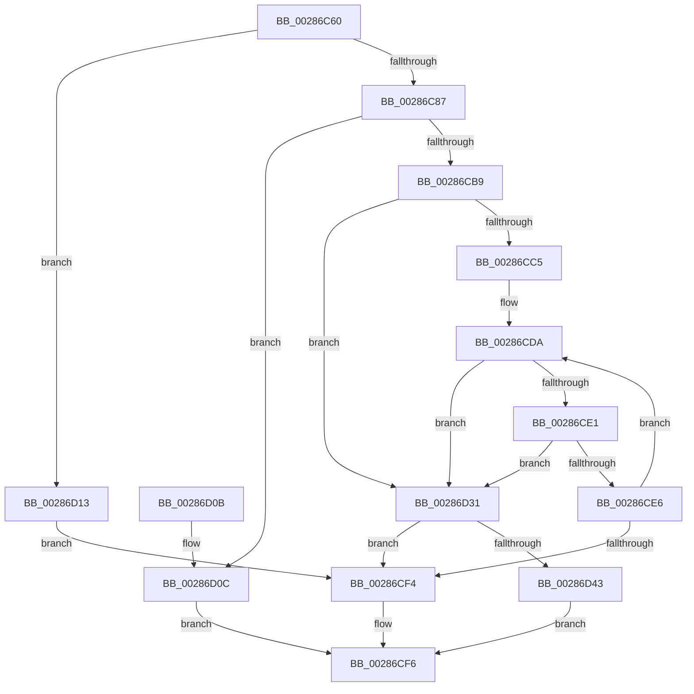

# MiAcquireNonPagedResources

- RVA: `0x00286C60`–`0x00286D58` (길이 `248` bytes)
- VA: `0x0000000140286C60`
- 실행 섹션: `.text`
- PDB 이름 있음: `예`; PDB Function 태그: `아니요`
- unwind 정보 RVA: `0x00066C70`
- 디코드: `71`개 명령, `248/248` bytes 표시
- 미해석 바이트: `0` (있으면 어셈블리에 `.byte`로 보존)

> 이 문서는 커널 이미지의 기계어와 PDB 기호를 분석해 생성했습니다. 4번과 5번은 함수 원형과 자료형을 바이너리 사용 방식에서 추정한 C 해석이며 원본 소스 복구 결과는 아닙니다.

## 1. Dependencies

- 직접 호출 지점: **5**; 고유 호출 대상: **4**
- 직접 호출자로 확인된 함수: **26**
- RIP 상대 이미지 참조: **1**

### Outgoing calls
- `0x00286CB0` → [MiChargeCommit](MiChargeCommit_function_00286EB0.md) (function, `0x00286EB0`)
- `0x00286D19` → [MiChargeCommit](MiChargeCommit_function_00286EB0.md) (function, `0x00286EB0`)
- `0x00286D2A` → [MiChargeResident](MiChargeResident_function_0028A0F0.md) (function, `0x0028A0F0`)
- `0x00286D3A` → [MiChargePartitionResidentAvailable](MiChargePartitionResidentAvailable_function_0028B000.md) (function, `0x0028B000`)
- `0x00286D4C` → [MiReturnCommit](../24/MiReturnCommit_function_00248410.md) (function, `0x00248410`)

### Direct callers
- [MiFindContiguousPagesEx](MiFindContiguousPagesEx_function_0028BDE0.md) at `0x0028BF5E`
- [MiAllocateKernelStackPages](../2A/MiAllocateKernelStackPages_function_002A1BEC.md) at `0x002A1CED`
- [MmAllocateNonChargedSecurePages](../2C/MmAllocateNonChargedSecurePages_function_002C886C.md) at `0x002C88BB`
- [MiPrefetchPreallocatePages](../36/MiPrefetchPreallocatePages_function_0036B1F0.md) at `0x0036B3C0`
- [MiCreateSlabEntry](../37/MiCreateSlabEntry_function_00374DEC.md) at `0x00374EC6`
- [MiObtainMdlCharges](../47/MiObtainMdlCharges_function_0047E014.md) at `0x0047E14C`
- [MiMakePageBad](../48/MiMakePageBad_function_00486F04.md) at `0x00486FE5`
- [MiGetFileHashPage](../49/MiGetFileHashPage_function_004926F4.md) at `0x00492717`
- [MiIdealClusterPage](../4D/MiIdealClusterPage_function_004DB964.md) at `0x004DBC29`
- [MmMarkPhysicalMemoryAsBad](../67/MmMarkPhysicalMemoryAsBad_function_0067AA50.md) at `0x0067ABD9`
- [MiMoveBadPageChargesCrossPartition](../68/MiMoveBadPageChargesCrossPartition_function_00689F60.md) at `0x00689FC6`
- [MmAllocateSecureKernelPages](../68/MmAllocateSecureKernelPages_function_0068F394.md) at `0x0068F462`
- [MiMoveBadPagePartition](../69/MiMoveBadPagePartition_function_00691924.md) at `0x0069195B`
- [MiStoreChargeReservedPages](../69/MiStoreChargeReservedPages_function_006926A0.md) at `0x006926B6`
- [MiProcessVaContiguityInformation](../69/MiProcessVaContiguityInformation_function_006939C0.md) at `0x00693A92`
- [MmRemovePhysicalMemory](../../page/7F/MmRemovePhysicalMemory_function_007FB560.md) at `0x007FB639`
- [MiAllocateFastAwePages](../../page/80/MiAllocateFastAwePages_function_0080969C.md) at `0x00809714`
- [MiAllocatePartitionPhysicalPages](../../page/80/MiAllocatePartitionPhysicalPages_function_0080C9D4.md) at `0x0080CAB1`
- [MiAllocateProcessShadow](../../page/A5/MiAllocateProcessShadow_function_00A5F1A0.md) at `0x00A5F1DF`
- [MiMapSystemImage](../../page/AA/MiMapSystemImage_function_00AA3558.md) at `0x00AA35A3`
- [MiChargeSystemImageCommitment](../../page/AB/MiChargeSystemImageCommitment_function_00AB5BA4.md) at `0x00AB5BDB`
- [MiAllocateDummyPage](../../init/C5/MiAllocateDummyPage_function_00C5F6E8.md) at `0x00C5F713`
- [MmInitializeImageViewExtensionCfg](../../init/C6/MmInitializeImageViewExtensionCfg_function_00C64FC4.md) at `0x00C650B9`
- [MiUpdateBootHpatPagesInUse](../../init/C6/MiUpdateBootHpatPagesInUse_function_00C67548.md) at `0x00C67700`
- [MiInitializeBootShadowStackPage](../../init/C6/MiInitializeBootShadowStackPage_function_00C67D8C.md) at `0x00C67E47`
- [MiInitializeBootLoadedDriverPfns](../../init/C6/MiInitializeBootLoadedDriverPfns_function_00C6BB10.md) at `0x00C6BC6D`

### Static image references
- `0x00286CB9` → RVA `0x00E38D00` (`.data`; read)

## 2. Other-region calls and transfers

- 다른 실행 섹션으로 향하는 call: **0**
- 별도 외부 분기/꼬리 이동을 확인하지 못했습니다.

## 3. Assembly (complete function range)

```asm
00286C60  48 89 5C 24 08                  mov qword ptr [rsp + 8], rbx
00286C65  48 89 6C 24 10                  mov qword ptr [rsp + 0x10], rbp
00286C6A  48 89 74 24 18                  mov qword ptr [rsp + 0x18], rsi
00286C6F  57                              push rdi
00286C70  48 83 EC 20                     sub rsp, 0x20
00286C74  49 8B E8                        mov rbp, r8
00286C77  48 8B DA                        mov rbx, rdx
00286C7A  48 8B F9                        mov rdi, rcx
00286C7D  41 F6 C1 01                     test r9b, 1
00286C81  0F 85 8C 00 00 00               jne 0x140286d13
00286C87  41 8B C9                        mov ecx, r9d
00286C8A  D1 E9                           shr ecx, 1
00286C8C  83 E1 01                        and ecx, 1
00286C8F  8B D1                           mov edx, ecx
00286C91  83 CA 02                        or edx, 2
00286C94  41 F6 C1 04                     test r9b, 4
00286C98  0F 44 D1                        cmove edx, ecx
00286C9B  48 8B CF                        mov rcx, rdi
00286C9E  8B F2                           mov esi, edx
00286CA0  83 CE 10                        or esi, 0x10
00286CA3  41 F6 C1 08                     test r9b, 8
00286CA7  0F 44 F2                        cmove esi, edx
00286CAA  48 8B D3                        mov rdx, rbx
00286CAD  44 8B C6                        mov r8d, esi
00286CB0  E8 FB 01 00 00                  call 0x140286eb0
00286CB5  85 C0                           test eax, eax
00286CB7  74 53                           je 0x140286d0c
00286CB9  48 8D 05 40 20 BB 00            lea rax, [rip + 0xbb2040]
00286CC0  48 3B F8                        cmp rdi, rax
00286CC3  75 6C                           jne 0x140286d31
00286CC5  65 48 8B 14 25 20 00 00 00      mov rdx, qword ptr gs:[0x20]
00286CCE  41 B8 FF FF FF FF               mov r8d, 0xffffffff
00286CD4  8B 82 9C 8B 00 00               mov eax, dword ptr [rdx + 0x8b9c]
00286CDA  8B C8                           mov ecx, eax
00286CDC  48 3B D9                        cmp rbx, rcx
00286CDF  77 50                           ja 0x140286d31
00286CE1  41 3B C0                        cmp eax, r8d
00286CE4  74 4B                           je 0x140286d31
00286CE6  8B C8                           mov ecx, eax
00286CE8  2B CB                           sub ecx, ebx
00286CEA  F0 0F B1 8A 9C 8B 00 00         lock cmpxchg dword ptr [rdx + 0x8b9c], ecx
00286CF2  75 E6                           jne 0x140286cda
00286CF4  33 C0                           xor eax, eax
00286CF6  48 8B 5C 24 30                  mov rbx, qword ptr [rsp + 0x30]
00286CFB  48 8B 6C 24 38                  mov rbp, qword ptr [rsp + 0x38]
00286D00  48 8B 74 24 40                  mov rsi, qword ptr [rsp + 0x40]
00286D05  48 83 C4 20                     add rsp, 0x20
00286D09  5F                              pop rdi
00286D0A  C3                              ret
00286D0B  CC                              int3
00286D0C  B8 2D 01 00 C0                  mov eax, 0xc000012d
00286D11  EB E3                           jmp 0x140286cf6
00286D13  41 B8 04 00 00 00               mov r8d, 4
00286D19  E8 92 01 00 00                  call 0x140286eb0
00286D1E  41 B8 FF FF FF FF               mov r8d, 0xffffffff
00286D24  48 8B D3                        mov rdx, rbx
00286D27  48 8B CF                        mov rcx, rdi
00286D2A  E8 C1 33 00 00                  call 0x14028a0f0
00286D2F  EB C3                           jmp 0x140286cf4
00286D31  4C 8B C5                        mov r8, rbp
00286D34  48 8B D3                        mov rdx, rbx
00286D37  48 8B CF                        mov rcx, rdi
00286D3A  E8 C1 42 00 00                  call 0x14028b000
00286D3F  85 C0                           test eax, eax
00286D41  75 B1                           jne 0x140286cf4
00286D43  44 8B C6                        mov r8d, esi
00286D46  48 8B D3                        mov rdx, rbx
00286D49  48 8B CF                        mov rcx, rdi
00286D4C  E8 BF 16 FC FF                  call 0x140248410
00286D51  B8 9A 00 00 C0                  mov eax, 0xc000009a
00286D56  EB 9E                           jmp 0x140286cf6
```

## 4. C-style interpretation (structured pseudocode)

```c
__int64 __fastcall MiAcquireNonPagedResources(__int64 a1, __int64 a2, __int64 a3, int a4)
{
    __int64 result;
    __int64 v_rsi;
    __int64 v_rsp;
    unsigned __int64 v_stack_p10;
    unsigned __int64 v_stack_p18;
    unsigned __int64 v_stack_p8;

    v_stack_p8 = v_rbx;
    v_stack_p10 = v_rbp;
    v_stack_p18 = v_rsi;
    v_rsp = (v_rsp) - (32);
    if ((((unsigned __int8)(a4)) & (1)) != 0) goto loc_00286D13;
    a1 = (unsigned int)(((unsigned int)(a4)) >> (1));
    a1 = (unsigned int)((a1) & (1));
    a2 = (unsigned int)(((unsigned int)((unsigned int)(a1))) | (2));
    if ((((unsigned __int8)(a4)) & (4)) == 0) { a2 = (unsigned int)(a1); }
    v_rsi = (unsigned int)(((unsigned int)((unsigned int)(a2))) | (16));
    if ((((unsigned __int8)(a4)) & (8)) == 0) { v_rsi = (unsigned int)(a2); }
    result = MiChargeCommit(a1, a2, (unsigned int)((unsigned int)(v_rsi)), a4);
    if ((unsigned int)(result) == 0) goto loc_00286D0C;
    if (a1 != (v_rip + 12263488)) goto loc_00286D31;
loc_00286CDA:
    if (a2 > ((unsigned int)((unsigned int)((unsigned int)(*(unsigned int *)(*(unsigned __int64 *)(gs_base + (0 + 32)) + 35740)))))) goto loc_00286D31;
    if (((unsigned int)((unsigned int)(*(unsigned int *)(*(unsigned __int64 *)(gs_base + (0 + 32)) + 35740)))) == ((unsigned int)((unsigned int)(0xFFFFFFFFULL)))) goto loc_00286D31;
    a1 = (unsigned int)(((unsigned int)((unsigned int)((unsigned int)(*(unsigned int *)(*(unsigned __int64 *)(gs_base + (0 + 32)) + 35740))))) - ((unsigned int)(a2)));
    if (condition_is_not_equal) goto loc_00286CDA;
loc_00286CF4:
    result = 0;
loc_00286CF6:
    v_rsp = (v_rsp) + (32);
    return result;
loc_00286D0C:
    goto loc_00286CF6;
loc_00286D13:
    result = MiChargeCommit(a1, *(unsigned __int64 *)(gs_base + (0 + 32)), 4, a4);
    result = MiChargeResident(a1, v_stack_p8, (unsigned int)(0xFFFFFFFFULL), a4);
    goto loc_00286CF4;
loc_00286D31:
    result = MiChargePartitionResidentAvailable(a1, v_stack_p8, v_stack_p10, a4);
    if ((unsigned int)(result) != 0) goto loc_00286CF4;
    result = MiReturnCommit(a1, v_stack_p8, (unsigned int)((unsigned int)(v_stack_p18)), a4);
    goto loc_00286CF6;
}
```

## 5. (Beta) C Style

```c
int64_t MiAcquireNonPagedResources(int64_t Arg1, int64_t Arg2, int64_t Arg3, int32_t Arg4)
{
    int64_t result;
    int64_t local_rsi;
    int64_t local_rsp;
    uint64_t v_stack_p10;
    uint64_t v_stack_p18;
    uint64_t v_stack_p8;

    v_stack_p8 = local_rbx;
    v_stack_p10 = local_rbp;
    v_stack_p18 = local_rsi;
    local_rsp = (local_rsp) - (32);
    if ((((uint8_t)(Arg4)) & (1)) != 0) goto loc_00286D13;
    Arg1 = (uint32_t)(((uint32_t)(Arg4)) >> (1));
    Arg1 = (uint32_t)((Arg1) & (1));
    Arg2 = (uint32_t)(((uint32_t)((uint32_t)(Arg1))) | (2));
    if ((((uint8_t)(Arg4)) & (4)) == 0) { Arg2 = (uint32_t)(Arg1); }
    local_rsi = (uint32_t)(((uint32_t)((uint32_t)(Arg2))) | (16));
    if ((((uint8_t)(Arg4)) & (8)) == 0) { local_rsi = (uint32_t)(Arg2); }
    result = MiChargeCommit(Arg1, Arg2, (uint32_t)((uint32_t)(local_rsi)), Arg4);
    if ((uint32_t)(result) == 0) goto loc_00286D0C;
    if (Arg1 != (v_rip + 12263488)) goto loc_00286D31;
loc_00286CDA:
    if (Arg2 > ((uint32_t)((uint32_t)((uint32_t)(*(uint32_t *)(*(uint64_t *)(gs_base + (0 + 0x20)) + 0x8B9C)))))) goto loc_00286D31;
    if (((uint32_t)((uint32_t)(*(uint32_t *)(*(uint64_t *)(gs_base + (0 + 0x20)) + 0x8B9C)))) == ((uint32_t)((uint32_t)(0xFFFFFFFFULL)))) goto loc_00286D31;
    Arg1 = (uint32_t)(((uint32_t)((uint32_t)((uint32_t)(*(uint32_t *)(*(uint64_t *)(gs_base + (0 + 0x20)) + 0x8B9C))))) - ((uint32_t)(Arg2)));
    if (condition_is_not_equal) goto loc_00286CDA;
loc_00286CF4:
    result = 0;
loc_00286CF6:
    local_rsp = (local_rsp) + (32);
    return result;
loc_00286D0C:
    goto loc_00286CF6;
loc_00286D13:
    result = MiChargeCommit(Arg1, *(uint64_t *)(gs_base + (0 + 0x20)), 4, Arg4);
    result = MiChargeResident(Arg1, v_stack_p8, (uint32_t)(0xFFFFFFFFULL), Arg4);
    goto loc_00286CF4;
loc_00286D31:
    result = MiChargePartitionResidentAvailable(Arg1, v_stack_p8, v_stack_p10, Arg4);
    if ((uint32_t)(result) != 0) goto loc_00286CF4;
    result = MiReturnCommit(Arg1, v_stack_p8, (uint32_t)((uint32_t)(v_stack_p18)), Arg4);
    goto loc_00286CF6;
}
```

## 6. Execution-region graph

[열기: 2D/3D 그래프와 함수 탐색 컨트롤 패널](../../../control-panel.html?section=text&rva=0x00286C60&view=graph)

- 2D 그래프는 위에서 아래로 흐르고, 3D 그래프는 빈 공간을 드래그해 회전합니다. Shift+드래그는 이동, 휠은 확대·축소, 함수 노드 선택은 대상 보고서 이동입니다.

### Static fallback


