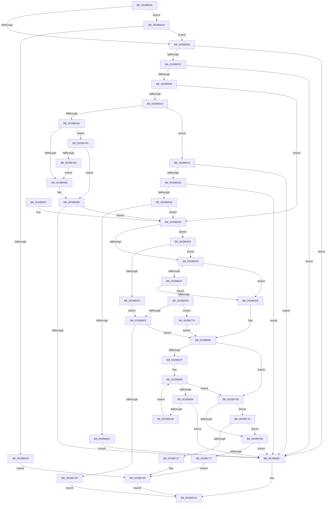

# MiAddLockedPageCharge

- RVA: `0x0028B550`–`0x0028B796` (길이 `582` bytes)
- VA: `0x000000014028B550`
- 실행 섹션: `.text`
- PDB 이름 있음: `예`; PDB Function 태그: `아니요`
- unwind 정보 RVA: `0x00066F80`
- 디코드: `144`개 명령, `582/582` bytes 표시
- 미해석 바이트: `0` (있으면 어셈블리에 `.byte`로 보존)

> 이 문서는 커널 이미지의 기계어와 PDB 기호를 분석해 생성했습니다. 4번과 5번은 함수 원형과 자료형을 바이너리 사용 방식에서 추정한 C 해석이며 원본 소스 복구 결과는 아닙니다.

## 1. Dependencies

- 직접 호출 지점: **3**; 고유 호출 대상: **3**
- 직접 호출자로 확인된 함수: **20**
- RIP 상대 이미지 참조: **2**

### Outgoing calls
- `0x0028B720` → [MiChargeCommit](MiChargeCommit_function_00286EB0.md) (function, `0x00286EB0`)
- `0x0028B740` → [MiReturnCommit](../24/MiReturnCommit_function_00248410.md) (function, `0x00248410`)
- `0x0028B764` → [MiChargePartitionResidentAvailable](MiChargePartitionResidentAvailable_function_0028B000.md) (function, `0x0028B000`)

### Direct callers
- [MiTryLockProtoPoolPageAtDpc](MiTryLockProtoPoolPageAtDpc_function_0028B3C8.md) at `0x0028B4BC`
- [MiMigratePfn](MiMigratePfn_function_0028DBB0.md) at `0x0028DF06`
- [MmCopyToCachedPage](../34/MmCopyToCachedPage_function_00347B44.md) at `0x00348141`
- [MiMakeFaultPfnActive](../36/MiMakeFaultPfnActive_function_00361D00.md) at `0x00361D27`
- [MiWalkEntireImage](../36/MiWalkEntireImage_function_00365D70.md) at `0x0036617D`
- [MiPrivateFixup](../36/MiPrivateFixup_function_003693E8.md) at `0x0036987A`
- [MiHandleCollidedFault](../36/MiHandleCollidedFault_function_00369B48.md) at `0x00369C74`
- [MiWaitForCollidedFaultComplete](../36/MiWaitForCollidedFaultComplete_function_00369EDC.md) at `0x00369F4F`
- [MiBuildReservationCluster](../40/MiBuildReservationCluster_function_004071A0.md) at `0x0040733D`
- [MiMirrorPerformBrownWrites](../45/MiMirrorPerformBrownWrites_function_0045C560.md) at `0x0045CDA2`
- [MiLockPagedAddress](../48/MiLockPagedAddress_function_00484CDC.md) at `0x00484DA6`
- [MiBuildForkPageTable](../4A/MiBuildForkPageTable_function_004ACF5C.md) at `0x004AD0DA`
- [MiSwitchToTransition](../4C/MiSwitchToTransition_function_004C0F5C.md) at `0x004C14CC`
- [MiMapSystemCachePage](../4D/MiMapSystemCachePage_function_004D3588.md) at `0x004D3612`
- [MiLockDownWorkingSet](../4D/MiLockDownWorkingSet_function_004D4950.md) at `0x004D4A20`
- [MiSplitDirectMapPage](../4D/MiSplitDirectMapPage_function_004DAAA0.md) at `0x004DAC35`
- [MiIdealClusterPage](../4D/MiIdealClusterPage_function_004DB964.md) at `0x004DBCFA`
- [MiPurgeBadFileOnlyPages](../68/MiPurgeBadFileOnlyPages_function_00681ADC.md) at `0x00681B93`
- [MiDbgMarkPfnModified](../68/MiDbgMarkPfnModified_function_0068524C.md) at `0x006853D1`
- [sub_006DAAE6](../6D/Unknown_function_006DAAE6.md) at `0x006DAC3E`

### Static image references
- `0x0028B65A` → RVA `0x00E30088` (`.data`; read)
- `0x0028B66F` → RVA `0x00E38D00` (`.data`; read)

## 2. Other-region calls and transfers

- 다른 실행 섹션으로 향하는 call: **0**
- 별도 외부 분기/꼬리 이동을 확인하지 못했습니다.

## 3. Assembly (complete function range)

```asm
0028B550  48 89 5C 24 08                  mov qword ptr [rsp + 8], rbx
0028B555  48 89 6C 24 18                  mov qword ptr [rsp + 0x18], rbp
0028B55A  56                              push rsi
0028B55B  57                              push rdi
0028B55C  41 56                           push r14
0028B55E  48 83 EC 20                     sub rsp, 0x20
0028B562  48 8B D9                        mov rbx, rcx
0028B565  F6 C2 01                        test dl, 1
0028B568  0F 84 3F 01 00 00               je 0x14028b6ad
0028B56E  48 8B 41 28                     mov rax, qword ptr [rcx + 0x28]
0028B572  BF 01 00 00 00                  mov edi, 1
0028B577  48 0F BA E0 28                  bt rax, 0x28
0028B57C  72 3E                           jb 0x14028b5bc
0028B57E  48 0F BA 61 28 35               bt qword ptr [rcx + 0x28], 0x35
0028B584  72 36                           jb 0x14028b5bc
0028B586  44 8B 41 20                     mov r8d, dword ptr [rcx + 0x20]
0028B58A  48 8B 41 18                     mov rax, qword ptr [rcx + 0x18]
0028B58E  48 B9 FF FF FF FF FF FF FF 3F   movabs rcx, 0x3fffffffffffffff
0028B598  48 23 C1                        and rax, rcx
0028B59B  33 C9                           xor ecx, ecx
0028B59D  66 45 85 C0                     test r8w, r8w
0028B5A1  74 45                           je 0x14028b5e8
0028B5A3  66 44 3B C7                     cmp r8w, di
0028B5A7  0F 85 18 01 00 00               jne 0x14028b6c5
0028B5AD  48 85 C0                        test rax, rax
0028B5B0  0F 84 96 01 00 00               je 0x14028b74c
0028B5B6  8B CF                           mov ecx, edi
0028B5B8  85 C9                           test ecx, ecx
0028B5BA  75 2C                           jne 0x14028b5e8
0028B5BC  8B 43 20                        mov eax, dword ptr [rbx + 0x20]
0028B5BF  89 44 24 48                     mov dword ptr [rsp + 0x48], eax
0028B5C3  66 FF C0                        inc ax
0028B5C6  66 89 44 24 48                  mov word ptr [rsp + 0x48], ax
0028B5CB  8B 44 24 48                     mov eax, dword ptr [rsp + 0x48]
0028B5CF  89 43 20                        mov dword ptr [rbx + 0x20], eax
0028B5D2  8B C7                           mov eax, edi
0028B5D4  48 8B 5C 24 40                  mov rbx, qword ptr [rsp + 0x40]
0028B5D9  48 8B 6C 24 50                  mov rbp, qword ptr [rsp + 0x50]
0028B5DE  48 83 C4 20                     add rsp, 0x20
0028B5E2  41 5E                           pop r14
0028B5E4  5F                              pop rdi
0028B5E5  5E                              pop rsi
0028B5E6  C3                              ret
0028B5E7  CC                              int3
0028B5E8  23 D7                           and edx, edi
0028B5EA  8B C2                           mov eax, edx
0028B5EC  F7 D8                           neg eax
0028B5EE  B8 FF FF FF FF                  mov eax, 0xffffffff
0028B5F3  4D 1B F6                        sbb r14, r14
0028B5F6  33 D7                           xor edx, edi
0028B5F8  4C 23 F0                        and r14, rax
0028B5FB  40 32 ED                        xor bpl, bpl
0028B5FE  48 8B 43 28                     mov rax, qword ptr [rbx + 0x28]
0028B602  44 8D 04 95 04 00 00 00         lea r8d, [rdx*4 + 4]
0028B60A  48 85 C0                        test rax, rax
0028B60D  0F 88 D5 00 00 00               js 0x14028b6e8
0028B613  48 8B 4B 08                     mov rcx, qword ptr [rbx + 8]
0028B617  49 B9 00 00 00 00 80 F6 FF FF   movabs r9, 0xfffff68000000000
0028B621  49 8B C1                        mov rax, r9
0028B624  48 BA 78 FF FF FF 3F 00 00 00   movabs rdx, 0x3fffffff78
0028B62E  48 03 C2                        add rax, rdx
0028B631  48 BA 00 00 00 00 00 00 00 80   movabs rdx, 0x8000000000000000
0028B63B  48 0B CA                        or rcx, rdx
0028B63E  48 3B C8                        cmp rcx, rax
0028B641  77 13                           ja 0x14028b656
0028B643  48 8B 4B 08                     mov rcx, qword ptr [rbx + 8]
0028B647  48 0B CA                        or rcx, rdx
0028B64A  49 8B C1                        mov rax, r9
0028B64D  48 3B C8                        cmp rcx, rax
0028B650  0F 83 A2 00 00 00               jae 0x14028b6f8
0028B656  48 8B 4B 28                     mov rcx, qword ptr [rbx + 0x28]
0028B65A  48 8B 05 27 4A BA 00            mov rax, qword ptr [rip + 0xba4a27]
0028B661  48 C1 E9 2B                     shr rcx, 0x2b
0028B665  81 E1 FF 03 00 00               and ecx, 0x3ff
0028B66B  48 8B 34 C8                     mov rsi, qword ptr [rax + rcx*8]
0028B66F  48 8D 05 8A D6 BA 00            lea rax, [rip + 0xbad68a]
0028B676  48 3B F0                        cmp rsi, rax
0028B679  0F 85 DC 00 00 00               jne 0x14028b75b
0028B67F  65 48 8B 14 25 20 00 00 00      mov rdx, qword ptr gs:[0x20]
0028B688  8B 82 9C 8B 00 00               mov eax, dword ptr [rdx + 0x8b9c]
0028B68E  8D 48 FF                        lea ecx, [rax - 1]
0028B691  83 F9 FD                        cmp ecx, -3
0028B694  0F 87 C1 00 00 00               ja 0x14028b75b
0028B69A  8D 48 FF                        lea ecx, [rax - 1]
0028B69D  F0 0F B1 8A 9C 8B 00 00         lock cmpxchg dword ptr [rdx + 0x8b9c], ecx
0028B6A5  0F 84 11 FF FF FF               je 0x14028b5bc
0028B6AB  EB E1                           jmp 0x14028b68e
0028B6AD  8B 41 20                        mov eax, dword ptr [rcx + 0x20]
0028B6B0  41 B8 FF 7F 00 00               mov r8d, 0x7fff
0028B6B6  66 41 3B C0                     cmp ax, r8w
0028B6BA  0F 82 AE FE FF FF               jb 0x14028b56e
0028B6C0  E9 80 00 00 00                  jmp 0x14028b745
0028B6C5  66 41 83 F8 02                  cmp r8w, 2
0028B6CA  0F 85 EC FE FF FF               jne 0x14028b5bc
0028B6D0  48 85 C0                        test rax, rax
0028B6D3  0F 84 E3 FE FF FF               je 0x14028b5bc
0028B6D9  F6 43 22 08                     test byte ptr [rbx + 0x22], 8
0028B6DD  0F 85 05 FF FF FF               jne 0x14028b5e8
0028B6E3  E9 D4 FE FF FF                  jmp 0x14028b5bc
0028B6E8  8B 43 10                        mov eax, dword ptr [rbx + 0x10]
0028B6EB  48 0F BA E0 0A                  bt rax, 0xa
0028B6F0  0F 83 1D FF FF FF               jae 0x14028b613
0028B6F6  EB 06                           jmp 0x14028b6fe
0028B6F8  F6 43 23 20                     test byte ptr [rbx + 0x23], 0x20
0028B6FC  74 7B                           je 0x14028b779
0028B6FE  48 8B 4B 28                     mov rcx, qword ptr [rbx + 0x28]
0028B702  48 8B D7                        mov rdx, rdi
0028B705  48 8B 05 7C 49 BA 00            mov rax, qword ptr [rip + 0xba497c]
0028B70C  40 B5 01                        mov bpl, 1
0028B70F  48 C1 E9 2B                     shr rcx, 0x2b
0028B713  81 E1 FF 03 00 00               and ecx, 0x3ff
0028B719  48 8B 34 C8                     mov rsi, qword ptr [rax + rcx*8]
0028B71D  48 8B CE                        mov rcx, rsi
0028B720  E8 8B B7 FF FF                  call 0x140286eb0
0028B725  85 C0                           test eax, eax
0028B727  0F 85 42 FF FF FF               jne 0x14028b66f
0028B72D  E9 A2 FE FF FF                  jmp 0x14028b5d4
0028B732  40 84 ED                        test bpl, bpl
0028B735  74 36                           je 0x14028b76d
0028B737  45 33 C0                        xor r8d, r8d
0028B73A  48 8B D7                        mov rdx, rdi
0028B73D  48 8B CE                        mov rcx, rsi
0028B740  E8 CB CC FB FF                  call 0x140248410
0028B745  33 C0                           xor eax, eax
0028B747  E9 88 FE FF FF                  jmp 0x14028b5d4
0028B74C  F6 43 22 08                     test byte ptr [rbx + 0x22], 8
0028B750  0F 84 62 FE FF FF               je 0x14028b5b8
0028B756  E9 5B FE FF FF                  jmp 0x14028b5b6
0028B75B  4D 8B C6                        mov r8, r14
0028B75E  48 8B D7                        mov rdx, rdi
0028B761  48 8B CE                        mov rcx, rsi
0028B764  E8 97 F8 FF FF                  call 0x14028b000
0028B769  85 C0                           test eax, eax
0028B76B  74 C5                           je 0x14028b732
0028B76D  8B F8                           mov edi, eax
0028B76F  85 C0                           test eax, eax
0028B771  0F 85 45 FE FF FF               jne 0x14028b5bc
0028B777  EB CC                           jmp 0x14028b745
0028B779  48 8B 43 28                     mov rax, qword ptr [rbx + 0x28]
0028B77D  48 8B 0D 04 49 BA 00            mov rcx, qword ptr [rip + 0xba4904]
0028B784  48 C1 E8 2B                     shr rax, 0x2b
0028B788  25 FF 03 00 00                  and eax, 0x3ff
0028B78D  48 8B 34 C1                     mov rsi, qword ptr [rcx + rax*8]
0028B791  E9 D9 FE FF FF                  jmp 0x14028b66f
```

## 4. C-style interpretation (structured pseudocode)

```c
__int64 __fastcall MiAddLockedPageCharge(__int64 a1, int a2)
{
    __int64 result;
    __int64 v_r14;
    __int64 v_rbp;
    __int64 v_rsp;
    unsigned int v_stack_p10;
    unsigned __int64 v_stack_p18;
    unsigned __int64 v_stack_p8;

    v_stack_p8 = v_rbx;
    v_stack_p18 = v_rbp;
    v_rsp = (v_rsp) - (32);
    if ((((unsigned __int8)(a2)) & (1)) == 0) goto loc_0028B6AD;
loc_0028B56E:
    if (condition_is_below) goto loc_0028B5BC;
    if (condition_is_below) goto loc_0028B5BC;
    result = (*(unsigned __int64 *)(a1 + 24)) & (a1);
    a1 = 0;
    if ((unsigned __int16)((unsigned int)(*(unsigned int *)(a1 + 32))) == 0) goto loc_0028B5E8;
    if (((unsigned __int16)((unsigned int)(*(unsigned int *)(a1 + 32)))) != 1) goto loc_0028B6C5;
    if (result == 0) goto loc_0028B74C;
loc_0028B5B6:
loc_0028B5B8:
    if (1 != 0) goto loc_0028B5E8;
loc_0028B5BC:
    v_stack_p10 = (unsigned int)((unsigned int)(*(unsigned int *)(a1 + 32)));
    result = (unsigned __int16)(((unsigned int)(*(unsigned int *)(a1 + 32))) + 1);
    v_stack_p10 = (unsigned __int16)(result);
    *(unsigned int *)(a1 + 32) = (unsigned int)((unsigned int)(v_stack_p10));
loc_0028B5D4:
    v_rsp = (v_rsp) + (32);
    return 1;
loc_0028B5E8:
    a2 = (unsigned int)((a2) & (1));
    result = (unsigned int)(-((unsigned int)(a2)));
    a2 = (unsigned int)((a2) ^ (1));
    v_r14 = (v_r14) & ((unsigned int)(0xFFFFFFFFULL));
    v_rbp = 0;
    if (sign_flag) goto loc_0028B6E8;
loc_0028B613:
    result = (a4) + (a2);
    a1 = (*(unsigned __int64 *)(v_stack_p8 + 8)) | (a2);
    if (a1 > result) goto loc_0028B656;
    a1 = (*(unsigned __int64 *)(v_stack_p8 + 8)) | (a2);
    if (a1 >= a4) goto loc_0028B6F8;
loc_0028B656:
    a1 = (*(unsigned __int64 *)(v_stack_p8 + 40)) >> (43);
    a1 = (unsigned int)((a1) & (0x3FFULL));
loc_0028B66F:
    if ((*(unsigned __int64 *)(*(unsigned __int64 *)(v_rip + 12208679) + a1 * 8)) != (v_rip + 12244618)) goto loc_0028B75B;
loc_0028B68E:
    if (((unsigned int)((unsigned int)(*(unsigned int *)(*(unsigned __int64 *)(gs_base + (0 + 32)) + 35740)) - 1)) > -3) goto loc_0028B75B;
    if (((unsigned int)((unsigned int)(*(unsigned int *)(*(unsigned __int64 *)(gs_base + (0 + 32)) + 35740)) - 1)) == -3) goto loc_0028B5BC;
    goto loc_0028B68E;
loc_0028B6AD:
    if (((unsigned __int16)((unsigned int)(*(unsigned int *)((unsigned int)(*(unsigned int *)(*(unsigned __int64 *)(gs_base + (0 + 32)) + 35740)) - 1 + 32)))) < ((unsigned __int16)((unsigned int)(0x7FFFULL)))) goto loc_0028B56E;
    goto loc_0028B745;
loc_0028B6C5:
    if (((unsigned __int16)((unsigned int)(0x7FFFULL))) != 2) goto loc_0028B5BC;
    if ((unsigned int)(*(unsigned int *)((unsigned int)(*(unsigned int *)(*(unsigned __int64 *)(gs_base + (0 + 32)) + 35740)) - 1 + 32)) == 0) goto loc_0028B5BC;
    if (((*(unsigned __int8 *)(v_stack_p8 + 34)) & (8)) != 0) goto loc_0028B5E8;
    goto loc_0028B5BC;
loc_0028B6E8:
    if (condition_is_above_or_equal) goto loc_0028B613;
    goto loc_0028B6FE;
loc_0028B6F8:
    if (((*(unsigned __int8 *)(v_stack_p8 + 35)) & (32)) == 0) goto loc_0028B779;
loc_0028B6FE:
    a1 = (*(unsigned __int64 *)(v_stack_p8 + 40)) >> (43);
    a1 = (unsigned int)((a1) & (0x3FFULL));
    result = MiChargeCommit(*(unsigned __int64 *)(*(unsigned __int64 *)(v_rip + 12208508) + a1 * 8), 1, (unsigned int)(0x7FFFULL), a4);
    if ((unsigned int)(result) != 0) goto loc_0028B66F;
    goto loc_0028B5D4;
loc_0028B732:
    if (1 == 0) goto loc_0028B76D;
    a3 = 0;
    result = MiReturnCommit(*(unsigned __int64 *)(*(unsigned __int64 *)(v_rip + 12208508) + a1 * 8), 1, a3, a4);
loc_0028B745:
    result = 0;
    goto loc_0028B5D4;
loc_0028B74C:
    if (((*(unsigned __int8 *)(v_stack_p8 + 34)) & (8)) == 0) goto loc_0028B5B8;
    goto loc_0028B5B6;
loc_0028B75B:
    result = MiChargePartitionResidentAvailable(*(unsigned __int64 *)(*(unsigned __int64 *)(v_rip + 12208508) + a1 * 8), 1, v_r14, a4);
    if ((unsigned int)(result) == 0) goto loc_0028B732;
loc_0028B76D:
    if ((unsigned int)(result) != 0) goto loc_0028B5BC;
    goto loc_0028B745;
loc_0028B779:
    result = (*(unsigned __int64 *)(v_stack_p8 + 40)) >> (43);
    result = (unsigned int)((result) & (0x3FFULL));
    goto loc_0028B66F;
}
```

## 5. (Beta) C Style

```c
int64_t MiAddLockedPageCharge(void *Arg1, int32_t Arg2)
{
    uint8_t *arg1 = (uint8_t *)Arg1;

    int64_t result;
    int64_t local_r14;
    int64_t local_rbp;
    int64_t local_rsp;
    uint32_t v_stack_p10;
    uint64_t v_stack_p18;
    uint64_t v_stack_p8;

    v_stack_p8 = local_rbx;
    v_stack_p18 = local_rbp;
    local_rsp = (local_rsp) - (32);
    if ((((uint8_t)(Arg2)) & (1)) == 0) goto loc_0028B6AD;
loc_0028B56E:
    if (condition_is_below) goto loc_0028B5BC;
    if (condition_is_below) goto loc_0028B5BC;
    result = (*(uint64_t *)(arg1 + 0x18)) & (Arg1);
    Arg1 = 0;
    if ((uint16_t)((uint32_t)(*(uint32_t *)(arg1 + 0x20))) == 0) goto loc_0028B5E8;
    if (((uint16_t)((uint32_t)(*(uint32_t *)(arg1 + 0x20)))) != 1) goto loc_0028B6C5;
    if (result == 0) goto loc_0028B74C;
loc_0028B5B6:
loc_0028B5B8:
    if (1 != 0) goto loc_0028B5E8;
loc_0028B5BC:
    v_stack_p10 = (uint32_t)((uint32_t)(*(uint32_t *)(arg1 + 0x20)));
    result = (uint16_t)(((uint32_t)(*(uint32_t *)(arg1 + 0x20))) + 1);
    v_stack_p10 = (uint16_t)(result);
    *(uint32_t *)(arg1 + 0x20) = (uint32_t)((uint32_t)(v_stack_p10));
loc_0028B5D4:
    local_rsp = (local_rsp) + (32);
    return 1;
loc_0028B5E8:
    Arg2 = (uint32_t)((Arg2) & (1));
    result = (uint32_t)(-((uint32_t)(Arg2)));
    Arg2 = (uint32_t)((Arg2) ^ (1));
    local_r14 = (local_r14) & ((uint32_t)(0xFFFFFFFFULL));
    local_rbp = 0;
    if (sign_flag) goto loc_0028B6E8;
loc_0028B613:
    result = (a4) + (Arg2);
    Arg1 = (*(uint64_t *)(v_stack_p8 + 0x8)) | (Arg2);
    if (Arg1 > result) goto loc_0028B656;
    Arg1 = (*(uint64_t *)(v_stack_p8 + 0x8)) | (Arg2);
    if (Arg1 >= a4) goto loc_0028B6F8;
loc_0028B656:
    Arg1 = (*(uint64_t *)(v_stack_p8 + 0x28)) >> (43);
    Arg1 = (uint32_t)((Arg1) & (0x3FFULL));
loc_0028B66F:
    if ((*(uint64_t *)(*(uint64_t *)(v_rip + 0xBA4A27) + arg1 * 8)) != (v_rip + 12244618)) goto loc_0028B75B;
loc_0028B68E:
    if (((uint32_t)((uint32_t)(*(uint32_t *)(*(uint64_t *)(gs_base + (0 + 0x20)) + 0x8B9C)) - 1)) > -3) goto loc_0028B75B;
    if (((uint32_t)((uint32_t)(*(uint32_t *)(*(uint64_t *)(gs_base + (0 + 0x20)) + 0x8B9C)) - 1)) == -3) goto loc_0028B5BC;
    goto loc_0028B68E;
loc_0028B6AD:
    if (((uint16_t)((uint32_t)(*(uint32_t *)((uint32_t)(*(uint32_t *)(*(uint64_t *)(gs_base + (0 + 0x20)) + 0x8B9C)) - 0x1 + 0x20)))) < ((uint16_t)((uint32_t)(0x7FFFULL)))) goto loc_0028B56E;
    goto loc_0028B745;
loc_0028B6C5:
    if (((uint16_t)((uint32_t)(0x7FFFULL))) != 2) goto loc_0028B5BC;
    if ((uint32_t)(*(uint32_t *)((uint32_t)(*(uint32_t *)(*(uint64_t *)(gs_base + (0 + 0x20)) + 0x8B9C)) - 0x1 + 0x20)) == 0) goto loc_0028B5BC;
    if (((*(uint8_t *)(v_stack_p8 + 0x22)) & (8)) != 0) goto loc_0028B5E8;
    goto loc_0028B5BC;
loc_0028B6E8:
    if (condition_is_above_or_equal) goto loc_0028B613;
    goto loc_0028B6FE;
loc_0028B6F8:
    if (((*(uint8_t *)(v_stack_p8 + 0x23)) & (32)) == 0) goto loc_0028B779;
loc_0028B6FE:
    Arg1 = (*(uint64_t *)(v_stack_p8 + 0x28)) >> (43);
    Arg1 = (uint32_t)((Arg1) & (0x3FFULL));
    result = MiChargeCommit(*(uint64_t *)(*(uint64_t *)(v_rip + 0xBA497C) + arg1 * 8), 1, (uint32_t)(0x7FFFULL), a4);
    if ((uint32_t)(result) != 0) goto loc_0028B66F;
    goto loc_0028B5D4;
loc_0028B732:
    if (1 == 0) goto loc_0028B76D;
    a3 = 0;
    result = MiReturnCommit(*(uint64_t *)(*(uint64_t *)(v_rip + 0xBA497C) + arg1 * 8), 1, a3, a4);
loc_0028B745:
    result = 0;
    goto loc_0028B5D4;
loc_0028B74C:
    if (((*(uint8_t *)(v_stack_p8 + 0x22)) & (8)) == 0) goto loc_0028B5B8;
    goto loc_0028B5B6;
loc_0028B75B:
    result = MiChargePartitionResidentAvailable(*(uint64_t *)(*(uint64_t *)(v_rip + 0xBA497C) + arg1 * 8), 1, local_r14, a4);
    if ((uint32_t)(result) == 0) goto loc_0028B732;
loc_0028B76D:
    if ((uint32_t)(result) != 0) goto loc_0028B5BC;
    goto loc_0028B745;
loc_0028B779:
    result = (*(uint64_t *)(v_stack_p8 + 0x28)) >> (43);
    result = (uint32_t)((result) & (0x3FFULL));
    goto loc_0028B66F;
}
```

### 관측된 메모리 오프셋

구조체 형식이 확인되지 않은 접근은 인자 기준의 오프셋으로만 기록했습니다.

| 기준 인자 | 오프셋 표현 | 폭 (bit) | 접근 |
|---|---:|---:|---|
| `Arg1` | `+ 0x8` | `64` | `R` |
| `Arg1` | `+ 0x10` | `32` | `R` |
| `Arg1` | `+ 0x18` | `64` | `R` |
| `Arg1` | `+ 0x20` | `32` | `R` |
| `Arg1` | `+ 0x20` | `32` | `W` |
| `Arg1` | `+ 0x22` | `8` | `R` |
| `Arg1` | `+ 0x23` | `8` | `R` |
| `Arg1` | `+ 0x28` | `64` | `R` |

## 6. Execution-region graph

[열기: 2D/3D 그래프와 함수 탐색 컨트롤 패널](../../../control-panel.html?section=text&rva=0x0028B550&view=graph)

- 2D 그래프는 위에서 아래로 흐르고, 3D 그래프는 빈 공간을 드래그해 회전합니다. Shift+드래그는 이동, 휠은 확대·축소, 함수 노드 선택은 대상 보고서 이동입니다.

### Static fallback


