# MiAddPageToFlushMdl

- RVA: `0x00286930`–`0x00286C59` (길이 `809` bytes)
- VA: `0x0000000140286930`
- 실행 섹션: `.text`
- PDB 이름 있음: `예`; PDB Function 태그: `아니요`
- unwind 정보 RVA: `0x00066C50`
- 디코드: `198`개 명령, `809/809` bytes 표시
- 미해석 바이트: `0` (있으면 어셈블리에 `.byte`로 보존)

> 이 문서는 커널 이미지의 기계어와 PDB 기호를 분석해 생성했습니다. 4번과 5번은 함수 원형과 자료형을 바이너리 사용 방식에서 추정한 C 해석이며 원본 소스 복구 결과는 아닙니다.

## 1. Dependencies

- 직접 호출 지점: **10**; 고유 호출 대상: **10**
- 직접 호출자로 확인된 함수: **1**
- RIP 상대 이미지 참조: **5**

### Outgoing calls
- `0x0028698B` → [ExpWaitForSpinLockExclusiveAndAcquire](../32/ExpWaitForSpinLockExclusiveAndAcquire_function_003239A0.md) (function, `0x003239A0`)
- `0x00286A37` → [MiChargeForWriteInProgressPage](MiChargeForWriteInProgressPage_function_00286D60.md) (function, `0x00286D60`)
- `0x00286B2D` → [MiUnlinkPageFromListEx](MiUnlinkPageFromListEx_function_00287590.md) (function, `0x00287590`)
- `0x00286B56` → [MiGetPagePrivilege](MiGetPagePrivilege_function_00285420.md) (function, `0x00285420`)
- `0x00286B6B` → [MiClearPfnImageVerified](../40/MiClearPfnImageVerified_function_00407000.md) (function, `0x00407000`)
- `0x00286B89` → [ExpAcquireSpinLockExclusiveAtDpcLevelInstrumented](../32/ExpAcquireSpinLockExclusiveAtDpcLevelInstrumented_function_00323A70.md) (function, `0x00323A70`)
- `0x00286BC7` → [KiCheckVpBackingLongSpinWaitHypercall](../30/KiCheckVpBackingLongSpinWaitHypercall_function_0030F490.md) (function, `0x0030F490`)
- `0x00286BD7` → [HvlNotifyLongSpinWait](../30/HvlNotifyLongSpinWait_function_0030F460.md) (function, `0x0030F460`)
- `0x00286C11` → [ExpReleaseSpinLockExclusiveFromDpcLevelInstrumented](../2C/ExpReleaseSpinLockExclusiveFromDpcLevelInstrumented_function_002C0F44.md) (function, `0x002C0F44`)
- `0x00286C1E` → [MiCanPfnOriginalPteBeLost](../37/MiCanPfnOriginalPteBeLost_function_00373D3C.md) (function, `0x00373D3C`)

### Direct callers
- [MiFlushSection](../40/MiFlushSection_function_004036B0.md) at `0x00403ACB`

### Static image references
- `0x0028696C` → RVA `0x00FC6B06` (`ALMOSTRO`; read)
- `0x002869B7` → RVA `0x00FC52AC` (`ALMOSTRO`; reference)
- `0x00286A07` → RVA `0x00E30088` (`.data`; read)
- `0x00286B75` → RVA `0x00F0DE58` (`.data`; read)
- `0x00286BB9` → RVA `0x00FC6AB8` (`ALMOSTRO`; read)

## 2. Other-region calls and transfers

- 다른 실행 섹션으로 향하는 call: **0**
- 별도 외부 분기/꼬리 이동을 확인하지 못했습니다.

## 3. Assembly (complete function range)

```asm
00286930  48 89 5C 24 10                  mov qword ptr [rsp + 0x10], rbx
00286935  48 89 6C 24 18                  mov qword ptr [rsp + 0x18], rbp
0028693A  48 89 74 24 20                  mov qword ptr [rsp + 0x20], rsi
0028693F  57                              push rdi
00286940  41 54                           push r12
00286942  41 55                           push r13
00286944  41 56                           push r14
00286946  41 57                           push r15
00286948  48 83 EC 20                     sub rsp, 0x20
0028694C  45 33 FF                        xor r15d, r15d
0028694F  45 8B E1                        mov r12d, r9d
00286952  4D 8B F0                        mov r14, r8
00286955  48 8B DA                        mov rbx, rdx
00286958  48 8B F9                        mov rdi, rcx
0028695B  45 8B EF                        mov r13d, r15d
0028695E  41 8D 6F 02                     lea ebp, [r15 + 2]
00286962  44 39 79 28                     cmp dword ptr [rcx + 0x28], r15d
00286966  0F 85 97 00 00 00               jne 0x140286a03
0028696C  F6 05 93 01 D4 00 21            test byte ptr [rip + 0xd40193], 0x21
00286973  44 8B ED                        mov r13d, ebp
00286976  0F 85 F9 01 00 00               jne 0x140286b75
0028697C  F0 41 0F BA 68 48 1F            lock bts dword ptr [r8 + 0x48], 0x1f
00286983  73 0E                           jae 0x140286993
00286985  B2 FF                           mov dl, 0xff
00286987  49 8D 48 48                     lea rcx, [r8 + 0x48]
0028698B  E8 10 D0 09 00                  call 0x1403239a0
00286990  44 8B F8                        mov r15d, eax
00286993  41 8B 56 48                     mov edx, dword ptr [r14 + 0x48]
00286997  8B CA                           mov ecx, edx
00286999  0F BA F1 1E                     btr ecx, 0x1e
0028699D  81 F9 00 00 00 80               cmp ecx, 0x80000000
002869A3  74 32                           je 0x1402869d7
002869A5  0F BA E2 1E                     bt edx, 0x1e
002869A9  72 09                           jb 0x1402869b4
002869AB  F0 41 81 4E 48 00 00 00 40      lock or dword ptr [r14 + 0x48], 0x40000000
002869B4  41 FF C7                        inc r15d
002869B7  44 85 3D EE E8 D3 00            test dword ptr [rip + 0xd3e8ee], r15d
002869BE  0F 84 F5 01 00 00               je 0x140286bb9
002869C4  F3 90                           pause
002869C6  41 8B 56 48                     mov edx, dword ptr [r14 + 0x48]
002869CA  8B C2                           mov eax, edx
002869CC  0F BA F0 1E                     btr eax, 0x1e
002869D0  3D 00 00 00 80                  cmp eax, 0x80000000
002869D5  75 CE                           jne 0x1402869a5
002869D7  45 33 FF                        xor r15d, r15d
002869DA  41 FF 46 4C                     inc dword ptr [r14 + 0x4c]
002869DE  F6 05 21 01 D4 00 01            test byte ptr [rip + 0xd40121], 1
002869E5  0F 85 0F 02 00 00               jne 0x140286bfa
002869EB  45 89 7E 48                     mov dword ptr [r14 + 0x48], r15d
002869EF  4C 89 3F                        mov qword ptr [rdi], r15
002869F2  66 44 89 7F 0A                  mov word ptr [rdi + 0xa], r15w
002869F7  4C 89 7F 20                     mov qword ptr [rdi + 0x20], r15
002869FB  44 89 7F 28                     mov dword ptr [rdi + 0x28], r15d
002869FF  44 89 67 2C                     mov dword ptr [rdi + 0x2c], r12d
00286A03  48 8B 43 28                     mov rax, qword ptr [rbx + 0x28]
00286A07  48 8B 0D 7A 96 BA 00            mov rcx, qword ptr [rip + 0xba967a]
00286A0E  48 8B 74 24 70                  mov rsi, qword ptr [rsp + 0x70]
00286A13  48 C1 E8 2B                     shr rax, 0x2b
00286A17  83 E6 01                        and esi, 1
00286A1A  25 FF 03 00 00                  and eax, 0x3ff
00286A1F  48 8B 0C C1                     mov rcx, qword ptr [rcx + rax*8]
00286A23  8B 43 10                        mov eax, dword ptr [rbx + 0x10]
00286A26  48 C1 E8 0A                     shr rax, 0xa
00286A2A  83 E0 01                        and eax, 1
00286A2D  8B D0                           mov edx, eax
00286A2F  0B D5                           or edx, ebp
00286A31  45 85 ED                        test r13d, r13d
00286A34  0F 44 D0                        cmove edx, eax
00286A37  E8 24 03 00 00                  call 0x140286d60
00286A3C  44 8B F0                        mov r14d, eax
00286A3F  85 C0                           test eax, eax
00286A41  0F 84 9A 01 00 00               je 0x140286be1
00286A47  48 85 F6                        test rsi, rsi
00286A4A  0F 84 D8 00 00 00               je 0x140286b28
00286A50  8B 43 20                        mov eax, dword ptr [rbx + 0x20]
00286A53  89 44 24 70                     mov dword ptr [rsp + 0x70], eax
00286A57  66 FF C0                        inc ax
00286A5A  66 89 44 24 70                  mov word ptr [rsp + 0x70], ax
00286A5F  8B 44 24 70                     mov eax, dword ptr [rsp + 0x70]
00286A63  89 43 20                        mov dword ptr [rbx + 0x20], eax
00286A66  44 8B 5B 20                     mov r11d, dword ptr [rbx + 0x20]
00286A6A  44 89 5C 24 70                  mov dword ptr [rsp + 0x70], r11d
00286A6F  41 C1 EB 10                     shr r11d, 0x10
00286A73  41 F6 C3 08                     test r11b, 8
00286A77  0F 85 9E 01 00 00               jne 0x140286c1b
00286A7D  41 80 E3 EF                     and r11b, 0xef
00286A81  44 88 5C 24 72                  mov byte ptr [rsp + 0x72], r11b
00286A86  8B 44 24 70                     mov eax, dword ptr [rsp + 0x70]
00286A8A  89 43 20                        mov dword ptr [rbx + 0x20], eax
00286A8D  8B 43 20                        mov eax, dword ptr [rbx + 0x20]
00286A90  89 44 24 70                     mov dword ptr [rsp + 0x70], eax
00286A94  C1 E8 10                        shr eax, 0x10
00286A97  0C 08                           or al, 8
00286A99  88 44 24 72                     mov byte ptr [rsp + 0x72], al
00286A9D  8B 44 24 70                     mov eax, dword ptr [rsp + 0x70]
00286AA1  89 43 20                        mov dword ptr [rbx + 0x20], eax
00286AA4  8B 43 10                        mov eax, dword ptr [rbx + 0x10]
00286AA7  48 0F BA E0 0A                  bt rax, 0xa
00286AAC  0F 83 9A 00 00 00               jae 0x140286b4c
00286AB2  48 B8 FF FF FF FF FF FF FF 7F   movabs rax, 0x7fffffffffffffff
00286ABC  F0 48 21 43 18                  lock and qword ptr [rbx + 0x18], rax
00286AC1  48 B8 00 00 00 00 00 DE FF FF   movabs rax, 0xffffde0000000000
00286ACB  48 2B D8                        sub rbx, rax
00286ACE  48 B8 AB AA AA AA AA AA AA AA   movabs rax, 0xaaaaaaaaaaaaaaab
00286AD8  48 C1 FB 04                     sar rbx, 4
00286ADC  48 0F AF D8                     imul rbx, rax
00286AE0  8B 47 28                        mov eax, dword ptr [rdi + 0x28]
00286AE3  48 89 5C C7 30                  mov qword ptr [rdi + rax*8 + 0x30], rbx
00286AE8  8B 57 28                        mov edx, dword ptr [rdi + 0x28]
00286AEB  44 8B 47 2C                     mov r8d, dword ptr [rdi + 0x2c]
00286AEF  FF C2                           inc edx
00286AF1  89 57 28                        mov dword ptr [rdi + 0x28], edx
00286AF4  41 83 FE 03                     cmp r14d, 3
00286AF8  0F 84 95 00 00 00               je 0x140286b93
00286AFE  41 3B D0                        cmp edx, r8d
00286B01  41 8B EF                        mov ebp, r15d
00286B04  40 0F 94 C5                     sete bpl
00286B08  8B C5                           mov eax, ebp
00286B0A  48 8B 5C 24 58                  mov rbx, qword ptr [rsp + 0x58]
00286B0F  48 8B 6C 24 60                  mov rbp, qword ptr [rsp + 0x60]
00286B14  48 8B 74 24 68                  mov rsi, qword ptr [rsp + 0x68]
00286B19  48 83 C4 20                     add rsp, 0x20
00286B1D  41 5F                           pop r15
00286B1F  41 5E                           pop r14
00286B21  41 5D                           pop r13
00286B23  41 5C                           pop r12
00286B25  5F                              pop rdi
00286B26  C3                              ret
00286B27  CC                              int3
00286B28  33 D2                           xor edx, edx
00286B2A  48 8B CB                        mov rcx, rbx
00286B2D  E8 5E 0A 00 00                  call 0x140287590
00286B32  48 8B 43 18                     mov rax, qword ptr [rbx + 0x18]
00286B36  48 B9 00 00 00 00 00 00 00 C0   movabs rcx, 0xc000000000000000
00286B40  48 23 C1                        and rax, rcx
00286B43  48 89 43 18                     mov qword ptr [rbx + 0x18], rax
00286B47  E9 04 FF FF FF                  jmp 0x140286a50
00286B4C  45 33 C0                        xor r8d, r8d
00286B4F  48 8B CB                        mov rcx, rbx
00286B52  41 8D 50 01                     lea edx, [r8 + 1]
00286B56  E8 C5 E8 FF FF                  call 0x140285420
00286B5B  A8 10                           test al, 0x10
00286B5D  0F 84 4F FF FF FF               je 0x140286ab2
00286B63  BA 1C 00 00 00                  mov edx, 0x1c
00286B68  48 8B CB                        mov rcx, rbx
00286B6B  E8 90 04 18 00                  call 0x140407000
00286B70  E9 3D FF FF FF                  jmp 0x140286ab2
00286B75  8B 05 DD 72 C8 00               mov eax, dword ptr [rip + 0xc872dd]
00286B7B  85 C0                           test eax, eax
00286B7D  0F 85 F9 FD FF FF               jne 0x14028697c
00286B83  B2 FF                           mov dl, 0xff
00286B85  49 8D 48 48                     lea rcx, [r8 + 0x48]
00286B89  E8 E2 CE 09 00                  call 0x140323a70
00286B8E  E9 47 FE FF FF                  jmp 0x1402869da
00286B93  83 FA 10                        cmp edx, 0x10
00286B96  0F 83 6C FF FF FF               jae 0x140286b08
00286B9C  65 48 8B 04 25 88 01 00 00      mov rax, qword ptr gs:[0x188]
00286BA5  8B 88 A4 05 00 00               mov ecx, dword ptr [rax + 0x5a4]
00286BAB  40 84 CD                        test bpl, cl
00286BAE  0F 84 54 FF FF FF               je 0x140286b08
00286BB4  E9 45 FF FF FF                  jmp 0x140286afe
00286BB9  8B 05 F9 FE D3 00               mov eax, dword ptr [rip + 0xd3fef9]
00286BBF  A8 40                           test al, 0x40
00286BC1  0F 84 FD FD FF FF               je 0x1402869c4
00286BC7  E8 C4 88 08 00                  call 0x14030f490
00286BCC  84 C0                           test al, al
00286BCE  0F 84 F0 FD FF FF               je 0x1402869c4
00286BD4  41 8B CF                        mov ecx, r15d
00286BD7  E8 84 88 08 00                  call 0x14030f460
00286BDC  E9 E5 FD FF FF                  jmp 0x1402869c6
00286BE1  48 B8 FF FF FF FF FF FF FF 7F   movabs rax, 0x7fffffffffffffff
00286BEB  F0 48 21 43 18                  lock and qword ptr [rbx + 0x18], rax
00286BF0  B8 03 00 00 00                  mov eax, 3
00286BF5  E9 10 FF FF FF                  jmp 0x140286b0a
00286BFA  8B 05 58 72 C8 00               mov eax, dword ptr [rip + 0xc87258]
00286C00  85 C0                           test eax, eax
00286C02  0F 85 E3 FD FF FF               jne 0x1402869eb
00286C08  48 8B 54 24 48                  mov rdx, qword ptr [rsp + 0x48]
00286C0D  49 8D 4E 48                     lea rcx, [r14 + 0x48]
00286C11  E8 2E A3 03 00                  call 0x1402c0f44
00286C16  E9 D4 FD FF FF                  jmp 0x1402869ef
00286C1B  48 8B CB                        mov rcx, rbx
00286C1E  E8 19 D1 0E 00                  call 0x140373d3c
00286C23  85 C0                           test eax, eax
00286C25  0F 84 52 FE FF FF               je 0x140286a7d
00286C2B  48 8B 43 10                     mov rax, qword ptr [rbx + 0x10]
00286C2F  0F B6 4B 22                     movzx ecx, byte ptr [rbx + 0x22]
00286C33  C0 E9 04                        shr cl, 4
00286C36  A8 04                           test al, 4
00286C38  F6 D1                           not cl
00286C3A  0F 95 C0                        setne al
00286C3D  22 C8                           and cl, al
00286C3F  F6 C1 01                        test cl, 1
00286C42  0F 84 35 FE FF FF               je 0x140286a7d
00286C48  48 8B 43 10                     mov rax, qword ptr [rbx + 0x10]
00286C4C  48 83 E0 FB                     and rax, 0xfffffffffffffffb
00286C50  48 89 43 10                     mov qword ptr [rbx + 0x10], rax
00286C54  E9 24 FE FF FF                  jmp 0x140286a7d
```

## 4. C-style interpretation (structured pseudocode)

```c
__int64 __fastcall MiAddPageToFlushMdl(__int64 a1, __int64 a2, __int64 a3, int a4, unsigned int a5)
{
    __int64 result;
    __int64 v_r11;
    __int64 v_r15;
    __int64 v_rbp;
    __int64 v_rbx;
    __int64 v_rsi;
    __int64 v_rsp;
    unsigned __int64 v_stack_p10;
    unsigned __int64 v_stack_p18;
    unsigned __int64 v_stack_p20;
    unsigned int v_stack_p28;
    unsigned __int8 v_stack_p2A;
    unsigned __int64 v_stack_p48;

    v_stack_p10 = v_rbx;
    v_stack_p18 = v_rbp;
    v_stack_p20 = v_rsi;
    v_rsp = (v_rsp) - (32);
    v_r15 = 0;
    if ((*(unsigned int *)(a1 + 40)) != 0) goto loc_00286A03;
    if (((*(unsigned __int8 *)(v_rip + 13894035)) & (33)) != 0) goto loc_00286B75;
loc_0028697C:
    if (!(condition_is_above_or_equal)) {
        a2 = 255;
        a1 = a3 + 72;
        result = ExpWaitForSpinLockExclusiveAndAcquire(a1, a2, a3, a4);
        v_r15 = (unsigned int)(result);
    }
    if (((unsigned int)((unsigned int)((unsigned int)((unsigned int)(*(unsigned int *)(a3 + 72)))))) == 0x80000000ULL) goto loc_002869D7;
loc_002869A5:
    if (((unsigned int)((unsigned int)((unsigned int)((unsigned int)(*(unsigned int *)(a3 + 72)))))) >= 0x80000000ULL) {
    }
    v_r15 = (unsigned int)((v_r15) + 1);
    if (((*(unsigned int *)(v_rip + 13887726)) & ((unsigned int)(v_r15))) == 0) goto loc_00286BB9;
loc_002869C4:
loc_002869C6:
    if (((unsigned int)((unsigned int)((unsigned int)((unsigned int)(*(unsigned int *)(a3 + 72)))))) != 0x80000000ULL) goto loc_002869A5;
loc_002869D7:
    v_r15 = 0;
loc_002869DA:
    if (((*(unsigned __int8 *)(v_rip + 13893921)) & (1)) != 0) goto loc_00286BFA;
loc_002869EB:
    *(unsigned int *)(a3 + 72) = 0;
loc_002869EF:
    *(unsigned __int64 *)(a1) = 0;
    *(unsigned __int16 *)(a1 + 10) = 0;
    *(unsigned __int64 *)(a1 + 32) = 0;
    *(unsigned int *)(a1 + 40) = 0;
    *(unsigned int *)(a1 + 44) = (unsigned int)((unsigned int)(a4));
loc_00286A03:
    result = (*(unsigned __int64 *)(a2 + 40)) >> (43);
    v_rsi = (unsigned int)((a5) & (1));
    result = (unsigned int)((result) & (0x3FFULL));
    result = ((unsigned int)(*(unsigned int *)(a2 + 16))) >> (10);
    result = (unsigned int)((result) & (1));
    a2 = (unsigned int)(((unsigned int)((unsigned int)(result))) | ((unsigned int)(v_r15 + 2)));
    if ((unsigned int)((unsigned int)((unsigned int)(v_r15 + 2))) == 0) { a2 = (unsigned int)(result); }
    result = MiChargeForWriteInProgressPage(*(unsigned __int64 *)(*(unsigned __int64 *)(v_rip + 12228218) + result * 8), a2, a3, a4);
    if ((unsigned int)(result) == 0) goto loc_00286BE1;
    if (v_rsi == 0) goto loc_00286B28;
loc_00286A50:
    v_stack_p28 = (unsigned int)((unsigned int)(*(unsigned int *)(a2 + 32)));
    result = (unsigned __int16)(((unsigned int)(*(unsigned int *)(a2 + 32))) + 1);
    v_stack_p28 = (unsigned __int16)(result);
    *(unsigned int *)(a2 + 32) = (unsigned int)((unsigned int)(a5));
    v_stack_p28 = (unsigned int)((unsigned int)(*(unsigned int *)(a2 + 32)));
    v_r11 = (unsigned int)(((unsigned int)(*(unsigned int *)(a2 + 32))) >> (16));
    if ((((unsigned __int8)(v_r11)) & (8)) != 0) goto loc_00286C1B;
loc_00286A7D:
    v_r11 = (unsigned __int8)((v_r11) & (239));
    v_stack_p2A = (unsigned __int8)(v_r11);
    *(unsigned int *)(a2 + 32) = (unsigned int)((unsigned int)(a5));
    v_stack_p28 = (unsigned int)((unsigned int)(*(unsigned int *)(a2 + 32)));
    result = (unsigned int)(((unsigned int)(*(unsigned int *)(a2 + 32))) >> (16));
    result = (unsigned __int8)((result) | (8));
    v_stack_p2A = (unsigned __int8)(result);
    *(unsigned int *)(a2 + 32) = (unsigned int)((unsigned int)(a5));
    if (condition_is_above_or_equal) goto loc_00286B4C;
loc_00286AB2:
    v_rbx = (a2) - ((unsigned int)(*(unsigned int *)(a2 + 16)));
    v_rbx = (v_rbx) >> (4);
    v_rbx = (v_rbx) * ((unsigned int)(*(unsigned int *)(a2 + 16)));
    *(unsigned __int64 *)(a1 + (unsigned int)(*(unsigned int *)(a1 + 40)) * 8 + 48) = v_rbx;
    a2 = (unsigned int)(((unsigned int)(*(unsigned int *)(a1 + 40))) + 1);
    *(unsigned int *)(a1 + 40) = (unsigned int)(a2);
    if (((unsigned int)((unsigned int)((unsigned int)(result)))) == 3) goto loc_00286B93;
loc_00286AFE:
    v_rbp = (((unsigned int)(a2)) == ((unsigned int)((unsigned int)(*(unsigned int *)(a1 + 44))))) ? 1 : 0;
loc_00286B08:
loc_00286B0A:
    v_rsp = (v_rsp) + (32);
    return (unsigned int)((unsigned int)(v_rbp));
loc_00286B28:
    a2 = 0;
    result = MiUnlinkPageFromListEx(v_stack_p10, a2, (unsigned int)(*(unsigned int *)(a1 + 44)), a4);
    result = (*(unsigned __int64 *)(v_stack_p10 + 24)) & (v_stack_p10);
    *(unsigned __int64 *)(v_stack_p10 + 24) = result;
    goto loc_00286A50;
loc_00286B4C:
    a3 = 0;
    result = MiGetPagePrivilege(v_stack_p10, a3 + 1, a3, a4);
    if ((((unsigned __int8)(result)) & (16)) == 0) goto loc_00286AB2;
    result = MiClearPfnImageVerified(v_stack_p10, 28, a3, a4);
    goto loc_00286AB2;
loc_00286B75:
    if ((unsigned int)((unsigned int)(*(unsigned int *)(v_rip + 13136605))) != 0) goto loc_0028697C;
    result = ExpAcquireSpinLockExclusiveAtDpcLevelInstrumented(a3 + 72, 255, a3, a4);
    goto loc_002869DA;
loc_00286B93:
    if (255 >= 16) goto loc_00286B08;
    if ((((unsigned __int8)(v_stack_p18)) & ((unsigned __int8)((unsigned int)(*(unsigned int *)(*(unsigned __int64 *)(gs_base + (0 + 392)) + 1444))))) == 0) goto loc_00286B08;
    goto loc_00286AFE;
loc_00286BB9:
    if ((((unsigned __int8)((unsigned int)(*(unsigned int *)(v_rip + 13893369)))) & (64)) == 0) goto loc_002869C4;
    result = KiCheckVpBackingLongSpinWaitHypercall((unsigned int)(*(unsigned int *)(*(unsigned __int64 *)(gs_base + (0 + 392)) + 1444)), 255, a3, a4);
    if ((unsigned __int8)(result) == 0) goto loc_002869C4;
    result = HvlNotifyLongSpinWait(0, 255, a3, a4);
    goto loc_002869C6;
loc_00286BE1:
    goto loc_00286B0A;
loc_00286BFA:
    if ((unsigned int)((unsigned int)(*(unsigned int *)(v_rip + 13136472))) != 0) goto loc_002869EB;
    result = ExpReleaseSpinLockExclusiveFromDpcLevelInstrumented((unsigned int)((unsigned int)(result)) + 72, v_stack_p48, a3, a4);
    goto loc_002869EF;
loc_00286C1B:
    result = MiCanPfnOriginalPteBeLost(v_stack_p10, v_stack_p48, a3, a4);
    if ((unsigned int)(result) == 0) goto loc_00286A7D;
    a1 = (unsigned __int8)((*(unsigned __int8 *)(v_stack_p10 + 34)) >> (4));
    a1 = (unsigned __int8)(~(a1));
    result = ((((unsigned __int8)(*(unsigned __int64 *)(v_stack_p10 + 16))) & (4)) != 0) ? 1 : 0;
    a1 = (unsigned __int8)((a1) & ((unsigned __int8)(result)));
    if ((((unsigned __int8)(a1)) & (1)) == 0) goto loc_00286A7D;
    result = (*(unsigned __int64 *)(v_stack_p10 + 16)) & (-5);
    *(unsigned __int64 *)(v_stack_p10 + 16) = result;
    goto loc_00286A7D;
}
```

## 5. (Beta) C Style

```c
int64_t MiAddPageToFlushMdl(void *Arg1, void *Arg2, void *Arg3, int32_t Arg4, uint32_t Arg5)
{
    uint8_t *arg1 = (uint8_t *)Arg1;
    uint8_t *arg2 = (uint8_t *)Arg2;
    uint8_t *arg3 = (uint8_t *)Arg3;

    int64_t result;
    int64_t local_r11;
    int64_t local_r15;
    int64_t local_rbp;
    int64_t local_rbx;
    int64_t local_rsi;
    int64_t local_rsp;
    uint64_t v_stack_p10;
    uint64_t v_stack_p18;
    uint64_t v_stack_p20;
    uint32_t v_stack_p28;
    uint8_t v_stack_p2A;
    uint64_t v_stack_p48;

    v_stack_p10 = local_rbx;
    v_stack_p18 = local_rbp;
    v_stack_p20 = local_rsi;
    local_rsp = (local_rsp) - (32);
    local_r15 = 0;
    if ((*(uint32_t *)(arg1 + 0x28)) != 0) goto loc_00286A03;
    if (((*(uint8_t *)(v_rip + 0xD40193)) & (33)) != 0) goto loc_00286B75;
loc_0028697C:
    if (!(condition_is_above_or_equal)) {
        Arg2 = 255;
        Arg1 = Arg3 + 72;
        result = ExpWaitForSpinLockExclusiveAndAcquire(Arg1, Arg2, Arg3, Arg4);
        local_r15 = (uint32_t)(result);
    }
    if (((uint32_t)((uint32_t)((uint32_t)((uint32_t)(*(uint32_t *)(arg3 + 0x48)))))) == 0x80000000ULL) goto loc_002869D7;
loc_002869A5:
    if (((uint32_t)((uint32_t)((uint32_t)((uint32_t)(*(uint32_t *)(arg3 + 0x48)))))) >= 0x80000000ULL) {
    }
    local_r15 = (uint32_t)((local_r15) + 1);
    if (((*(uint32_t *)(v_rip + 0xD3E8EE)) & ((uint32_t)(local_r15))) == 0) goto loc_00286BB9;
loc_002869C4:
loc_002869C6:
    if (((uint32_t)((uint32_t)((uint32_t)((uint32_t)(*(uint32_t *)(arg3 + 0x48)))))) != 0x80000000ULL) goto loc_002869A5;
loc_002869D7:
    local_r15 = 0;
loc_002869DA:
    if (((*(uint8_t *)(v_rip + 0xD40121)) & (1)) != 0) goto loc_00286BFA;
loc_002869EB:
    *(uint32_t *)(arg3 + 0x48) = 0;
loc_002869EF:
    *(uint64_t *)(arg1) = 0;
    *(uint16_t *)(arg1 + 0xA) = 0;
    *(uint64_t *)(arg1 + 0x20) = 0;
    *(uint32_t *)(arg1 + 0x28) = 0;
    *(uint32_t *)(arg1 + 0x2C) = (uint32_t)((uint32_t)(Arg4));
loc_00286A03:
    result = (*(uint64_t *)(arg2 + 0x28)) >> (43);
    local_rsi = (uint32_t)((Arg5) & (1));
    result = (uint32_t)((result) & (0x3FFULL));
    result = ((uint32_t)(*(uint32_t *)(arg2 + 0x10))) >> (10);
    result = (uint32_t)((result) & (1));
    Arg2 = (uint32_t)(((uint32_t)((uint32_t)(result))) | ((uint32_t)(local_r15 + 2)));
    if ((uint32_t)((uint32_t)((uint32_t)(local_r15 + 2))) == 0) { Arg2 = (uint32_t)(result); }
    result = MiChargeForWriteInProgressPage(*(uint64_t *)(*(uint64_t *)(v_rip + 0xBA967A) + result * 8), Arg2, Arg3, Arg4);
    if ((uint32_t)(result) == 0) goto loc_00286BE1;
    if (local_rsi == 0) goto loc_00286B28;
loc_00286A50:
    v_stack_p28 = (uint32_t)((uint32_t)(*(uint32_t *)(arg2 + 0x20)));
    result = (uint16_t)(((uint32_t)(*(uint32_t *)(arg2 + 0x20))) + 1);
    v_stack_p28 = (uint16_t)(result);
    *(uint32_t *)(arg2 + 0x20) = (uint32_t)((uint32_t)(Arg5));
    v_stack_p28 = (uint32_t)((uint32_t)(*(uint32_t *)(arg2 + 0x20)));
    local_r11 = (uint32_t)(((uint32_t)(*(uint32_t *)(arg2 + 0x20))) >> (16));
    if ((((uint8_t)(local_r11)) & (8)) != 0) goto loc_00286C1B;
loc_00286A7D:
    local_r11 = (uint8_t)((local_r11) & (239));
    v_stack_p2A = (uint8_t)(local_r11);
    *(uint32_t *)(arg2 + 0x20) = (uint32_t)((uint32_t)(Arg5));
    v_stack_p28 = (uint32_t)((uint32_t)(*(uint32_t *)(arg2 + 0x20)));
    result = (uint32_t)(((uint32_t)(*(uint32_t *)(arg2 + 0x20))) >> (16));
    result = (uint8_t)((result) | (8));
    v_stack_p2A = (uint8_t)(result);
    *(uint32_t *)(arg2 + 0x20) = (uint32_t)((uint32_t)(Arg5));
    if (condition_is_above_or_equal) goto loc_00286B4C;
loc_00286AB2:
    local_rbx = (Arg2) - ((uint32_t)(*(uint32_t *)(arg2 + 0x10)));
    local_rbx = (local_rbx) >> (4);
    local_rbx = (local_rbx) * ((uint32_t)(*(uint32_t *)(arg2 + 0x10)));
    *(uint64_t *)(arg1 + (uint32_t)(*(uint32_t *)(arg1 + 0x28)) * 8 + 0x30) = local_rbx;
    Arg2 = (uint32_t)(((uint32_t)(*(uint32_t *)(arg1 + 0x28))) + 1);
    *(uint32_t *)(arg1 + 0x28) = (uint32_t)(Arg2);
    if (((uint32_t)((uint32_t)((uint32_t)(result)))) == 3) goto loc_00286B93;
loc_00286AFE:
    local_rbp = (((uint32_t)(Arg2)) == ((uint32_t)((uint32_t)(*(uint32_t *)(arg1 + 0x2C))))) ? 1 : 0;
loc_00286B08:
loc_00286B0A:
    local_rsp = (local_rsp) + (32);
    return (uint32_t)((uint32_t)(local_rbp));
loc_00286B28:
    Arg2 = 0;
    result = MiUnlinkPageFromListEx(v_stack_p10, Arg2, (uint32_t)(*(uint32_t *)(arg1 + 0x2C)), Arg4);
    result = (*(uint64_t *)(v_stack_p10 + 0x18)) & (v_stack_p10);
    *(uint64_t *)(v_stack_p10 + 0x18) = result;
    goto loc_00286A50;
loc_00286B4C:
    Arg3 = 0;
    result = MiGetPagePrivilege(v_stack_p10, Arg3 + 1, Arg3, Arg4);
    if ((((uint8_t)(result)) & (16)) == 0) goto loc_00286AB2;
    result = MiClearPfnImageVerified(v_stack_p10, 28, Arg3, Arg4);
    goto loc_00286AB2;
loc_00286B75:
    if ((uint32_t)((uint32_t)(*(uint32_t *)(v_rip + 0xC872DD))) != 0) goto loc_0028697C;
    result = ExpAcquireSpinLockExclusiveAtDpcLevelInstrumented(Arg3 + 72, 255, Arg3, Arg4);
    goto loc_002869DA;
loc_00286B93:
    if (255 >= 16) goto loc_00286B08;
    if ((((uint8_t)(v_stack_p18)) & ((uint8_t)((uint32_t)(*(uint32_t *)(*(uint64_t *)(gs_base + (0 + 0x188)) + 0x5A4))))) == 0) goto loc_00286B08;
    goto loc_00286AFE;
loc_00286BB9:
    if ((((uint8_t)((uint32_t)(*(uint32_t *)(v_rip + 0xD3FEF9)))) & (64)) == 0) goto loc_002869C4;
    result = KiCheckVpBackingLongSpinWaitHypercall((uint32_t)(*(uint32_t *)(*(uint64_t *)(gs_base + (0 + 0x188)) + 0x5A4)), 255, Arg3, Arg4);
    if ((uint8_t)(result) == 0) goto loc_002869C4;
    result = HvlNotifyLongSpinWait(0, 255, Arg3, Arg4);
    goto loc_002869C6;
loc_00286BE1:
    goto loc_00286B0A;
loc_00286BFA:
    if ((uint32_t)((uint32_t)(*(uint32_t *)(v_rip + 0xC87258))) != 0) goto loc_002869EB;
    result = ExpReleaseSpinLockExclusiveFromDpcLevelInstrumented((uint32_t)((uint32_t)(result)) + 72, v_stack_p48, Arg3, Arg4);
    goto loc_002869EF;
loc_00286C1B:
    result = MiCanPfnOriginalPteBeLost(v_stack_p10, v_stack_p48, Arg3, Arg4);
    if ((uint32_t)(result) == 0) goto loc_00286A7D;
    Arg1 = (uint8_t)((*(uint8_t *)(v_stack_p10 + 0x22)) >> (4));
    Arg1 = (uint8_t)(~(Arg1));
    result = ((((uint8_t)(*(uint64_t *)(v_stack_p10 + 0x10))) & (4)) != 0) ? 1 : 0;
    Arg1 = (uint8_t)((Arg1) & ((uint8_t)(result)));
    if ((((uint8_t)(Arg1)) & (1)) == 0) goto loc_00286A7D;
    result = (*(uint64_t *)(v_stack_p10 + 0x10)) & (-5);
    *(uint64_t *)(v_stack_p10 + 0x10) = result;
    goto loc_00286A7D;
}
```

### 관측된 메모리 오프셋

구조체 형식이 확인되지 않은 접근은 인자 기준의 오프셋으로만 기록했습니다.

| 기준 인자 | 오프셋 표현 | 폭 (bit) | 접근 |
|---|---:|---:|---|
| `Arg1` | `+ 0x0` | `64` | `W` |
| `Arg1` | `+ 0xA` | `16` | `W` |
| `Arg1` | `+ 0x20` | `64` | `W` |
| `Arg1` | `+ 0x28` | `32` | `R` |
| `Arg1` | `+ 0x28` | `32` | `W` |
| `Arg1` | `+ 0x2C` | `32` | `R` |
| `Arg1` | `+ 0x2C` | `32` | `W` |
| `Arg1` | `+ 0x30 + rax*8` | `64` | `W` |
| `Arg2` | `+ 0x10` | `32` | `R` |
| `Arg2` | `+ 0x10` | `64` | `R` |
| `Arg2` | `+ 0x10` | `64` | `W` |
| `Arg2` | `+ 0x18` | `64` | `R` |
| `Arg2` | `+ 0x18` | `64` | `R/W` |
| `Arg2` | `+ 0x18` | `64` | `W` |
| `Arg2` | `+ 0x20` | `32` | `R` |
| `Arg2` | `+ 0x20` | `32` | `W` |
| `Arg2` | `+ 0x22` | `8` | `R` |
| `Arg2` | `+ 0x28` | `64` | `R` |
| `Arg3` | `+ 0x48` | `32` | `R` |
| `Arg3` | `+ 0x48` | `32` | `R/W` |
| `Arg3` | `+ 0x48` | `32` | `W` |
| `Arg3` | `+ 0x48` | `64` | `R` |
| `Arg3` | `+ 0x4C` | `32` | `R/W` |

## 6. Execution-region graph

[열기: 2D/3D 그래프와 함수 탐색 컨트롤 패널](../../../control-panel.html?section=text&rva=0x00286930&view=graph)

- 2D 그래프는 위에서 아래로 흐르고, 3D 그래프는 빈 공간을 드래그해 회전합니다. Shift+드래그는 이동, 휠은 확대·축소, 함수 노드 선택은 대상 보고서 이동입니다.

### Static fallback

```mermaid
flowchart TD
  bb_00286930[BB_00286930]
  bb_0028696C[BB_0028696C]
  bb_0028697C[BB_0028697C]
  bb_00286985[BB_00286985]
  bb_00286993[BB_00286993]
  bb_002869A5[BB_002869A5]
  bb_002869AB[BB_002869AB]
  bb_002869B4[BB_002869B4]
  bb_002869C4[BB_002869C4]
  bb_002869C6[BB_002869C6]
  bb_002869D7[BB_002869D7]
  bb_002869DA[BB_002869DA]
  bb_002869EB[BB_002869EB]
  bb_002869EF[BB_002869EF]
  bb_00286A03[BB_00286A03]
  bb_00286A47[BB_00286A47]
  bb_00286A50[BB_00286A50]
  bb_00286A7D[BB_00286A7D]
  bb_00286AB2[BB_00286AB2]
  bb_00286AFE[BB_00286AFE]
  bb_00286B08[BB_00286B08]
  bb_00286B0A[BB_00286B0A]
  bb_00286B27[BB_00286B27]
  bb_00286B28[BB_00286B28]
  bb_00286B4C[BB_00286B4C]
  bb_00286B63[BB_00286B63]
  bb_00286B75[BB_00286B75]
  bb_00286B83[BB_00286B83]
  bb_00286B93[BB_00286B93]
  bb_00286B9C[BB_00286B9C]
  bb_00286BB4[BB_00286BB4]
  bb_00286BB9[BB_00286BB9]
  bb_00286BC7[BB_00286BC7]
  bb_00286BD4[BB_00286BD4]
  bb_00286BE1[BB_00286BE1]
  bb_00286BFA[BB_00286BFA]
  bb_00286C08[BB_00286C08]
  bb_00286C1B[BB_00286C1B]
  bb_00286C2B[BB_00286C2B]
  bb_00286C48[BB_00286C48]
  bb_00286930 -->|branch| bb_00286A03
  bb_00286930 -->|fallthrough| bb_0028696C
  bb_0028696C -->|branch| bb_00286B75
  bb_0028696C -->|fallthrough| bb_0028697C
  bb_0028697C -->|branch| bb_00286993
  bb_0028697C -->|fallthrough| bb_00286985
  bb_00286985 -->|flow| bb_00286993
  bb_00286993 -->|branch| bb_002869D7
  bb_00286993 -->|fallthrough| bb_002869A5
  bb_002869A5 -->|branch| bb_002869B4
  bb_002869A5 -->|fallthrough| bb_002869AB
  bb_002869AB -->|flow| bb_002869B4
  bb_002869B4 -->|branch| bb_00286BB9
  bb_002869B4 -->|fallthrough| bb_002869C4
  bb_002869C4 -->|flow| bb_002869C6
  bb_002869C6 -->|branch| bb_002869A5
  bb_002869C6 -->|fallthrough| bb_002869D7
  bb_002869D7 -->|flow| bb_002869DA
  bb_002869DA -->|branch| bb_00286BFA
  bb_002869DA -->|fallthrough| bb_002869EB
  bb_002869EB -->|flow| bb_002869EF
  bb_002869EF -->|flow| bb_00286A03
  bb_00286A03 -->|branch| bb_00286BE1
  bb_00286A03 -->|fallthrough| bb_00286A47
  bb_00286A47 -->|branch| bb_00286B28
  bb_00286A47 -->|fallthrough| bb_00286A50
  bb_00286A50 -->|branch| bb_00286C1B
  bb_00286A50 -->|fallthrough| bb_00286A7D
  bb_00286A7D -->|branch| bb_00286B4C
  bb_00286A7D -->|fallthrough| bb_00286AB2
  bb_00286AB2 -->|branch| bb_00286B93
  bb_00286AB2 -->|fallthrough| bb_00286AFE
  bb_00286AFE -->|flow| bb_00286B08
  bb_00286B08 -->|flow| bb_00286B0A
  bb_00286B27 -->|flow| bb_00286B28
  bb_00286B28 -->|branch| bb_00286A50
  bb_00286B4C -->|branch| bb_00286AB2
  bb_00286B4C -->|fallthrough| bb_00286B63
  bb_00286B63 -->|branch| bb_00286AB2
  bb_00286B75 -->|branch| bb_0028697C
  bb_00286B75 -->|fallthrough| bb_00286B83
  bb_00286B83 -->|branch| bb_002869DA
  bb_00286B93 -->|branch| bb_00286B08
  bb_00286B93 -->|fallthrough| bb_00286B9C
  bb_00286B9C -->|branch| bb_00286B08
  bb_00286B9C -->|fallthrough| bb_00286BB4
  bb_00286BB4 -->|branch| bb_00286AFE
  bb_00286BB9 -->|branch| bb_002869C4
  bb_00286BB9 -->|fallthrough| bb_00286BC7
  bb_00286BC7 -->|branch| bb_002869C4
  bb_00286BC7 -->|fallthrough| bb_00286BD4
  bb_00286BD4 -->|branch| bb_002869C6
  bb_00286BE1 -->|branch| bb_00286B0A
  bb_00286BFA -->|branch| bb_002869EB
  bb_00286BFA -->|fallthrough| bb_00286C08
  bb_00286C08 -->|branch| bb_002869EF
  bb_00286C1B -->|branch| bb_00286A7D
  bb_00286C1B -->|fallthrough| bb_00286C2B
  bb_00286C2B -->|branch| bb_00286A7D
  bb_00286C2B -->|fallthrough| bb_00286C48
  bb_00286C48 -->|branch| bb_00286A7D
```


