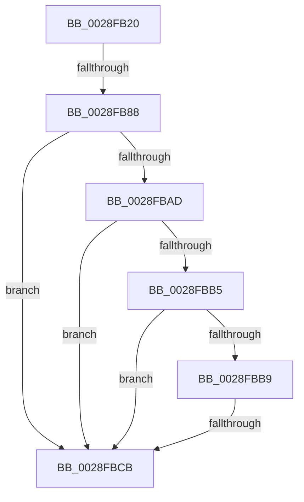

# MiAgePteWorker

- RVA: `0x0028FB20`–`0x0028FBD9` (길이 `185` bytes)
- VA: `0x000000014028FB20`
- 실행 섹션: `.text`
- PDB 이름 있음: `예`; PDB Function 태그: `아니요`
- unwind 정보 RVA: `0x000673A8`
- 디코드: `44`개 명령, `185/185` bytes 표시
- 미해석 바이트: `0` (있으면 어셈블리에 `.byte`로 보존)

> 이 문서는 커널 이미지의 기계어와 PDB 기호를 분석해 생성했습니다. 4번과 5번은 함수 원형과 자료형을 바이너리 사용 방식에서 추정한 C 해석이며 원본 소스 복구 결과는 아닙니다.

## 1. Dependencies

- 직접 호출 지점: **0**; 고유 호출 대상: **0**
- 직접 호출자로 확인된 함수: **3**
- RIP 상대 이미지 참조: **0**

### Outgoing calls
- 직접 디코드된 call 명령이 없습니다.

### Direct callers
- [sub_0028F780](Unknown_function_0028F780.md) at `0x0028F8A3`
- [MiAgeWorkingSetVpabCallback](../48/MiAgeWorkingSetVpabCallback_function_0048DE00.md) at `0x0048DE9E`
- [MiSimpleAgePte](../4A/MiSimpleAgePte_function_004ACD40.md) at `0x004ACE19`

### Static image references
- 디코드된 RIP-relative 메모리 참조가 없습니다.

## 2. Other-region calls and transfers

- 다른 실행 섹션으로 향하는 call: **0**
- call이 아닌 외부 분기/꼬리 이동: **2**
  - `0x0028FB82` → [sub_0029016D](../29/Unknown_function_0029016D.md) (`tail-transfer`)
  - `0x0028FBC5` → [sub_0028FD74](Unknown_function_0028FD74.md) (`tail-transfer`)

## 3. Assembly (complete function range)

```asm
0028FB20  48 89 5C 24 20                  mov qword ptr [rsp + 0x20], rbx
0028FB25  48 89 54 24 10                  mov qword ptr [rsp + 0x10], rdx
0028FB2A  56                              push rsi
0028FB2B  57                              push rdi
0028FB2C  41 55                           push r13
0028FB2E  41 56                           push r14
0028FB30  41 57                           push r15
0028FB32  48 83 EC 30                     sub rsp, 0x30
0028FB36  48 8B 71 20                     mov rsi, qword ptr [rcx + 0x20]
0028FB3A  4D 8B F1                        mov r14, r9
0028FB3D  4D 8B E8                        mov r13, r8
0028FB40  48 BA 00 00 00 00 80 F6 FF FF   movabs rdx, 0xfffff68000000000
0028FB4A  48 8B C2                        mov rax, rdx
0028FB4D  48 B9 00 D0 BE 7D FB F6 FF FF   movabs rcx, 0xfffff6fb7dbed000
0028FB57  48 BB FF FF FF FF FF 00 00 00   movabs rbx, 0xffffffffff
0028FB61  49 B9 F8 D7 BE 7D FB F6 FF FF   movabs r9, 0xfffff6fb7dbed7f8
0028FB6B  48 BF 00 00 00 00 00 DE FF FF   movabs rdi, 0xffffde0000000000
0028FB75  49 B8 FF FF FF FF FF F6 FF FF   movabs r8, 0xfffff6ffffffffff
0028FB7F  4C 3B E8                        cmp r13, rax
0028FB82  0F 83 E5 05 00 00               jae 0x14029016d
0028FB88  4D 8B C5                        mov r8, r13
0028FB8B  48 BB F8 FF FF FF 7F 00 00 00   movabs rbx, 0x7ffffffff8
0028FB95  49 C1 E8 09                     shr r8, 9
0028FB99  4C 23 C3                        and r8, rbx
0028FB9C  48 8B C2                        mov rax, rdx
0028FB9F  4C 03 C0                        add r8, rax
0028FBA2  49 8B 00                        mov rax, qword ptr [r8]
0028FBA5  48 8B C9                        mov rcx, rcx
0028FBA8  4C 3B C1                        cmp r8, rcx
0028FBAB  72 1E                           jb 0x14028fbcb
0028FBAD  49 8B C9                        mov rcx, r9
0028FBB0  4C 3B C1                        cmp r8, rcx
0028FBB3  77 16                           ja 0x14028fbcb
0028FBB5  A8 01                           test al, 1
0028FBB7  74 12                           je 0x14028fbcb
0028FBB9  A8 42                           test al, 0x42
0028FBBB  0F 95 C2                        setne dl
0028FBBE  A8 20                           test al, 0x20
0028FBC0  0F 95 C1                        setne cl
0028FBC3  84 D1                           test cl, dl
0028FBC5  0F 84 A9 01 00 00               je 0x14028fd74
0028FBCB  48 C1 E8 38                     shr rax, 0x38
0028FBCF  24 0F                           and al, 0xf
0028FBD1  44 8B BC 24 88 00 00 00         mov r15d, dword ptr [rsp + 0x88]
```

## 4. C-style interpretation (structured pseudocode)

```c
__int64 __fastcall MiAgePteWorker(__int64 a1, __int64 a2, __int64 a3, __int64 a4, __int64 a5, unsigned int a6)
{
    __int64 result;
    __int64 v_rsp;
    unsigned __int64 v_stack_p10;
    unsigned __int64 v_stack_p20;

    v_stack_p20 = v_rbx;
    v_stack_p10 = a2;
    v_rsp = (v_rsp) - (48);
    a3 = (a3) >> (9);
    a3 = (a3) & (v_rbx);
    a3 = (a3) + (a2);
    if (a3 < a1) goto loc_0028FBCB;
    if (a3 > a4) goto loc_0028FBCB;
    if ((((unsigned __int8)(*(unsigned __int64 *)(a3))) & (1)) == 0) goto loc_0028FBCB;
    a2 = ((((unsigned __int8)(*(unsigned __int64 *)(a3))) & (66)) != 0) ? 1 : 0;
    a1 = ((((unsigned __int8)(*(unsigned __int64 *)(a3))) & (32)) != 0) ? 1 : 0;
loc_0028FBCB:
    result = (*(unsigned __int64 *)(a3)) >> (56);
    result = (unsigned __int8)((result) & (15));
    return result;
}
```

## 5. (Beta) C Style

```c
int64_t MiAgePteWorker(void *Arg1, int64_t Arg2, int64_t Arg3, int64_t Arg4, uint64_t Arg5, uint32_t Arg6)
{
    uint8_t *arg1 = (uint8_t *)Arg1;

    int64_t result;
    int64_t local_rsp;
    uint64_t v_stack_p10;
    uint64_t v_stack_p20;

    v_stack_p20 = local_rbx;
    v_stack_p10 = Arg2;
    local_rsp = (local_rsp) - (48);
    Arg3 = (Arg3) >> (9);
    Arg3 = (Arg3) & (local_rbx);
    Arg3 = (Arg3) + (Arg2);
    if (Arg3 < Arg1) goto loc_0028FBCB;
    if (Arg3 > Arg4) goto loc_0028FBCB;
    if ((((uint8_t)(*(uint64_t *)(Arg3))) & (1)) == 0) goto loc_0028FBCB;
    Arg2 = ((((uint8_t)(*(uint64_t *)(Arg3))) & (66)) != 0) ? 1 : 0;
    Arg1 = ((((uint8_t)(*(uint64_t *)(Arg3))) & (32)) != 0) ? 1 : 0;
loc_0028FBCB:
    result = (*(uint64_t *)(Arg3)) >> (56);
    result = (uint8_t)((result) & (15));
    return result;
}
```

### 관측된 메모리 오프셋

구조체 형식이 확인되지 않은 접근은 인자 기준의 오프셋으로만 기록했습니다.

| 기준 인자 | 오프셋 표현 | 폭 (bit) | 접근 |
|---|---:|---:|---|
| `Arg1` | `+ 0x20` | `64` | `R` |

## 6. Execution-region graph

[열기: 2D/3D 그래프와 함수 탐색 컨트롤 패널](../../../control-panel.html?section=text&rva=0x0028FB20&view=graph)

- 2D 그래프는 위에서 아래로 흐르고, 3D 그래프는 빈 공간을 드래그해 회전합니다. Shift+드래그는 이동, 휠은 확대·축소, 함수 노드 선택은 대상 보고서 이동입니다.

### Static fallback


