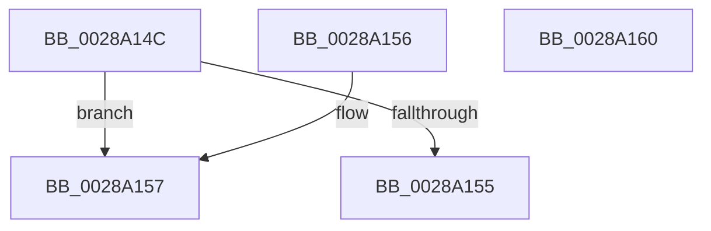

# MiCacheAttributeHasValue

- RVA: `0x0028A14C`–`0x0028A161` (길이 `21` bytes)
- VA: `0x000000014028A14C`
- 실행 섹션: `.text`
- PDB 이름 있음: `예`; PDB Function 태그: `아니요`
- unwind 정보 RVA: `0x000DB714`
- 디코드: `10`개 명령, `21/21` bytes 표시
- 미해석 바이트: `0` (있으면 어셈블리에 `.byte`로 보존)

> 이 문서는 커널 이미지의 기계어와 PDB 기호를 분석해 생성했습니다. 4번과 5번은 함수 원형과 자료형을 바이너리 사용 방식에서 추정한 C 해석이며 원본 소스 복구 결과는 아닙니다.

## 1. Dependencies

- 직접 호출 지점: **0**; 고유 호출 대상: **0**
- 직접 호출자로 확인된 함수: **3**
- RIP 상대 이미지 참조: **0**

### Outgoing calls
- 직접 디코드된 call 명령이 없습니다.

### Direct callers
- [MiGetPage](MiGetPage_function_002884C0.md) at `0x002889C0`
- [MiGetPage](MiGetPage_function_002884C0.md) at `0x0028924A`
- [MiDemoteLocalLargePage](MiDemoteLocalLargePage_function_0028A4F0.md) at `0x0028A5FE`
- [MiDemoteLocalLargePage](MiDemoteLocalLargePage_function_0028A4F0.md) at `0x0028A6EB`
- [MiDemoteLocalLargePage](MiDemoteLocalLargePage_function_0028A4F0.md) at `0x0028A950`
- [MiPreemptivePageDemoteAmount](MiPreemptivePageDemoteAmount_function_0028B338.md) at `0x0028B35A`

### Static image references
- 디코드된 RIP-relative 메모리 참조가 없습니다.

## 2. Other-region calls and transfers

- 다른 실행 섹션으로 향하는 call: **0**
- 별도 외부 분기/꼬리 이동을 확인하지 못했습니다.

## 3. Assembly (complete function range)

```asm
0028A14C  B8 01 00 00 00                  mov eax, 1
0028A151  3B C8                           cmp ecx, eax
0028A153  75 02                           jne 0x14028a157
0028A155  C3                              ret
0028A156  CC                              int3
0028A157  33 C0                           xor eax, eax
0028A159  83 F9 02                        cmp ecx, 2
0028A15C  0F 94 C0                        sete al
0028A15F  C3                              ret
0028A160  CC                              int3
```

## 4. C-style interpretation (structured pseudocode)

```c
__int64 __fastcall MiCacheAttributeHasValue(int a1)
{
    __int64 result;

    if (a1 != 1) goto loc_0028A157;
    return 1;
loc_0028A157:
    result = 0;
    result = (a1 == 2) ? 1 : 0;
    return result;
}
```

## 5. (Beta) C Style

```c
int64_t MiCacheAttributeHasValue(int32_t Arg1)
{
    int64_t result;

    if (Arg1 != 1) goto loc_0028A157;
    return 1;
loc_0028A157:
    result = 0;
    result = (Arg1 == 2) ? 1 : 0;
    return result;
}
```

## 6. Execution-region graph

[열기: 2D/3D 그래프와 함수 탐색 컨트롤 패널](../../../control-panel.html?section=text&rva=0x0028A14C&view=graph)

- 2D 그래프는 위에서 아래로 흐르고, 3D 그래프는 빈 공간을 드래그해 회전합니다. Shift+드래그는 이동, 휠은 확대·축소, 함수 노드 선택은 대상 보고서 이동입니다.

### Static fallback


