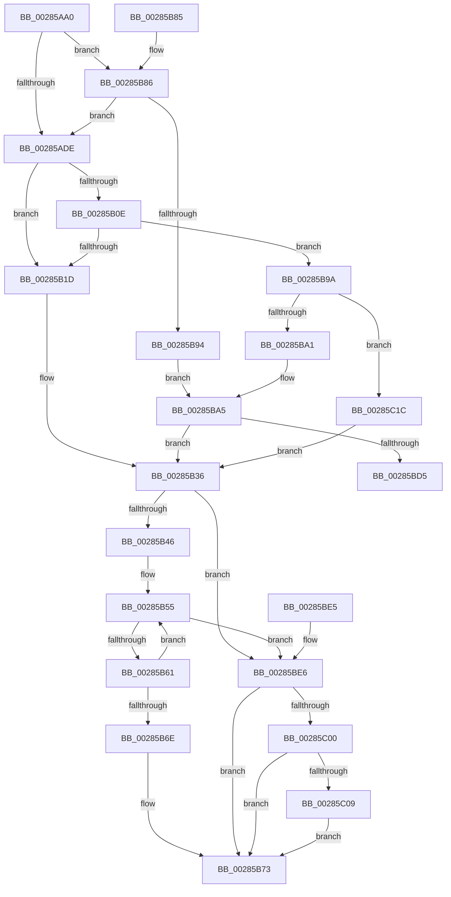

# MiChargeForLockedPage

- RVA: `0x00285AA0`–`0x00285C39` (길이 `409` bytes)
- VA: `0x0000000140285AA0`
- 실행 섹션: `.text`
- PDB 이름 있음: `예`; PDB Function 태그: `아니요`
- unwind 정보 RVA: `0x00066AC8`
- 디코드: `100`개 명령, `409/409` bytes 표시
- 미해석 바이트: `0` (있으면 어셈블리에 `.byte`로 보존)

> 이 문서는 커널 이미지의 기계어와 PDB 기호를 분석해 생성했습니다. 4번과 5번은 함수 원형과 자료형을 바이너리 사용 방식에서 추정한 C 해석이며 원본 소스 복구 결과는 아닙니다.

## 1. Dependencies

- 직접 호출 지점: **3**; 고유 호출 대상: **3**
- 직접 호출자로 확인된 함수: **3**
- RIP 상대 이미지 참조: **2**

### Outgoing calls
- `0x00285BC8` → [MiChargeCommit](MiChargeCommit_function_00286EB0.md) (function, `0x00286EB0`)
- `0x00285BF1` → [MiChargePartitionResidentAvailable](MiChargePartitionResidentAvailable_function_0028B000.md) (function, `0x0028B000`)
- `0x00285C12` → [MiReturnCommit](../24/MiReturnCommit_function_00248410.md) (function, `0x00248410`)

### Direct callers
- [MiObtainProtoReference](../31/MiObtainProtoReference_function_00318178.md) at `0x003181EF`
- [MiRelockProtoPoolPage](../31/MiRelockProtoPoolPage_function_0031826C.md) at `0x003182D4`
- [MiDoubleLockMdlPage](../31/MiDoubleLockMdlPage_function_00318324.md) at `0x003183C1`

### Static image references
- `0x00285B21` → RVA `0x00E30088` (`.data`; read)
- `0x00285B36` → RVA `0x00E38D00` (`.data`; read)

## 2. Other-region calls and transfers

- 다른 실행 섹션으로 향하는 call: **0**
- 별도 외부 분기/꼬리 이동을 확인하지 못했습니다.

## 3. Assembly (complete function range)

```asm
00285AA0  48 89 5C 24 08                  mov qword ptr [rsp + 8], rbx
00285AA5  48 89 74 24 10                  mov qword ptr [rsp + 0x10], rsi
00285AAA  57                              push rdi
00285AAB  48 83 EC 20                     sub rsp, 0x20
00285AAF  83 E2 01                        and edx, 1
00285AB2  4C 8B C1                        mov r8, rcx
00285AB5  8B C2                           mov eax, edx
00285AB7  F7 D8                           neg eax
00285AB9  B8 FF FF FF FF                  mov eax, 0xffffffff
00285ABE  48 1B FF                        sbb rdi, rdi
00285AC1  83 F2 01                        xor edx, 1
00285AC4  48 23 F8                        and rdi, rax
00285AC7  40 32 F6                        xor sil, sil
00285ACA  48 8B 41 28                     mov rax, qword ptr [rcx + 0x28]
00285ACE  8D 14 95 04 00 00 00            lea edx, [rdx*4 + 4]
00285AD5  48 85 C0                        test rax, rax
00285AD8  0F 88 A8 00 00 00               js 0x140285b86
00285ADE  48 8B 49 08                     mov rcx, qword ptr [rcx + 8]
00285AE2  49 BA 00 00 00 00 80 F6 FF FF   movabs r10, 0xfffff68000000000
00285AEC  49 8B C2                        mov rax, r10
00285AEF  49 B9 78 FF FF FF 3F 00 00 00   movabs r9, 0x3fffffff78
00285AF9  49 03 C1                        add rax, r9
00285AFC  49 B9 00 00 00 00 00 00 00 80   movabs r9, 0x8000000000000000
00285B06  49 0B C9                        or rcx, r9
00285B09  48 3B C8                        cmp rcx, rax
00285B0C  77 0F                           ja 0x140285b1d
00285B0E  49 8B 48 08                     mov rcx, qword ptr [r8 + 8]
00285B12  49 0B C9                        or rcx, r9
00285B15  49 8B C2                        mov rax, r10
00285B18  48 3B C8                        cmp rcx, rax
00285B1B  73 7D                           jae 0x140285b9a
00285B1D  49 8B 48 28                     mov rcx, qword ptr [r8 + 0x28]
00285B21  48 8B 05 60 A5 BA 00            mov rax, qword ptr [rip + 0xbaa560]
00285B28  48 C1 E9 2B                     shr rcx, 0x2b
00285B2C  81 E1 FF 03 00 00               and ecx, 0x3ff
00285B32  48 8B 1C C8                     mov rbx, qword ptr [rax + rcx*8]
00285B36  48 8D 05 C3 31 BB 00            lea rax, [rip + 0xbb31c3]
00285B3D  48 3B D8                        cmp rbx, rax
00285B40  0F 85 A0 00 00 00               jne 0x140285be6
00285B46  65 48 8B 14 25 20 00 00 00      mov rdx, qword ptr gs:[0x20]
00285B4F  8B 82 9C 8B 00 00               mov eax, dword ptr [rdx + 0x8b9c]
00285B55  8D 48 FF                        lea ecx, [rax - 1]
00285B58  83 F9 FD                        cmp ecx, -3
00285B5B  0F 87 85 00 00 00               ja 0x140285be6
00285B61  8D 48 FF                        lea ecx, [rax - 1]
00285B64  F0 0F B1 8A 9C 8B 00 00         lock cmpxchg dword ptr [rdx + 0x8b9c], ecx
00285B6C  75 E7                           jne 0x140285b55
00285B6E  BF 01 00 00 00                  mov edi, 1
00285B73  8B C7                           mov eax, edi
00285B75  48 8B 5C 24 30                  mov rbx, qword ptr [rsp + 0x30]
00285B7A  48 8B 74 24 38                  mov rsi, qword ptr [rsp + 0x38]
00285B7F  48 83 C4 20                     add rsp, 0x20
00285B83  5F                              pop rdi
00285B84  C3                              ret
00285B85  CC                              int3
00285B86  8B 41 10                        mov eax, dword ptr [rcx + 0x10]
00285B89  48 0F BA E0 0A                  bt rax, 0xa
00285B8E  0F 83 4A FF FF FF               jae 0x140285ade
00285B94  48 8B 49 28                     mov rcx, qword ptr [rcx + 0x28]
00285B98  EB 0B                           jmp 0x140285ba5
00285B9A  41 F6 40 23 20                  test byte ptr [r8 + 0x23], 0x20
00285B9F  74 7B                           je 0x140285c1c
00285BA1  49 8B 48 28                     mov rcx, qword ptr [r8 + 0x28]
00285BA5  48 8B 05 DC A4 BA 00            mov rax, qword ptr [rip + 0xbaa4dc]
00285BAC  44 8B C2                        mov r8d, edx
00285BAF  48 C1 E9 2B                     shr rcx, 0x2b
00285BB3  BA 01 00 00 00                  mov edx, 1
00285BB8  81 E1 FF 03 00 00               and ecx, 0x3ff
00285BBE  40 B6 01                        mov sil, 1
00285BC1  48 8B 1C C8                     mov rbx, qword ptr [rax + rcx*8]
00285BC5  48 8B CB                        mov rcx, rbx
00285BC8  E8 E3 12 00 00                  call 0x140286eb0
00285BCD  85 C0                           test eax, eax
00285BCF  0F 85 61 FF FF FF               jne 0x140285b36
00285BD5  48 8B 5C 24 30                  mov rbx, qword ptr [rsp + 0x30]
00285BDA  48 8B 74 24 38                  mov rsi, qword ptr [rsp + 0x38]
00285BDF  48 83 C4 20                     add rsp, 0x20
00285BE3  5F                              pop rdi
00285BE4  C3                              ret
00285BE5  CC                              int3
00285BE6  4C 8B C7                        mov r8, rdi
00285BE9  BA 01 00 00 00                  mov edx, 1
00285BEE  48 8B CB                        mov rcx, rbx
00285BF1  E8 0A 54 00 00                  call 0x14028b000
00285BF6  8B F8                           mov edi, eax
00285BF8  85 C0                           test eax, eax
00285BFA  0F 85 73 FF FF FF               jne 0x140285b73
00285C00  40 84 F6                        test sil, sil
00285C03  0F 84 6A FF FF FF               je 0x140285b73
00285C09  45 33 C0                        xor r8d, r8d
00285C0C  8D 50 01                        lea edx, [rax + 1]
00285C0F  48 8B CB                        mov rcx, rbx
00285C12  E8 F9 27 FC FF                  call 0x140248410
00285C17  E9 57 FF FF FF                  jmp 0x140285b73
00285C1C  49 8B 40 28                     mov rax, qword ptr [r8 + 0x28]
00285C20  48 8B 0D 61 A4 BA 00            mov rcx, qword ptr [rip + 0xbaa461]
00285C27  48 C1 E8 2B                     shr rax, 0x2b
00285C2B  25 FF 03 00 00                  and eax, 0x3ff
00285C30  48 8B 1C C1                     mov rbx, qword ptr [rcx + rax*8]
00285C34  E9 FD FE FF FF                  jmp 0x140285b36
```

## 4. C-style interpretation (structured pseudocode)

```c
__int64 __fastcall MiChargeForLockedPage(__int64 a1, int a2)
{
    __int64 result;
    __int64 v_rdi;
    __int64 v_rsi;
    __int64 v_rsp;
    unsigned __int64 v_stack_p10;
    unsigned __int64 v_stack_p30;
    unsigned __int64 v_stack_p38;
    unsigned __int64 v_stack_p8;

    v_stack_p8 = v_rbx;
    v_stack_p10 = v_rsi;
    v_rsp = (v_rsp) - (32);
    a2 = (unsigned int)((a2) & (1));
    result = (unsigned int)(-((unsigned int)(a2)));
    a2 = (unsigned int)((a2) ^ (1));
    v_rdi = (v_rdi) & ((unsigned int)(0xFFFFFFFFULL));
    v_rsi = 0;
    if (sign_flag) goto loc_00285B86;
loc_00285ADE:
    result = (v_r10) + (a4);
    a1 = (*(unsigned __int64 *)(a1 + 8)) | (a4);
    if (a1 > result) goto loc_00285B1D;
    a1 = (*(unsigned __int64 *)(a1 + 8)) | (a4);
    if (a1 >= v_r10) goto loc_00285B9A;
loc_00285B1D:
    a1 = (*(unsigned __int64 *)(a1 + 40)) >> (43);
    a1 = (unsigned int)((a1) & (0x3FFULL));
loc_00285B36:
    if ((*(unsigned __int64 *)(*(unsigned __int64 *)(v_rip + 12232032) + a1 * 8)) != (v_rip + 12267971)) goto loc_00285BE6;
loc_00285B55:
    if (((unsigned int)((unsigned int)(*(unsigned int *)(*(unsigned __int64 *)(gs_base + (0 + 32)) + 35740)) - 1)) > -3) goto loc_00285BE6;
    if (((unsigned int)((unsigned int)(*(unsigned int *)(*(unsigned __int64 *)(gs_base + (0 + 32)) + 35740)) - 1)) != -3) goto loc_00285B55;
loc_00285B73:
    v_rsp = (v_rsp) + (32);
    return 1;
loc_00285B86:
    if (condition_is_above_or_equal) goto loc_00285ADE;
    goto loc_00285BA5;
loc_00285B9A:
    if (((*(unsigned __int8 *)(a1 + 35)) & (32)) == 0) goto loc_00285C1C;
loc_00285BA5:
    a1 = (*(unsigned __int64 *)(a1 + 40)) >> (43);
    a1 = (unsigned int)((a1) & (0x3FFULL));
    result = MiChargeCommit(*(unsigned __int64 *)(*(unsigned __int64 *)(v_rip + 12231900) + a1 * 8), 1, (unsigned int)((unsigned int)(*(unsigned __int64 *)(gs_base + (0 + 32)))), a4);
    if ((unsigned int)(result) != 0) goto loc_00285B36;
    v_rsp = (v_rsp) + (32);
    return result;
loc_00285BE6:
    result = MiChargePartitionResidentAvailable(v_stack_p30, 1, 1, a4);
    if ((unsigned int)(result) != 0) goto loc_00285B73;
    if ((unsigned __int8)(v_stack_p38) == 0) goto loc_00285B73;
    a3 = 0;
    result = MiReturnCommit(v_stack_p30, result + 1, a3, a4);
    goto loc_00285B73;
loc_00285C1C:
    result = (*(unsigned __int64 *)(a3 + 40)) >> (43);
    result = (unsigned int)((result) & (0x3FFULL));
    goto loc_00285B36;
}
```

## 5. (Beta) C Style

```c
int64_t MiChargeForLockedPage(void *Arg1, int32_t Arg2)
{
    uint8_t *arg1 = (uint8_t *)Arg1;

    int64_t result;
    int64_t local_rdi;
    int64_t local_rsi;
    int64_t local_rsp;
    uint64_t v_stack_p10;
    uint64_t v_stack_p30;
    uint64_t v_stack_p38;
    uint64_t v_stack_p8;

    v_stack_p8 = local_rbx;
    v_stack_p10 = local_rsi;
    local_rsp = (local_rsp) - (32);
    Arg2 = (uint32_t)((Arg2) & (1));
    result = (uint32_t)(-((uint32_t)(Arg2)));
    Arg2 = (uint32_t)((Arg2) ^ (1));
    local_rdi = (local_rdi) & ((uint32_t)(0xFFFFFFFFULL));
    local_rsi = 0;
    if (sign_flag) goto loc_00285B86;
loc_00285ADE:
    result = (local_r10) + (a4);
    Arg1 = (*(uint64_t *)(arg1 + 0x8)) | (a4);
    if (Arg1 > result) goto loc_00285B1D;
    Arg1 = (*(uint64_t *)(arg1 + 0x8)) | (a4);
    if (Arg1 >= local_r10) goto loc_00285B9A;
loc_00285B1D:
    Arg1 = (*(uint64_t *)(arg1 + 0x28)) >> (43);
    Arg1 = (uint32_t)((Arg1) & (0x3FFULL));
loc_00285B36:
    if ((*(uint64_t *)(*(uint64_t *)(v_rip + 0xBAA560) + arg1 * 8)) != (v_rip + 12267971)) goto loc_00285BE6;
loc_00285B55:
    if (((uint32_t)((uint32_t)(*(uint32_t *)(*(uint64_t *)(gs_base + (0 + 0x20)) + 0x8B9C)) - 1)) > -3) goto loc_00285BE6;
    if (((uint32_t)((uint32_t)(*(uint32_t *)(*(uint64_t *)(gs_base + (0 + 0x20)) + 0x8B9C)) - 1)) != -3) goto loc_00285B55;
loc_00285B73:
    local_rsp = (local_rsp) + (32);
    return 1;
loc_00285B86:
    if (condition_is_above_or_equal) goto loc_00285ADE;
    goto loc_00285BA5;
loc_00285B9A:
    if (((*(uint8_t *)(arg1 + 0x23)) & (32)) == 0) goto loc_00285C1C;
loc_00285BA5:
    Arg1 = (*(uint64_t *)(arg1 + 0x28)) >> (43);
    Arg1 = (uint32_t)((Arg1) & (0x3FFULL));
    result = MiChargeCommit(*(uint64_t *)(*(uint64_t *)(v_rip + 0xBAA4DC) + arg1 * 8), 1, (uint32_t)((uint32_t)(*(uint64_t *)(gs_base + (0 + 0x20)))), a4);
    if ((uint32_t)(result) != 0) goto loc_00285B36;
    local_rsp = (local_rsp) + (32);
    return result;
loc_00285BE6:
    result = MiChargePartitionResidentAvailable(v_stack_p30, 1, 1, a4);
    if ((uint32_t)(result) != 0) goto loc_00285B73;
    if ((uint8_t)(v_stack_p38) == 0) goto loc_00285B73;
    a3 = 0;
    result = MiReturnCommit(v_stack_p30, result + 1, a3, a4);
    goto loc_00285B73;
loc_00285C1C:
    result = (*(uint64_t *)(a3 + 0x28)) >> (43);
    result = (uint32_t)((result) & (0x3FFULL));
    goto loc_00285B36;
}
```

### 관측된 메모리 오프셋

구조체 형식이 확인되지 않은 접근은 인자 기준의 오프셋으로만 기록했습니다.

| 기준 인자 | 오프셋 표현 | 폭 (bit) | 접근 |
|---|---:|---:|---|
| `Arg1` | `+ 0x8` | `64` | `R` |
| `Arg1` | `+ 0x10` | `32` | `R` |
| `Arg1` | `+ 0x23` | `8` | `R` |
| `Arg1` | `+ 0x28` | `64` | `R` |

## 6. Execution-region graph

[열기: 2D/3D 그래프와 함수 탐색 컨트롤 패널](../../../control-panel.html?section=text&rva=0x00285AA0&view=graph)

- 2D 그래프는 위에서 아래로 흐르고, 3D 그래프는 빈 공간을 드래그해 회전합니다. Shift+드래그는 이동, 휠은 확대·축소, 함수 노드 선택은 대상 보고서 이동입니다.

### Static fallback


