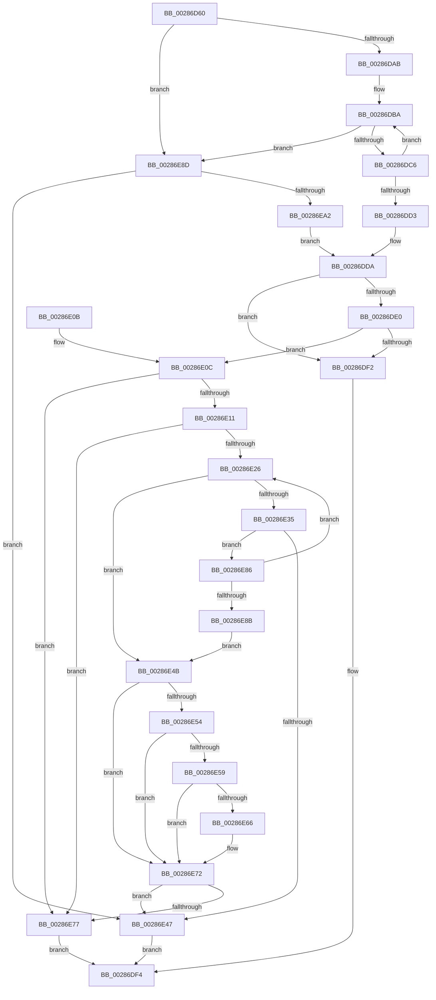

# MiChargeForWriteInProgressPage

- RVA: `0x00286D60`–`0x00286EA7` (길이 `327` bytes)
- VA: `0x0000000140286D60`
- 실행 섹션: `.text`
- PDB 이름 있음: `예`; PDB Function 태그: `아니요`
- unwind 정보 RVA: `0x00066C88`
- 디코드: `95`개 명령, `327/327` bytes 표시
- 미해석 바이트: `0` (있으면 어셈블리에 `.byte`로 보존)

> 이 문서는 커널 이미지의 기계어와 PDB 기호를 분석해 생성했습니다. 4번과 5번은 함수 원형과 자료형을 바이너리 사용 방식에서 추정한 C 해석이며 원본 소스 복구 결과는 아닙니다.

## 1. Dependencies

- 직접 호출 지점: **2**; 고유 호출 대상: **2**
- 직접 호출자로 확인된 함수: **4**
- RIP 상대 이미지 참조: **1**

### Outgoing calls
- `0x00286DE9` → [MiChargeCommit](MiChargeCommit_function_00286EB0.md) (function, `0x00286EB0`)
- `0x00286E97` → [MiChargePartitionResidentAvailable](MiChargePartitionResidentAvailable_function_0028B000.md) (function, `0x0028B000`)

### Direct callers
- [MiAddPageToFlushMdl](MiAddPageToFlushMdl_function_00286930.md) at `0x00286A37`
- [MiMappedPageWriter](../40/MiMappedPageWriter_function_00404AC0.md) at `0x00404C21`
- [MiReferencePageForModifiedWrite](../40/MiReferencePageForModifiedWrite_function_00405DAC.md) at `0x00405E04`
- [MiAllocateModWriterEntry](../47/MiAllocateModWriterEntry_function_0047A718.md) at `0x0047A757`

### Static image references
- `0x00286D79` → RVA `0x00E38D00` (`.data`; read)

## 2. Other-region calls and transfers

- 다른 실행 섹션으로 향하는 call: **0**
- 별도 외부 분기/꼬리 이동을 확인하지 못했습니다.

## 3. Assembly (complete function range)

```asm
00286D60  48 89 5C 24 08                  mov qword ptr [rsp + 8], rbx
00286D65  48 89 6C 24 18                  mov qword ptr [rsp + 0x18], rbp
00286D6A  56                              push rsi
00286D6B  57                              push rdi
00286D6C  41 54                           push r12
00286D6E  41 56                           push r14
00286D70  41 57                           push r15
00286D72  48 83 EC 20                     sub rsp, 0x20
00286D76  4C 8B F1                        mov r14, rcx
00286D79  4C 8D 3D 80 1F BB 00            lea r15, [rip + 0xbb1f80]
00286D80  8B C2                           mov eax, edx
00286D82  BD 04 00 00 00                  mov ebp, 4
00286D87  83 E0 02                        and eax, 2
00286D8A  B9 08 00 00 00                  mov ecx, 8
00286D8F  41 BC FF FF FF FF               mov r12d, 0xffffffff
00286D95  8B F2                           mov esi, edx
00286D97  0F 44 E9                        cmove ebp, ecx
00286D9A  F7 D8                           neg eax
00286D9C  4D 1B C0                        sbb r8, r8
00286D9F  4D 23 C4                        and r8, r12
00286DA2  4D 3B F7                        cmp r14, r15
00286DA5  0F 85 E2 00 00 00               jne 0x140286e8d
00286DAB  65 48 8B 14 25 20 00 00 00      mov rdx, qword ptr gs:[0x20]
00286DB4  8B 82 9C 8B 00 00               mov eax, dword ptr [rdx + 0x8b9c]
00286DBA  8D 48 FF                        lea ecx, [rax - 1]
00286DBD  83 F9 FD                        cmp ecx, -3
00286DC0  0F 87 C7 00 00 00               ja 0x140286e8d
00286DC6  8D 48 FF                        lea ecx, [rax - 1]
00286DC9  F0 0F B1 8A 9C 8B 00 00         lock cmpxchg dword ptr [rdx + 0x8b9c], ecx
00286DD1  75 E7                           jne 0x140286dba
00286DD3  BB 01 00 00 00                  mov ebx, 1
00286DD8  8B FB                           mov edi, ebx
00286DDA  40 F6 C6 01                     test sil, 1
00286DDE  74 12                           je 0x140286df2
00286DE0  44 8B C5                        mov r8d, ebp
00286DE3  48 8B D3                        mov rdx, rbx
00286DE6  49 8B CE                        mov rcx, r14
00286DE9  E8 C2 00 00 00                  call 0x140286eb0
00286DEE  85 C0                           test eax, eax
00286DF0  74 1A                           je 0x140286e0c
00286DF2  8B C7                           mov eax, edi
00286DF4  48 8B 5C 24 50                  mov rbx, qword ptr [rsp + 0x50]
00286DF9  48 8B 6C 24 60                  mov rbp, qword ptr [rsp + 0x60]
00286DFE  48 83 C4 20                     add rsp, 0x20
00286E02  41 5F                           pop r15
00286E04  41 5E                           pop r14
00286E06  41 5C                           pop r12
00286E08  5F                              pop rdi
00286E09  5E                              pop rsi
00286E0A  C3                              ret
00286E0B  CC                              int3
00286E0C  4D 3B F7                        cmp r14, r15
00286E0F  75 66                           jne 0x140286e77
00286E11  65 4C 8B 04 25 20 00 00 00      mov r8, qword ptr gs:[0x20]
00286E1A  41 8B 90 9C 8B 00 00            mov edx, dword ptr [r8 + 0x8b9c]
00286E21  41 3B D4                        cmp edx, r12d
00286E24  74 51                           je 0x140286e77
00286E26  48 63 CA                        movsxd rcx, edx
00286E29  48 FF C1                        inc rcx
00286E2C  48 81 F9 00 01 00 00            cmp rcx, 0x100
00286E33  77 16                           ja 0x140286e4b
00286E35  8D 4A 01                        lea ecx, [rdx + 1]
00286E38  8B C2                           mov eax, edx
00286E3A  F0 41 0F B1 88 9C 8B 00 00      lock cmpxchg dword ptr [r8 + 0x8b9c], ecx
00286E43  8B D0                           mov edx, eax
00286E45  75 3F                           jne 0x140286e86
00286E47  33 C0                           xor eax, eax
00286E49  EB A9                           jmp 0x140286df4
00286E4B  B9 C0 00 00 00                  mov ecx, 0xc0
00286E50  3B D1                           cmp edx, ecx
00286E52  7E 1E                           jle 0x140286e72
00286E54  41 3B D4                        cmp edx, r12d
00286E57  74 19                           je 0x140286e72
00286E59  8B C2                           mov eax, edx
00286E5B  F0 41 0F B1 88 9C 8B 00 00      lock cmpxchg dword ptr [r8 + 0x8b9c], ecx
00286E64  75 0C                           jne 0x140286e72
00286E66  8D 82 40 FF FF FF               lea eax, [rdx - 0xc0]
00286E6C  48 63 D8                        movsxd rbx, eax
00286E6F  48 FF C3                        inc rbx
00286E72  48 85 DB                        test rbx, rbx
00286E75  74 D0                           je 0x140286e47
00286E77  F0 49 01 9E 40 49 00 00         lock add qword ptr [r14 + 0x4940], rbx
00286E7F  33 C0                           xor eax, eax
00286E81  E9 6E FF FF FF                  jmp 0x140286df4
00286E86  41 3B C4                        cmp eax, r12d
00286E89  75 9B                           jne 0x140286e26
00286E8B  EB BE                           jmp 0x140286e4b
00286E8D  BB 01 00 00 00                  mov ebx, 1
00286E92  49 8B CE                        mov rcx, r14
00286E95  8B D3                           mov edx, ebx
00286E97  E8 64 41 00 00                  call 0x14028b000
00286E9C  8B F8                           mov edi, eax
00286E9E  85 C0                           test eax, eax
00286EA0  74 A5                           je 0x140286e47
00286EA2  E9 33 FF FF FF                  jmp 0x140286dda
```

## 4. C-style interpretation (structured pseudocode)

```c
__int64 __fastcall MiChargeForWriteInProgressPage(__int64 a1, int a2, __int64 a3)
{
    __int64 result;
    __int64 v_rbp;
    __int64 v_rbx;
    __int64 v_rsp;
    unsigned __int64 v_stack_p18;
    unsigned __int64 v_stack_p8;

    v_stack_p8 = v_rbx;
    v_stack_p18 = v_rbp;
    v_rsp = (v_rsp) - (32);
    result = (unsigned int)(((unsigned int)(a2)) & (2));
    v_rbp = 4;
    if (condition_is_equal) { v_rbp = 8; }
    result = (unsigned int)(-(result));
    a3 = (a3) & ((unsigned int)(0xFFFFFFFFULL));
    if (a1 != (v_rip + 12263296)) goto loc_00286E8D;
loc_00286DBA:
    if (((unsigned int)((unsigned int)(*(unsigned int *)(*(unsigned __int64 *)(gs_base + (0 + 32)) + 35740)) - 1)) > -3) goto loc_00286E8D;
    if (((unsigned int)((unsigned int)(*(unsigned int *)(*(unsigned __int64 *)(gs_base + (0 + 32)) + 35740)) - 1)) != -3) goto loc_00286DBA;
loc_00286DDA:
    if ((((unsigned __int8)((unsigned int)(a2))) & (1)) == 0) goto loc_00286DF2;
    result = MiChargeCommit(a1, 1, (unsigned int)((unsigned int)(v_rbp)), a4);
    if ((unsigned int)(result) == 0) goto loc_00286E0C;
loc_00286DF2:
loc_00286DF4:
    v_rsp = (v_rsp) + (32);
    return 1;
loc_00286E0C:
    if (a1 != (v_rip + 12263296)) goto loc_00286E77;
    if (((unsigned int)((unsigned int)(*(unsigned int *)(*(unsigned __int64 *)(gs_base + (0 + 32)) + 35740)))) == ((unsigned int)((unsigned int)(0xFFFFFFFFULL)))) goto loc_00286E77;
loc_00286E26:
    a1 = ((int)((unsigned int)((unsigned int)(*(unsigned int *)(*(unsigned __int64 *)(gs_base + (0 + 32)) + 35740))))) + 1;
    if (a1 > 256) goto loc_00286E4B;
    if (a1 != 256) goto loc_00286E86;
loc_00286E47:
    result = 0;
    goto loc_00286DF4;
loc_00286E4B:
    if (((unsigned int)((unsigned int)((unsigned int)((unsigned int)((unsigned int)((unsigned int)(*(unsigned int *)(*(unsigned __int64 *)(gs_base + (0 + 32)) + 35740)))))))) <= 192) goto loc_00286E72;
    if (((unsigned int)((unsigned int)((unsigned int)((unsigned int)((unsigned int)((unsigned int)(*(unsigned int *)(*(unsigned __int64 *)(gs_base + (0 + 32)) + 35740)))))))) == ((unsigned int)((unsigned int)(0xFFFFFFFFULL)))) goto loc_00286E72;
    result = (unsigned int)((unsigned int)((unsigned int)((unsigned int)((unsigned int)((unsigned int)((unsigned int)(*(unsigned int *)(*(unsigned __int64 *)(gs_base + (0 + 32)) + 35740))))))));
    v_rbx = v_stack_p8;
    if (((unsigned int)((unsigned int)((unsigned int)((unsigned int)((unsigned int)((unsigned int)(*(unsigned int *)(*(unsigned __int64 *)(gs_base + (0 + 32)) + 35740)))))))) == ((unsigned int)((unsigned int)(0xFFFFFFFFULL)))) {
        result = (unsigned int)((unsigned int)((unsigned int)((unsigned int)((unsigned int)(*(unsigned int *)(*(unsigned __int64 *)(gs_base + (0 + 32)) + 35740)))))) - 192;
        v_rbx = (int)((unsigned int)(result));
        v_rbx = (v_rbx) + 1;
    }
    if (v_rbx == 0) goto loc_00286E47;
loc_00286E77:
    result = 0;
    goto loc_00286DF4;
loc_00286E86:
    if (0 != ((unsigned int)((unsigned int)(0xFFFFFFFFULL)))) goto loc_00286E26;
    goto loc_00286E4B;
loc_00286E8D:
    result = MiChargePartitionResidentAvailable(a1, 1, *(unsigned __int64 *)(gs_base + (0 + 32)), a4);
    if ((unsigned int)(result) == 0) goto loc_00286E47;
    goto loc_00286DDA;
}
```

## 5. (Beta) C Style

```c
int64_t MiChargeForWriteInProgressPage(int64_t Arg1, int32_t Arg2, int64_t Arg3)
{
    int64_t result;
    int64_t local_rbp;
    int64_t local_rbx;
    int64_t local_rsp;
    uint64_t v_stack_p18;
    uint64_t v_stack_p8;

    v_stack_p8 = local_rbx;
    v_stack_p18 = local_rbp;
    local_rsp = (local_rsp) - (32);
    result = (uint32_t)(((uint32_t)(Arg2)) & (2));
    local_rbp = 4;
    if (condition_is_equal) { local_rbp = 8; }
    result = (uint32_t)(-(result));
    Arg3 = (Arg3) & ((uint32_t)(0xFFFFFFFFULL));
    if (Arg1 != (v_rip + 12263296)) goto loc_00286E8D;
loc_00286DBA:
    if (((uint32_t)((uint32_t)(*(uint32_t *)(*(uint64_t *)(gs_base + (0 + 0x20)) + 0x8B9C)) - 1)) > -3) goto loc_00286E8D;
    if (((uint32_t)((uint32_t)(*(uint32_t *)(*(uint64_t *)(gs_base + (0 + 0x20)) + 0x8B9C)) - 1)) != -3) goto loc_00286DBA;
loc_00286DDA:
    if ((((uint8_t)((uint32_t)(Arg2))) & (1)) == 0) goto loc_00286DF2;
    result = MiChargeCommit(Arg1, 1, (uint32_t)((uint32_t)(local_rbp)), a4);
    if ((uint32_t)(result) == 0) goto loc_00286E0C;
loc_00286DF2:
loc_00286DF4:
    local_rsp = (local_rsp) + (32);
    return 1;
loc_00286E0C:
    if (Arg1 != (v_rip + 12263296)) goto loc_00286E77;
    if (((uint32_t)((uint32_t)(*(uint32_t *)(*(uint64_t *)(gs_base + (0 + 0x20)) + 0x8B9C)))) == ((uint32_t)((uint32_t)(0xFFFFFFFFULL)))) goto loc_00286E77;
loc_00286E26:
    Arg1 = ((int32_t)((uint32_t)((uint32_t)(*(uint32_t *)(*(uint64_t *)(gs_base + (0 + 0x20)) + 0x8B9C))))) + 1;
    if (Arg1 > 256) goto loc_00286E4B;
    if (Arg1 != 256) goto loc_00286E86;
loc_00286E47:
    result = 0;
    goto loc_00286DF4;
loc_00286E4B:
    if (((uint32_t)((uint32_t)((uint32_t)((uint32_t)((uint32_t)((uint32_t)(*(uint32_t *)(*(uint64_t *)(gs_base + (0 + 0x20)) + 0x8B9C)))))))) <= 192) goto loc_00286E72;
    if (((uint32_t)((uint32_t)((uint32_t)((uint32_t)((uint32_t)((uint32_t)(*(uint32_t *)(*(uint64_t *)(gs_base + (0 + 0x20)) + 0x8B9C)))))))) == ((uint32_t)((uint32_t)(0xFFFFFFFFULL)))) goto loc_00286E72;
    result = (uint32_t)((uint32_t)((uint32_t)((uint32_t)((uint32_t)((uint32_t)((uint32_t)(*(uint32_t *)(*(uint64_t *)(gs_base + (0 + 0x20)) + 0x8B9C))))))));
    local_rbx = v_stack_p8;
    if (((uint32_t)((uint32_t)((uint32_t)((uint32_t)((uint32_t)((uint32_t)(*(uint32_t *)(*(uint64_t *)(gs_base + (0 + 0x20)) + 0x8B9C)))))))) == ((uint32_t)((uint32_t)(0xFFFFFFFFULL)))) {
        result = (uint32_t)((uint32_t)((uint32_t)((uint32_t)((uint32_t)(*(uint32_t *)(*(uint64_t *)(gs_base + (0 + 0x20)) + 0x8B9C)))))) - 192;
        local_rbx = (int32_t)((uint32_t)(result));
        local_rbx = (local_rbx) + 1;
    }
    if (local_rbx == 0) goto loc_00286E47;
loc_00286E77:
    result = 0;
    goto loc_00286DF4;
loc_00286E86:
    if (0 != ((uint32_t)((uint32_t)(0xFFFFFFFFULL)))) goto loc_00286E26;
    goto loc_00286E4B;
loc_00286E8D:
    result = MiChargePartitionResidentAvailable(Arg1, 1, *(uint64_t *)(gs_base + (0 + 0x20)), a4);
    if ((uint32_t)(result) == 0) goto loc_00286E47;
    goto loc_00286DDA;
}
```

## 6. Execution-region graph

[열기: 2D/3D 그래프와 함수 탐색 컨트롤 패널](../../../control-panel.html?section=text&rva=0x00286D60&view=graph)

- 2D 그래프는 위에서 아래로 흐르고, 3D 그래프는 빈 공간을 드래그해 회전합니다. Shift+드래그는 이동, 휠은 확대·축소, 함수 노드 선택은 대상 보고서 이동입니다.

### Static fallback


