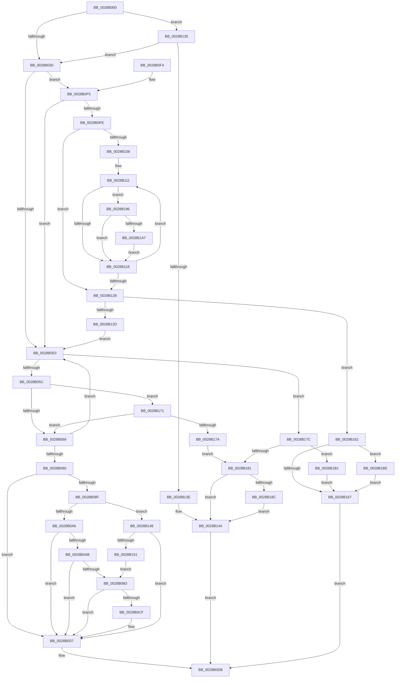

# MiChargePartitionResidentAvailable

- RVA: `0x0028B000`–`0x0028B1C8` (길이 `456` bytes)
- VA: `0x000000014028B000`
- 실행 섹션: `.text`
- PDB 이름 있음: `예`; PDB Function 태그: `아니요`
- unwind 정보 RVA: `0x00066F40`
- 디코드: `118`개 명령, `456/456` bytes 표시
- 미해석 바이트: `0` (있으면 어셈블리에 `.byte`로 보존)

> 이 문서는 커널 이미지의 기계어와 PDB 기호를 분석해 생성했습니다. 4번과 5번은 함수 원형과 자료형을 바이너리 사용 방식에서 추정한 C 해석이며 원본 소스 복구 결과는 아닙니다.

## 1. Dependencies

- 직접 호출 지점: **1**; 고유 호출 대상: **1**
- 직접 호출자로 확인된 함수: **15**
- RIP 상대 이미지 참조: **5**

### Outgoing calls
- `0x0028B0D2` → [MiReturnResident](MiReturnResident_function_00286890.md) (function, `0x00286890`)

### Direct callers
- [sub_0023C6E5](../23/Unknown_function_0023C6E5.md) at `0x0023C71F`
- [sub_0023E278](../23/Unknown_function_0023E278.md) at `0x0023E51F`
- [MiChargeForLockedPage](MiChargeForLockedPage_function_00285AA0.md) at `0x00285BF1`
- [MiAcquireNonPagedResources](MiAcquireNonPagedResources_function_00286C60.md) at `0x00286D3A`
- [MiChargeForWriteInProgressPage](MiChargeForWriteInProgressPage_function_00286D60.md) at `0x00286E97`
- [MiChargeResident](MiChargeResident_function_0028A0F0.md) at `0x0028A13C`
- [MmStoreChargeResidentAvailableForRead](MmStoreChargeResidentAvailableForRead_function_0028ACB0.md) at `0x0028ACFF`
- [SmAcquireReleaseResAvailForRead](SmAcquireReleaseResAvailForRead_function_0028AD20.md) at `0x0028AE59`
- [MiObtainFaultCharges](MiObtainFaultCharges_function_0028AEB0.md) at `0x0028AFA8`
- [MiAddLockedPageCharge](MiAddLockedPageCharge_function_0028B550.md) at `0x0028B764`
- [MiLockProtoPoolPage](../2B/MiLockProtoPoolPage_function_002B8B80.md) at `0x002B916D`
- [MiCheckProtoPtePageState](../31/MiCheckProtoPtePageState_function_003183E0.md) at `0x003186D7`
- [MiLockProtoPoolPageForce](../32/MiLockProtoPoolPageForce_function_00320E10.md) at `0x003211C8`
- [MiResolveProtoPteFault](../32/MiResolveProtoPteFault_function_00321750.md) at `0x00322346`
- [MiObtainPoolCharges](../46/MiObtainPoolCharges_function_00460AD8.md) at `0x00460B84`

### Static image references
- `0x0028B037` → RVA `0x00E38D00` (`.data`; read)
- `0x0028B0FE` → RVA `0x00FC6A80` (`ALMOSTRO`; read)
- `0x0028B108` → RVA `0x00FC8C40` (`ALMOSTRO`; read)
- `0x0028B13E` → RVA `0x00E302B8` (`.data`; read/write)
- `0x0028B181` → RVA `0x00E302BC` (`.data`; read/write)

## 2. Other-region calls and transfers

- 다른 실행 섹션으로 향하는 call: **0**
- 별도 외부 분기/꼬리 이동을 확인하지 못했습니다.

## 3. Assembly (complete function range)

```asm
0028B000  48 89 5C 24 08                  mov qword ptr [rsp + 8], rbx
0028B005  48 89 6C 24 18                  mov qword ptr [rsp + 0x18], rbp
0028B00A  48 89 74 24 20                  mov qword ptr [rsp + 0x20], rsi
0028B00F  57                              push rdi
0028B010  41 56                           push r14
0028B012  41 57                           push r15
0028B014  48 83 EC 20                     sub rsp, 0x20
0028B018  4A 8D 04 02                     lea rax, [rdx + r8]
0028B01C  4D 8B D8                        mov r11, r8
0028B01F  4C 8B C9                        mov r9, rcx
0028B022  BD FF FF FF FF                  mov ebp, 0xffffffff
0028B027  48 3B C2                        cmp rax, rdx
0028B02A  0F 82 05 01 00 00               jb 0x14028b135
0028B030  48 8B B9 40 49 00 00            mov rdi, qword ptr [rcx + 0x4940]
0028B037  4C 8D 3D C2 DC BA 00            lea r15, [rip + 0xbadcc2]
0028B03E  45 33 D2                        xor r10d, r10d
0028B041  41 BE 00 04 00 00               mov r14d, 0x400
0028B047  45 8B C2                        mov r8d, r10d
0028B04A  49 3B FE                        cmp rdi, r14
0028B04D  0F 8C A2 00 00 00               jl 0x14028b0f5
0028B053  48 85 FF                        test rdi, rdi
0028B056  0F 8E 20 01 00 00               jle 0x14028b17c
0028B05C  4A 8D 0C 1A                     lea rcx, [rdx + r11]
0028B060  48 3B CF                        cmp rcx, rdi
0028B063  0F 87 08 01 00 00               ja 0x14028b171
0028B069  48 8B DF                        mov rbx, rdi
0028B06C  48 8B C7                        mov rax, rdi
0028B06F  48 2B DA                        sub rbx, rdx
0028B072  F0 49 0F B1 99 40 49 00 00      lock cmpxchg qword ptr [r9 + 0x4940], rbx
0028B07B  48 8B F8                        mov rdi, rax
0028B07E  75 D3                           jne 0x14028b053
0028B080  49 3B DE                        cmp rbx, r14
0028B083  45 8B DA                        mov r11d, r10d
0028B086  41 0F 9C C3                     setl r11b
0028B08A  4D 3B CF                        cmp r9, r15
0028B08D  75 48                           jne 0x14028b0d7
0028B08F  65 48 8B 14 25 20 00 00 00      mov rdx, qword ptr gs:[0x20]
0028B098  8B 8A 9C 8B 00 00               mov ecx, dword ptr [rdx + 0x8b9c]
0028B09E  3B CD                           cmp ecx, ebp
0028B0A0  0F 84 A2 00 00 00               je 0x14028b148
0028B0A6  83 F9 40                        cmp ecx, 0x40
0028B0A9  73 2C                           jae 0x14028b0d7
0028B0AB  44 8B D1                        mov r10d, ecx
0028B0AE  49 3B DE                        cmp rbx, r14
0028B0B1  7E 24                           jle 0x14028b0d7
0028B0B3  BA 80 00 00 00                  mov edx, 0x80
0028B0B8  48 8B CB                        mov rcx, rbx
0028B0BB  41 2B D2                        sub edx, r10d
0028B0BE  48 8B C3                        mov rax, rbx
0028B0C1  48 2B CA                        sub rcx, rdx
0028B0C4  F0 49 0F B1 89 40 49 00 00      lock cmpxchg qword ptr [r9 + 0x4940], rcx
0028B0CD  75 08                           jne 0x14028b0d7
0028B0CF  49 8B C9                        mov rcx, r9
0028B0D2  E8 B9 B7 FF FF                  call 0x140286890
0028B0D7  41 8D 43 02                     lea eax, [r11 + 2]
0028B0DB  48 8B 5C 24 40                  mov rbx, qword ptr [rsp + 0x40]
0028B0E0  48 8B 6C 24 50                  mov rbp, qword ptr [rsp + 0x50]
0028B0E5  48 8B 74 24 58                  mov rsi, qword ptr [rsp + 0x58]
0028B0EA  48 83 C4 20                     add rsp, 0x20
0028B0EE  41 5F                           pop r15
0028B0F0  41 5E                           pop r14
0028B0F2  5F                              pop rdi
0028B0F3  C3                              ret
0028B0F4  CC                              int3
0028B0F5  4D 3B CF                        cmp r9, r15
0028B0F8  0F 85 55 FF FF FF               jne 0x14028b053
0028B0FE  8B 05 7C B9 D3 00               mov eax, dword ptr [rip + 0xd3b97c]
0028B104  85 C0                           test eax, eax
0028B106  74 20                           je 0x14028b128
0028B108  48 8D 0D 31 DB D3 00            lea rcx, [rip + 0xd3db31]
0028B10F  8B F0                           mov esi, eax
0028B111  48 8B 19                        mov rbx, qword ptr [rcx]
0028B114  8B 83 9C 8B 00 00               mov eax, dword ptr [rbx + 0x8b9c]
0028B11A  3B C5                           cmp eax, ebp
0028B11C  75 78                           jne 0x14028b196
0028B11E  48 83 C1 08                     add rcx, 8
0028B122  48 83 EE 01                     sub rsi, 1
0028B126  75 E9                           jne 0x14028b111
0028B128  4C 3B C2                        cmp r8, rdx
0028B12B  73 35                           jae 0x14028b162
0028B12D  49 2B D0                        sub rdx, r8
0028B130  E9 1E FF FF FF                  jmp 0x14028b053
0028B135  4C 3B DD                        cmp r11, rbp
0028B138  0F 84 F2 FE FF FF               je 0x14028b030
0028B13E  FF 05 74 51 BA 00               inc dword ptr [rip + 0xba5174]
0028B144  33 C0                           xor eax, eax
0028B146  EB 93                           jmp 0x14028b0db
0028B148  48 81 FB 00 08 00 00            cmp rbx, 0x800
0028B14F  7C 86                           jl 0x14028b0d7
0028B151  83 C8 FF                        or eax, 0xffffffff
0028B154  F0 44 0F B1 92 9C 8B 00 00      lock cmpxchg dword ptr [rdx + 0x8b9c], r10d
0028B15D  E9 51 FF FF FF                  jmp 0x14028b0b3
0028B162  4C 2B C2                        sub r8, rdx
0028B165  75 57                           jne 0x14028b1be
0028B167  B8 03 00 00 00                  mov eax, 3
0028B16C  E9 6A FF FF FF                  jmp 0x14028b0db
0028B171  4C 3B DD                        cmp r11, rbp
0028B174  0F 84 EF FE FF FF               je 0x14028b069
0028B17A  EB 05                           jmp 0x14028b181
0028B17C  4C 3B DD                        cmp r11, rbp
0028B17F  74 30                           je 0x14028b1b1
0028B181  FF 05 35 51 BA 00               inc dword ptr [rip + 0xba5135]
0028B187  4D 85 C0                        test r8, r8
0028B18A  74 B8                           je 0x14028b144
0028B18C  F0 4D 01 81 40 49 00 00         lock add qword ptr [r9 + 0x4940], r8
0028B194  EB AE                           jmp 0x14028b144
0028B196  83 C8 FF                        or eax, 0xffffffff
0028B199  87 83 9C 8B 00 00               xchg dword ptr [rbx + 0x8b9c], eax
0028B19F  3B C5                           cmp eax, ebp
0028B1A1  0F 84 77 FF FF FF               je 0x14028b11e
0028B1A7  8B C0                           mov eax, eax
0028B1A9  4C 03 C0                        add r8, rax
0028B1AC  E9 6D FF FF FF                  jmp 0x14028b11e
0028B1B1  48 F7 DA                        neg rdx
0028B1B4  F0 49 01 91 40 49 00 00         lock add qword ptr [r9 + 0x4940], rdx
0028B1BC  EB A9                           jmp 0x14028b167
0028B1BE  F0 4D 01 81 40 49 00 00         lock add qword ptr [r9 + 0x4940], r8
0028B1C6  EB 9F                           jmp 0x14028b167
```

## 4. C-style interpretation (structured pseudocode)

```c
__int64 __fastcall MiChargePartitionResidentAvailable(__int64 a1, __int64 a2, __int64 a3)
{
    __int64 result;
    __int64 v_r10;
    __int64 v_r11;
    __int64 v_rbx;
    __int64 v_rsi;
    __int64 v_rsp;
    unsigned __int64 v_stack_p18;
    unsigned __int64 v_stack_p20;
    unsigned __int64 v_stack_p8;

    v_stack_p8 = v_rbx;
    v_stack_p18 = v_rbp;
    v_stack_p20 = v_rsi;
    v_rsp = (v_rsp) - (32);
    if ((a2 + a3 * 1) < a2) goto loc_0028B135;
loc_0028B030:
    v_r10 = 0;
    if ((*(unsigned __int64 *)(a1 + 18752)) < ((unsigned int)(0x400ULL))) goto loc_0028B0F5;
loc_0028B053:
    if (condition_is_less_or_equal) goto loc_0028B17C;
    if ((a2 + a3 * 1) > (*(unsigned __int64 *)(a1 + 18752))) goto loc_0028B171;
loc_0028B069:
    v_rbx = (*(unsigned __int64 *)(a1 + 18752)) - (a2);
    if (condition_is_not_equal) goto loc_0028B053;
    v_r11 = (v_rbx < ((unsigned int)(0x400ULL))) ? 1 : 0;
    if (a1 != (v_rip + 12246210)) goto loc_0028B0D7;
    if (((unsigned int)((unsigned int)(*(unsigned int *)(*(unsigned __int64 *)(gs_base + (0 + 32)) + 35740)))) == ((unsigned int)((unsigned int)(0xFFFFFFFFULL)))) goto loc_0028B148;
    if (((unsigned int)((unsigned int)(*(unsigned int *)(*(unsigned __int64 *)(gs_base + (0 + 32)) + 35740)))) >= 64) goto loc_0028B0D7;
    if (v_rbx <= ((unsigned int)(0x400ULL))) goto loc_0028B0D7;
loc_0028B0B3:
    a2 = (unsigned int)((128) - ((unsigned int)((unsigned int)((unsigned int)((unsigned int)(*(unsigned int *)(*(unsigned __int64 *)(gs_base + (0 + 32)) + 35740)))))));
    a1 = (v_rbx) - (a2);
    result = v_rbx;
    if (!(condition_is_not_equal)) {
        a1 = a1;
        result = MiReturnResident(a1, a2, 0, a1);
    }
loc_0028B0DB:
    v_rsp = (v_rsp) + (32);
    return v_r11 + 2;
loc_0028B0F5:
    if (a1 != (v_rip + 12246210)) goto loc_0028B053;
    if ((unsigned int)((unsigned int)(*(unsigned int *)(v_rip + 13875580))) == 0) goto loc_0028B128;
loc_0028B111:
    if (((unsigned int)((unsigned int)(*(unsigned int *)(*(unsigned __int64 *)(v_rip + 13884209) + 35740)))) != ((unsigned int)(v_stack_p18))) goto loc_0028B196;
loc_0028B11E:
    a1 = (v_rip + 13884209) + (8);
    v_rsi = ((unsigned int)((unsigned int)((unsigned int)(*(unsigned int *)(v_rip + 13875580))))) - (1);
    if (condition_is_not_equal) goto loc_0028B111;
loc_0028B128:
    if (0 >= a2) goto loc_0028B162;
    a2 = (a2) - (0);
    goto loc_0028B053;
loc_0028B135:
    if (v_r11 == v_stack_p18) goto loc_0028B030;
loc_0028B144:
    result = 0;
    goto loc_0028B0DB;
loc_0028B148:
    if ((*(unsigned __int64 *)(v_rip + 13884209)) < 0x800ULL) goto loc_0028B0D7;
    result = (unsigned int)((result) | (0xFFFFFFFFULL));
    goto loc_0028B0B3;
loc_0028B162:
    a3 = (0) - (a2);
    if (condition_is_not_equal) goto loc_0028B1BE;
loc_0028B167:
    goto loc_0028B0DB;
loc_0028B171:
    if (v_r11 == v_stack_p18) goto loc_0028B069;
    goto loc_0028B181;
loc_0028B17C:
    if (v_r11 == v_stack_p18) goto loc_0028B1B1;
loc_0028B181:
    if (a3 == 0) goto loc_0028B144;
    goto loc_0028B144;
loc_0028B196:
    result = (unsigned int)((3) | (0xFFFFFFFFULL));
    if (((unsigned int)(result)) == ((unsigned int)(v_stack_p18))) goto loc_0028B11E;
    a3 = (a3) + ((unsigned int)((unsigned int)(result)));
    goto loc_0028B11E;
loc_0028B1B1:
    a2 = -(a2);
    goto loc_0028B167;
loc_0028B1BE:
    goto loc_0028B167;
}
```

## 5. (Beta) C Style

```c
int64_t MiChargePartitionResidentAvailable(void *Arg1, void *Arg2, int64_t Arg3)
{
    uint8_t *arg1 = (uint8_t *)Arg1;
    uint8_t *arg2 = (uint8_t *)Arg2;

    int64_t result;
    int64_t local_r10;
    int64_t local_r11;
    int64_t local_rbx;
    int64_t local_rsi;
    int64_t local_rsp;
    uint64_t v_stack_p18;
    uint64_t v_stack_p20;
    uint64_t v_stack_p8;

    v_stack_p8 = local_rbx;
    v_stack_p18 = local_rbp;
    v_stack_p20 = local_rsi;
    local_rsp = (local_rsp) - (32);
    if ((Arg2 + Arg3 * 1) < Arg2) goto loc_0028B135;
loc_0028B030:
    local_r10 = 0;
    if ((*(uint64_t *)(arg1 + 0x4940)) < ((uint32_t)(0x400ULL))) goto loc_0028B0F5;
loc_0028B053:
    if (condition_is_less_or_equal) goto loc_0028B17C;
    if ((Arg2 + Arg3 * 1) > (*(uint64_t *)(arg1 + 0x4940))) goto loc_0028B171;
loc_0028B069:
    local_rbx = (*(uint64_t *)(arg1 + 0x4940)) - (Arg2);
    if (condition_is_not_equal) goto loc_0028B053;
    local_r11 = (local_rbx < ((uint32_t)(0x400ULL))) ? 1 : 0;
    if (Arg1 != (v_rip + 12246210)) goto loc_0028B0D7;
    if (((uint32_t)((uint32_t)(*(uint32_t *)(*(uint64_t *)(gs_base + (0 + 0x20)) + 0x8B9C)))) == ((uint32_t)((uint32_t)(0xFFFFFFFFULL)))) goto loc_0028B148;
    if (((uint32_t)((uint32_t)(*(uint32_t *)(*(uint64_t *)(gs_base + (0 + 0x20)) + 0x8B9C)))) >= 64) goto loc_0028B0D7;
    if (local_rbx <= ((uint32_t)(0x400ULL))) goto loc_0028B0D7;
loc_0028B0B3:
    Arg2 = (uint32_t)((128) - ((uint32_t)((uint32_t)((uint32_t)((uint32_t)(*(uint32_t *)(*(uint64_t *)(gs_base + (0 + 0x20)) + 0x8B9C)))))));
    Arg1 = (local_rbx) - (Arg2);
    result = local_rbx;
    if (!(condition_is_not_equal)) {
        Arg1 = Arg1;
        result = MiReturnResident(Arg1, Arg2, 0, Arg1);
    }
loc_0028B0DB:
    local_rsp = (local_rsp) + (32);
    return local_r11 + 2;
loc_0028B0F5:
    if (Arg1 != (v_rip + 12246210)) goto loc_0028B053;
    if ((uint32_t)((uint32_t)(*(uint32_t *)(v_rip + 0xD3B97C))) == 0) goto loc_0028B128;
loc_0028B111:
    if (((uint32_t)((uint32_t)(*(uint32_t *)(*(uint64_t *)(v_rip + 0xD3DB31) + 0x8B9C)))) != ((uint32_t)(v_stack_p18))) goto loc_0028B196;
loc_0028B11E:
    Arg1 = (v_rip + 13884209) + (8);
    local_rsi = ((uint32_t)((uint32_t)((uint32_t)(*(uint32_t *)(v_rip + 0xD3B97C))))) - (1);
    if (condition_is_not_equal) goto loc_0028B111;
loc_0028B128:
    if (0 >= Arg2) goto loc_0028B162;
    Arg2 = (Arg2) - (0);
    goto loc_0028B053;
loc_0028B135:
    if (local_r11 == v_stack_p18) goto loc_0028B030;
loc_0028B144:
    result = 0;
    goto loc_0028B0DB;
loc_0028B148:
    if ((*(uint64_t *)(v_rip + 0xD3DB31)) < 0x800ULL) goto loc_0028B0D7;
    result = (uint32_t)((result) | (0xFFFFFFFFULL));
    goto loc_0028B0B3;
loc_0028B162:
    Arg3 = (0) - (Arg2);
    if (condition_is_not_equal) goto loc_0028B1BE;
loc_0028B167:
    goto loc_0028B0DB;
loc_0028B171:
    if (local_r11 == v_stack_p18) goto loc_0028B069;
    goto loc_0028B181;
loc_0028B17C:
    if (local_r11 == v_stack_p18) goto loc_0028B1B1;
loc_0028B181:
    if (Arg3 == 0) goto loc_0028B144;
    goto loc_0028B144;
loc_0028B196:
    result = (uint32_t)((3) | (0xFFFFFFFFULL));
    if (((uint32_t)(result)) == ((uint32_t)(v_stack_p18))) goto loc_0028B11E;
    Arg3 = (Arg3) + ((uint32_t)((uint32_t)(result)));
    goto loc_0028B11E;
loc_0028B1B1:
    Arg2 = -(Arg2);
    goto loc_0028B167;
loc_0028B1BE:
    goto loc_0028B167;
}
```

### 관측된 메모리 오프셋

구조체 형식이 확인되지 않은 접근은 인자 기준의 오프셋으로만 기록했습니다.

| 기준 인자 | 오프셋 표현 | 폭 (bit) | 접근 |
|---|---:|---:|---|
| `Arg1` | `+ 0x4940` | `64` | `R` |
| `Arg2` | `+ 0x0 + r11*1` | `64` | `R` |
| `Arg2` | `+ 0x0 + r8*1` | `64` | `R` |

## 6. Execution-region graph

[열기: 2D/3D 그래프와 함수 탐색 컨트롤 패널](../../../control-panel.html?section=text&rva=0x0028B000&view=graph)

- 2D 그래프는 위에서 아래로 흐르고, 3D 그래프는 빈 공간을 드래그해 회전합니다. Shift+드래그는 이동, 휠은 확대·축소, 함수 노드 선택은 대상 보고서 이동입니다.

### Static fallback


