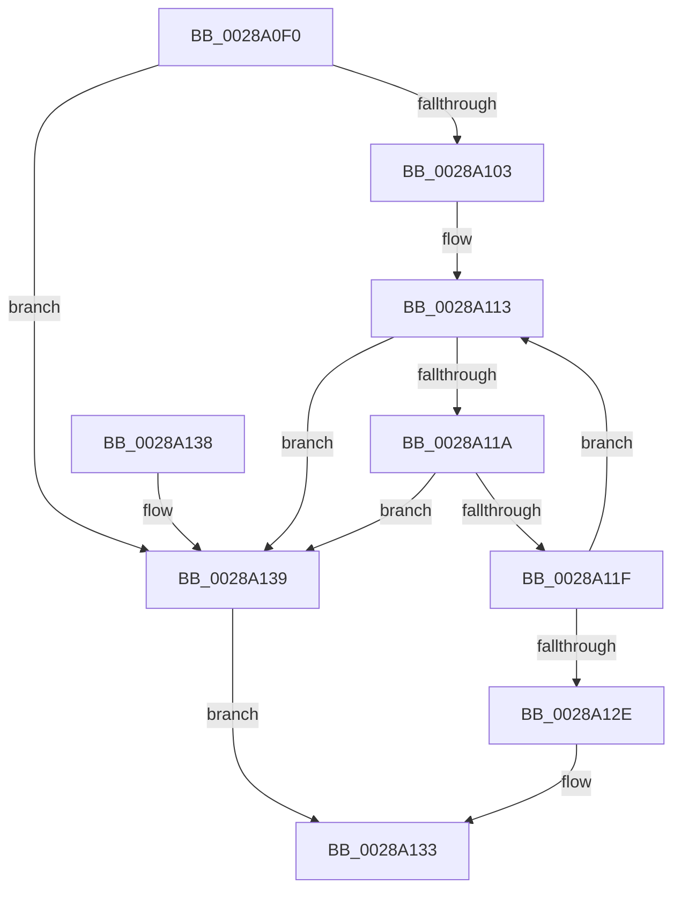

# MiChargeResident

- RVA: `0x0028A0F0`–`0x0028A143` (길이 `83` bytes)
- VA: `0x000000014028A0F0`
- 실행 섹션: `.text`
- PDB 이름 있음: `예`; PDB Function 태그: `아니요`
- unwind 정보 RVA: `0x0005F758`
- 디코드: `23`개 명령, `83/83` bytes 표시
- 미해석 바이트: `0` (있으면 어셈블리에 `.byte`로 보존)

> 이 문서는 커널 이미지의 기계어와 PDB 기호를 분석해 생성했습니다. 4번과 5번은 함수 원형과 자료형을 바이너리 사용 방식에서 추정한 C 해석이며 원본 소스 복구 결과는 아닙니다.

## 1. Dependencies

- 직접 호출 지점: **1**; 고유 호출 대상: **1**
- 직접 호출자로 확인된 함수: **21**
- RIP 상대 이미지 참조: **1**

### Outgoing calls
- `0x0028A13C` → [MiChargePartitionResidentAvailable](MiChargePartitionResidentAvailable_function_0028B000.md) (function, `0x0028B000`)

### Direct callers
- [sub_002066BE](../20/Unknown_function_002066BE.md) at `0x0020677B`
- [MiGetCloneCharges](../22/MiGetCloneCharges_function_0022CB5C.md) at `0x0022CBFD`
- [sub_00285D62](Unknown_function_00285D62.md) at `0x00285D6B`
- [MiAcquireNonPagedResources](MiAcquireNonPagedResources_function_00286C60.md) at `0x00286D2A`
- [MmChargeResources](MmChargeResources_function_002880E0.md) at `0x0028815B`
- [MiCreateUltraThreadContext](MiCreateUltraThreadContext_function_00288200.md) at `0x002882B9`
- [MiObtainFaultCharges](MiObtainFaultCharges_function_0028AEB0.md) at `0x0028AFDA`
- [MiCreateUltraThreadContextHelper](../2C/MiCreateUltraThreadContextHelper_function_002CB380.md) at `0x002CB408`
- [MiReplenishUltraPageTables](../2C/MiReplenishUltraPageTables_function_002CB4EC.md) at `0x002CB5CB`
- [MiObtainSystemCharges](../37/MiObtainSystemCharges_function_003771F4.md) at `0x00377237`
- [MiCreateLargePfnList](../3D/MiCreateLargePfnList_function_003D2DA8.md) at `0x003D30C5`
- [MmAdjustWorkingSetSizeEx](../47/MmAdjustWorkingSetSizeEx_function_0047D8D4.md) at `0x0047DAC7`
- [sub_006E1B8C](../6E/Unknown_function_006E1B8C.md) at `0x006E1B95`
- [sub_006F1BC0](../6F/Unknown_function_006F1BC0.md) at `0x006F1BC9`
- [MiInitializeSystemWorkingSetList](../../page/7F/MiInitializeSystemWorkingSetList_function_007FB7D4.md) at `0x007FB8A0`
- [MmObtainChargesToLockPagedPool](../../page/7F/MmObtainChargesToLockPagedPool_function_007FE390.md) at `0x007FE3B5`
- [MiChargeLargeProtoSubsection](../../page/80/MiChargeLargeProtoSubsection_function_00800A24.md) at `0x00800A43`
- [MiInsertVadCharges](../../page/88/MiInsertVadCharges_function_00886AA8.md) at `0x00886C20`
- [MiCreatePagingFileMap](../../page/98/MiCreatePagingFileMap_function_009852F8.md) at `0x009858A6`
- [MmCreateProcessAddressSpace](../../page/A5/MmCreateProcessAddressSpace_function_00A5EE5C.md) at `0x00A5F00C`
- [MiConstructLoaderEntry](../../page/AA/MiConstructLoaderEntry_function_00AAA264.md) at `0x00AAA3F2`

### Static image references
- `0x0028A0F4` → RVA `0x00E38D00` (`.data`; read)

## 2. Other-region calls and transfers

- 다른 실행 섹션으로 향하는 call: **0**
- 별도 외부 분기/꼬리 이동을 확인하지 못했습니다.

## 3. Assembly (complete function range)

```asm
0028A0F0  48 83 EC 28                     sub rsp, 0x28
0028A0F4  48 8D 05 05 EC BA 00            lea rax, [rip + 0xbaec05]
0028A0FB  4C 8B D1                        mov r10, rcx
0028A0FE  48 3B C8                        cmp rcx, rax
0028A101  75 36                           jne 0x14028a139
0028A103  65 4C 8B 0C 25 20 00 00 00      mov r9, qword ptr gs:[0x20]
0028A10C  41 8B 81 9C 8B 00 00            mov eax, dword ptr [r9 + 0x8b9c]
0028A113  8B C8                           mov ecx, eax
0028A115  48 3B D1                        cmp rdx, rcx
0028A118  77 1F                           ja 0x14028a139
0028A11A  83 F8 FF                        cmp eax, -1
0028A11D  74 1A                           je 0x14028a139
0028A11F  8B C8                           mov ecx, eax
0028A121  2B CA                           sub ecx, edx
0028A123  F0 41 0F B1 89 9C 8B 00 00      lock cmpxchg dword ptr [r9 + 0x8b9c], ecx
0028A12C  75 E5                           jne 0x14028a113
0028A12E  B8 01 00 00 00                  mov eax, 1
0028A133  48 83 C4 28                     add rsp, 0x28
0028A137  C3                              ret
0028A138  CC                              int3
0028A139  49 8B CA                        mov rcx, r10
0028A13C  E8 BF 0E 00 00                  call 0x14028b000
0028A141  EB F0                           jmp 0x14028a133
```

## 4. C-style interpretation (structured pseudocode)

```c
__int64 __fastcall MiChargeResident(__int64 a1, __int64 a2)
{
    __int64 result;
    __int64 v_rsp;

    v_rsp = (v_rsp) - (40);
    if (a1 != (v_rip + 12250117)) goto loc_0028A139;
loc_0028A113:
    if (a2 > ((unsigned int)((unsigned int)((unsigned int)(*(unsigned int *)(*(unsigned __int64 *)(gs_base + (0 + 32)) + 35740)))))) goto loc_0028A139;
    if (((unsigned int)((unsigned int)(*(unsigned int *)(*(unsigned __int64 *)(gs_base + (0 + 32)) + 35740)))) == -1) goto loc_0028A139;
    a1 = (unsigned int)(((unsigned int)((unsigned int)((unsigned int)(*(unsigned int *)(*(unsigned __int64 *)(gs_base + (0 + 32)) + 35740))))) - ((unsigned int)(a2)));
    if (condition_is_not_equal) goto loc_0028A113;
loc_0028A133:
    v_rsp = (v_rsp) + (40);
    return 1;
loc_0028A139:
    result = MiChargePartitionResidentAvailable(a1, a2, a3, *(unsigned __int64 *)(gs_base + (0 + 32)));
    goto loc_0028A133;
}
```

## 5. (Beta) C Style

```c
int64_t MiChargeResident(int64_t Arg1, int64_t Arg2)
{
    int64_t result;
    int64_t local_rsp;

    local_rsp = (local_rsp) - (40);
    if (Arg1 != (v_rip + 12250117)) goto loc_0028A139;
loc_0028A113:
    if (Arg2 > ((uint32_t)((uint32_t)((uint32_t)(*(uint32_t *)(*(uint64_t *)(gs_base + (0 + 0x20)) + 0x8B9C)))))) goto loc_0028A139;
    if (((uint32_t)((uint32_t)(*(uint32_t *)(*(uint64_t *)(gs_base + (0 + 0x20)) + 0x8B9C)))) == -1) goto loc_0028A139;
    Arg1 = (uint32_t)(((uint32_t)((uint32_t)((uint32_t)(*(uint32_t *)(*(uint64_t *)(gs_base + (0 + 0x20)) + 0x8B9C))))) - ((uint32_t)(Arg2)));
    if (condition_is_not_equal) goto loc_0028A113;
loc_0028A133:
    local_rsp = (local_rsp) + (40);
    return 1;
loc_0028A139:
    result = MiChargePartitionResidentAvailable(Arg1, Arg2, a3, *(uint64_t *)(gs_base + (0 + 0x20)));
    goto loc_0028A133;
}
```

## 6. Execution-region graph

[열기: 2D/3D 그래프와 함수 탐색 컨트롤 패널](../../../control-panel.html?section=text&rva=0x0028A0F0&view=graph)

- 2D 그래프는 위에서 아래로 흐르고, 3D 그래프는 빈 공간을 드래그해 회전합니다. Shift+드래그는 이동, 휠은 확대·축소, 함수 노드 선택은 대상 보고서 이동입니다.

### Static fallback


