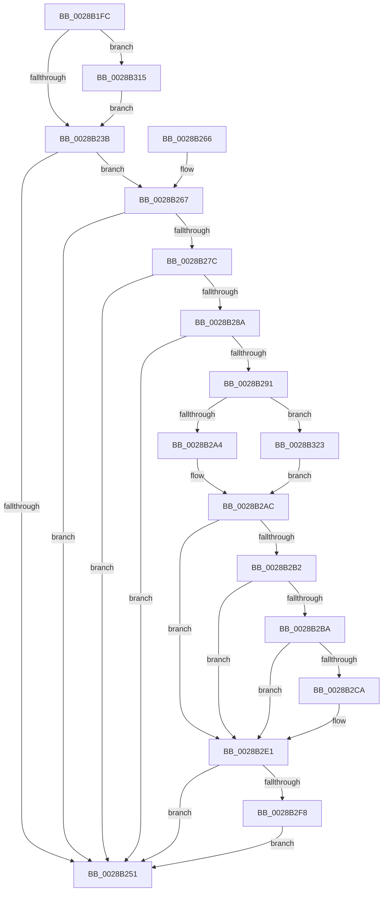

# MiCheckZeroFreeRebalance

- RVA: `0x0028B1FC`–`0x0028B330` (길이 `308` bytes)
- VA: `0x000000014028B1FC`
- 실행 섹션: `.text`
- PDB 이름 있음: `예`; PDB Function 태그: `아니요`
- unwind 정보 RVA: `0x00065F58`
- 디코드: `81`개 명령, `308/308` bytes 표시
- 미해석 바이트: `0` (있으면 어셈블리에 `.byte`로 보존)

> 이 문서는 커널 이미지의 기계어와 PDB 기호를 분석해 생성했습니다. 4번과 5번은 함수 원형과 자료형을 바이너리 사용 방식에서 추정한 C 해석이며 원본 소스 복구 결과는 아닙니다.

## 1. Dependencies

- 직접 호출 지점: **7**; 고유 호출 대상: **7**
- 직접 호출자로 확인된 함수: **1**
- RIP 상대 이미지 참조: **3**

### Outgoing calls
- `0x0028B244` → [MiNodeFreeZeroPages](../3B/MiNodeFreeZeroPages_function_003BBF60.md) (function, `0x003BBF60`)
- `0x0028B26F` → [MiGetNodeStandbyPageCount](../3B/MiGetNodeStandbyPageCount_function_003BC09C.md) (function, `0x003BC09C`)
- `0x0028B2A4` → [ExAcquireSpinLockExclusive](../24/ExAcquireSpinLockExclusive_function_00248690.md) (function, `0x00248690`)
- `0x0028B2C1` → [PsReferencePartitionSafe](../3B/PsReferencePartitionSafe_function_003BA6C0.md) (function, `0x003BA6C0`)
- `0x0028B2EB` → [MiReleaseSpinLockExclusive](../24/MiReleaseSpinLockExclusive_function_002482C0.md) (function, `0x002482C0`)
- `0x0028B30B` → [ExQueueWorkItemToPartition](../35/ExQueueWorkItemToPartition_function_00356E2C.md) (function, `0x00356E2C`)
- `0x0028B326` → [ExAcquireSpinLockExclusiveAtDpcLevel](../24/ExAcquireSpinLockExclusiveAtDpcLevel_function_00248E80.md) (function, `0x00248E80`)

### Direct callers
- [MiGetPage](MiGetPage_function_002884C0.md) at `0x00288999`

### Static image references
- `0x0028B22E` → RVA `0x00FC5002` (`ALMOSTRO`; read)
- `0x0028B293` → RVA `0x00E30040` (`.data`; read)
- `0x0028B2CD` → RVA `0x003BB9B0` (`MiRebalanceZeroFreeLists`; read)

## 2. Other-region calls and transfers

- 다른 실행 섹션으로 향하는 call: **0**
- 별도 외부 분기/꼬리 이동을 확인하지 못했습니다.

## 3. Assembly (complete function range)

```asm
0028B1FC  48 89 5C 24 08                  mov qword ptr [rsp + 8], rbx
0028B201  48 89 6C 24 10                  mov qword ptr [rsp + 0x10], rbp
0028B206  48 89 74 24 18                  mov qword ptr [rsp + 0x18], rsi
0028B20B  57                              push rdi
0028B20C  48 83 EC 20                     sub rsp, 0x20
0028B210  48 8B E9                        mov rbp, rcx
0028B213  8B DA                           mov ebx, edx
0028B215  C1 EB 09                        shr ebx, 9
0028B218  40 32 F6                        xor sil, sil
0028B21B  83 E3 3F                        and ebx, 0x3f
0028B21E  41 8B F8                        mov edi, r8d
0028B221  8B C3                           mov eax, ebx
0028B223  48 69 C8 80 DF 00 00            imul rcx, rax, 0xdf80
0028B22A  48 03 4D 10                     add rcx, qword ptr [rbp + 0x10]
0028B22E  80 3D CD 9D D3 00 01            cmp byte ptr [rip + 0xd39dcd], 1
0028B235  0F 87 DA 00 00 00               ja 0x14028b315
0028B23B  41 B8 00 00 08 00               mov r8d, 0x80000
0028B241  40 8A D6                        mov dl, sil
0028B244  E8 17 0D 13 00                  call 0x1403bbf60
0028B249  48 3D 00 02 00 00               cmp rax, 0x200
0028B24F  72 16                           jb 0x14028b267
0028B251  48 8B 5C 24 30                  mov rbx, qword ptr [rsp + 0x30]
0028B256  48 8B 6C 24 38                  mov rbp, qword ptr [rsp + 0x38]
0028B25B  48 8B 74 24 40                  mov rsi, qword ptr [rsp + 0x40]
0028B260  48 83 C4 20                     add rsp, 0x20
0028B264  5F                              pop rdi
0028B265  C3                              ret
0028B266  CC                              int3
0028B267  44 8A C6                        mov r8b, sil
0028B26A  8B D3                           mov edx, ebx
0028B26C  48 8B CD                        mov rcx, rbp
0028B26F  E8 28 0E 13 00                  call 0x1403bc09c
0028B274  48 3D 00 10 00 00               cmp rax, 0x1000
0028B27A  72 D5                           jb 0x14028b251
0028B27C  48 8D 9D 10 42 00 00            lea rbx, [rbp + 0x4210]
0028B283  48 83 7B 10 00                  cmp qword ptr [rbx + 0x10], 0
0028B288  75 C7                           jne 0x14028b251
0028B28A  8B 45 04                        mov eax, dword ptr [rbp + 4]
0028B28D  A8 01                           test al, 1
0028B28F  75 C0                           jne 0x14028b251
0028B291  8B C7                           mov eax, edi
0028B293  48 8D 0D A6 4D BA 00            lea rcx, [rip + 0xba4da6]
0028B29A  D1 E8                           shr eax, 1
0028B29C  33 F6                           xor esi, esi
0028B29E  0B C7                           or eax, edi
0028B2A0  A8 01                           test al, 1
0028B2A2  75 7F                           jne 0x14028b323
0028B2A4  E8 E7 D3 FB FF                  call 0x140248690
0028B2A9  40 8A F8                        mov dil, al
0028B2AC  48 39 73 10                     cmp qword ptr [rbx + 0x10], rsi
0028B2B0  75 2F                           jne 0x14028b2e1
0028B2B2  8B 4D 04                        mov ecx, dword ptr [rbp + 4]
0028B2B5  F6 C1 01                        test cl, 1
0028B2B8  75 27                           jne 0x14028b2e1
0028B2BA  48 8B 8D B8 00 00 00            mov rcx, qword ptr [rbp + 0xb8]
0028B2C1  E8 FA F3 12 00                  call 0x1403ba6c0
0028B2C6  84 C0                           test al, al
0028B2C8  74 17                           je 0x14028b2e1
0028B2CA  48 21 33                        and qword ptr [rbx], rsi
0028B2CD  48 8D 05 DC 06 13 00            lea rax, [rip + 0x1306dc]
0028B2D4  48 89 43 10                     mov qword ptr [rbx + 0x10], rax
0028B2D8  BE 01 00 00 00                  mov esi, 1
0028B2DD  48 89 6B 18                     mov qword ptr [rbx + 0x18], rbp
0028B2E1  40 8A D7                        mov dl, dil
0028B2E4  48 8D 0D 55 4D BA 00            lea rcx, [rip + 0xba4d55]
0028B2EB  E8 D0 CF FB FF                  call 0x1402482c0
0028B2F0  85 F6                           test esi, esi
0028B2F2  0F 84 59 FF FF FF               je 0x14028b251
0028B2F8  4C 8B 8D B8 00 00 00            mov r9, qword ptr [rbp + 0xb8]
0028B2FF  41 83 C8 FF                     or r8d, 0xffffffff
0028B303  BA 01 00 00 00                  mov edx, 1
0028B308  48 8B CB                        mov rcx, rbx
0028B30B  E8 1C BB 0C 00                  call 0x140356e2c
0028B310  E9 3C FF FF FF                  jmp 0x14028b251
0028B315  8B F2                           mov esi, edx
0028B317  C1 EE 08                        shr esi, 8
0028B31A  40 80 E6 01                     and sil, 1
0028B31E  E9 18 FF FF FF                  jmp 0x14028b23b
0028B323  40 B7 11                        mov dil, 0x11
0028B326  E8 55 DB FB FF                  call 0x140248e80
0028B32B  E9 7C FF FF FF                  jmp 0x14028b2ac
```

## 4. C-style interpretation (structured pseudocode)

```c
__int64 __fastcall MiCheckZeroFreeRebalance(__int64 a1, int a2, int a3)
{
    __int64 result;
    __int64 v_rbx;
    __int64 v_rsi;
    __int64 v_rsp;
    unsigned __int64 v_stack_p10;
    unsigned __int64 v_stack_p18;
    unsigned __int64 v_stack_p8;

    v_stack_p8 = v_rbx;
    v_stack_p10 = v_rbp;
    v_stack_p18 = v_rsi;
    v_rsp = (v_rsp) - (32);
    v_rbx = (unsigned int)(((unsigned int)(a2)) >> (9));
    v_rsi = 0;
    v_rbx = (unsigned int)((v_rbx) & (63));
    a1 = (a1) * ((unsigned int)((unsigned int)(v_rbx)));
    a1 = (a1) + (*(unsigned __int64 *)(a1 + 16));
    if ((*(unsigned __int8 *)(v_rip + 13868493)) > 1) goto loc_0028B315;
loc_0028B23B:
    result = MiNodeFreeZeroPages(a1, 0, (unsigned int)(0x80000ULL), a4);
    if (result < 512) goto loc_0028B267;
loc_0028B251:
    v_rsp = (v_rsp) + (32);
    return result;
loc_0028B267:
    result = MiGetNodeStandbyPageCount(v_stack_p10, (unsigned int)((unsigned int)(v_stack_p8)), (unsigned __int8)(v_stack_p18), a4);
    if (result < 0x1000ULL) goto loc_0028B251;
    if ((*(unsigned __int64 *)(v_stack_p10 + 16912 + 16)) != 0) goto loc_0028B251;
    if ((((unsigned __int8)((unsigned int)(*(unsigned int *)(v_stack_p10 + 4)))) & (1)) != 0) goto loc_0028B251;
    result = (unsigned int)(((unsigned int)((unsigned int)((unsigned int)(a3)))) >> (1));
    v_rsi = 0;
    result = (unsigned int)((result) | ((unsigned int)((unsigned int)(a3))));
    if ((((unsigned __int8)(result)) & (1)) != 0) goto loc_0028B323;
    result = ExAcquireSpinLockExclusive(v_rip + 12209574, (unsigned int)((unsigned int)(v_stack_p8)), (unsigned __int8)(v_stack_p18), a4);
loc_0028B2AC:
    if ((*(unsigned __int64 *)(v_stack_p10 + 16912 + 16)) != 0) goto loc_0028B2E1;
    if ((((unsigned __int8)((unsigned int)(*(unsigned int *)(v_stack_p10 + 4)))) & (1)) != 0) goto loc_0028B2E1;
    result = PsReferencePartitionSafe(*(unsigned __int64 *)(v_stack_p10 + 184), (unsigned int)((unsigned int)(v_stack_p8)), (unsigned __int8)(v_stack_p18), a4);
    if ((unsigned __int8)(result) != 0) {
        result = v_rip + 1246940;
        *(unsigned __int64 *)(v_stack_p10 + 16912 + 16) = result;
        v_rsi = 1;
        *(unsigned __int64 *)(v_stack_p10 + 16912 + 24) = v_stack_p10;
    }
    result = MiReleaseSpinLockExclusive(v_rip + 12209493, (unsigned __int8)((unsigned __int8)(result)), (unsigned __int8)(v_stack_p18), a4);
    if ((unsigned int)(v_rsi) == 0) goto loc_0028B251;
    a3 = (unsigned int)(((unsigned __int8)(v_stack_p18)) | (0xFFFFFFFFULL));
    result = ExQueueWorkItemToPartition(v_stack_p10 + 16912, 1, a3, *(unsigned __int64 *)(v_stack_p10 + 184));
    goto loc_0028B251;
loc_0028B315:
    v_rsi = (unsigned int)((1) >> (8));
    v_rsi = (unsigned __int8)((v_rsi) & (1));
    goto loc_0028B23B;
loc_0028B323:
    result = ExAcquireSpinLockExclusiveAtDpcLevel(v_stack_p10 + 16912, 1, a3, *(unsigned __int64 *)(v_stack_p10 + 184));
    goto loc_0028B2AC;
}
```

## 5. (Beta) C Style

```c
int64_t MiCheckZeroFreeRebalance(void *Arg1, int32_t Arg2, int32_t Arg3)
{
    uint8_t *arg1 = (uint8_t *)Arg1;

    int64_t result;
    int64_t local_rbx;
    int64_t local_rsi;
    int64_t local_rsp;
    uint64_t v_stack_p10;
    uint64_t v_stack_p18;
    uint64_t v_stack_p8;

    v_stack_p8 = local_rbx;
    v_stack_p10 = local_rbp;
    v_stack_p18 = local_rsi;
    local_rsp = (local_rsp) - (32);
    local_rbx = (uint32_t)(((uint32_t)(Arg2)) >> (9));
    local_rsi = 0;
    local_rbx = (uint32_t)((local_rbx) & (63));
    Arg1 = (Arg1) * ((uint32_t)((uint32_t)(local_rbx)));
    Arg1 = (Arg1) + (*(uint64_t *)(arg1 + 0x10));
    if ((*(uint8_t *)(v_rip + 0xD39DCD)) > 1) goto loc_0028B315;
loc_0028B23B:
    result = MiNodeFreeZeroPages(Arg1, 0, (uint32_t)(0x80000ULL), a4);
    if (result < 512) goto loc_0028B267;
loc_0028B251:
    local_rsp = (local_rsp) + (32);
    return result;
loc_0028B267:
    result = MiGetNodeStandbyPageCount(v_stack_p10, (uint32_t)((uint32_t)(v_stack_p8)), (uint8_t)(v_stack_p18), a4);
    if (result < 0x1000ULL) goto loc_0028B251;
    if ((*(uint64_t *)(v_stack_p10 + 0x4210 + 0x10)) != 0) goto loc_0028B251;
    if ((((uint8_t)((uint32_t)(*(uint32_t *)(v_stack_p10 + 0x4)))) & (1)) != 0) goto loc_0028B251;
    result = (uint32_t)(((uint32_t)((uint32_t)((uint32_t)(Arg3)))) >> (1));
    local_rsi = 0;
    result = (uint32_t)((result) | ((uint32_t)((uint32_t)(Arg3))));
    if ((((uint8_t)(result)) & (1)) != 0) goto loc_0028B323;
    result = ExAcquireSpinLockExclusive(v_rip + 12209574, (uint32_t)((uint32_t)(v_stack_p8)), (uint8_t)(v_stack_p18), a4);
loc_0028B2AC:
    if ((*(uint64_t *)(v_stack_p10 + 0x4210 + 0x10)) != 0) goto loc_0028B2E1;
    if ((((uint8_t)((uint32_t)(*(uint32_t *)(v_stack_p10 + 0x4)))) & (1)) != 0) goto loc_0028B2E1;
    result = PsReferencePartitionSafe(*(uint64_t *)(v_stack_p10 + 0xB8), (uint32_t)((uint32_t)(v_stack_p8)), (uint8_t)(v_stack_p18), a4);
    if ((uint8_t)(result) != 0) {
        result = v_rip + 1246940;
        *(uint64_t *)(v_stack_p10 + 0x4210 + 0x10) = result;
        local_rsi = 1;
        *(uint64_t *)(v_stack_p10 + 0x4210 + 0x18) = v_stack_p10;
    }
    result = MiReleaseSpinLockExclusive(v_rip + 12209493, (uint8_t)((uint8_t)(result)), (uint8_t)(v_stack_p18), a4);
    if ((uint32_t)(local_rsi) == 0) goto loc_0028B251;
    Arg3 = (uint32_t)(((uint8_t)(v_stack_p18)) | (0xFFFFFFFFULL));
    result = ExQueueWorkItemToPartition(v_stack_p10 + 16912, 1, Arg3, *(uint64_t *)(v_stack_p10 + 0xB8));
    goto loc_0028B251;
loc_0028B315:
    local_rsi = (uint32_t)((1) >> (8));
    local_rsi = (uint8_t)((local_rsi) & (1));
    goto loc_0028B23B;
loc_0028B323:
    result = ExAcquireSpinLockExclusiveAtDpcLevel(v_stack_p10 + 16912, 1, Arg3, *(uint64_t *)(v_stack_p10 + 0xB8));
    goto loc_0028B2AC;
}
```

### 관측된 메모리 오프셋

구조체 형식이 확인되지 않은 접근은 인자 기준의 오프셋으로만 기록했습니다.

| 기준 인자 | 오프셋 표현 | 폭 (bit) | 접근 |
|---|---:|---:|---|
| `Arg1` | `+ 0x0` | `64` | `R/W` |
| `Arg1` | `+ 0x4` | `32` | `R` |
| `Arg1` | `+ 0x10` | `64` | `R` |
| `Arg1` | `+ 0x10` | `64` | `W` |
| `Arg1` | `+ 0x18` | `64` | `W` |
| `Arg1` | `+ 0xB8` | `64` | `R` |
| `Arg1` | `+ 0x4210` | `64` | `R` |

## 6. Execution-region graph

[열기: 2D/3D 그래프와 함수 탐색 컨트롤 패널](../../../control-panel.html?section=text&rva=0x0028B1FC&view=graph)

- 2D 그래프는 위에서 아래로 흐르고, 3D 그래프는 빈 공간을 드래그해 회전합니다. Shift+드래그는 이동, 휠은 확대·축소, 함수 노드 선택은 대상 보고서 이동입니다.

### Static fallback


