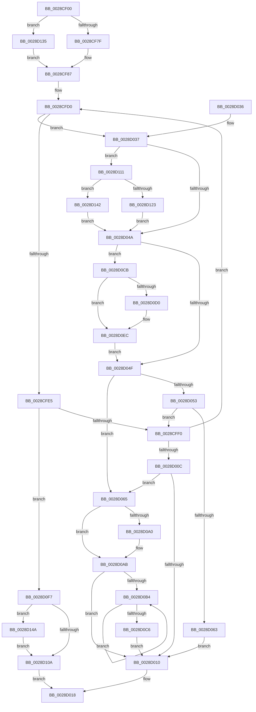

# MiClaimPhysicalRun

- RVA: `0x0028CF00`–`0x0028D154` (길이 `596` bytes)
- VA: `0x000000014028CF00`
- 실행 섹션: `.text`
- PDB 이름 있음: `예`; PDB Function 태그: `아니요`
- unwind 정보 RVA: `0x00067014`
- 디코드: `145`개 명령, `596/596` bytes 표시
- 미해석 바이트: `0` (있으면 어셈블리에 `.byte`로 보존)

> 이 문서는 커널 이미지의 기계어와 PDB 기호를 분석해 생성했습니다. 4번과 5번은 함수 원형과 자료형을 바이너리 사용 방식에서 추정한 C 해석이며 원본 소스 복구 결과는 아닙니다.

## 1. Dependencies

- 직접 호출 지점: **2**; 고유 호출 대상: **2**
- 직접 호출자로 확인된 함수: **4**
- RIP 상대 이미지 참조: **3**

### Outgoing calls
- `0x0028CFDB` → [MiTradePage](MiTradePage_function_0028D160.md) (function, `0x0028D160`)
- `0x0028D0BB` → [MiReleaseFreshPage](../33/MiReleaseFreshPage_function_00334AE0.md) (function, `0x00334AE0`)

### Direct callers
- [MiFindContiguousPagesEx](MiFindContiguousPagesEx_function_0028BDE0.md) at `0x0028CD19`
- [MiDefragmentSlabWorker](../68/MiDefragmentSlabWorker_function_0068D730.md) at `0x0068D9B3`
- [MmRelocatePfnList](../../page/90/MmRelocatePfnList_function_00901E70.md) at `0x00902088`
- [MiScrubNode](../../page/A4/MiScrubNode_function_00A46098.md) at `0x00A46233`

### Static image references
- `0x0028D065` → RVA `0x00EF5320` (`.data`; read/write)
- `0x0028D095` → RVA `0x00EF5324` (`.data`; write)
- `0x0028D0F7` → RVA `0x00EF523C` (`.data`; read/write)

## 2. Other-region calls and transfers

- 다른 실행 섹션으로 향하는 call: **0**
- 별도 외부 분기/꼬리 이동을 확인하지 못했습니다.

## 3. Assembly (complete function range)

```asm
0028CF00  4C 8B DC                        mov r11, rsp
0028CF03  49 89 5B 08                     mov qword ptr [r11 + 8], rbx
0028CF07  49 89 6B 10                     mov qword ptr [r11 + 0x10], rbp
0028CF0B  49 89 73 18                     mov qword ptr [r11 + 0x18], rsi
0028CF0F  57                              push rdi
0028CF10  41 54                           push r12
0028CF12  41 55                           push r13
0028CF14  41 56                           push r14
0028CF16  41 57                           push r15
0028CF18  48 83 EC 60                     sub rsp, 0x60
0028CF1C  48 8B 84 24 B0 00 00 00         mov rax, qword ptr [rsp + 0xb0]
0028CF24  45 33 E4                        xor r12d, r12d
0028CF27  4C 8B AC 24 C8 00 00 00         mov r13, qword ptr [rsp + 0xc8]
0028CF2F  4D 8B F8                        mov r15, r8
0028CF32  8B AC 24 B8 00 00 00            mov ebp, dword ptr [rsp + 0xb8]
0028CF39  48 8B FA                        mov rdi, rdx
0028CF3C  4C 8B B4 24 D8 00 00 00         mov r14, qword ptr [rsp + 0xd8]
0028CF44  49 89 43 A0                     mov qword ptr [r11 - 0x60], rax
0028CF48  8B 84 24 C0 00 00 00            mov eax, dword ptr [rsp + 0xc0]
0028CF4F  4D 89 63 C0                     mov qword ptr [r11 - 0x40], r12
0028CF53  4D 89 6B D0                     mov qword ptr [r11 - 0x30], r13
0028CF57  49 89 4B 98                     mov qword ptr [r11 - 0x68], rcx
0028CF5B  89 6C 24 38                     mov dword ptr [rsp + 0x38], ebp
0028CF5F  4D 89 43 A8                     mov qword ptr [r11 - 0x58], r8
0028CF63  89 44 24 3C                     mov dword ptr [rsp + 0x3c], eax
0028CF67  48 8B 84 24 D0 00 00 00         mov rax, qword ptr [rsp + 0xd0]
0028CF6F  45 89 26                        mov dword ptr [r14], r12d
0028CF72  4D 89 4B C8                     mov qword ptr [r11 - 0x38], r9
0028CF76  48 85 C0                        test rax, rax
0028CF79  0F 85 B6 01 00 00               jne 0x14028d135
0028CF7F  49 C7 43 B8 FF FF FF FF         mov qword ptr [r11 - 0x48], 0xffffffffffffffff
0028CF87  48 8D 1C 52                     lea rbx, [rdx + rdx*2]
0028CF8B  4C 89 BC 24 C8 00 00 00         mov qword ptr [rsp + 0xc8], r15
0028CF93  48 C1 E3 04                     shl rbx, 4
0028CF97  48 B8 00 00 00 00 00 DE FF FF   movabs rax, 0xffffde0000000000
0028CFA1  48 8B C0                        mov rax, rax
0028CFA4  48 03 D8                        add rbx, rax
0028CFA7  4B 8D 34 40                     lea rsi, [r8 + r8*2]
0028CFAB  48 C1 E6 04                     shl rsi, 4
0028CFAF  4A 8D 04 02                     lea rax, [rdx + r8]
0028CFB3  48 03 F3                        add rsi, rbx
0028CFB6  48 89 84 24 D8 00 00 00         mov qword ptr [rsp + 0xd8], rax
0028CFBE  81 E5 00 20 00 00               and ebp, 0x2000
0028CFC4  0F 1F 40 00                     nop dword ptr [rax]
0028CFC8  0F 1F 84 00 00 00 00 00         nop dword ptr [rax + rax]
0028CFD0  4D 8B C6                        mov r8, r14
0028CFD3  48 8D 4C 24 20                  lea rcx, [rsp + 0x20]
0028CFD8  48 8B D7                        mov rdx, rdi
0028CFDB  E8 80 01 00 00                  call 0x14028d160
0028CFE0  48 85 C0                        test rax, rax
0028CFE3  74 52                           je 0x14028d037
0028CFE5  48 29 44 24 30                  sub qword ptr [rsp + 0x30], rax
0028CFEA  0F 84 07 01 00 00               je 0x14028d0f7
0028CFF0  48 8D 0C 40                     lea rcx, [rax + rax*2]
0028CFF4  48 C7 44 24 40 FF FF FF FF      mov qword ptr [rsp + 0x40], 0xffffffffffffffff
0028CFFD  48 C1 E1 04                     shl rcx, 4
0028D001  48 03 F8                        add rdi, rax
0028D004  48 03 D9                        add rbx, rcx
0028D007  48 3B DE                        cmp rbx, rsi
0028D00A  72 C4                           jb 0x14028cfd0
0028D00C  85 ED                           test ebp, ebp
0028D00E  74 55                           je 0x14028d065
0028D010  48 8B 84 24 C8 00 00 00         mov rax, qword ptr [rsp + 0xc8]
0028D018  4C 8D 5C 24 60                  lea r11, [rsp + 0x60]
0028D01D  49 8B 5B 30                     mov rbx, qword ptr [r11 + 0x30]
0028D021  49 8B 6B 38                     mov rbp, qword ptr [r11 + 0x38]
0028D025  49 8B 73 40                     mov rsi, qword ptr [r11 + 0x40]
0028D029  49 8B E3                        mov rsp, r11
0028D02C  41 5F                           pop r15
0028D02E  41 5E                           pop r14
0028D030  41 5D                           pop r13
0028D032  41 5C                           pop r12
0028D034  5F                              pop rdi
0028D035  C3                              ret
0028D036  CC                              int3
0028D037  48 8B 4C 24 48                  mov rcx, qword ptr [rsp + 0x48]
0028D03C  B8 01 00 00 00                  mov eax, 1
0028D041  48 3B C8                        cmp rcx, rax
0028D044  0F 87 C7 00 00 00               ja 0x14028d111
0028D04A  45 85 E4                        test r12d, r12d
0028D04D  74 7C                           je 0x14028d0cb
0028D04F  85 ED                           test ebp, ebp
0028D051  74 12                           je 0x14028d065
0028D053  48 8B 8C 24 D8 00 00 00         mov rcx, qword ptr [rsp + 0xd8]
0028D05B  48 2B CF                        sub rcx, rdi
0028D05E  48 3B C1                        cmp rax, rcx
0028D061  72 8D                           jb 0x14028cff0
0028D063  EB AB                           jmp 0x14028d010
0028D065  FF 05 B5 82 C6 00               inc dword ptr [rip + 0xc682b5]
0028D06B  48 B8 00 00 00 00 00 DE FF FF   movabs rax, 0xffffde0000000000
0028D075  48 8B C0                        mov rax, rax
0028D078  4C 2B 7C 24 30                  sub r15, qword ptr [rsp + 0x30]
0028D07D  48 8B CB                        mov rcx, rbx
0028D080  48 2B C8                        sub rcx, rax
0028D083  48 B8 AB AA AA AA AA AA AA AA   movabs rax, 0xaaaaaaaaaaaaaaab
0028D08D  48 C1 F9 04                     sar rcx, 4
0028D091  48 0F AF C8                     imul rcx, rax
0028D095  89 0D 89 82 C6 00               mov dword ptr [rip + 0xc68289], ecx
0028D09B  4D 85 ED                        test r13, r13
0028D09E  74 0B                           je 0x14028d0ab
0028D0A0  41 69 C7 00 F0 FF FF            imul eax, r15d, 0xfffff000
0028D0A7  41 01 45 28                     add dword ptr [r13 + 0x28], eax
0028D0AB  4D 85 FF                        test r15, r15
0028D0AE  0F 84 5C FF FF FF               je 0x14028d010
0028D0B4  48 83 EB 30                     sub rbx, 0x30
0028D0B8  48 8B CB                        mov rcx, rbx
0028D0BB  E8 20 7A 0A 00                  call 0x140334ae0
0028D0C0  49 83 EF 01                     sub r15, 1
0028D0C4  75 EE                           jne 0x14028d0b4
0028D0C6  E9 45 FF FF FF                  jmp 0x14028d010
0028D0CB  48 85 C9                        test rcx, rcx
0028D0CE  74 1C                           je 0x14028d0ec
0028D0D0  48 8B 94 24 D8 00 00 00         mov rdx, qword ptr [rsp + 0xd8]
0028D0D8  48 FF C9                        dec rcx
0028D0DB  48 F7 D1                        not rcx
0028D0DE  48 23 CF                        and rcx, rdi
0028D0E1  48 2B D1                        sub rdx, rcx
0028D0E4  48 89 94 24 C8 00 00 00         mov qword ptr [rsp + 0xc8], rdx
0028D0EC  41 BC 01 00 00 00               mov r12d, 1
0028D0F2  E9 58 FF FF FF                  jmp 0x14028d04f
0028D0F7  FF 05 3F 81 C6 00               inc dword ptr [rip + 0xc6813f]
0028D0FD  48 8B 8C 24 D0 00 00 00         mov rcx, qword ptr [rsp + 0xd0]
0028D105  48 85 C9                        test rcx, rcx
0028D108  75 40                           jne 0x14028d14a
0028D10A  33 C0                           xor eax, eax
0028D10C  E9 07 FF FF FF                  jmp 0x14028d018
0028D111  48 8D 51 FF                     lea rdx, [rcx - 1]
0028D115  48 F7 D2                        not rdx
0028D118  48 8B C2                        mov rax, rdx
0028D11B  48 23 C7                        and rax, rdi
0028D11E  48 3B F8                        cmp rdi, rax
0028D121  74 1F                           je 0x14028d142
0028D123  48 8D 41 FF                     lea rax, [rcx - 1]
0028D127  48 03 C7                        add rax, rdi
0028D12A  48 23 C2                        and rax, rdx
0028D12D  48 2B C7                        sub rax, rdi
0028D130  E9 15 FF FF FF                  jmp 0x14028d04a
0028D135  48 8B 00                        mov rax, qword ptr [rax]
0028D138  48 89 44 24 40                  mov qword ptr [rsp + 0x40], rax
0028D13D  E9 45 FE FF FF                  jmp 0x14028cf87
0028D142  48 8B C1                        mov rax, rcx
0028D145  E9 00 FF FF FF                  jmp 0x14028d04a
0028D14A  48 8B 44 24 40                  mov rax, qword ptr [rsp + 0x40]
0028D14F  48 89 01                        mov qword ptr [rcx], rax
0028D152  EB B6                           jmp 0x14028d10a
```

## 4. C-style interpretation (structured pseudocode)

```c
__int64 __fastcall MiClaimPhysicalRun(__int64 a1, __int64 a2, __int64 a3, __int64 a4, __int64 a5, unsigned int a6, unsigned int a7, __int64 a8, __int64 a9, __int64 a10)
{
    __int64 result;
    __int64 v_r12;
    __int64 v_r15;
    __int64 v_rbp;
    __int64 v_rbx;
    __int64 v_rdi;
    __int64 v_rsi;
    __int64 v_rsp;
    unsigned __int64 v_stack_m18;
    unsigned __int64 v_stack_m20;
    unsigned __int64 v_stack_m28;
    unsigned __int64 v_stack_m30;
    unsigned __int64 v_stack_m48;
    unsigned int v_stack_m4C;
    unsigned int v_stack_m50;
    unsigned __int64 v_stack_m58;
    unsigned __int64 v_stack_m68;
    unsigned __int64 v_stack_p40;
    unsigned __int64 v_stack_p50;
    unsigned __int64 v_stack_p68;

    *(unsigned __int64 *)(v_rsp + 8) = v_rbx;
    *(unsigned __int64 *)(v_rsp + 16) = v_rbp;
    *(unsigned __int64 *)(v_rsp + 24) = v_rsi;
    v_rsp = (v_rsp) - (96);
    v_r12 = 0;
    *(unsigned __int64 *)(v_rsp - 96) = a5;
    *(unsigned __int64 *)(v_rsp - 64) = 0;
    *(unsigned __int64 *)(v_rsp - 48) = a8;
    *(unsigned __int64 *)(v_rsp - 104) = a1;
    v_stack_m50 = (unsigned int)((unsigned int)(a6));
    *(unsigned __int64 *)(v_rsp - 88) = a3;
    v_stack_m4C = (unsigned int)((unsigned int)(a7));
    *(unsigned int *)(a10) = 0;
    *(unsigned __int64 *)(v_rsp - 56) = a4;
    if (a9 != 0) goto loc_0028D135;
    *(unsigned __int64 *)(v_rsp - 72) = -1;
loc_0028CF87:
    v_stack_p40 = a3;
    v_rbx = (a2 + a2 * 2) << (4);
    v_rbx = (v_rbx) + (a9);
    v_rsi = (a3 + a3 * 2) << (4);
    v_rsi = (v_rsi) + (v_rbx);
    v_stack_p50 = a2 + a3 * 1;
    v_rbp = (unsigned int)(((unsigned int)(a6)) & (0x2000ULL));
loc_0028CFD0:
    result = MiTradePage(v_stack_m68, a2, a10, a4);
    if (result == 0) goto loc_0028D037;
    if (result == 0) goto loc_0028D0F7;
loc_0028CFF0:
    v_stack_m48 = -1;
    a1 = (result + result * 2) << (4);
    v_rdi = (a2) + (result);
    v_rbx = (v_rbx) + (a1);
    if (v_rbx < v_rsi) goto loc_0028CFD0;
    if ((unsigned int)(v_rbp) == 0) goto loc_0028D065;
loc_0028D010:
loc_0028D018:
    return a8;
loc_0028D037:
    if (v_stack_m18 > 1) goto loc_0028D111;
loc_0028D04A:
    if (0 == 0) goto loc_0028D0CB;
loc_0028D04F:
    if ((unsigned int)(*(unsigned __int64 *)(v_stack_m28 + 56)) == 0) goto loc_0028D065;
    a1 = (a10) - (v_rdi);
    if (1 < a1) goto loc_0028CFF0;
    goto loc_0028D010;
loc_0028D065:
    v_r15 = (a3) - (v_stack_m30);
    a1 = (*(unsigned __int64 *)(v_stack_m28 + 48)) - (1);
    a1 = (a1) >> (4);
    a1 = (a1) * (1);
    *(unsigned int *)(v_rip + 13009545) = (unsigned int)(a1);
    result = 1;
    if (a8 != 0) {
        result = (unsigned int)((1) * ((unsigned int)(v_r15)));
    }
    if (v_r15 == 0) goto loc_0028D010;
loc_0028D0B4:
    v_rbx = (*(unsigned __int64 *)(v_stack_m28 + 48)) - (48);
    result = MiReleaseFreshPage(v_rbx, a2, a10, a4);
    v_r15 = (v_r15) - (1);
    if (condition_is_not_equal) goto loc_0028D0B4;
    goto loc_0028D010;
loc_0028D0CB:
    if (v_rbx != 0) {
        a2 = a10;
        a1 = (v_rbx) - 1;
        a1 = ~(a1);
        a1 = (a1) & (v_rdi);
        a2 = (a2) - (a1);
        v_stack_p68 = a2;
    }
    goto loc_0028D04F;
loc_0028D0F7:
    if (a9 != 0) goto loc_0028D14A;
loc_0028D10A:
    result = 0;
    goto loc_0028D018;
loc_0028D111:
    a2 = ~(a9 - 1);
    result = (a2) & (v_rdi);
    if (v_rdi == result) goto loc_0028D142;
    result = (a9 - 1) + (v_rdi);
    result = (result) & (a2);
    result = (result) - (v_rdi);
    goto loc_0028D04A;
loc_0028D135:
    v_stack_m20 = *(unsigned __int64 *)(result);
    goto loc_0028CF87;
loc_0028D142:
    goto loc_0028D04A;
loc_0028D14A:
    *(unsigned __int64 *)(a9) = v_stack_m20;
    goto loc_0028D10A;
}
```

## 5. (Beta) C Style

```c
int64_t MiClaimPhysicalRun(int64_t Arg1, void *Arg2, void *Arg3, int64_t Arg4, int64_t Arg5, uint32_t Arg6, uint32_t Arg7, int64_t Arg8, int64_t Arg9, void *Arg10)
{
    uint8_t *arg2 = (uint8_t *)Arg2;
    uint8_t *arg3 = (uint8_t *)Arg3;
    uint8_t *arg10 = (uint8_t *)Arg10;

    int64_t result;
    int64_t local_r12;
    int64_t local_r15;
    int64_t local_rbp;
    int64_t local_rbx;
    int64_t local_rdi;
    int64_t local_rsi;
    int64_t local_rsp;
    uint64_t v_stack_m18;
    uint64_t v_stack_m20;
    uint64_t v_stack_m28;
    uint64_t v_stack_m30;
    uint64_t v_stack_m48;
    uint32_t v_stack_m4C;
    uint32_t v_stack_m50;
    uint64_t v_stack_m58;
    uint64_t v_stack_m68;
    uint64_t v_stack_p40;
    uint64_t v_stack_p50;
    uint64_t v_stack_p68;

    *(uint64_t *)(local_rsp + 0x8) = local_rbx;
    *(uint64_t *)(local_rsp + 0x10) = local_rbp;
    *(uint64_t *)(local_rsp + 0x18) = local_rsi;
    local_rsp = (local_rsp) - (96);
    local_r12 = 0;
    *(uint64_t *)(local_rsp - 0x60) = Arg5;
    *(uint64_t *)(local_rsp - 0x40) = 0;
    *(uint64_t *)(local_rsp - 0x30) = Arg8;
    *(uint64_t *)(local_rsp - 0x68) = Arg1;
    v_stack_m50 = (uint32_t)((uint32_t)(Arg6));
    *(void **)(local_rsp - 0x58) = Arg3;
    v_stack_m4C = (uint32_t)((uint32_t)(Arg7));
    *(uint32_t *)(arg10) = 0;
    *(uint64_t *)(local_rsp - 0x38) = Arg4;
    if (Arg9 != 0) goto loc_0028D135;
    *(uint64_t *)(local_rsp - 0x48) = -1;
loc_0028CF87:
    v_stack_p40 = Arg3;
    local_rbx = (Arg2 + Arg2 * 2) << (4);
    local_rbx = (local_rbx) + (Arg9);
    local_rsi = (Arg3 + Arg3 * 2) << (4);
    local_rsi = (local_rsi) + (local_rbx);
    v_stack_p50 = Arg2 + Arg3 * 1;
    local_rbp = (uint32_t)(((uint32_t)(Arg6)) & (0x2000ULL));
loc_0028CFD0:
    result = MiTradePage(v_stack_m68, Arg2, Arg10, Arg4);
    if (result == 0) goto loc_0028D037;
    if (result == 0) goto loc_0028D0F7;
loc_0028CFF0:
    v_stack_m48 = -1;
    Arg1 = (result + result * 2) << (4);
    local_rdi = (Arg2) + (result);
    local_rbx = (local_rbx) + (Arg1);
    if (local_rbx < local_rsi) goto loc_0028CFD0;
    if ((uint32_t)(local_rbp) == 0) goto loc_0028D065;
loc_0028D010:
loc_0028D018:
    return Arg8;
loc_0028D037:
    if (v_stack_m18 > 1) goto loc_0028D111;
loc_0028D04A:
    if (0 == 0) goto loc_0028D0CB;
loc_0028D04F:
    if ((uint32_t)(*(uint64_t *)(v_stack_m28 + 0x38)) == 0) goto loc_0028D065;
    Arg1 = (Arg10) - (local_rdi);
    if (1 < Arg1) goto loc_0028CFF0;
    goto loc_0028D010;
loc_0028D065:
    local_r15 = (Arg3) - (v_stack_m30);
    Arg1 = (*(uint64_t *)(v_stack_m28 + 0x30)) - (1);
    Arg1 = (Arg1) >> (4);
    Arg1 = (Arg1) * (1);
    *(uint32_t *)(v_rip + 0xC68289) = (uint32_t)(Arg1);
    result = 1;
    if (Arg8 != 0) {
        result = (uint32_t)((1) * ((uint32_t)(local_r15)));
    }
    if (local_r15 == 0) goto loc_0028D010;
loc_0028D0B4:
    local_rbx = (*(uint64_t *)(v_stack_m28 + 0x30)) - (48);
    result = MiReleaseFreshPage(local_rbx, Arg2, Arg10, Arg4);
    local_r15 = (local_r15) - (1);
    if (condition_is_not_equal) goto loc_0028D0B4;
    goto loc_0028D010;
loc_0028D0CB:
    if (local_rbx != 0) {
        Arg2 = Arg10;
        Arg1 = (local_rbx) - 1;
        Arg1 = ~(Arg1);
        Arg1 = (Arg1) & (local_rdi);
        Arg2 = (Arg2) - (Arg1);
        v_stack_p68 = Arg2;
    }
    goto loc_0028D04F;
loc_0028D0F7:
    if (Arg9 != 0) goto loc_0028D14A;
loc_0028D10A:
    result = 0;
    goto loc_0028D018;
loc_0028D111:
    Arg2 = ~(Arg9 - 1);
    result = (Arg2) & (local_rdi);
    if (local_rdi == result) goto loc_0028D142;
    result = (Arg9 - 1) + (local_rdi);
    result = (result) & (Arg2);
    result = (result) - (local_rdi);
    goto loc_0028D04A;
loc_0028D135:
    v_stack_m20 = *(uint64_t *)(result);
    goto loc_0028CF87;
loc_0028D142:
    goto loc_0028D04A;
loc_0028D14A:
    *(uint64_t *)(Arg9) = v_stack_m20;
    goto loc_0028D10A;
}
```

### 관측된 메모리 오프셋

구조체 형식이 확인되지 않은 접근은 인자 기준의 오프셋으로만 기록했습니다.

| 기준 인자 | 오프셋 표현 | 폭 (bit) | 접근 |
|---|---:|---:|---|
| `Arg2` | `+ 0x0` | `32` | `R` |
| `Arg2` | `+ 0x0 + r8*1` | `64` | `R` |
| `Arg2` | `+ 0x0 + rax*1` | `32` | `R` |
| `Arg2` | `+ 0x0 + rdx*2` | `64` | `R` |
| `Arg3` | `+ 0x0 + r8*2` | `64` | `R` |
| `Arg10` | `+ 0x0` | `32` | `W` |

## 6. Execution-region graph

[열기: 2D/3D 그래프와 함수 탐색 컨트롤 패널](../../../control-panel.html?section=text&rva=0x0028CF00&view=graph)

- 2D 그래프는 위에서 아래로 흐르고, 3D 그래프는 빈 공간을 드래그해 회전합니다. Shift+드래그는 이동, 휠은 확대·축소, 함수 노드 선택은 대상 보고서 이동입니다.

### Static fallback


