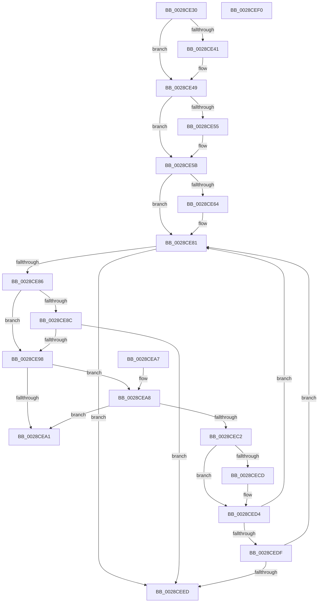

# MiCollapseRunTopDown

- RVA: `0x0028CE30`–`0x0028CEF1` (길이 `193` bytes)
- VA: `0x000000014028CE30`
- 실행 섹션: `.text`
- PDB 이름 있음: `예`; PDB Function 태그: `아니요`
- unwind 정보 RVA: `0x000DB714`
- 디코드: `65`개 명령, `193/193` bytes 표시
- 미해석 바이트: `0` (있으면 어셈블리에 `.byte`로 보존)

> 이 문서는 커널 이미지의 기계어와 PDB 기호를 분석해 생성했습니다. 4번과 5번은 함수 원형과 자료형을 바이너리 사용 방식에서 추정한 C 해석이며 원본 소스 복구 결과는 아닙니다.

## 1. Dependencies

- 직접 호출 지점: **0**; 고유 호출 대상: **0**
- 직접 호출자로 확인된 함수: **2**
- RIP 상대 이미지 참조: **0**

### Outgoing calls
- 직접 디코드된 call 명령이 없습니다.

### Direct callers
- [MiFindContiguousPagesEx](MiFindContiguousPagesEx_function_0028BDE0.md) at `0x0028C144`
- [MiFindBestLargePageStealCandidates](../45/MiFindBestLargePageStealCandidates_function_00453EEC.md) at `0x004540A2`

### Static image references
- 디코드된 RIP-relative 메모리 참조가 없습니다.

## 2. Other-region calls and transfers

- 다른 실행 섹션으로 향하는 call: **0**
- 별도 외부 분기/꼬리 이동을 확인하지 못했습니다.

## 3. Assembly (complete function range)

```asm
0028CE30  4C 8B 49 08                     mov r9, qword ptr [rcx + 8]
0028CE34  48 8B 51 18                     mov rdx, qword ptr [rcx + 0x18]
0028CE38  49 8D 41 FF                     lea rax, [r9 - 1]
0028CE3C  48 3B C2                        cmp rax, rdx
0028CE3F  76 08                           jbe 0x14028ce49
0028CE41  4C 8D 4A 01                     lea r9, [rdx + 1]
0028CE45  4C 89 49 08                     mov qword ptr [rcx + 8], r9
0028CE49  4C 8B 01                        mov r8, qword ptr [rcx]
0028CE4C  48 8B 41 10                     mov rax, qword ptr [rcx + 0x10]
0028CE50  4C 3B C0                        cmp r8, rax
0028CE53  73 06                           jae 0x14028ce5b
0028CE55  48 89 01                        mov qword ptr [rcx], rax
0028CE58  4C 8B C0                        mov r8, rax
0028CE5B  48 8B 51 30                     mov rdx, qword ptr [rcx + 0x30]
0028CE5F  48 85 D2                        test rdx, rdx
0028CE62  74 1D                           je 0x14028ce81
0028CE64  49 FF C8                        dec r8
0028CE67  48 8D 42 FF                     lea rax, [rdx - 1]
0028CE6B  48 F7 D0                        not rax
0028CE6E  4C 03 C2                        add r8, rdx
0028CE71  4C 23 C0                        and r8, rax
0028CE74  49 23 C1                        and rax, r9
0028CE77  4C 89 01                        mov qword ptr [rcx], r8
0028CE7A  4C 8B C8                        mov r9, rax
0028CE7D  48 89 41 08                     mov qword ptr [rcx + 8], rax
0028CE81  4D 3B C1                        cmp r8, r9
0028CE84  73 67                           jae 0x14028ceed
0028CE86  80 79 38 00                     cmp byte ptr [rcx + 0x38], 0
0028CE8A  75 0C                           jne 0x14028ce98
0028CE8C  49 8B C1                        mov rax, r9
0028CE8F  49 2B C0                        sub rax, r8
0028CE92  48 39 41 28                     cmp qword ptr [rcx + 0x28], rax
0028CE96  77 55                           ja 0x14028ceed
0028CE98  4C 8B 51 20                     mov r10, qword ptr [rcx + 0x20]
0028CE9C  4D 85 D2                        test r10, r10
0028CE9F  75 07                           jne 0x14028cea8
0028CEA1  B8 01 00 00 00                  mov eax, 1
0028CEA6  C3                              ret
0028CEA7  CC                              int3
0028CEA8  49 8B D1                        mov rdx, r9
0028CEAB  4D 8D 5A FF                     lea r11, [r10 - 1]
0028CEAF  48 2B 51 28                     sub rdx, qword ptr [rcx + 0x28]
0028CEB3  49 8D 41 FF                     lea rax, [r9 - 1]
0028CEB7  48 33 D0                        xor rdx, rax
0028CEBA  49 F7 D3                        not r11
0028CEBD  49 85 D3                        test r11, rdx
0028CEC0  74 DF                           je 0x14028cea1
0028CEC2  49 8B C1                        mov rax, r9
0028CEC5  49 23 C3                        and rax, r11
0028CEC8  49 3B C1                        cmp rax, r9
0028CECB  74 07                           je 0x14028ced4
0028CECD  48 89 41 08                     mov qword ptr [rcx + 8], rax
0028CED1  4C 8B C8                        mov r9, rax
0028CED4  49 8B C0                        mov rax, r8
0028CED7  49 23 C3                        and rax, r11
0028CEDA  49 3B C0                        cmp rax, r8
0028CEDD  74 A2                           je 0x14028ce81
0028CEDF  49 FF C8                        dec r8
0028CEE2  4D 03 C2                        add r8, r10
0028CEE5  4D 23 C3                        and r8, r11
0028CEE8  4C 89 01                        mov qword ptr [rcx], r8
0028CEEB  75 94                           jne 0x14028ce81
0028CEED  33 C0                           xor eax, eax
0028CEEF  C3                              ret
0028CEF0  CC                              int3
```

## 4. C-style interpretation (structured pseudocode)

```c
__int64 __fastcall MiCollapseRunTopDown(__int64 a1)
{
    __int64 result;
    __int64 v_r11;

    if ((*(unsigned __int64 *)(a1 + 8) - 1) >= = (*(unsigned __int64 *)(a1 + 24))) {
        a4 = *(unsigned __int64 *)(a1 + 24) + 1;
        *(unsigned __int64 *)(a1 + 8) = a4;
    }
    if ((*(unsigned __int64 *)(a1)) < (*(unsigned __int64 *)(a1 + 16))) {
        *(unsigned __int64 *)(a1) = *(unsigned __int64 *)(a1 + 16);
        a3 = *(unsigned __int64 *)(a1 + 16);
    }
    result = *(unsigned __int64 *)(a1 + 16);
    if (*(unsigned __int64 *)(a1 + 48) != 0) {
        a3 = (a3) - 1;
        result = *(unsigned __int64 *)(a1 + 48) - 1;
        result = ~(result);
        a3 = (a3) + (*(unsigned __int64 *)(a1 + 48));
        a3 = (a3) & (result);
        result = (result) & (a4);
        *(unsigned __int64 *)(a1) = a3;
        a4 = result;
        *(unsigned __int64 *)(a1 + 8) = result;
    }
    if (a3 >= a4) goto loc_0028CEED;
    if ((*(unsigned __int8 *)(a1 + 56)) != 0) goto loc_0028CE98;
    result = (a4) - (a3);
    if ((*(unsigned __int64 *)(a1 + 40)) > result) goto loc_0028CEED;
loc_0028CE98:
    if (*(unsigned __int64 *)(a1 + 32) != 0) goto loc_0028CEA8;
loc_0028CEA1:
    return 1;
loc_0028CEA8:
    a2 = (a4) - (*(unsigned __int64 *)(a1 + 40));
    a2 = (a2) ^ (a4 - 1);
    v_r11 = ~(*(unsigned __int64 *)(a1 + 32) - 1);
    if (((v_r11) & (a2)) == 0) goto loc_0028CEA1;
    result = (a4) & (v_r11);
    if (result != a4) {
        *(unsigned __int64 *)(a1 + 8) = result;
        a4 = result;
    }
    result = (a3) & (v_r11);
    if (result == a3) goto loc_0028CE81;
    a3 = (a3) - 1;
    a3 = (a3) + (*(unsigned __int64 *)(a1 + 32));
    a3 = (a3) & (v_r11);
    *(unsigned __int64 *)(a1) = a3;
    if (condition_is_not_equal) goto loc_0028CE81;
loc_0028CEED:
    result = 0;
    return result;
}
```

## 5. (Beta) C Style

```c
int64_t MiCollapseRunTopDown(void *Arg1)
{
    uint8_t *arg1 = (uint8_t *)Arg1;

    int64_t result;
    int64_t local_r11;

    if ((*(uint64_t *)(arg1 + 0x8) - 1) >= = (*(uint64_t *)(arg1 + 0x18))) {
        a4 = *(uint64_t *)(arg1 + 0x18) + 1;
        *(uint64_t *)(arg1 + 0x8) = a4;
    }
    if ((*(uint64_t *)(arg1)) < (*(uint64_t *)(arg1 + 0x10))) {
        *(uint64_t *)(arg1) = *(uint64_t *)(arg1 + 0x10);
        a3 = *(uint64_t *)(arg1 + 0x10);
    }
    result = *(uint64_t *)(arg1 + 0x10);
    if (*(uint64_t *)(arg1 + 0x30) != 0) {
        a3 = (a3) - 1;
        result = *(uint64_t *)(arg1 + 0x30) - 1;
        result = ~(result);
        a3 = (a3) + (*(uint64_t *)(arg1 + 0x30));
        a3 = (a3) & (result);
        result = (result) & (a4);
        *(uint64_t *)(arg1) = a3;
        a4 = result;
        *(uint64_t *)(arg1 + 0x8) = result;
    }
    if (a3 >= a4) goto loc_0028CEED;
    if ((*(uint8_t *)(arg1 + 0x38)) != 0) goto loc_0028CE98;
    result = (a4) - (a3);
    if ((*(uint64_t *)(arg1 + 0x28)) > result) goto loc_0028CEED;
loc_0028CE98:
    if (*(uint64_t *)(arg1 + 0x20) != 0) goto loc_0028CEA8;
loc_0028CEA1:
    return 1;
loc_0028CEA8:
    a2 = (a4) - (*(uint64_t *)(arg1 + 0x28));
    a2 = (a2) ^ (a4 - 1);
    local_r11 = ~(*(uint64_t *)(arg1 + 0x20) - 1);
    if (((local_r11) & (a2)) == 0) goto loc_0028CEA1;
    result = (a4) & (local_r11);
    if (result != a4) {
        *(uint64_t *)(arg1 + 0x8) = result;
        a4 = result;
    }
    result = (a3) & (local_r11);
    if (result == a3) goto loc_0028CE81;
    a3 = (a3) - 1;
    a3 = (a3) + (*(uint64_t *)(arg1 + 0x20));
    a3 = (a3) & (local_r11);
    *(uint64_t *)(arg1) = a3;
    if (condition_is_not_equal) goto loc_0028CE81;
loc_0028CEED:
    result = 0;
    return result;
}
```

### 관측된 메모리 오프셋

구조체 형식이 확인되지 않은 접근은 인자 기준의 오프셋으로만 기록했습니다.

| 기준 인자 | 오프셋 표현 | 폭 (bit) | 접근 |
|---|---:|---:|---|
| `Arg1` | `+ 0x0` | `64` | `R` |
| `Arg1` | `+ 0x0` | `64` | `W` |
| `Arg1` | `+ 0x8` | `64` | `R` |
| `Arg1` | `+ 0x8` | `64` | `W` |
| `Arg1` | `+ 0x10` | `64` | `R` |
| `Arg1` | `+ 0x18` | `64` | `R` |
| `Arg1` | `+ 0x20` | `64` | `R` |
| `Arg1` | `+ 0x28` | `64` | `R` |
| `Arg1` | `+ 0x30` | `64` | `R` |
| `Arg1` | `+ 0x38` | `8` | `R` |

## 6. Execution-region graph

[열기: 2D/3D 그래프와 함수 탐색 컨트롤 패널](../../../control-panel.html?section=text&rva=0x0028CE30&view=graph)

- 2D 그래프는 위에서 아래로 흐르고, 3D 그래프는 빈 공간을 드래그해 회전합니다. Shift+드래그는 이동, 휠은 확대·축소, 함수 노드 선택은 대상 보고서 이동입니다.

### Static fallback


