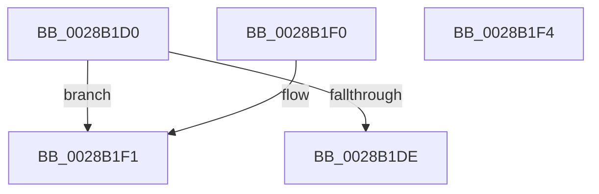

# MiColorHasSlists

- RVA: `0x0028B1D0`–`0x0028B1F5` (길이 `37` bytes)
- VA: `0x000000014028B1D0`
- 실행 섹션: `.text`
- PDB 이름 있음: `예`; PDB Function 태그: `아니요`
- unwind 정보 RVA: `0x000DB714`
- 디코드: `13`개 명령, `37/37` bytes 표시
- 미해석 바이트: `0` (있으면 어셈블리에 `.byte`로 보존)

> 이 문서는 커널 이미지의 기계어와 PDB 기호를 분석해 생성했습니다. 4번과 5번은 함수 원형과 자료형을 바이너리 사용 방식에서 추정한 C 해석이며 원본 소스 복구 결과는 아닙니다.

## 1. Dependencies

- 직접 호출 지점: **0**; 고유 호출 대상: **0**
- 직접 호출자로 확인된 함수: **4**
- RIP 상대 이미지 참조: **0**

### Outgoing calls
- 직접 디코드된 call 명령이 없습니다.

### Direct callers
- [MiGetPerfectColorHeadPage](MiGetPerfectColorHeadPage_function_00289CA8.md) at `0x00289F85`
- [MiRemovePageAnyColor](MiRemovePageAnyColor_function_0028A9D8.md) at `0x0028AC1D`
- [MiTradePage](MiTradePage_function_0028D160.md) at `0x0028D5BA`
- [MiPageFreeToZero](../33/MiPageFreeToZero_function_00337A30.md) at `0x00337C77`

### Static image references
- 디코드된 RIP-relative 메모리 참조가 없습니다.

## 2. Other-region calls and transfers

- 다른 실행 섹션으로 향하는 call: **0**
- 별도 외부 분기/꼬리 이동을 확인하지 못했습니다.

## 3. Assembly (complete function range)

```asm
0028B1D0  8B C1                           mov eax, ecx
0028B1D2  25 00 00 03 00                  and eax, 0x30000
0028B1D7  3D 00 00 03 00                  cmp eax, 0x30000
0028B1DC  75 13                           jne 0x14028b1f1
0028B1DE  33 C0                           xor eax, eax
0028B1E0  81 E1 00 00 0C 00               and ecx, 0xc0000
0028B1E6  81 F9 00 00 04 00               cmp ecx, 0x40000
0028B1EC  0F 94 C0                        sete al
0028B1EF  C3                              ret
0028B1F0  CC                              int3
0028B1F1  33 C0                           xor eax, eax
0028B1F3  C3                              ret
0028B1F4  CC                              int3
```

## 4. C-style interpretation (structured pseudocode)

```c
__int64 __fastcall MiColorHasSlists(int a1)
{
    __int64 result;

    result = (unsigned int)(((unsigned int)(a1)) & (0x30000ULL));
    if (((unsigned int)(result)) != 0x30000ULL) goto loc_0028B1F1;
    result = 0;
    a1 = (unsigned int)((a1) & (0xC0000ULL));
    result = (a1 == 0x40000ULL) ? 1 : 0;
    return result;
loc_0028B1F1:
    result = 0;
    return result;
}
```

## 5. (Beta) C Style

```c
int64_t MiColorHasSlists(int32_t Arg1)
{
    int64_t result;

    result = (uint32_t)(((uint32_t)(Arg1)) & (0x30000ULL));
    if (((uint32_t)(result)) != 0x30000ULL) goto loc_0028B1F1;
    result = 0;
    Arg1 = (uint32_t)((Arg1) & (0xC0000ULL));
    result = (Arg1 == 0x40000ULL) ? 1 : 0;
    return result;
loc_0028B1F1:
    result = 0;
    return result;
}
```

## 6. Execution-region graph

[열기: 2D/3D 그래프와 함수 탐색 컨트롤 패널](../../../control-panel.html?section=text&rva=0x0028B1D0&view=graph)

- 2D 그래프는 위에서 아래로 흐르고, 3D 그래프는 빈 공간을 드래그해 회전합니다. Shift+드래그는 이동, 휠은 확대·축소, 함수 노드 선택은 대상 보고서 이동입니다.

### Static fallback


